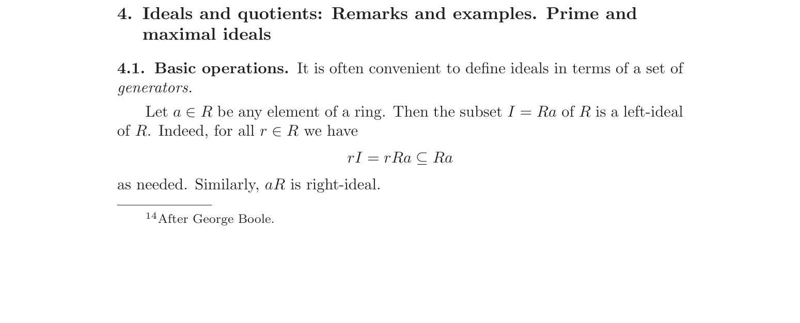
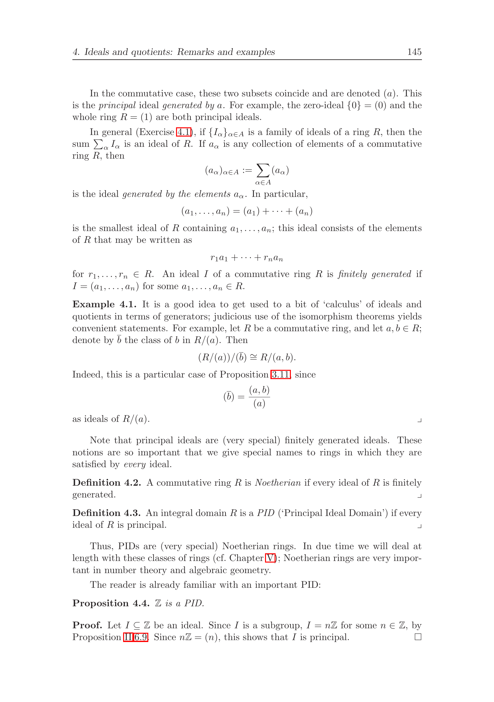
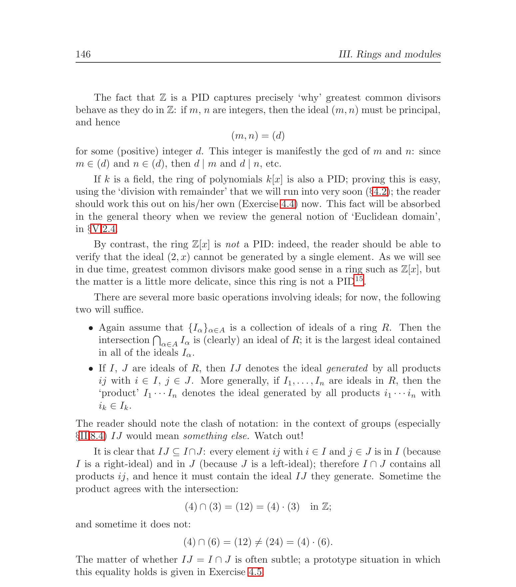

# III 4.1. Basic operations｜理想的生成与运算

[阅读目录](README.md) · [下一小节](02-III-4.2.md)

**本节总任务：把“哪些子集是理想”推进成“怎样从少数元素造出理想，并计算理想之间的关系”。**你已读完 §3，这里只调用商环和同构定理，不重写前节。阅读顺序是：一个生成元 → 多个生成元 → 连续加关系 → 理想的和、交、积。

## 原书第 144 页：原文底本

完整保留本小节在此页的原文；PDF 阅读器页码为 167。原书习题区不在本次范围。

## 第 144 页句读：先说目的，再逐步展开

### 一、为什么首先写 Ra，而不是直接写“由 a 生成的理想”？

**这段在干什么：**从原文 “define ideals in terms of a set of generators” 出发，找出只给一个元素时必须补进哪些元素。

设大环为 $R$，指定一个元素 $a$。如果要造一个包含 $a$ 的左理想，仅放 $a$ 不够，因为左吸收要求：任意 $r\in R$ 乘上 $a$，结果仍在里面。

因此至少必须包含

$$
Ra=\{ra:r\in R\}.
$$

这个集合真是左理想吗？逐项检查：

1. 含零，因为 $0a=0$。
2. 对减法封闭，因为 $ra-sa=(r-s)a$。
3. 对大环任意左乘封闭，因为 $t(ra)=(tr)a$。

同时 $a=1a$ 在里面。若 $J$ 是任何包含 $a$ 的左理想，则全部 $ra$ 都在 $J$，因此 $Ra\subseteq J$。

**所以它不仅是一个可行左理想，而且是包含 a 的最小左理想。**“生成”表示补齐结构要求所强迫的元素，而不是任意扩大集合。

右理想同理为 $aR$。非交换时，两者可能不同；由 $a$ 生成的双边理想一般要允许有限和 $\sum r_i a s_i$，不能直接用 $Ra$ 代替。交换环中 $Ra=aR$，这才统一记为 $(a)$。

页底脚注 14 来自本页上方前节内容；这里只保留原页样貌，不把前节习题纳入本注。

## 原书第 145 页：原文底本

完整保留本小节在此页的原文；PDF 阅读器页码为 168。原书习题区不在本次范围。

## 第 145 页句读：先说目的，再逐步展开

### 二、多个生成元：为什么是线性组合，而不是只收集它们的倍数？

**这段在干什么：**解释 $(a_1,\ldots,a_n)$ 的具体成员是什么，以及“最小”怎样证明。

从这里讨论交换环。若理想包含 $a_1,a_2$，它必须包含 $r_1a_1,r_2a_2$，又因加法封闭，必须包含它们的和。因此自然得到

$$
(a_1,\ldots,a_n)
=\{r_1a_1+\cdots+r_na_n:r_i\in R\}.
$$

这不是只取 $(a_1)\cup\cdots\cup(a_n)$。并集可能不对加法封闭，例如 $2\in(2)$、$3\in(3)$，但 $2+3=5$ 不在它们的并集中；生成理想却必须接住这个和。

证明最小性的模板是：

- 上述集合自己是理想，并包含所有 $a_i$。
- 任意包含所有 $a_i$ 的理想，都必须包含每一个有限线性组合。

所以这个集合包含于任何候选理想，正是最小那个。

生成元无限多时，也只允许**每个元素使用有限项**。环没有默认定义无穷级数，也没有默认拓扑让无穷和收敛。无限的是可选材料，不是每次表达式的长度。

### 三、Example 4.1：连续取商为什么等于一次加上两组关系？

**这段在干什么：**展开作者很快引用第三同构定理的地方，说明两个商环究竟怎样对应。

先在 $R$ 中令 $a=0$，得到 $R/(a)$。记 $b$ 在其中的像为 $\bar b$。再令 $\bar b=0$，得到 $(R/(a))/(\bar b)$。

从原环看，这等于同时要求 $a=0,b=0$，所以应当得到 $R/(a,b)$。但“看起来一样”还不是证明，我们构造映射：

$$
F:R\longrightarrow (R/(a))/(\bar b),
\qquad r\longmapsto (r+(a))+(\bar b).
$$

这是两次自然投影的复合，因此是满环同态。现在算核。$F(r)=0$，等价于在 $R/(a)$ 中有

$$
\bar r=\bar s\,\bar b
$$

对某个 $s\in R$ 成立。也就是 $r-sb\in(a)$，所以 $r=ta+sb$，即 $r\in(a,b)$。反过来，任何这种组合都会被两次投影杀掉。

因此 $\ker F=(a,b)$。第一同构定理给

$$
\boxed{(R/(a))/(\bar b)\cong R/(a,b).}
$$

比如整数里先模 6，再令 4 的类为零，得到 $\mathbb Z/(6,4)\cong\mathbb Z/2\mathbb Z$。新关系并不是“再模 4 所以模 24”；关系是相加生成一个理想。

### 四、Noetherian 与 PID：它们限制的是每一个理想，不只是环本身

**这段在干什么：**把 Definitions III.4.2–4.3 的量词展开，分清两种有限生成要求。

一个主理想只需一个生成元；一个有限生成理想允许有限多个。这两个条件不同。

Noetherian 环要求：**对环里的每一个理想，都能找到有限个生成元。**不同理想可以用不同数目的生成元，不要求全环有统一的数字上限。

PID 要求更强：环先是整环，而且每一个理想只需一个生成元。因此 PID 一定 Noetherian；反向不能直接推出。

特别不要说“$R$ 由 1 生成，所以 $R$ 是 Noetherian”。$R=(1)$ 只说明全环这个理想是主的，没有检查其他理想。

Proposition III.4.4 证明 $\mathbb Z$ 是 PID：任意理想先是加法子群，已知整数加法子群都是 $n\mathbb Z$，而 $n\mathbb Z=(n)$。这里作者真正复用的是群论已经获得的结构结论。

## 原书第 146 页：原文底本

完整保留本小节在此页的原文；PDF 阅读器页码为 169。原书习题区不在本次范围。

## 第 146 页句读：先说目的，再逐步展开

### 五、最大公因数为什么能写成一个理想的生成元？

**这段在干什么：**解释作者说 PID 捕捉了整数 gcd 行为的意思，并补出两个方向。

取两个不全为零的整数 $m,n$。因 $\mathbb Z$ 是 PID，

$$
(m,n)=(d)
$$

可取 $d>0$。因为 $m,n\in(d)$，有 $d\mid m,d\mid n$，所以 $d$ 是公因数。

另一方面 $d\in(m,n)$，因此存在整数 $u,v$ 使 $d=um+vn$。任意公因数 $c$ 都整除右边，故 $c\mid d$。这说明 $d$ 是最大公因数的整除意义版本，同时得到 Bézout 关系。

例如

$$
(12,18)=(6),\qquad 6=18-12.
$$

这里“最大”不是只比较大小，而是所有公因数都整除它。在一般整环中，整除语言比正负大小更稳妥。

### 六、为什么 k[x] 是 PID，而 Z[x] 未必？

**这段在干什么：**说明系数能否求逆怎样影响生成理想，防止把整数结论机械推广。

在域 $k$ 上，一个非零理想 $I\subseteq k[x]$ 有非零最低次数元素 $f$，可将它首项系数除成 1。任意 $g\in I$ 带余除以 $f$：

$$
g=qf+r,\qquad \deg r<\deg f.
$$

又因 $r=g-qf\in I$，若 $r\ne0$，就违背 $f$ 的最低次数选择。因此 $r=0$，所有 $g$ 都在 $(f)$，所以 $I=(f)$。

改成 $\mathbb Z[x]$，不能随意除首项系数。具体看 $I=(2,x)$。若 $I=(f)$，因 $2\in I$ 有 $2=fg$。在整环 $\mathbb Z[x]$ 中，次数相加迫使 $f$ 是常数。又因 $x\in I$，该常数整除 $x$ 的系数 1，只能为 $\pm1$。

这会推出 $I$ 是全环。但 $1\notin(2,x)$：若 $1=2u(x)+xv(x)$，令 $x=0$ 就得到 $1=2u(0)$，不可能。因此 $(2,x)$ 不是主理想。

这也说明：有 gcd，不自动代表能用同样的 Bézout 线性组合生成理想；后面 UFD、PID 的区别正在这里埋下伏笔。

### 七、交与积：为什么乘积必须允许有限和？

**这段在干什么：**逐项解释本页的两种理想运算及 $IJ\subseteq I\cap J$。

交 $I\cap J$ 收集同时在两者里的元素，所以仍满足减法和吸收条件。它是同时包含于 $I,J$ 的最大理想。

积 $IJ$ 却不是只取单个乘积 $ij$ 的集合，而是这些乘积生成的理想。对双边理想，它可具体写成有限和 $\sum i_kj_k$。单个乘积集合未必对加法封闭，必须补上有限和。

每个 $ij$ 在 $I$ 中，因为 $I$ 吸收右乘的 $j$；也在 $J$ 中，因为 $J$ 吸收左乘的 $i$。有限和仍同时在两者中，所以

$$
IJ\subseteq I\cap J.
$$

在整数里，

$$
(m)+(n)=(\gcd(m,n)),\quad
(m)\cap(n)=(\operatorname{lcm}(m,n)),\quad
(m)(n)=(mn)
$$

（取正生成元）。于是 $(4)\cap(6)=(12)$，但 $(4)(6)=(24)$，严格不同；$(4)\cap(3)=(12)=(4)(3)$。

原文提醒和群论符号冲突：群里的子群集合乘积与理想乘积不是同一种定义，不能见到相同字母就照搬。

### 八、本节分级与推导总结

**这段在干什么：**标出后续会反复调用的节点，而不是要求把全部例子等量背诵。

| 知识点与原书定位 | 等级 | 为什么重要 | 应达到的程度 |
|---|---|---|---|
| 生成理想、有限线性组合，pp144–145 | A | 以后所有关系与生成元计算都要用 | 会证明“自己合法且包含于所有候选” |
| Example III.4.1，p145 | A | 将连续取商翻译为加关系 | 会构造复合投影、算核 |
| Noetherian、PID，Definitions III.4.2–4.3 | B | 后面有专章展开 | 说清“每个理想”的量词，区分一个与有限个 |
| Proposition III.4.4 与 gcd，pp145–146 | A | 生成理想连接整除和 Bézout | 能复原两个方向 |
| 和、交、积，p146 | A | 决定后续商和包含计算 | 知道积含有限和，并会给积不等于交的例子 |

整条路线：从给定元素出发 → 补齐理想条件 → 生成元描述关系 → 用投影与核处理加关系 → 比较所有理想的生成方式 → 计算和、交、积。这里没有新增习题；上述证明与例子都用于解释原书正文。

---

[阅读目录](README.md) · [下一小节](02-III-4.2.md)
