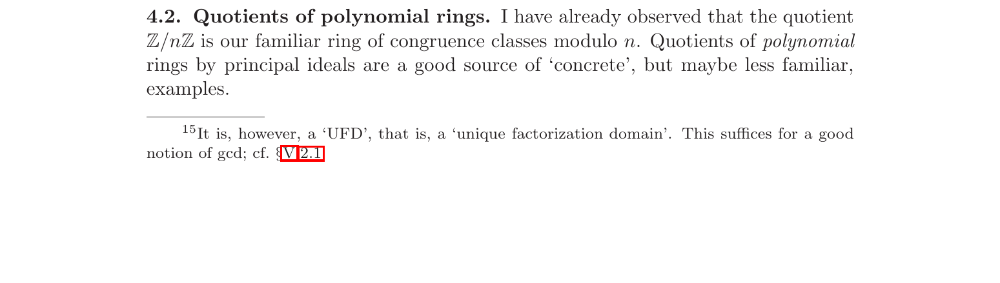
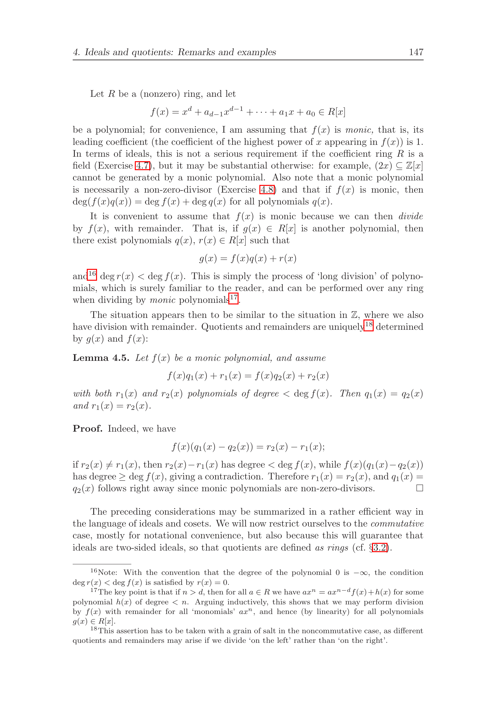
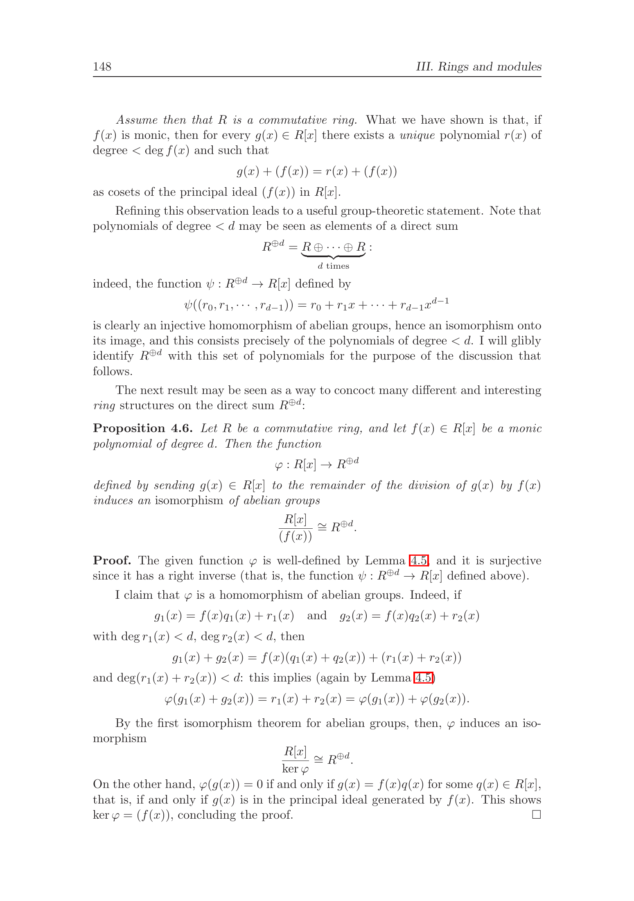
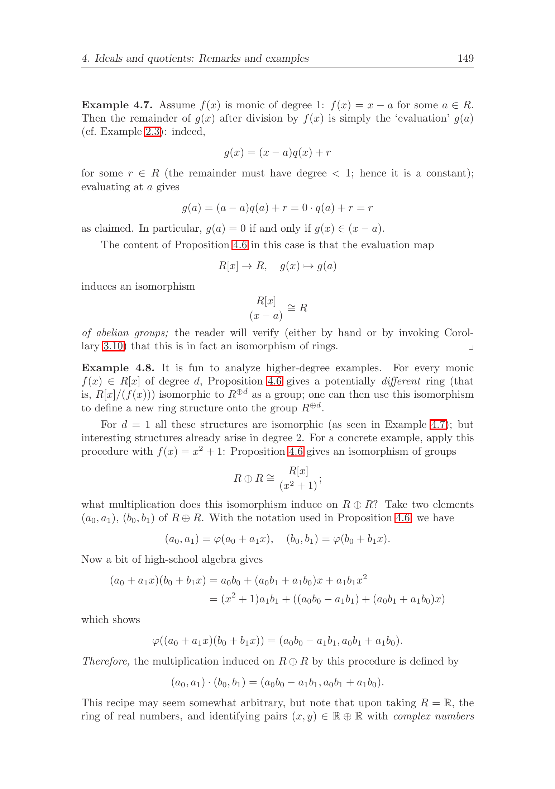
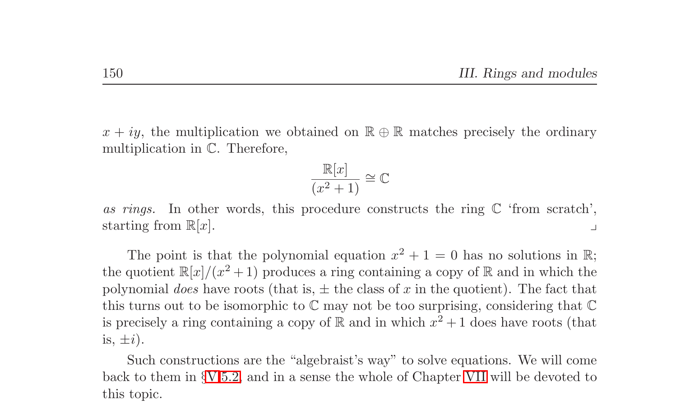

# III 4.2. Quotients of polynomial rings｜把多项式关系变成可计算的商环

[阅读目录](README.md) · [上一小节](01-III-4.1.md) · [下一小节](03-III-4.3.md)

**本节总任务：把“对一个多项式关系取商”变成能够实际加、减、乘的代数对象。**最重要的分界是：低次余式描述元素，但乘法必须先相乘再约化；它通常不是坐标逐项乘法。

## 原书第 146 页：原文底本

完整保留本小节在此页的原文；PDF 阅读器页码为 169。原书习题区不在本次范围。

## 第 146 页句读：先说目的，再逐步展开

### 一、整数模 n 已熟悉，多项式模 f 要多做什么？

**这段在干什么：**解释本节开头为什么拿 $\mathbb Z/n\mathbb Z$ 作参照。

整数模 $n$ 时，每个整数都可用一个标准余数表示。例如模 5，12 与 2 代表同一类，因为相差 $2\cdot5$。运算时先算整数，再除去 5 的倍数。

现在把整数换成多项式，把 $n$ 换成 $f(x)$。希望用低次多项式代表一个类，并在乘法后除去 $f(x)$ 的倍数。

例如若要求 $x^2+1=0$，那么 $x^2$ 可替成 $-1$，高次幂便能反复降低。但这种替换要有统一、唯一的结果，否则不同算法可能给不同答案。下一页的首一条件和带余除法正是在解决这个问题。

## 原书第 147 页：原文底本

完整保留本小节在此页的原文；PDF 阅读器页码为 170。原书习题区不在本次范围。

## 第 147 页句读：先说目的，再逐步展开

### 二、为什么作者要求 f 首一？

**这段在干什么：**说明首项系数为 1 为什么是长除法能在一般环上工作的重要条件。

设

$$
f(x)=x^d+a_{d-1}x^{d-1}+\cdots+a_0.
$$

要消去 $g$ 的最高项 $bx^n$，可以减去 $bx^{n-d}f(x)$，最高项恰好抵消。不需要除以任何系数。

若除数首项是 $2x^d$，消去 $x^n$ 就可能要用 $1/2$。在域里没问题，在 $\mathbb Z$ 里却不允许。因此“首一”不是为了排版整齐，而是避免要求系数环里本不存在的逆元。

在域 $k$ 中，任何非零多项式都可除以首项系数变首一，生成的理想不变，因为乘了一个单位。在 $\mathbb Z[x]$，$(2x)$ 却不能换成首一生成元。

### 三、带余除法怎样一步步得到低次代表？

**这段在干什么：**补出作者假定熟悉的长除法，并指出过程为什么会终止。

取 $f=x^2+1$、$g=x^4+2x^3+3x+5$。先减 $x^2f$：

$$
g-x^2f=2x^3-x^2+3x+5.
$$

再减 $2xf$：

$$
2x^3-x^2+3x+5-2xf=-x^2+x+5.
$$

最后减 $-f$，余下 $x+6$。因此

$$
g=(x^2+1)(x^2+2x-1)+(x+6).
$$

余式次数小于 2。每一步最高次数严格下降，不可能无限继续。这就说明为什么能得到 $g=fq+r$、$\deg r<d$。

这里先在交换环中算清楚；非交换环上需分左、右除法，原文脚注也明确提醒。接下来商环部分，作者正式限制为交换环。

### 四、Lemma III.4.5：为什么余式不会因消元顺序不同而改变？

**这段在干什么：**证明“余式”真的给出一个确定的函数，而不是任选结果。

假设有两种分解：

$$
g=fq_1+r_1=fq_2+r_2,\qquad \deg r_1,\deg r_2<d.
$$

相减得 $f(q_1-q_2)=r_2-r_1$。如果 $q_1-q_2\ne0$，由于 $f$ 首一，左边最高项系数正是 $q_1-q_2$ 的最高项系数，不会被环里的零因子消去，所以

$$
\deg(f(q_1-q_2))=d+\deg(q_1-q_2)\ge d.
$$

右边却要么为零，要么次数小于 $d$，不可能相等。因此 $q_1=q_2$，进而 $r_1=r_2$。

**关键不是把系数环假设成整环，而是首一保证最高项不会消失。**正因如此，该结果能在含零因子的交换环里继续使用。

零多项式的次数按作者约定为 $-\infty$，所以它也满足“次数小于 $d$”；不用为零余式另造一套结论。

## 原书第 148 页：原文底本

完整保留本小节在此页的原文；PDF 阅读器页码为 171。原书习题区不在本次范围。

## 第 148 页句读：先说目的，再逐步展开

### 五、一个商类为什么对应唯一的 d 个系数？

**这段在干什么：**把带余除法翻译成商环语言，再解释 Proposition III.4.6 中的 $R^{\oplus d}$。

若 $g=fq+r$，则 $g-r\in(f)$，所以

$$
g+(f)=r+(f).
$$

商类没有因为换成余式而改变。又因余式唯一，每个商类可以恰好用

$$
r_0+r_1x+\cdots+r_{d-1}x^{d-1}
$$

表示。将它记成系数列 $(r_0,\ldots,r_{d-1})$，就得到与 $R^{\oplus d}$ 的一一对应。

但一一对应不自动是所需结构的同构。作者下一步要说明加法也吻合。

### 六、余式映射如何应用第一同构定理？

**这段在干什么：**逐项证明 III.4.6，不把“显然”或定理名称当作中间计算。

定义 $\varphi:R[x]\to R^{\oplus d}$ 为取余式系数。

**确定性。**上页唯一性保证同一个多项式不会得到两组输出。

**满射。**给任意系数列 $(r_0,\ldots,r_{d-1})$，直接取对应低次多项式，它自己就是余式，所以能被送到。

**保加法。**若 $g_i=fq_i+r_i$，则

$$
g_1+g_2=f(q_1+q_2)+(r_1+r_2).
$$

两余式之和仍低于 $d$ 次，所以唯一性告诉我们：它正是和的余式。因此 $\varphi(g_1+g_2)=\varphi(g_1)+\varphi(g_2)$。

**算核。**余式为零，当且仅当多项式是 $f$ 的倍数，所以 $\ker\varphi=(f)$。

由阿贝尔群的第一同构定理，

$$
\boxed{R[x]/(f)\cong R^{\oplus d}\quad\text{作为加法群}.}
$$

对交换环，其实还能看成 $R$-模同构，后面学模就能重新理解。但此刻书中只主张加法群同构，没有说右边原有的逐项乘法和商乘法相同。

### 七、为什么这里不能顺手写“环同构”？

**这段在干什么：**标清本命题保留了哪种结构，避免把忘掉乘法后的结论升级。

仍取 $d=2,f=x^2+1$。坐标 $(0,1)$ 代表 $x$。在商环里它的平方代表 $x^2=-1$，所以平方是 $(-1,0)$。

若在 $R^2$ 用普通逐坐标乘法，$(0,1)^2=(0,1)$，不是同一个结果。

作者说可以把商环乘法“搬到”$R^{\oplus d}$ 上，意思是另定义乘法：把坐标变回多项式 → 相乘 → 除以 $f$ 取余 → 再转回坐标。这样右边才成为与商环同构的环。

这个区别正体现范畴观点：在 $\mathbf{Ab}$ 里同构的两个对象，加上乘法后可能很不同。“同构”之前必须说明在哪个范畴。

## 原书第 149 页：原文底本

完整保留本小节在此页的原文；PDF 阅读器页码为 172。原书习题区不在本次范围。

## 第 149 页句读：先说目的，再逐步展开

### 八、Example III.4.7：代入为什么就是除以 x−a 的余数？

**这段在干什么：**把熟悉的代入函数与新学的商环接起来。

除以一次首一式 $x-a$，余式只能是常数 $r$：

$$
g(x)=(x-a)q(x)+r.
$$

把 $x=a$ 代入，第一项为零，得到 $g(a)=r$。所以取余映射就是 $\operatorname{ev}_a:g\mapsto g(a)$。

它保加法、乘法与 1；任意常数都能到达；核是全部在 $a$ 处为零的多项式，也正是 $(x-a)$。因此这次可在环范畴用第一同构定理：

$$
\boxed{R[x]/(x-a)\cong R\quad\text{作为环}.}
$$

例如模 $x-2$ 时，$x^3+4x+1$ 的类等于常数 $17$ 的类。你不是把多项式的所有信息一概丢光，而是让“在代入 2 后无法分辨的多项式”成为同一类。

### 九、Example III.4.8：复数乘法为什么可以从商里算出来？

**这段在干什么：**把原文二次例子的乘法完整展开，说明新结构不是任意规定。

在 $R[x]/(x^2+1)$ 中，记 $u=x+(x^2+1)$，则 $u^2=-1$。每个元素唯一写成 $a+bu$。

先按分配律乘：

$$
(a+bu)(c+du)=ac+(ad+bc)u+bd\,u^2.
$$

再用强加的关系 $u^2=-1$：

$$
(a+bu)(c+du)=(ac-bd)+(ad+bc)u.
$$

所以搬到坐标上的乘法必须为

$$
\boxed{(a,b)\cdot(c,d)=(ac-bd,\ ad+bc).}
$$

不是先凭直觉定义一个古怪公式，再发现它好像有用。**投影要保乘法，加上 $u^2=-1$ 的关系，就把公式强迫出来了。**

取 $R=\mathbb R$，这与 $(a+bi)(c+di)$ 的复数乘法一致。比如 $(2+3u)(1-u)=5+u$，也就是坐标 $(2,3)\cdot(1,-1)=(5,1)$。

## 原书第 150 页：原文底本

完整保留本小节在此页的原文；PDF 阅读器页码为 173。原书习题区不在本次范围。

## 第 150 页句读：先说目的，再逐步展开

### 十、“代数学家解方程”：不是在旧环里硬找一个不存在的数

**这段在干什么：**解释作者为什么说商环是一种解方程的方法，并把它与泛性质连起来。

$x^2+1=0$ 在 $\mathbb R$ 中无解。我们不修改实数中的等式，而是构造新环 $\mathbb R[x]/(x^2+1)$；新元素 $u$ 按定义满足 $u^2+1=0$。再证明新环恰好是熟悉的 $\mathbb C$。

一般首一 $f$ 也能这样做。非零常数不可能是正次数首一 $f$ 的倍数，因此 $R$ 的常数像不会被意外合并，$R$ 可以自然嵌入这个新环；$u$ 则是 $f$ 在新环中的根。

还可以把“只加所需关系”说成明确的映射性质。若 $S$ 是交换 $R$-代数，已选好系数映射 $\alpha:R\to S$，并有 $b\in S$ 满足 $\alpha(f)(b)=0$，则代入给出 $R[x]\to S$，而 $(f)$ 被送为零，于是唯一下降为

$$
R[x]/(f)\longrightarrow S,\qquad u\longmapsto b.
$$

存在来自 $f(b)=0$，唯一来自系数像已定、$u$ 的像已定。这里没有声称所有新环都同构；它说任何满足这些条件的映射都必须经过这个商。

商里有根，也不自动表示商是域。例如 $k[x]/(x^2)$ 中非零的 $\bar x$ 平方为零；下一小节会说明什么时候商是整环或域。

### 十一、本节分级与推导总结

**这段在干什么：**将条件、计算与范畴层级放到同一张复习表里。

| 知识点与定位 | 等级 | 为什么重要 | 应达到的程度 |
|---|---|---|---|
| 首一与长除法，p147 | A | 保证一般系数环中仍能降次 | 会说明为何无需除系数 |
| Lemma III.4.5，p147 | A | 后面唯一代表全部靠它 | 用两分解相减与次数比较重建证明 |
| Proposition III.4.6，p148 | A | 给商环可计算的元素模型 | 逐项检验映射、核、像，注明加法群层级 |
| Example III.4.7，p149 | A | 反复用于商和代入 | 会算 $\ker\operatorname{ev}_a$ |
| Example III.4.8，pp149–150 | A | 展示加根和新乘法 | 会从关系推导坐标乘法 |
| 加根的泛性质，p150 的解释补充 | B | 连接作者全书的泛性质主线 | 分开说明映射存在与唯一 |

完整路线：首一让长除法可做 → 次数让余式唯一 → 余式给低次坐标 → 同构定理识别加法结构 → 乘法约化搬出新环结构 → 类 $u$ 成为指定方程的根。

---

[阅读目录](README.md) · [上一小节](01-III-4.1.md) · [下一小节](03-III-4.3.md)
