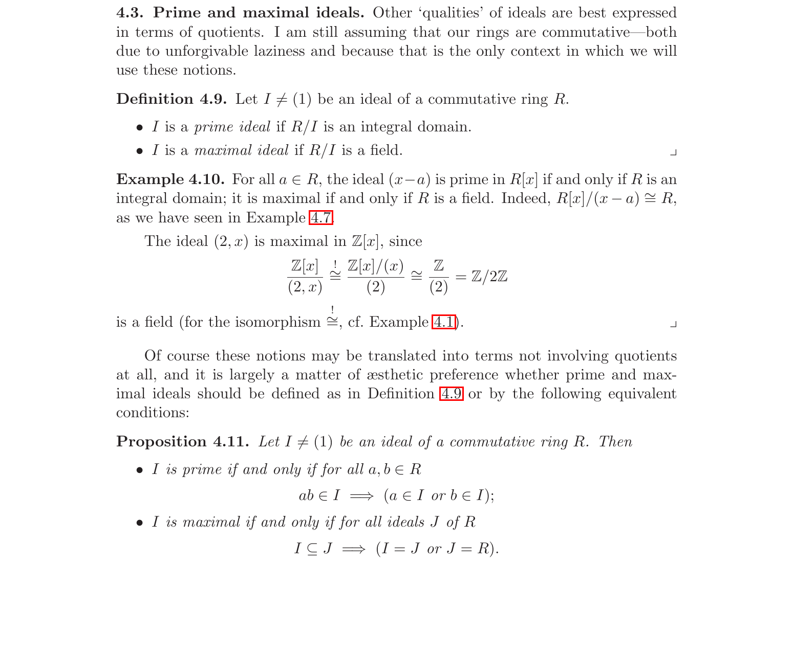
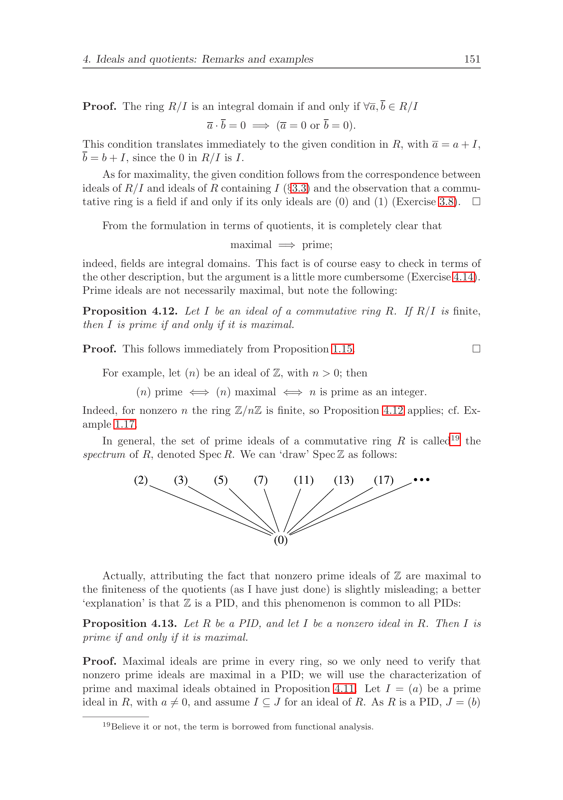
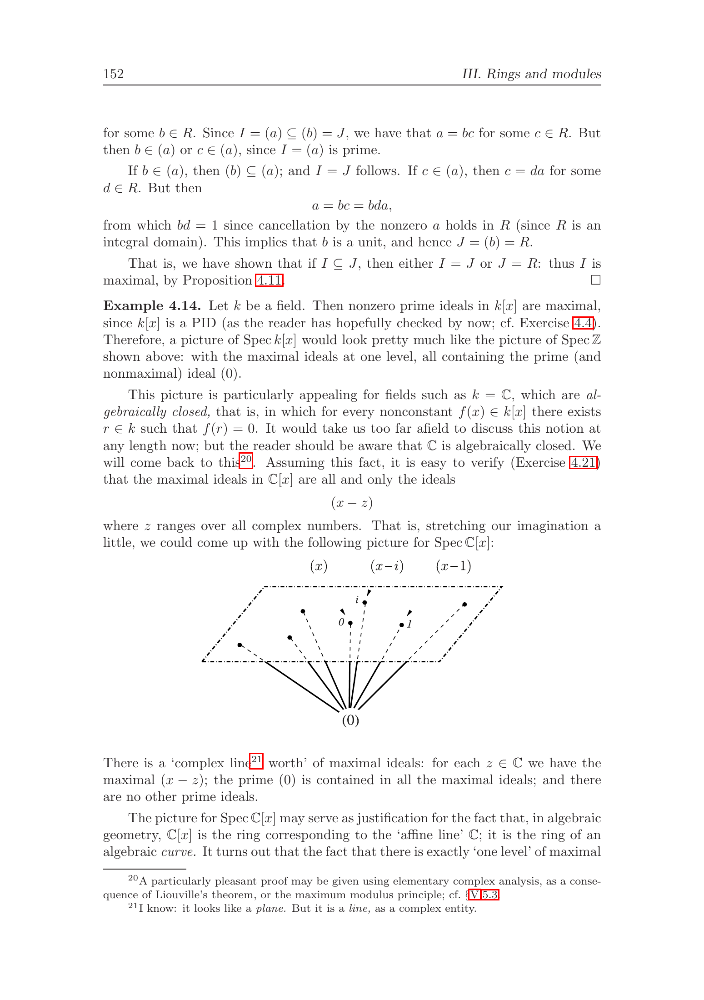
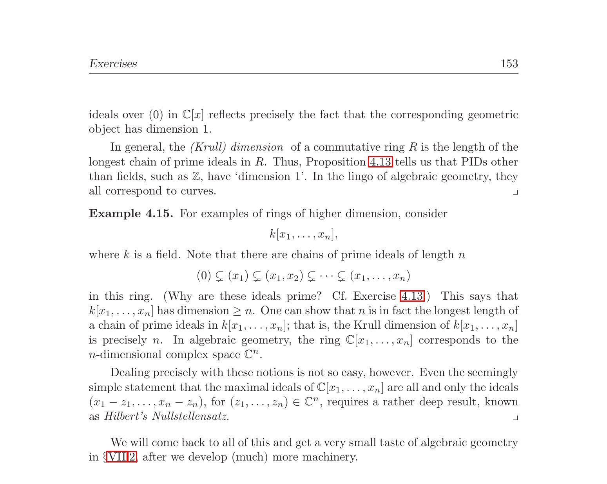

# III 4.3. Prime and maximal ideals｜用商理解素理想、极大理想与几何前景

[阅读目录](README.md) · [上一小节](02-III-4.2.md) · [下一小节](04-III-5.1.md)

**本节总任务：不只问怎样构造商环，还问取商后是否留下零因子、是否能对所有非零元素求逆。**作者先按商的性质定义素理想与极大理想，再将它们翻回元素和包含关系。

## 原书第 150 页：原文底本

完整保留本小节在此页的原文；PDF 阅读器页码为 173。原书习题区不在本次范围。

## 第 150 页句读：先说目的，再逐步展开

### 一、为什么定义理想的性质，却去看 R/I？

**这段在干什么：**解释 Definition III.4.9 的动机与真理想条件。

理想 $I$ 表示我们准备视为零的一组关系。商环 $R/I$ 就是施加这些关系以后留下的结构。判断关系是否使乘法退化、是否产生足够多逆元，直接看商最自然。

作者定义：

$$
I\text{ 素}\iff R/I\text{ 是整环},\qquad
I\text{ 极大}\iff R/I\text{ 是域}.
$$

这里 $R$ 是交换环，且 $I\ne R$。真理想条件不是可省的形式：若 $I=R$，商只有一个元素，$1=0$，而本书整环、域都要求非零。

“素”首先意味着商里两个非零类相乘不会成零；“极大”首先意味着商里每个非零类都有逆。后面的等价条件会解释这些名字为什么贴切。

### 二、Example III.4.10：已知商，比直接查理想省多少事？

**这段在干什么：**说明上一节的商计算现在怎样立即给出理想性质。

已知 $R[x]/(x-a)\cong R$，因此 $(x-a)$ 素当且仅当 $R$ 是整环，极大当且仅当 $R$ 是域。无需重新对无限多个多项式检查定义。

再看 $\mathbb Z[x]$ 中的 $(2,x)$。把 $x$ 设为零，再将整数模 2，得到满同态

$$
F:\mathbb Z[x]\to\mathbb F_2,\qquad
g\longmapsto g(0)\pmod2.
$$

若 $F(g)=0$，常数项为偶数，便可写 $g=2c+xh(x)$，所以核正是 $(2,x)$。因此商为 $\mathbb F_2$，它是域，理想极大。

注意同一理想 $(2,x)$ 在上一节用于说明“非主”，这里用于说明“极大”。主理想与极大理想考察不同方面，不能凭一个名字推另一个性质。

### 三、素理想判据：为什么会出现 ab∈I 就有一个因子在 I？

**这段在干什么：**把 Proposition III.4.11 的第一条从商里逐字翻译出来。

商里 $\bar a=0$ 当且仅当 $a\in I$；$\bar a\bar b=0$ 当且仅当 $ab\in I$。

整环要求

$$
\bar a\bar b=0\Longrightarrow
(\bar a=0\text{ 或 }\bar b=0).
$$

换回原环就是

$$
\boxed{ab\in I\Longrightarrow(a\in I\text{ 或 }b\in I).}
$$

例如 $(6)\subset\mathbb Z$ 不素：$2\cdot3\in(6)$，但两因子都不在里面；对应商里 $[2]_6,[3]_6$ 是非零零因子。

这解释“素”为什么是素数整除性质的推广：$(p)$ 的成员就是 $p$ 的倍数，条件变成 $p\mid ab$ 时 $p\mid a$ 或 $p\mid b$。

## 原书第 151 页：原文底本

完整保留本小节在此页的原文；PDF 阅读器页码为 174。原书习题区不在本次范围。

## 第 151 页句读：先说目的，再逐步展开

### 四、极大理想为什么没有真正的中间理想？

**这段在干什么：**补全 III.4.11 第二条的证明，说明“最大”不是指元素多寡。

先证明一个辅助事实：非零交换环 $S$ 是域，当且仅当仅有理想 $(0)$ 与 $S$。

若是域，非零理想里取非零 $a$，乘 $a^{-1}$ 得 1，理想就是全环。反过来，若仅有这两个理想，对任意非零 $a$，$(a)\ne0$，所以 $(a)=S$，于是 $1=ra$，$a$ 有逆。

再用理想对应：$R/I$ 的理想对应 $R$ 中包含 $I$ 的理想。零理想对应 $I$，全商环对应 $R$。所以商为域，当且仅当

$$
I\subseteq J\subseteq R\Longrightarrow J=I\text{ 或 }J=R.
$$

这就是说 $I$ 与 $R$ 之间没有严格中间理想。不是在全体真理想中存在唯一“最大的一个”。例如 $\mathbb Z$ 中 $(2)$ 与 $(3)$ 都极大，却互不包含。

### 五、极大为什么一定素，而素不一定极大？

**这段在干什么：**用商的结构解释蕴含方向，并指出逆向失败的具体原因。

域一定是整环，因此 $R/I$ 是域就没有非零零因子，立即得极大推出素。

逆向看 $\mathbb Z$ 的 $(0)$：商仍是 $\mathbb Z$，没有零因子，所以素；但 2 没有整数逆元，所以不是域，因此不极大。

也可以不用商检查极大推出素。若 $ab\in I$ 而 $a\notin I$，则理想 $I+(a)$ 严格大于 $I$，极大性迫使它等于 $R$。所以 $1=i+ra$，乘 $b$：

$$
b=ib+rab\in I.
$$

这里每一步都有作用：加上 $a$ 迫使全环出现；写出 1 的表达式，才把 $b$ 拉回 $I$。商证明更短，元素证明则把机制摊开，两者值得对照。

### 六、有限商为什么让素与极大合并？

**这段在干什么：**解释 Proposition III.4.12 调用了哪一个先前结论。

有限非零整环一定是域。理由是对非零 $a$，乘法映射 $x\mapsto ax$ 因无零因子而单射；有限集合中单射就是满射，所以能找到 $b$ 使 $ab=1$。

因此若 $R/I$ 有限，素已经足以保证商为域，也就保证极大。

例如 $\mathbb Z/(n)$ 在 $n>0$ 时有限，所以非零真整数理想 $(n)$ 的素、极大条件合并为 $n$ 是素数。不能把“有限”删掉再沿用这条证明；刚才的 $\mathbb Z/(0)$ 就是反例。

### 七、Proposition III.4.13：为什么 PID 能不靠有限性得到同样结论？

**这段在干什么：**逐步使用“理想都是主的”证明非零素理想极大。

设 $I=(a)$ 是非零素理想，取任何包含它的理想 $J$。PID 使 $J=(b)$。因 $a\in(b)$，有 $a=bc$。

素性给两种可能。若 $b\in(a)$，则 $(b)\subseteq(a)$，结合原来的包含，$J=I$。

另一种 $c\in(a)$，写 $c=da$，得到 $a=bda$。接下来要用 $a\ne0$ 和整环消去，这正是条件不能删的地方。

## 原书第 152 页：原文底本

完整保留本小节在此页的原文；PDF 阅读器页码为 175。原书习题区不在本次范围。

## 第 152 页句读：先说目的，再逐步展开

### 八、PID 证明的收尾：为何另一分支一定给全环？

**这段在干什么：**接上前页计算，并清点所有假设各在哪一步使用。

从 $a=bda$，因为 $a\ne0$，消去 $a$ 得 $1=bd$。于是 $b$ 是单位，$(b)=R$。

所以任何 $I\subseteq J$ 都只能 $J=I$ 或 $J=R$，$I$ 极大。完整证明使用：

- PID：把 $I,J$ 都写成一个生成元。
- 素性：从 $a=bc\in I$ 拆出两分支。
- 整环且 $a\ne0$：进行最后一次消去。

若删“非零”，$(0)\subset\mathbb Z$ 已经是素而非极大。反例与证明中的消去位置正好一一对应。

### 九、Spec 是在收集什么？先读包含关系，不急着把它当一张普通图

**这段在干什么：**解释 Examples III.4.14–4.15 的几何前景。

$\operatorname{Spec}R$ 先定义为所有素理想组成的集合。对 $\mathbb Z$，有 $(0)$ 和各个 $(p)$；$(0)$ 包含在每个 $(p)$ 中，各个非零素理想都极大。

书中的图先画这种包含层次，不是已经把 Zariski 拓扑的全部内容定义完。作者把一个环的结构改由理想之间的关系呈现，几何语言由此进入。

在 $\mathbb C[x]$，每个极大理想为 $(x-z)$。理由也可以一步步核对：多项式环是 PID，所以极大理想写成 $(f)$；它不可能由非零常数生成，否则是全环，也不可能是零理想，因为 $(0)$ 不是这里的极大理想。

因 $\mathbb C$ 上非常数多项式有根，写 $f=(x-z)g$。若 $\deg f>1$，便有严格中间理想

$$
(f)\subsetneq(x-z)\subsetneq\mathbb C[x].
$$

左边严格是因为低次的 $x-z$ 不可能成为高次 $f$ 的倍数；右边严格是因为代入 $z$ 会把 $(x-z)$ 全送为零，却不把 1 送为零。这与极大性矛盾，所以生成元只能一次。

因此一个复数点 $z$ 对应“在该点取值为零”的理想 $(x-z)$。代入取值把点与环之间接上，而不只是给抽象理想起几何外号。

这里用到 $\mathbb C$ 代数闭；本节不证明这一事实，原书也将它留待后面。

## 原书第 153 页：原文底本

完整保留本小节在此页的原文；PDF 阅读器页码为 176。原书习题区不在本次范围。

## 第 153 页句读：先说目的，再逐步展开

### 十、Krull 维数为什么数理想链的严格包含次数？

**这段在干什么：**说明末段把“维数”转成哪一种可以在环内讨论的数据。

链

$$
P_0\subsetneq P_1\subsetneq\cdots\subsetneq P_n
$$

长度为 $n$：有 $n+1$ 个理想，但严格上升 $n$ 次。Krull 维数取这种长度的上确界；若可以任意长，就为无穷，不一定存在一本书口语说的“最长链”。

在 $k[x_1,\ldots,x_n]$，链

$$
(0)\subsetneq(x_1)\subsetneq(x_1,x_2)
\subsetneq\cdots\subsetneq(x_1,\ldots,x_n)
$$

中的理想都是素的：依次取商，就是把对应变量设零，剩下的多项式环仍是整环。因此先证明维数至少为 $n$。

“没有更长链”是另一条上界证明，不能从写出一条链直接推出。作者在这里预告最终恰好等于 $n$，完整机器后面才发展。

极大理想都来自点 $(z_1,\ldots,z_n)$ 的一般结论也需要 Nullstellensatz。当前知道它在回答“几何点是否全能由取值理想描述”即可，不额外展开那项大定理。

### 十一、本节分级与推导总结

**这段在干什么：**把必须掌握的商翻译与几何预告分开，避免阅读深度失衡。

| 知识点与定位 | 等级 | 为什么重要 | 应达到的程度 |
|---|---|---|---|
| Definition III.4.9，p150 | A | 把商的域、整环性质搬回理想 | 记住交换、真理想条件 |
| Proposition III.4.11，pp150–151 | A | 实际判断理想与看商相互转换 | 重建元素判据与包含判据 |
| 极大推出素，p151 | A | 高频结构蕴含 | 会短证明与 $(0)\subset\mathbb Z$ 逆向反例 |
| Propositions III.4.12–4.13 | B | 展示有限性与 PID 两种不同机制 | 指出单满等价、主生成元、非零消去各自作用 |
| Examples III.4.14–4.15，pp152–153 | C | 几何与后章路线图 | 知道点理想、Spec、维数在问什么，不提前证明大定理 |

主线是：商没有零因子 → 素；商全部非零可逆 → 极大；再将这两句话翻译成原环语言。几何前景是在这条明确翻译基础上出现，不应反过来用尚未定义的几何术语解释基本理想。

---

[阅读目录](README.md) · [上一小节](02-III-4.2.md) · [下一小节](04-III-5.1.md)
