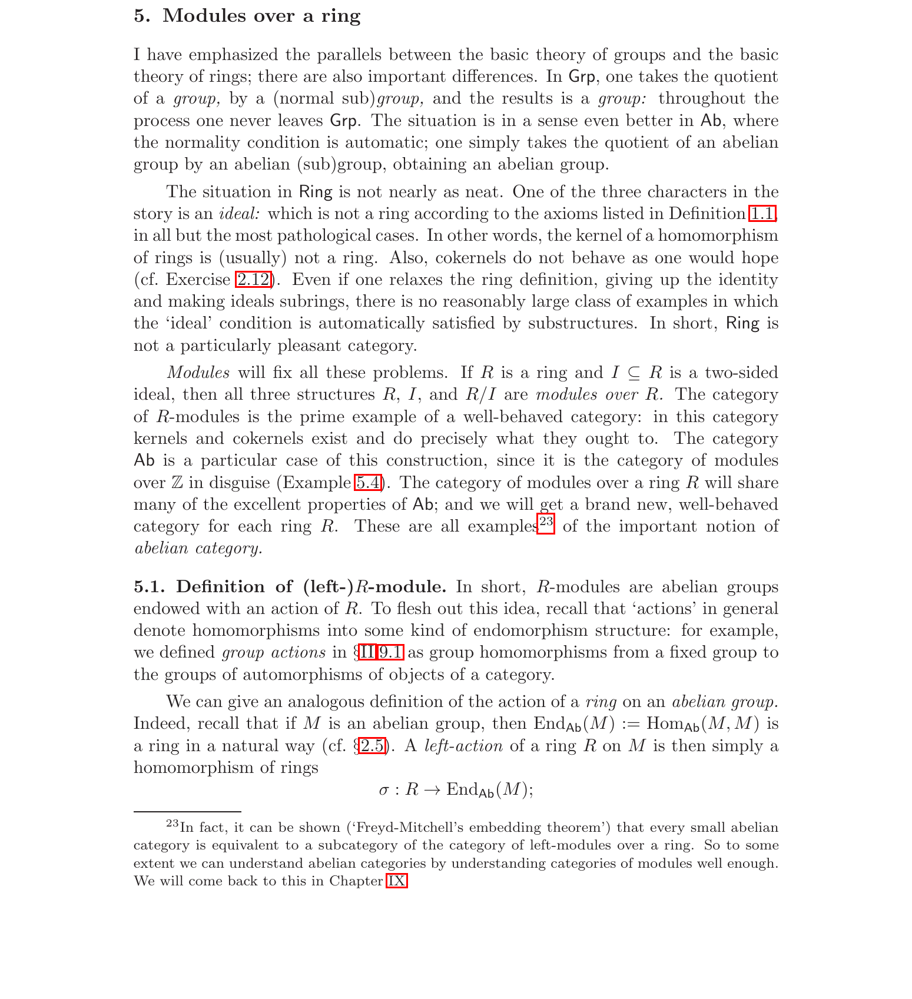
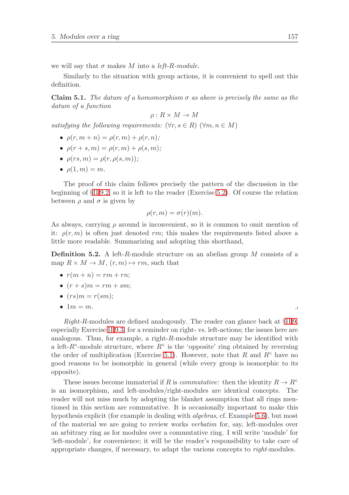

# III 5.1. Definition of (left-) R-module｜从环作用出发定义模

[阅读目录](README.md) · [上一小节](03-III-4.3.md) · [下一小节](05-III-5.2.md)

**本节总任务：把“环中的元素”看成作用在加法群上的算子，并建立一种能同时容纳子对象与商对象的语言。**模既推广向量空间，也补齐前面环范畴里不够整齐的构造。

## 原书第 156 页：原文底本

完整保留本小节在此页的原文；PDF 阅读器页码为 179。原书习题区不在本次范围。

## 第 156 页句读：先说目的，再逐步展开

### 一、作者为什么突然说 Ring 不够“舒服”？

**这段在干什么：**解释 §5 导言的转折，不让模看起来只是新加的一串公理。

群同态的核是群，商群也是群；阿贝尔群的子群又自动正规，因此子群、原群、商群始终处在同一种范畴里。

环里却不如此。$2\mathbb Z$ 是 $\mathbb Z$ 的理想，但它不含大环的 1。按本书含幺环、保幺同态的约定，它不是 $\mathbb Z$ 的子环。环同态的核通常也不包含 1，因此不像群那样直接成为同类子对象。

现在看同一个例子：$2\mathbb Z,\mathbb Z,\mathbb Z/2\mathbb Z$ 都能加，都能乘整数。若暂时只保留加法与“整数怎样作用”，三者就统一成 $\mathbb Z$-模。

这就是作者说模块修复问题的具体意思：**选择合适的对象类别，让核、子对象、商回到同一种结构。**不是宣称环不好、不重要，而是有些问题换到模里更自然。

### 二、环作用为什么映入 End，而群作用映入 Aut？

**这段在干什么：**说明原文用 $\sigma:R\to\operatorname{End}_{\mathbf{Ab}}(M)$ 定义模的来由。

先选一个阿贝尔群 $(M,+)$。每个 $r\in R$ 都要给出一个保持加法的操作 $\sigma(r):M\to M$。

这些操作不必可逆。例如整数 2 在 $\mathbb Z$ 上作用为 $m\mapsto2m$，它不是满射，却完全是合法标量作用。0 则作用为零映射，通常更不可能可逆。所以要用所有自同态的环 End，不只用可逆的 Aut。

End 的加法按输出逐点相加，乘法是复合。要求 $\sigma$ 是保幺环同态，就意味着：

- 环中加标量，对应把两个操作的输出相加。
- 环中乘标量，对应先后执行操作。
- 标量 1 对应什么也不改的恒等操作。

这比先记四条公理更能说明模究竟在记录什么。

## 原书第 157 页：原文底本

完整保留本小节在此页的原文；PDF 阅读器页码为 180。原书习题区不在本次范围。

## 第 157 页句读：先说目的，再逐步展开

### 三、Claim III.5.1：怎样从算子同态拆出四条模公理？

**这段在干什么：**逐项证明原文声称“同一数据”的两种写法确实等价。

定义 $rm=\sigma(r)(m)$。因为每个 $\sigma(r)$ 保加法，

$$
r(m+n)=\sigma(r)(m+n)=\sigma(r)(m)+\sigma(r)(n)=rm+rn.
$$

因为 $\sigma$ 保环加法，

$$
(r+s)m=(\sigma(r)+\sigma(s))(m)=rm+sm.
$$

因为它保环乘法，而 End 里的乘法是复合，

$$
(rs)m=(\sigma(r)\circ\sigma(s))(m)=r(sm).
$$

最后 $\sigma(1)=\operatorname{id}_M$，所以 $1m=m$。四条公理各自来自一个明确要求，没有多添无缘无故的条件。

反过来，若给了满足四条公理的标量作用，定义 $\sigma(r)(m)=rm$。第一条保证每个 $\sigma(r)$ 是加法群同态；第二条保证 $\sigma$ 保加法；第三条保证保乘法；第四条保证保幺。因此确实得到环同态。

**这不是两个不同定义凑巧都适用，而是可以双向恢复同一份数据。**

### 四、模像向量空间，但哪里不再能照搬线性代数？

**这段在干什么：**用熟悉例子定位新概念，同时指出标量不是域带来的变化。

向量空间的标量来自域，任何非零标量可逆。模的标量只来自环，非零标量可能不能除，也可能是零因子。

例如 $M=\mathbb Z/6\mathbb Z$ 是整数模，定义 $r[a]=[ra]$。取非零 $[3]$，有 $2[3]=[0]$。不能像向量空间那样两边除以非零标量 2，推出 $[3]=0$。

相反，当 $R=k$ 本来就是域，模公理与向量空间公理完全一样。模没有推翻线性代数，而是把“标量一定能除”的前提放开，再追踪哪些结论仍成立。

还可取 $R=M_2(k)$、$M=k^2$，用矩阵作用于列向量。$AB$ 的作用是先 $B$ 后 $A$，正好体现 $(rs)m=r(sm)$。因此一个“标量”本身也可能是矩阵，关键是它怎样作用，而不是它看起来像不像普通数。

### 五、左模与右模为什么不能总用换个写法解决？

**这段在干什么：**解释本页末尾 opposite ring 的必要性。

左模写 $(rs)m=r(sm)$，右模写 $m(rs)=(mr)s$。若把右作用写到左边，执行次序会反过来，所以对应的不是随便原封不动的 $R$，而是反乘法环 $R^{\mathrm{op}}$。

在 $R^{\mathrm{op}}$ 中定义 $r*s=sr$。将右模定义为左作用 $r\cdot m=mr$，便有

$$
r\cdot(s\cdot m)=(ms)r=m(sr)=(r*s)\cdot m.
$$

若 $R$ 交换，反乘法根本不改变环，左右模没有实质区别。非交换时，顺序就是结构的一部分，不能看见一对括号便随手移位。

本章后面主要可先采用交换环，或始终采用左模；作者将“module”简称为左模。所有计算应保持同一约定。

### 六、本节分级与推导总结

**这段在干什么：**把算子观点、四公理与例子一起整理。

| 知识点与原书定位 | 等级 | 为什么重要 | 应达到的程度 |
|---|---|---|---|
| §5 导言，p156 | A | 交代为什么改变对象类别 | 用 $2\mathbb Z,\mathbb Z,\mathbb Z/2$ 说明统一了什么 |
| Claim III.5.1，pp156–157 | A | 是环作用和公式定义的桥梁 | 双向逐项恢复数据 |
| Definition III.5.2，p157 | A | 全部后文的前提 | 会给整数模、向量空间、矩阵作用例子 |
| 与向量空间的区别 | A | 防止非法除法及自由性误判 | 知道非零标量未必可约去 |
| 右模与 opposite ring，p157 | B | 非交换结构的重要边界 | 能说明为何次序反向，不要求另展开右模全套理论 |

总路线：核与商需要统一的类别 → 给阿贝尔群添加环作用 → 把环乘法解释为操作复合 → 展开为四条公理 → 认出向量空间与阿贝尔群是重要特例。

---

[阅读目录](README.md) · [上一小节](03-III-4.3.md) · [下一小节](05-III-5.2.md)
