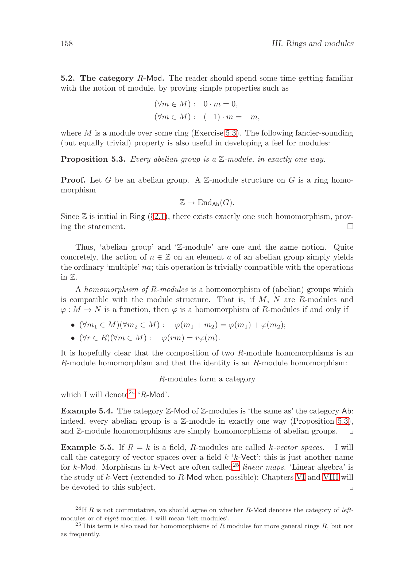
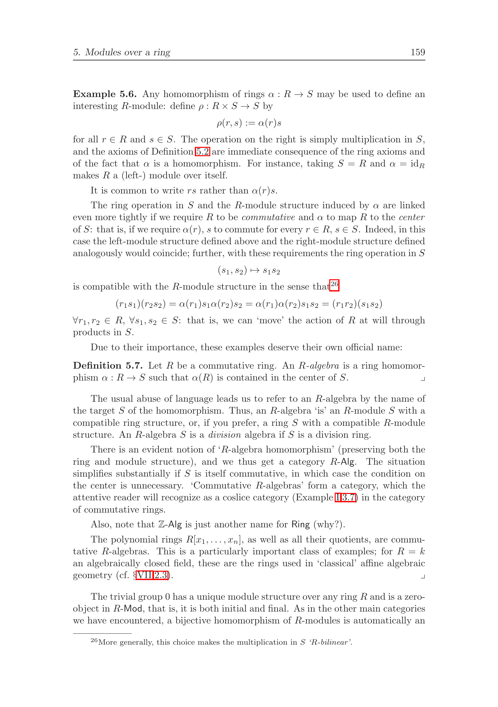
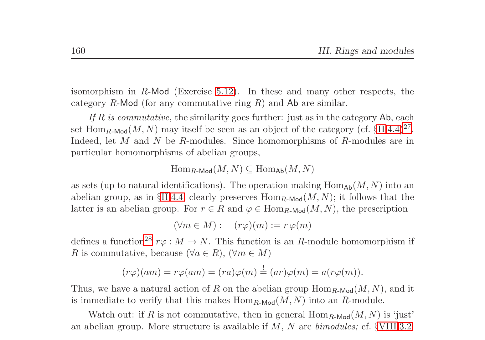

# III 5.2. The category R-Mod｜模范畴、线性映射与代数

[阅读目录](README.md) · [上一小节](04-III-5.1.md) · [下一小节](06-III-5.3.md)

**本节总任务：规定模之间什么映射算“保持结构”，再把阿贝尔群、向量空间、代数与 Hom 空间放回同一张关系图。**

## 原书第 158 页：原文底本

完整保留本小节在此页的原文；PDF 阅读器页码为 181。原书习题区不在本次范围。

## 第 158 页句读：先说目的，再逐步展开

### 一、零标量与负号不是要额外添加的公理

**这段在干什么：**补出本页开头建议熟悉的基本运算，让四条模公理真正可使用。

由 $(0_R+0_R)m=0_Rm+0_Rm$，而左边等于 $0_Rm$，在阿贝尔群中消去一项，得到 $0_Rm=0_M$。

再由 $(1_R+(-1_R))m=0_M$，得 $m+(-1_R)m=0_M$，所以 $(-1_R)m=-m$。

同样 $r(0_M+0_M)=r0_M+r0_M$，推出 $r0_M=0_M$。两个零分别来自环和模，写法常省略下标，但证明时知道它们属于哪里更稳妥。

### 二、Proposition III.5.3：每个阿贝尔群为什么只有一种整数模结构？

**这段在干什么：**解释作者如何用初始对象一句话完成一个本可很长的公理验证。

整数模结构等价于保幺环同态

$$
\mathbb Z\longrightarrow\operatorname{End}_{\mathbf{Ab}}(G).
$$

但 $\mathbb Z$ 是 Ring 的初始对象：到任何含幺环恰好有一个这样的同态。所以结构存在且唯一。

具体看，$1$ 必须作用为恒等；$n>0$ 是 $n$ 个 1 的和，所以 $ng$ 必须是 $n$ 次加 $g$；0、负整数的作用再由上面的规则决定。没有再选择另一种整数标量乘法的余地。

这展示作者的范畴方法：不重复验证所有整数情形，而先认出“环作用是一条同态”，再调用初始性完成存在与唯一。

### 三、模同态为什么要同时保加法和标量作用？

**这段在干什么：**定义 R-Mod 的态射，并区分“函数”“群同态”“模同态”三个层级。

给定两个已选好 $R$ 作用的模 $M,N$，映射 $f:M\to N$ 要满足

$$
f(m+n)=f(m)+f(n),\qquad f(rm)=rf(m).
$$

第一条保住原有阿贝尔群；第二条保住额外的环作用。不是任何加法同态都自动满足第二条。

例如复共轭 $f:\mathbb C\to\mathbb C$ 保加法，但作为复向量空间映射，它不保复标量：$f(i\cdot1)=-i$，而 $if(1)=i$。若只把两边当实向量空间，它却是线性的。**是否为模同态，必须连同底环说清楚。**

复合仍保两条规则，恒等映射也保，因此组成范畴 $R$-Mod。当 $R=\mathbb Z$，群同态本就保持整数倍，所以 $\mathbb Z$-Mod 与 Ab 相同；当 $R=k$ 为域，便得到 $k$-Vect，态射就是线性映射。

## 原书第 159 页：原文底本

完整保留本小节在此页的原文；PDF 阅读器页码为 182。原书习题区不在本次范围。

## 第 159 页句读：先说目的，再逐步展开

### 四、环同态怎样让一个环成为另一个环的模？

**这段在干什么：**展开 Example III.5.6 的“通过 α 使用标量”，不把 $rs$ 的简写误当成天然包含。

给定 $\alpha:R\to S$。要让 $r\in R$ 作用在 $s\in S$，先把 $r$ 送到 $S$，再在 $S$ 里相乘：

$$
r\cdot s:=\alpha(r)s.
$$

于是

$$
(r_1r_2)\cdot s
=\alpha(r_1)\alpha(r_2)s
=r_1\cdot(r_2\cdot s),
$$

保加法和保 1 的两项也同样来自 $\alpha$ 是环同态。

这里不要求 $\alpha$ 单射。例如商投影 $R\to R/I$ 给商环一个自然 $R$-模结构。记作 $rs$ 时，背后仍是 $\alpha(r)s$，不是说两个环元素原来就住在同一个集合。

取 $\alpha=\operatorname{id}_R$，就得到 $R$ 作为自身的左模，后面子模会认出左理想。

### 五、R-algebra 为什么不只是一个既叫环又叫模的东西？

**这段在干什么：**解释 Definition III.5.7 的相容条件，以及为什么要求像进入中心。

现在希望 $S$ 同时有自己的环乘法和 $R$ 的标量作用。两种结构不能互不相干。作者取 $R$ 交换，并要求

$$
\alpha(R)\subseteq Z(S),
$$

即每个标量像与 $S$ 的所有元素交换。这样计算

$$
(r_1s_1)(r_2s_2)
=\alpha(r_1)s_1\alpha(r_2)s_2
=\alpha(r_1)\alpha(r_2)s_1s_2
=(r_1r_2)(s_1s_2)
$$

才可在中间移动 $\alpha(r_2)$。中心条件准确解决的就是这一步，不是因为“通常默认交换”。

这样的结构叫 $R$-代数。它可以是非交换环，如 $M_n(k)$ 是 $k$-代数，标量映成标量矩阵；也可以是交换代数，如 $R[x]/(f)$。

代数同态不仅保环运算，还要和固定的标量映射相容。若 $f:S\to T$，条件是 $f\circ\alpha_S=\alpha_T$，等价于相应的 $R$-线性要求。

### 六、为什么交换 R-代数构成一个 coslice 范畴？

**这段在干什么：**把本页的范畴提示翻译成具体对象和交换三角形。

固定 $R$，对象不是单独一个交换环 $S$，而是一条箭头 $\alpha_S:R\to S$。两个对象间的态射为使

$$
R\xrightarrow{\alpha_S}S\xrightarrow{f}T
\quad\text{等于}\quad
R\xrightarrow{\alpha_T}T
$$

的环同态 $f$。这正是从固定对象 $R$ 出发的 coslice 构造 $R/\mathbf{CRing}$。

不要把 coslice 当作另加实体，它只是把“保住同一套系数来源”组织成范畴。$\mathbb Z$ 的箭头唯一且整数像总居中心，所以 $\mathbb Z$-Alg 便恢复 Ring。

本页末尾的零群有唯一模结构。到任意模、从任意模的线性映射都只能是零映射，所以它既初始又终结，即零对象。下一节的核、余核将依靠这些零映射表达。

## 原书第 160 页：原文底本

完整保留本小节在此页的原文；PDF 阅读器页码为 183。原书习题区不在本次范围。

## 第 160 页句读：先说目的，再逐步展开

### 七、为什么 Hom 集合本身也能相加？

**这段在干什么：**把“线性映射的集合”进一步看作有加法结构的对象。

给两个 $R$-线性映射 $f,g:M\to N$，逐点定义 $(f+g)(m)=f(m)+g(m)$。验证：

$$
(f+g)(m+n)=f(m)+f(n)+g(m)+g(n).
$$

因为 $N$ 加法交换，可重排为 $(f+g)(m)+(f+g)(n)$；标量相容也由分配律成立。因此 Hom 集在逐点加法下是阿贝尔群，零是零映射，负号逐点取。

这并不要求底环交换。它是后面“加性范畴”的一个具体来源，而不只是一个新定义。

### 八、为什么让 Hom 再成为 R-模，就需要额外交换条件？

**这段在干什么：**展开原文标了感叹号的等式，检查标量倍映射是否仍在线性映射集合里。

尝试定义 $(rf)(m)=r f(m)$。要它仍是 $R$-线性，必须对任意 $a\in R$ 有

$$
(rf)(am)=r\,a\,f(m)
\quad\stackrel{?}{=}\quad
a\,r\,f(m)=a(rf)(m).
$$

正是 $ra=ar$ 这一处需要交换。因此交换环下 Hom 自然成为 $R$-模。

非交换时并非纯技术问题。取 $R=M_2(k)$、$M=N=R$ 为左模，$f=\operatorname{id}$，取矩阵单位 $r=E_{12},a=E_{21}$。在 $m=1$ 处，左边是 $ra=E_{11}$，右边是 $ar=E_{22}$，不同。

所以不能因为“函数逐点乘标量很自然”，就跳过它是否保留线性的检查。一般仍有 Ab 结构；若只用中心标量，则还能得到相应的中心模结构。

### 九、本节分级与推导总结

**这段在干什么：**把同一页出现的多个“结构升级”分清。

| 知识点与定位 | 等级 | 为什么重要 | 应达到的程度 |
|---|---|---|---|
| Proposition III.5.3，p158 | A | 连接 Ab 与模 | 用整数初始性和重复加法两种方式说明 |
| 模同态、R-Mod，p158 | A | 后文全部映射的类型 | 检查保加法与标量，说明底环改变的影响 |
| Examples III.5.4–5.6 | A | 统一向量空间、阿贝尔群、环的标量限制 | 会写 $r\cdot s=\alpha(r)s$ |
| Definition III.5.7，p159 | B | 连接系数环与对象内部乘法 | 指出中心条件在哪一步使用 |
| coslice 与零对象，p159 | B | 理解作者范畴组织方法 | 说出对象、态射及交换条件 |
| Hom 的 Ab/模结构，p160 | A/B | 后续对偶和线性运算频繁使用 | 加法为 A；标量相容的交换条件须理解 |

主线不是同时记很多类别名称，而是逐步问：对象有什么运算？映射保哪些运算？这些映射本身还能作哪些运算？每次“还能”都必须检查封闭与相容。

---

[阅读目录](README.md) · [上一小节](04-III-5.1.md) · [下一小节](06-III-5.3.md)
