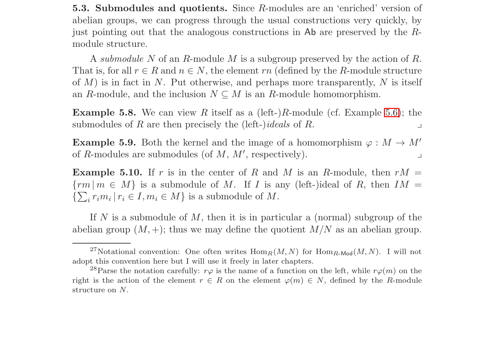
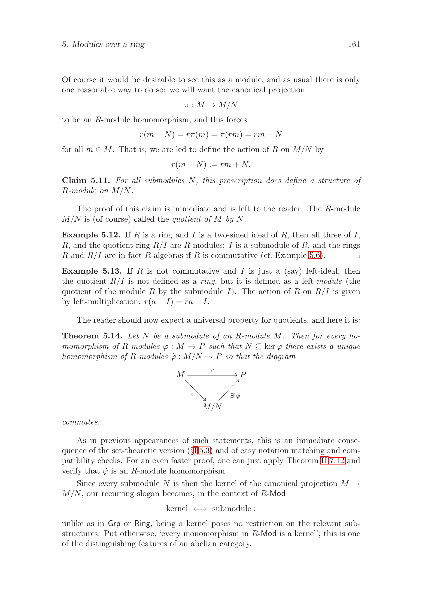

# III 5.3. Submodules and quotients｜子模、商模与商的泛性质

[阅读目录](README.md) · [上一小节](05-III-5.2.md) · [下一小节](07-III-5.4.md)

**本节总任务：确定哪些加法子群可以作为模的子对象，随后使商上的标量作用真正有定义。**路线与你给出的商环解读平行，但现在只需检查一个外部标量作用，不再要求商自身有环乘法。

## 原书第 160 页：原文底本

完整保留本小节在此页的原文；PDF 阅读器页码为 183。原书习题区不在本次范围。

## 第 160 页句读：先说目的，再逐步展开

### 一、子模：加法子群还需要对哪种操作稳定？

**这段在干什么：**解释本节第一段的 “preserved by the action of R”。

设 $M$ 已是 $R$-模，$N\subseteq M$。因为模有加法与标量乘法，子对象必须同时继承它们。因此先要求 $N$ 为加法子群，再要求

$$
r\in R,\ n\in N\Longrightarrow rn\in N.
$$

这是子模条件。不能只检查“$N$ 里的元素之间怎样运算”，因为标量来自整个 $R$。

例如 $\mathbb Z^2$ 的整数倍向量全体 $\mathbb Z(2,1)$ 是子模；仿射集合 $(1,0)+\mathbb Z(2,1)$ 一般不含零，不是子模。向量空间里“过原点的子空间”与“一条平移直线”的区别在这里仍在。

同一个子集是否为子模，也依赖所选的底环作用。$M=\mathbb C$ 时，$\mathbb R$ 是实子空间，却不是复子空间，因为 $i\cdot1\notin\mathbb R$。

### 二、Examples III.5.8–5.9：为什么核与像自动稳定？

**这段在干什么：**把原环理想与模子对象对上，并验证后面要用的两个典型子模。

把 $R$ 看作自身左模，子模正好是左理想：同样是加法子群并吸收大环左乘。若 $R$ 交换，就是普通理想。这将前面熟悉的对象放进了新类别。

给模同态 $f:M\to M'$，若 $m\in\ker f$，则

$$
f(rm)=rf(m)=r0=0,
$$

所以核对标量稳定。若 $y=f(m)$ 在像中，则 $ry=f(rm)$ 仍在像中。加法子群部分已经由保加法得到，因此核、像都是子模。

这两次计算才是“同态保结构，所以相应子集保结构”的实际内容。

### 三、Example III.5.10：为什么 rM 要求 r 在中心，而 IM 用左理想？

**这段在干什么：**辨认原文例子里的两个相似但条件不同的构造。

取 $rM=\{rm:m\in M\}$。它对加法封闭，但再乘 $a\in R$ 时，

$$
a(rm)=(ar)m.
$$

若 $r$ 在中心，可换成 $(ra)m=r(am)$，所以回到 $rM$。如果不能换序，这个论证便断了，故原文加上中心条件。

再取左理想 $I$，定义

$$
IM=\left\{\sum_{j=1}^n i_jm_j:i_j\in I,\ m_j\in M\right\}.
$$

这里本来就允许有限和。任意 $a\in R$ 左作用后，变成 $\sum(ai_j)m_j$；左理想保证 $ai_j\in I$。因此它是子模，不要求将 $a$ 与 $i_j$ 换序。

要区分“同一个 $r$ 的像”和“一个理想中许多系数的有限和”，不能因为都像倍数就省略条件。

## 原书第 161 页：原文底本

完整保留本小节在此页的原文；PDF 阅读器页码为 184。原书习题区不在本次范围。

## 第 161 页句读：先说目的，再逐步展开

### 四、先有加法商，再问标量必须怎样定义

**这段在干什么：**完全展开作者 “there is only one reasonable way” 的推导。

$M$ 加法交换，所以子群 $N$ 自动正规，$M/N$ 已经是阿贝尔群。现在要把它升级为 $R$-模。

要求自然投影 $\pi(m)=m+N$ 是 $R$-线性，就必须

$$
r(m+N)=r\pi(m)=\pi(rm)=rm+N.
$$

因此标量作用的公式没有自由选择。真正要检查的是：若改换 $m$ 的代表元，结果会不会变？

假设 $m+N=m'+N$，等价于 $m'-m\in N$。则

$$
rm'-rm=r(m'-m)\in N
$$

正好由子模稳定条件保证。于是 $rm'+N=rm+N$，作用与代表元无关。

如果只有加法子群而不稳定，这一步可能失败。例如把 $\mathbb C$ 当复向量空间，取加法子群 $N=\mathbb R$，则 $0+N=1+N$，但乘 $i$ 后得到 $0+N$ 与 $i+N$，不同。因此这个加法商不能直接继承复数标量作用。

### 五、Claim III.5.11：良定义以后怎样继承模公理？

**这段在干什么：**将“公理显然继承”实际核验一遍，标明先后逻辑。

先有良定义，才有资格用任意代表元计算。然后

$$
r((m+N)+(m'+N))
=r(m+m')+N
=(rm+N)+(rm'+N),
$$

以及

$$
(rs)(m+N)=(rs)m+N=r(sm)+N=r(s(m+N)).
$$

标量加法的分配律同样从 $M$ 继承；$1(m+N)=m+N$。这样 $M/N$ 真成为模，且投影按构造线性。

这里要学的是一种通用顺序：**先由希望投影保结构推定运算，再证明与代表元无关，最后继承公理。**不能颠倒为“公式像模公理，所以肯定合法”。

### 六、Example III.5.13：左理想商为什么能是模，却不是环？

**这段在干什么：**给出环商与模商所需条件不同的具体非交换例子。

取 $R=M_2(k)$，$I=RE_{11}$，即第二列为零的矩阵全体。左乘任意矩阵，第二列仍零，所以是左理想。

但 $E_{11}\in I$ 而 $E_{11}E_{12}=E_{12}\notin I$，所以不右吸收，不是双边理想。

左模商 $R/I$ 仍可定义 $r(a+I)=ra+I$，因为所需检查只有 $rI\subseteq I$。

若想定义环乘法，因 $E_{11}+I=0+I$，它与 $E_{12}+I$ 的乘积应为零；按代表元相乘却得到 $E_{12}+I\ne0$。因此环乘法不良定义。

**少要求一种运算，就少需要一种吸收条件。**模不是凑合的环，它在研究不同的结构数据。

### 七、Theorem III.5.14：商的泛性质到底在承诺什么？

**这段在干什么：**逐项构造唯一下降映射，并说明核条件为何必要。

给 $f:M\to P$ 线性，且 $N\subseteq\ker f$。若要 $f=\widetilde f\circ\pi$，每个商类的像只能定义为

$$
\widetilde f(m+N)=f(m).
$$

若换代表元，$m'-m\in N$，于是 $f(m')-f(m)=f(m'-m)=0$，所以良定义。

保加法由 $f$ 保加法得到；对标量，

$$
\widetilde f(r(m+N))
=\widetilde f(rm+N)
=f(rm)=rf(m)=r\widetilde f(m+N).
$$

所以它是模同态。任何下降映射都必须在每个 $m+N$ 上取这个值，因此唯一；背后是投影满射，每个商元素都有代表。

条件也必要：若 $f=\widetilde f\pi$，则所有 $n\in N$ 经 $\pi$ 都成零，故 $f(n)=0$。因此泛性质准确刻画“哪些映射允许在合并 $N$ 后仍保留”。

### 八、kernel ⇔ submodule 为什么比环情形整齐？

**这段在干什么：**解释本页末尾的范畴评价，并总结学习等级。

已证每个模同态的核是子模。反过来，任意子模 $N$ 都是投影 $M\to M/N$ 的核。于是所有子模都能实现为核，不必另筛正常性或双边条件。

| 知识点与定位 | 等级 | 为什么重要 | 应达到的程度 |
|---|---|---|---|
| 子模与核、像，p160 | A | 后续所有商与正合构造依赖 | 逐项检查加法、标量稳定 |
| Claim III.5.11，p161 | A | 商上继承结构的基本模板 | 从投影线性推出公式，再做代表元检查 |
| Examples III.5.12–5.13 | B | 解释模怎样统一环中的不同角色 | 用左理想例子区分环商与模商 |
| Theorem III.5.14，p161 | A | 全部下降映射的依据 | 分开证明存在、线性、唯一 |
| kernel 与 submodule 的对应 | A | 为后面阿贝尔范畴语言提供实际内容 | 指出两方向各是哪条构造 |

---

[阅读目录](README.md) · [上一小节](05-III-5.2.md) · [下一小节](07-III-5.4.md)
