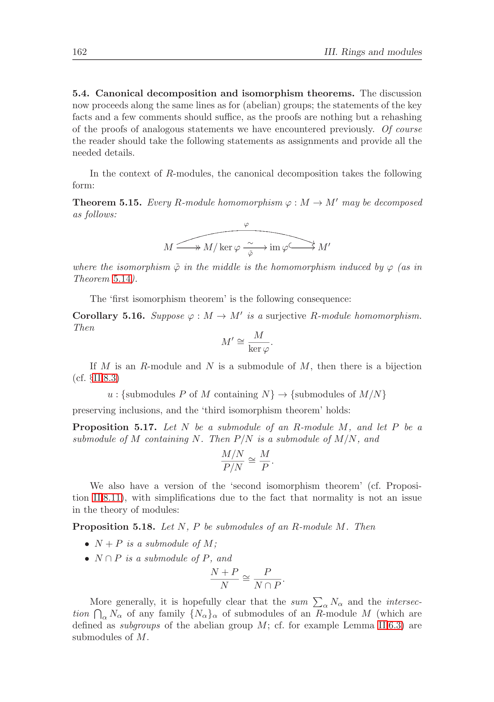

# III 5.4. Canonical decomposition and isomorphism theorems｜模同态分解与同构定理

[阅读目录](README.md) · [上一小节](06-III-5.3.md) · [下一小节](08-III-6.1.md)

**本节总任务：把熟悉的核—像分解、子对象对应和两次取商统一搬到模。**原文只有一页，省略了许多证明；这里把它们依靠的映射逐个写清。

## 原书第 162 页：原文底本

完整保留本小节在此页的原文；PDF 阅读器页码为 185。原书习题区不在本次范围。

## 第 162 页句读：先说目的，再逐步展开

### 一、Theorem III.5.15：先合并哪些元素，才能消除同态的不单射？

**这段在干什么：**从同态的输出相同出发，推出正确的商，而不是先背分解图。

给模同态 $f:M\to M'$，有

$$
f(m)=f(n)\iff f(m-n)=0
\iff m-n\in\ker f.
$$

所以输出不能分辨的元素，恰好属于同一个 $\ker f$ 商类。记 $K=\ker f$，令

$$
\bar f:M/K\to\operatorname{im}f,\qquad m+K\mapsto f(m).
$$

良定义正由上面等价保证。若两商类输出相等，同样等价使它们相同，所以单射；任何像元素本就为某个 $f(m)$，所以满射。

它还线性：

$$
\bar f(r(m+K))=f(rm)=rf(m)=r\bar f(m+K),
$$

加法同理。因此

$$
\boxed{M\twoheadrightarrow M/\ker f
\xrightarrow[\cong]{\bar f}\operatorname{im}f
\hookrightarrow M'.}
$$

第一步只合并必要的元素；中间成为一一对应且保模结构；最后只是把像看进原目标。

### 二、Corollary III.5.16：满射为什么能直接识别商？

**这段在干什么：**说明第一同构定理的使用方法，并算一个完整具体例子。

若 $f$ 满射，像就是全部 $M'$，于是 $M/\ker f\cong M'$。关键工作通常不是重证定理，而是找对 $f$ 并准确算核。

例如取整数模映射

$$
f:\mathbb Z^2\to\mathbb Z,\qquad f(a,b)=2a+3b.
$$

它保加法与整数倍，且 $f(-1,1)=1$，所以满射。核由 $2a+3b=0$ 描述：3 整除 $a$，写 $a=3t$，则 $b=-2t$。因此

$$
\ker f=\mathbb Z(3,-2),\qquad
\mathbb Z^2/\mathbb Z(3,-2)\cong\mathbb Z.
$$

同构不是“去掉一个坐标”这么模糊，而是明确送 $(a,b)+\mathbb Z(3,-2)$ 到 $2a+3b$。例如 $(1,0)$ 与 $(4,-2)$ 差 $(3,-2)$，同像都是 2。

### 三、子模对应：为什么只对应包含 N 的子模？

**这段在干什么：**展开本页的包含保持双射，分清元素投影与子模集合的对应。

给 $\pi:M\to M/N$。若子模 $P\subseteq M$ 包含 $N$，其像为 $P/N$。反过来，给商内子模 $Q$，取逆像 $\pi^{-1}(Q)$。

逆像是子模，因为线性映射下的加法与标量检查都能送过去完成；而且它含 $N$，因为 $N$ 全送为零，零在任何子模里。

两操作互逆：

$$
\pi^{-1}(P/N)=P.
$$

证明是：若 $\pi(m)=\pi(p)$、$p\in P$，则 $m-p\in N\subseteq P$，所以 $m\in P$。这里正用到 $P$ 含 $N$。另一方向 $\pi(\pi^{-1}(Q))=Q$ 用投影满射。

所以它是两类**子模组成的集合**之间的双射，不是说 $\pi$ 在每个元素上单射。

### 四、Proposition III.5.17：先除 N 再除 P/N，为何等于直接除 P？

**这段在干什么：**选出第三同构定理的实际映射并算核。

设 $N\subseteq P\subseteq M$。定义

$$
g:M/N\to M/P,\qquad m+N\mapsto m+P.
$$

若代表元差在 $N$，也在 $P$，所以良定义。它显然线性并满射；被送成零的类是 $m\in P$ 的那些，故 $\ker g=P/N$。

第一同构定理立刻给

$$
\boxed{(M/N)/(P/N)\cong M/P.}
$$

例如 $\mathbb Z$ 中 $12\mathbb Z\subseteq4\mathbb Z$，先模 12，再合并 4 的倍数类，最后等于直接模 4。这里的第二个“除”是除一个子模，不是把模数做数字除法。

### 五、Proposition III.5.18：P 加进 N 后，哪些信息真的新增加了？

**这段在干什么：**从限制投影推出第二同构定理，说明交为何自然成为核。

$N+P=\{n+p:n\in N,p\in P\}$ 是子模：加法与标量都逐项保持这种形式。$N\cap P$ 当然也是子模。

定义

$$
h:P\to(N+P)/N,\qquad p\mapsto p+N.
$$

它满射，因为任意 $(n+p)+N=p+N$；核是那些同时在 $P$ 和 $N$ 的元素，即 $N\cap P$。所以

$$
\boxed{P/(N\cap P)\cong(N+P)/N.}
$$

大白话说：把 $P$ 加进已经忽略的 $N$ 后，$P$ 里本来就属于 $N$ 的部分不会提供新信息，必须先在左边除掉。

整数例子 $N=6\mathbb Z,P=10\mathbb Z$，和为 $2\mathbb Z$、交为 $30\mathbb Z$，于是 $10\mathbb Z/30\mathbb Z\cong2\mathbb Z/6\mathbb Z$。映射明确为 $10t+30\mathbb Z\mapsto10t+6\mathbb Z$，不是只凭两边各有三个元素猜同构。

### 六、本节分级与推导总结

**这段在干什么：**把四种结论还原成少数可重复使用的证明动作。

| 知识点与定位 | 等级 | 为什么重要 | 应达到的程度 |
|---|---|---|---|
| Theorem III.5.15、Corollary III.5.16 | A | 识别商模的基本工具 | 会找同态并算核、像 |
| 子模对应，p162 | A | 正确追踪商前后的子对象 | 写出像与逆像，知道包含 $N$ 用在哪里 |
| Proposition III.5.17 | B | 群论模板在模中的复用 | 找到 $m+N\mapsto m+P$ 即能重建 |
| Proposition III.5.18 | A/B | 后面 Noetherian 证明立刻调用 | 结论会用，证明抓住限制投影的核 |

每条同构都来自同一个策略：先看要保留什么 → 构造自然线性映射 → 说明为什么满 → 说明什么被杀掉 → 第一同构定理。范畴语言没有免掉证明，而是帮你识别哪些证明其实是同一个构造。

---

[阅读目录](README.md) · [上一小节](06-III-5.3.md) · [下一小节](08-III-6.1.md)
