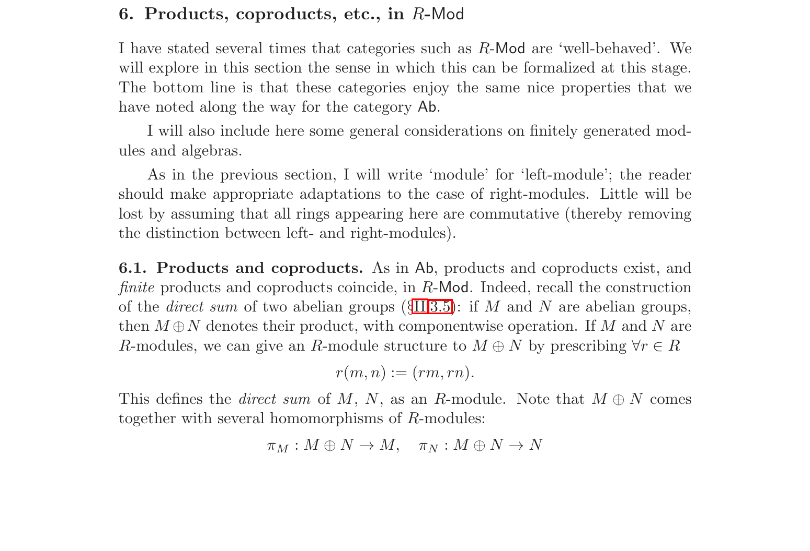
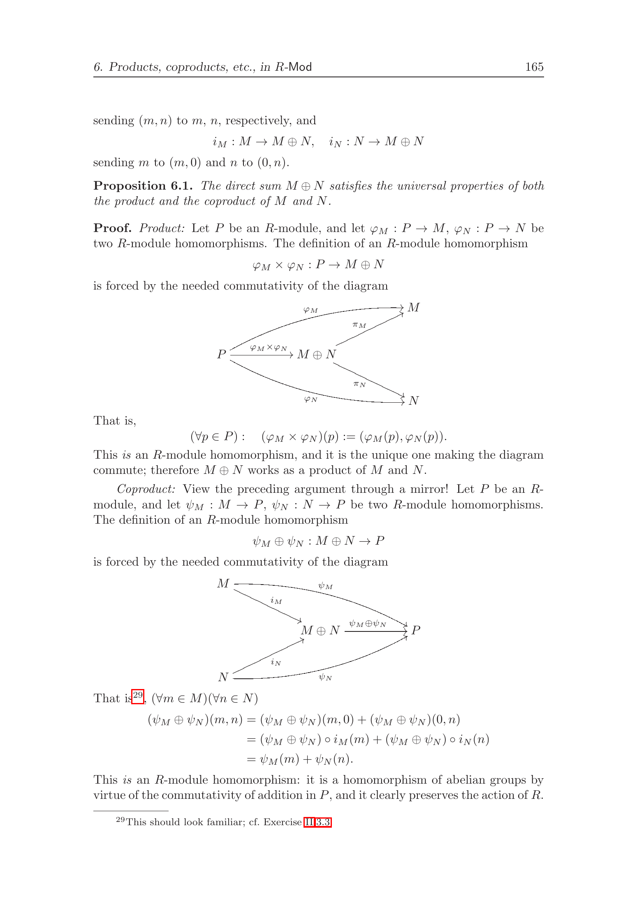
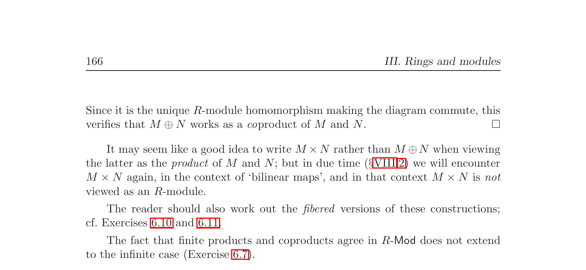

# III 6.1. Products and coproducts｜积与余积为什么由同一个直和实现

[阅读目录](README.md) · [上一小节](07-III-5.4.md) · [下一小节](09-III-6.2.md)

**本节总任务：给两个模造一个共同对象，使“同时映进去”和“分别映出来”都得到唯一映射。**有限情况下，这两个相反要求由同一个直和实现。

## 原书第 164 页：原文底本

完整保留本小节在此页的原文；PDF 阅读器页码为 187。原书习题区不在本次范围。

## 第 164 页句读：先说目的，再逐步展开

### 一、先造对象：把两个模并排放，不把它们的元素混加

**这段在干什么：**解释 §6 导言和 6.1 开头的逐分量结构。

给 $R$-模 $M,N$，取有序对集合 $M\times N$。定义

$$
(m,n)+(m',n')=(m+m',n+n'),\qquad
r(m,n)=(rm,rn).
$$

每条模公理在两个分量分别成立，因此这真是一个模，记 $M\oplus N$。

零元是 $(0_M,0_N)$。不要把 $M,N$ 当作原来就能互相相加的同一集合：对 $(m,n)$ 的描述，是为两类分量分配各自位置。

这个对象带四种自然映射。投影取出分量，$\pi_M(m,n)=m,\pi_N(m,n)=n$；嵌入把另一个分量填零，$i_M(m)=(m,0),i_N(n)=(0,n)$。

投影往外看各分量，嵌入从分量往里放。积、余积的两种泛性质就分别依靠它们。

## 原书第 165 页：原文底本

完整保留本小节在此页的原文；PDF 阅读器页码为 188。原书习题区不在本次范围。

## 第 165 页句读：先说目的，再逐步展开

### 二、积的泛性质：已知一个对象到 M、N 的映射，怎样一次打包？

**这段在干什么：**逐项证明 Proposition III.6.1 的 product 部分，说明唯一性是怎样被投影逼出的。

给一个模 $P$ 和两条线性映射 $f:P\to M,g:P\to N$。要找 $h:P\to M\oplus N$ 满足

$$
\pi_Mh=f,\qquad\pi_Nh=g.
$$

这两个条件已经规定了 $h(p)$ 的两个坐标，所以只能

$$
h(p)=(f(p),g(p)).
$$

因此唯一性先有了候选理由，接着检查候选确实线性：

$$
h(p+p')=(f(p)+f(p'),g(p)+g(p'))=h(p)+h(p'),
$$

$$
h(rp)=(rf(p),rg(p))=rh(p).
$$

投影关系也按定义成立。于是存在且唯一，这才完成泛性质。

大白话：分别知道同一个输入送到两处哪里，就能把两份输出放进一个有序对。积解决的是**箭头从共同来源进来**的问题。

### 三、余积的泛性质：分别给出 M、N 的输出，怎样合并？

**这段在干什么：**证明 product 的“镜像”结论，并解释加法交换在哪里使用。

现在箭头反过来，给 $f:M\to P,g:N\to P$。要找 $h:M\oplus N\to P$ 满足

$$
hi_M=f,\qquad hi_N=g.
$$

每个 $(m,n)$ 都有固定分解 $(m,0)+(0,n)$。若 $h$ 线性，便必须

$$
h(m,n)=f(m)+g(n).
$$

再检查候选。对两对元素相加，左边给

$$
f(m)+f(m')+g(n)+g(n'),
$$

右边 $h(m,n)+h(m',n')$ 给

$$
f(m)+g(n)+f(m')+g(n').
$$

它们相等用到 $P$ 的加法交换。标量相容则由分配律得到。嵌入关系明显成立，唯一性已由分解强迫。

因此同一个 $M\oplus N$ 也是余积。余积解决的是**从各个来源向共同目标出去**的问题。

### 四、为什么“同一个对象满足两种泛性质”不是把两种概念合并？

**这段在干什么：**分清对象的构造与它连同哪些结构映射一起被使用。

作为积，重要数据是两个投影；作为余积，重要数据是两个嵌入。泛性质比较的图和箭头方向不同，只是有限模情形可由同一底层对象同时实现，常称双积。

例如两个映射 $P\to M,N$ 的合并公式是有序对；两个映射 $M,N\to P$ 的合并公式是输出相加。它们不是把同一个等式左右翻一下，而是解决不同的映射问题。

范畴论的作用是明确“要和所有其他对象怎样联系”，而非只在某个集合里找到两个坐标。

## 原书第 166 页：原文底本

完整保留本小节在此页的原文；PDF 阅读器页码为 189。原书习题区不在本次范围。

## 第 166 页句读：先说目的，再逐步展开

### 五、无限多个模时，有限直和的结论哪里失效？

**这段在干什么：**解释原文末尾的警告，指出“每个元素只用有限项”的作用。

对一族 $M_a$，积 $\prod_aM_a$ 允许任意坐标族；直和 $\bigoplus_aM_a$ 只允许有限多个非零坐标。有限指标下两者一样，指标无限时一般不同。

积仍按所有投影打包输入。余积则要把各分量映到同一目标，公式是

$$
h((m_a))=\sum_a f_a(m_a).
$$

直和的有限支撑保证这个和有定义：普通模没有给一般无穷和额外意义。

取可数个 $\mathbb Z$。直和所有有限支撑整数列是可数集合；积包含所有 0、1 无限列，已不可数。因此它们甚至不可能是集合上一一对应的对象，更不可能模同构。

这比仅说“我写不出一个无穷和”更强：它给出确凿的不一样例子。

### 六、为什么作者以后写 M×N 时，又可能不把它当这个模？

**这段在干什么：**说明双线性问题与线性问题的类型区别，不让记号造成误读。

同一个有序对集合可以被用于不同问题。例如 $k\times k\to k$ 的乘法 $(a,b)\mapsto ab$ 对每个变量分别线性，但不是按直和模结构的线性映射：

$$
(1,0)+(0,1)=(1,1),\qquad
1\cdot1\ne1\cdot0+0\cdot1.
$$

所以“分别线性”与“对整个有序对线性”不同。后面张量积正为双线性问题服务；本节仍在讨论普通模同态的积与余积。

### 七、本节分级与推导总结

**这段在干什么：**用映射方向和有限支撑两条线索保存整节内容。

| 知识点与定位 | 等级 | 为什么重要 | 应达到的程度 |
|---|---|---|---|
| 逐分量模与四个自然映射，pp164–165 | A | 后续分裂、自由模都使用 | 会写投影、嵌入及其类型 |
| Proposition III.6.1，p165 | A | 是两种泛性质的典型实算 | 从交换条件推出唯一公式并检验线性 |
| 无限积与直和，p166 的提示 | A | 决定自由模和泛性质是否合法 | 说明有限支撑为何是必要构造 |
| 双线性记号提示，p166 | C | 为后章作边界标记 | 不将分别线性误当整体线性 |

积靠坐标由投影确定；余积靠有限分解与加法确定。两种唯一性有不同来源，却在有限模上相遇。

---

[阅读目录](README.md) · [上一小节](07-III-5.4.md) · [下一小节](09-III-6.2.md)
