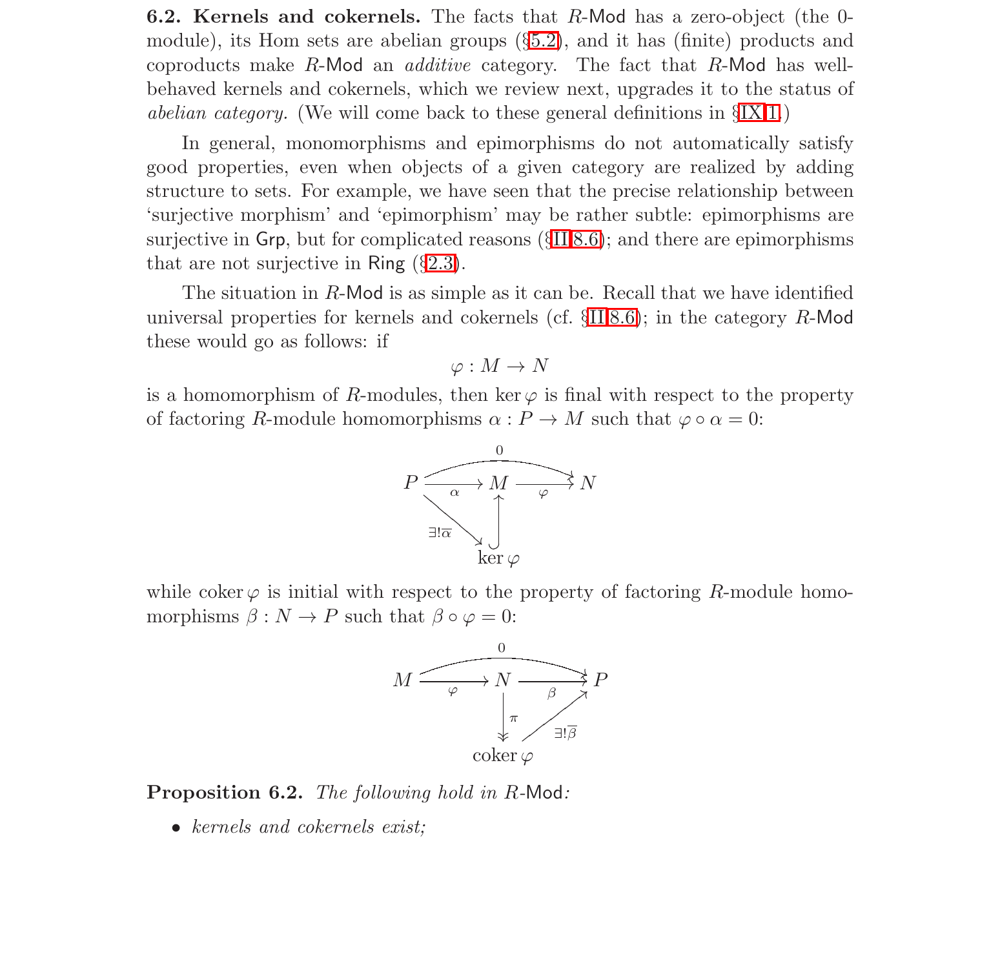
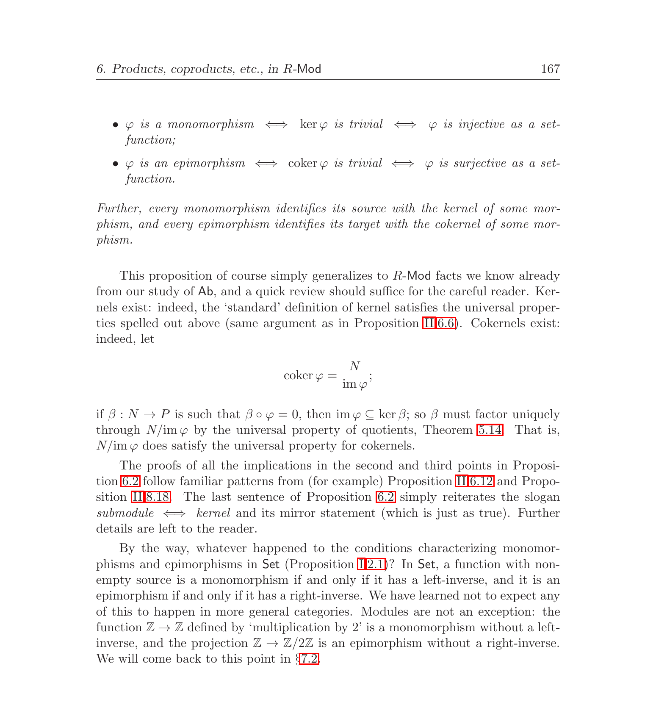

# III 6.2. Kernels and cokernels｜核、余核及单满性的范畴解释

[阅读目录](README.md) · [上一小节](08-III-6.1.md) · [下一小节](10-III-6.3.md)

**本节总任务：把核、余核写成明确的泛性质，并用它们判断单态、满态。**同时要分清：单、满不自动提供线性逆向选择。

## 原书第 166 页：原文底本

完整保留本小节在此页的原文；PDF 阅读器页码为 189。原书习题区不在本次范围。

## 第 166 页句读：先说目的，再逐步展开

### 一、“模范畴好用”现在有哪些具体证据？

**这段在干什么：**解释 additive、abelian 这些名字在本页先指向哪些已完成的构造。

我们已得到零对象，任意 Hom 集能相加，有限积和余积又由同一个直和实现。它们让线性映射可以相加、相减，并在多个对象间打包。

接下来还要能稳定地取核与余核，使每个子模都能成为某个核、每个合适商都能成为某个余核。满足完整相应公理的类别称阿贝尔范畴，正式定义在后面章节。

当前不要把几个例子当作完整抽象定义；先看“好用”具体是下面哪些操作真的存在并满足所需性质。

### 二、核的泛性质：所有被 f 送成零的输入，怎样统一收进去？

**这段在干什么：**读懂原文关于 kernel 的交换图，并解释终对象方向。

给 $f:M\to N$，取 $K=\{m:f(m)=0\}$ 和包含 $i:K\hookrightarrow M$。它满足 $fi=0$。

若另有 $a:P\to M$ 满足 $fa=0$，则每个 $a(p)$ 都在 $K$。因此存在唯一

$$
\bar a:P\to K,\qquad \bar a(p)=a(p)
$$

使 $i\bar a=a$。线性没有改变，因为只把输出目标收窄到子模。

所以核把所有“送到 $M$ 后会被 $f$ 杀掉”的映射统一接收；这些候选最后都唯一映向 $K$，这就是该问题中的终对象性质。

不是只有元素集合 $K$ 重要，包含箭头也在数据中。只给一个抽象同构模而不说明它怎样进入 $M$，还没有完整交代核。

### 三、余核的泛性质：怎样作最少的合并，让 f 的输出全部成为零？

**这段在干什么：**为 cokernel 找具体对象，而不是只把 kernel 图反着背。

要在目标 $N$ 上让 $f(M)$ 全成零，最自然是除去像：

$$
C=N/\operatorname{im}f,\qquad q:N\to C.
$$

若 $b:N\to P$ 满足 $bf=0$，则 $\operatorname{im}f\subseteq\ker b$。商的泛性质给唯一

$$
\bar b:C\to P,\qquad n+\operatorname{im}f\mapsto b(n)
$$

使 $\bar bq=b$。因此 $C$ 是余核。

核是把允许输入收窄到子对象；余核是在目标里作合并。两者方向相反，但都由一个“复合为零”的要求和唯一分解规定。

## 原书第 167 页：原文底本

完整保留本小节在此页的原文；PDF 阅读器页码为 190。原书习题区不在本次范围。

## 第 167 页句读：先说目的，再逐步展开

### 四、Proposition III.6.2：为什么 mono 等价于核为零，也等价于单射？

**这段在干什么：**给范畴消去条件一个元素可检验的版本。

若核为零，$f(m)=f(n)$ 就使 $m-n$ 在核中，故 $m=n$。反过来，单射显然只把零送到零。

单射满足范畴 mono 的左消去：若 $fa=fb$，逐元素由单射得 $a=b$。

反过来，若 $f$ 是 mono，取任意 $m\in\ker f$，构造两个线性映射

$$
u,v:R\to M,\qquad u(r)=rm,\quad v(r)=0.
$$

$fu=fv=0$。mono 迫使 $u=v$，代入 $r=1$ 得 $m=0$。因此核为零。

这个证明说明为什么把 $R$ 当测试对象能探测元素：每个 $m$ 都由 $1\mapsto m$ 的线性映射编码。

### 五、为什么 epi 等价于余核为零，也等价于满射？

**这段在干什么：**用余核投影检验范畴满态，而非把环范畴的情况误搬过来。

若 $f$ 满射，任何 $a,b:N\to P$ 满足 $af=bf$，都在所有 $N$ 元素上相等，所以 $a=b$，是 epi。

若 $f$ 是 epi，取余核投影 $q:N\to N/\operatorname{im}f$。因为 $qf=0f$，epi 迫使 $q=0$。但 $q$ 又满射，因此商只能为零，即 $\operatorname{im}f=N$。

所以三者等价。这里与 Ring 不同：$\mathbb Z\hookrightarrow\mathbb Q$ 是环范畴的非满射 epi，但作为整数模映射，它的余核 $\mathbb Q/\mathbb Z$ 非零，所以不是 epi。

“epi 就是满射”必须带上范畴；模里成立不表示任何加结构的集合类别里都成立。

### 六、每个单态是核、每个满态是余核，应怎样准确理解？

**这段在干什么：**说明 III.6.2 最后一条并非再增加一个未构造的新对象。

若 $f:M\to N$ 单射，它将 $M$ 同构到 $\operatorname{im}f$；而后者正是 $N\to N/\operatorname{im}f$ 的核。因此在这项同构识别下，$f$ 就是某个映射的核箭头。

若 $f$ 满射，由第一同构定理 $N\cong M/\ker f$；所以同构识别后，它是 $\ker f\hookrightarrow M$ 的余核箭头。

这里需要“通过自然同构识别”，不要求不同底层集合字面完全相同。范畴性质关心映射与其分解关系，允许同构替换对象。

### 七、为什么单射、满射还不保证能在线性范畴里倒着选？

**这段在干什么：**解释页末两个反例，并为分裂正合列提出真正的问题。

整数模映射 $f:\mathbb Z\to\mathbb Z$、$f(n)=2n$ 单射。若有线性左逆 $g$，则

$$
1=g(2)=2g(1),
$$

整数里不可能。所以不能像在实向量空间里那样直接写“除以 2”。

投影 $\pi:\mathbb Z\to\mathbb Z/2\mathbb Z$ 满射。若有线性右逆 $s$，令 $m=s([1])$，则 $2m=s(2[1])=s(0)=0$。整数无非零有限阶元，故 $m=0$，与 $\pi(m)=[1]$ 矛盾。

按集合选代表元可以选 0、1，但这个选择不保加法：$[1]+[1]=[0]$，而 $1+1\ne0$。因此不是合法模态射。后面“分裂”正要判断能否作这种**保持结构的选择**。

### 八、本节分级与推导总结

**这段在干什么：**保留判据与适用边界，而不让抽象名称代替构造。

| 知识点与定位 | 等级 | 为什么重要 | 应达到的程度 |
|---|---|---|---|
| kernel、cokernel 泛性质，pp166–167 | A | 为正合与同调提供基本材料 | 写清对象、箭头、复合为零、唯一分解 |
| Proposition III.6.2 的 mono/epi 判据 | A | 允许在范畴与元素之间切换 | 会用 $R$ 探针及余核投影证明反向 |
| 单满态实现为核余核，p167 | B | 连接阿贝尔范畴观点 | 知道需要哪条自然投影与同构 |
| 两个不分裂的整数例子，p167 | A | 防止将集合逆或域上线性直觉误用 | 指出逆映射为何不能线性 |
| 一般 abelian category 定义 | C | 后章抽象化 | 先掌握模里的具体构造即可 |

---

[阅读目录](README.md) · [上一小节](08-III-6.1.md) · [下一小节](10-III-6.3.md)
