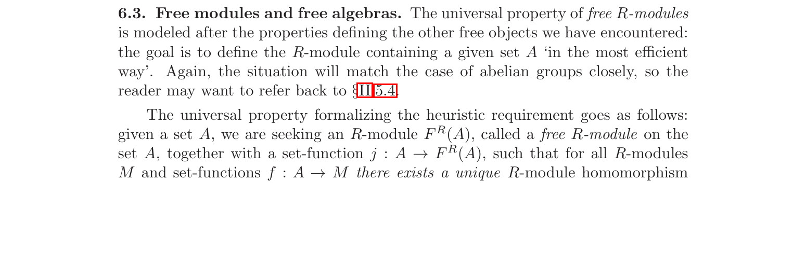
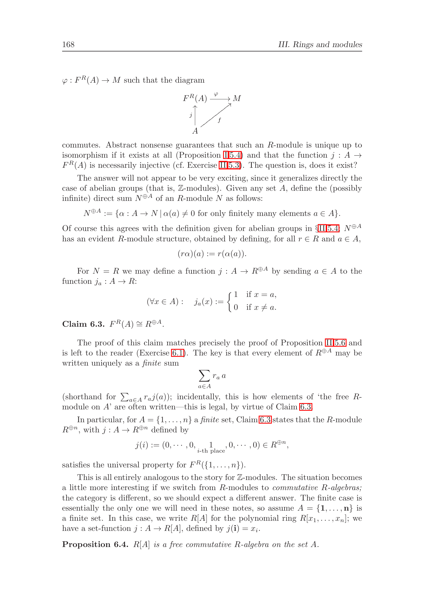
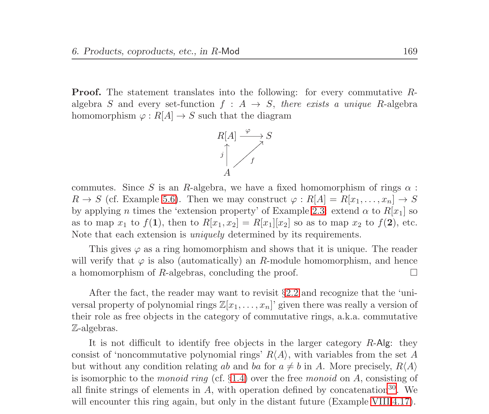

# III 6.3. Free modules and free algebras｜自由对象怎样由允许的运算决定

[阅读目录](README.md) · [上一小节](09-III-6.2.md) · [下一小节](11-III-6.4.md)

**本节总任务：给定一批名字，造出只满足模公理、没有额外线性关系的对象；再看换成代数范畴时，允许的运算改变了，为什么自由对象也要改变。**

## 原书第 167 页：原文底本

完整保留本小节在此页的原文；PDF 阅读器页码为 190。原书习题区不在本次范围。

## 第 167 页句读：先说目的，再逐步展开

### 一、“自由”先用映射要求表达，而不是凭外观判断

**这段在干什么：**解释本节开头的泛性质为何允许对生成元任意指定像。

给一个集合 $A$，其中元素先只是标签。希望有 $j:A\to F_R(A)$，使任意模 $M$、任意集合函数 $f:A\to M$ 都唯一延拓成线性映射

$$
\Phi:F_R(A)\to M,\qquad \Phi\circ j=f.
$$

任意指定像意味着标签之间不能预先添加某条额外关系。例如若强行让 $2j(a)=0$，映到 $\mathbb Z$ 时就不能任取 $f(a)=1$。这会违反泛性质。

唯一延拓又要求自由对象里每个元素能由这些标签和模运算确定，不能另藏一批与生成元无关、映射还可随意选择的元素。

所以“没有多余关系”和“没有多余元素”在这个泛性质中同时受到约束。接下来不是再添加定义，而是找一个确实满足它的构造。

## 原书第 168 页：原文底本

完整保留本小节在此页的原文；PDF 阅读器页码为 191。原书习题区不在本次范围。

## 第 168 页句读：先说目的，再逐步展开

### 二、为什么自由模用有限支撑函数造，而不是所有函数？

**这段在干什么：**解释 $R^{\oplus A}$ 的成员及其与形式线性组合的关系。

一个元素可写成函数 $\alpha:A\to R$，只在有限多个标签上非零。把 $\alpha(a)=r_a$，就可等价写成有限形式和

$$
\sum_{a\in A}r_a e_a.
$$

$e_a$ 是在位置 $a$ 为 1、其他位置为 0 的函数。有限支撑保证每个元素真是有限线性组合，而不是未经定义的无穷和。

例如 $A=\{u,v,w,\ldots\}$，元素 $2e_u-3e_w$ 记录 $u$ 位置系数 2、$w$ 位置系数 $-3$。标签可无限，单个元素仍只使用有限部分。

逐点加法与标量乘法使它成为模。若 $\sum r_ae_a=0$，看每个坐标就得到所有 $r_a=0$；这解释“自由”对应的唯一表达。

这里通常取非零环。若 $R$ 为零环，保幺模只有零模，自由对象仍存在，但 $A\to0$ 不一定单射。原文说 $j$ 必单射时，需要这项非退化条件，不能把它当对零环也无例外的结论。

### 三、Claim III.6.3：存在、线性、唯一各由什么保证？

**这段在干什么：**补全作者省略的自由模泛性质证明。

给任意 $f:A\to M$，唯一期望的公式是

$$
\Phi\left(\sum_a r_ae_a\right)=\sum_a r_af(a).
$$

**有定义。**每次只有有限项，并且坐标表达唯一，不会因另一种表达得到另一输出。

**线性。**两个输入相加时系数逐项相加，分配律给输出相加；左乘 $s$ 后，系数为 $sr_a$，于是输出为 $\sum(sr_a)f(a)=s\sum r_af(a)$。

**延拓。**代入 $e_a$ 就得到 $\Phi(e_a)=f(a)$。

**唯一。**任何线性映射若在每个 $e_a$ 上取 $f(a)$，对任意有限组合都必须按上式取值，无处再作选择。

因此 $F_R(A)\cong R^{\oplus A}$。抽象泛性质与具体函数模型完成对接。

### 四、有限自由模为什么就是 Rⁿ，而有限生成模未必自由？

**这段在干什么：**解释本页有限集合特例，并预防下一节的常见误判。

$A=\{1,\ldots,n\}$ 时，一切函数都自动有限支撑，得到 $R^n$，$e_i$ 就是标准坐标向量。任意线性映射由这 $n$ 个向量的像唯一决定。

但“有 $n$ 个生成元”只保证表达存在，不保证唯一。$\mathbb Z/2\mathbb Z$ 由 $[1]$ 生成，却有 $2[1]=0$，所以不同整数系数给同一元素，不能成为自由 $\mathbb Z$-模。

因此模理论不能把向量空间里“从生成集删去冗余得到基”的结论无条件搬来。额外关系可能无法通过简单删除生成元消失。

### 五、自由交换代数为什么是多项式环，而不是 Rⁿ？

**这段在干什么：**解释 Proposition III.6.4 提出的问题为什么变了。

模只允许加法与标量乘法，因此从标签 $a,b$ 造出的元素是 $ra+sb$ 等线性组合。

代数还允许对象内部相乘，于是必须包含 $a^2,ab,b^3$ 等新元素。若要求交换，便由交换多项式记录，得到 $R[x_1,\ldots,x_n]$。

换了范畴，态射还得保乘法；自由对象自然不同。“在一个集合上自由生成”并没有脱离范畴的唯一固定答案。

## 原书第 169 页：原文底本

完整保留本小节在此页的原文；PDF 阅读器页码为 192。原书习题区不在本次范围。

## 第 169 页句读：先说目的，再逐步展开

### 六、Proposition III.6.4：为什么任意指定变量像就唯一得到代数同态？

**这段在干什么：**把本页延拓证明写成明确公式，并说明系数像已经是对象数据。

固定交换环 $R$ 和交换 $R$-代数 $\alpha:R\to S$。给变量的任意像 $b_1,\ldots,b_n\in S$，定义

$$
\Phi\left(\sum_{\nu}r_\nu x_1^{\nu_1}\cdots x_n^{\nu_n}\right)
=\sum_\nu\alpha(r_\nu)b_1^{\nu_1}\cdots b_n^{\nu_n}.
$$

每个多项式只有有限项，所以计算合法。加法显然保；乘法由 $S$ 的交换性保证可按相同指数合并；1 保住；系数 $r$ 被送为 $\alpha(r)$。

因此 $\Phi$ 是环同态。还要核对标量：$\Phi(rp)=\Phi(r)\Phi(p)=\alpha(r)\Phi(p)=r\Phi(p)$，所以它确实保固定 $R$ 作用，是代数同态。唯一性来自每个多项式都由系数和变量经加乘构成，这些像一旦定好就全部定好。

原文逐个延拓变量，与上面一次写出公式是同一件事。前者强调构造过程，后者方便直接看每个多项式的像。

### 七、若目标代数不交换，为什么普通多项式环不够自由？

**这段在干什么：**解释作者末尾引入 $R\langle A\rangle$ 的动机，而不另展开完整构造理论。

普通多项式环内 $xy=yx$。若将 $x,y$ 任意送到非交换目标里的矩阵 $B,C$，环同态就会迫使 $BC=CB$，而任意矩阵未必满足。这说明普通多项式环只适合相应交换目标。

若希望不限制变量像彼此交换，就必须把 $xy$ 与 $yx$ 保留为不同的词。用所有有限词作基，乘法为连接词，得到非交换多项式环 $R\langle A\rangle$；空词作 1。

它和自由群的“词”相似，但没有自动逆元，也没有 $aa^{-1}$ 消去。作者这里只预告以后会再用，知道构造为何需要改变就够。

### 八、本节分级与推导总结

**这段在干什么：**把不同自由对象的运算权限与泛性质一一对齐。

| 知识点与定位 | 等级 | 为什么重要 | 应达到的程度 |
|---|---|---|---|
| 自由模泛性质，pp167–168 | A | 此后生成、表示、提升都依赖 | 清楚对象、集合映射、唯一下降箭头 |
| Claim III.6.3，p168 | A | 把抽象对象具体化 | 从有限支撑构造延拓并检验唯一 |
| 自由与有限生成区别 | A | 模理论不同于域上线性代数的关键 | 区分存在表达与唯一表达 |
| Proposition III.6.4，pp168–169 | A | 多项式环在代数范畴里的角色 | 根据变量像写出唯一同态 |
| 非交换自由代数，p169 | C | 后章结构入口 | 知道为什么需要保留词序 |

一句推导总结：给定标签以后，先看允许加、乘、标量中的哪些运算，再造只受这些公理约束的形式表达；泛性质证明所有赋值都能且只能以一种方式延拓。

---

[阅读目录](README.md) · [上一小节](09-III-6.2.md) · [下一小节](11-III-6.4.md)
