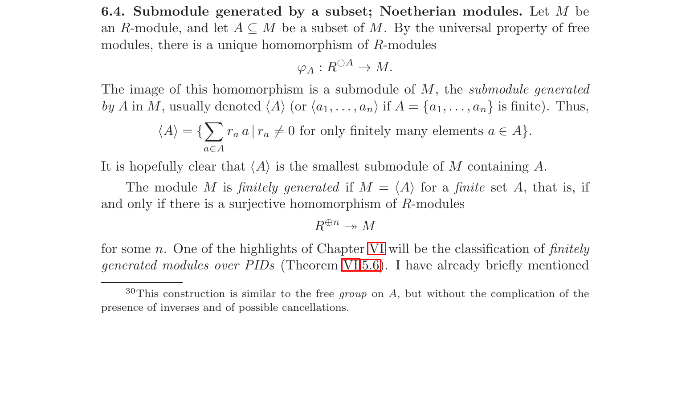
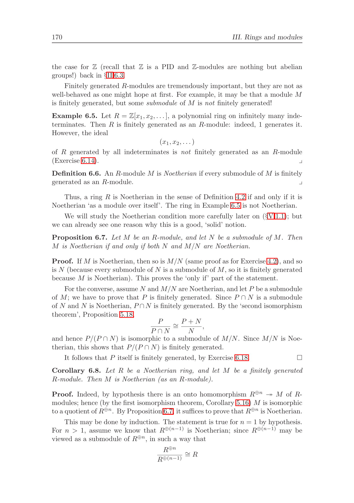
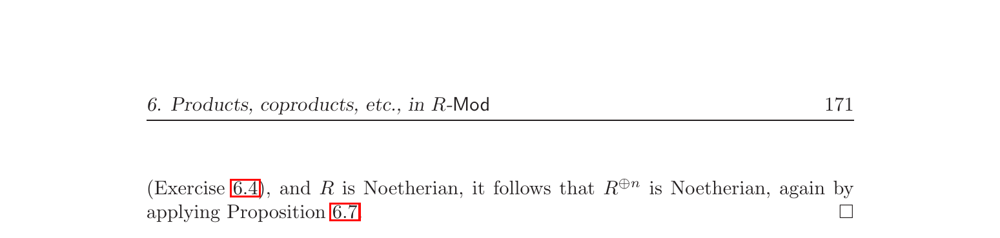

# III 6.4. Submodule generated by a subset; Noetherian modules｜生成元与 Noetherian 性质

[阅读目录](README.md) · [上一小节](10-III-6.3.md) · [下一小节](12-III-6.5.md)

**本节总任务：把自由模映到一个已有模，取得生成子模；再问有限生成是否能对子模与商稳定。**Noetherian 条件正是为控制这项稳定性出现的。

## 原书第 169 页：原文底本

完整保留本小节在此页的原文；PDF 阅读器页码为 192。原书习题区不在本次范围。

## 第 169 页句读：先说目的，再逐步展开

### 一、为什么生成子模是自由模映射的像？

**这段在干什么：**解释作者不是重新凭空定义线性组合，而是在使用前节的泛性质。

给子集 $A\subseteq M$。已有包含集合映射 $A\to M$，自由模性质给唯一线性映射

$$
\varphi_A:R^{\oplus A}\to M,\qquad
\sum r_ae_a\longmapsto\sum r_aa.
$$

它的像就是所有由 $A$ 作有限线性组合得到的元素，记为 $\langle A\rangle$。

像是子模，因此这套线性组合自动形成子模。任意包含 $A$ 的子模都必须包含所有这种有限组合，所以它又是最小的。这里“像的构造”与“最小封闭子对象”给同一个结果。

例如在 $\mathbb Z^2$，由 $(2,0),(0,3)$ 生成的是全部 $(2a,3b)$，不是整个 $\mathbb Z^2$。若换底环为 $\mathbb Q$ 并放在 $\mathbb Q^2$ 中，它们却能生成全部空间。生成问题仍依赖标量来源。

### 二、有限生成为什么等价于某个 Rⁿ 满射到 M？

**这段在干什么：**将生成元语言换成映射语言，为后面的证明准备可使用的箭头。

若 $M$ 由 $m_1,\ldots,m_n$ 生成，定义

$$
F:R^n\to M,\qquad(r_1,\ldots,r_n)\mapsto\sum r_im_i.
$$

生成的意思正是任意元素都能这样写，所以 $F$ 满射。反过来，若给这样的满射，每个元素都来自某个坐标列，由线性可用 $F(e_1),\ldots,F(e_n)$ 生成。

因此“有限生成”不要求映射单射。核记录生成元间的关系；自由 $R^n$ 与它的商可能很不一样。这是以后有限表示与关系矩阵的入口，但这里先不额外展开后章理论。

## 原书第 170 页：原文底本

完整保留本小节在此页的原文；PDF 阅读器页码为 193。原书习题区不在本次范围。

## 第 170 页句读：先说目的，再逐步展开

### 三、Example III.6.5：为什么全模一个生成元，子模却可能要无限多个？

**这段在干什么：**把原文反例的真正障碍证明出来，不用有限维向量空间直觉代替判断。

取 $R=\mathbb Z[x_1,x_2,\ldots]$。作为自身模，$1$ 就生成全部 $R$。但理想 $I=(x_1,x_2,\ldots)$ 不有限生成。

假设它由有限多项式 $f_1,\ldots,f_s$ 生成。这些多项式总共只使用有限多个变量，设在 $x_1,\ldots,x_N$ 内（可重排标签）。

把这些变量全部设零，其他变量保留。每个 $f_i$ 都在 $I$，没有纯整数常数项，所以全部变零。因此它们生成的任意组合也变零。

但 $x_{N+1}\in I$ 在这个代入下仍为 $x_{N+1}\ne0$，矛盾。

要注意不能只说“系数含不到新变量”，因为乘上任意 $R$ 元素本来就可能带新变量。正确证明是选择一个环同态，让有限生成元同时消失，却让漏掉的变量不消失。

### 四、Noetherian 模比有限生成多要求了什么？

**这段在干什么：**解释 Definition III.6.6 的全称量词及它与前面 Noetherian 环的关系。

有限生成只看 $M$ 自己。Noetherian 模要求 $M$ 的**每一个子模**都有限生成，包括 $M$ 自身。

因此 Noetherian 模一定有限生成，反向刚才的 $R$ 例子已经否定。对交换环 $R$，自身的子模正是理想，所以 $R$ 是 Noetherian 环，当且仅当 $R$ 作为自身模 Noetherian。

这不是两套偶然同名的概念，而是一般模块条件在正则模 $R$ 上的特例。

### 五、Proposition III.6.7 的正向：为什么子模与商都继承 Noetherian？

**这段在干什么：**把“显然继承”和“同上一道证明”展开成可检查构造。

设 $M$ Noetherian，$N\subseteq M$。任意 $N$ 的子模也是 $M$ 的子模，因此有限生成，故 $N$ Noetherian。

对 $M/N$ 中任意子模 $Q$，取逆像 $P\subseteq M$。$P$ 有有限生成元 $p_1,\ldots,p_s$。投影后的 $\bar p_1,\ldots,\bar p_s$ 生成 $Q$：因为每个 $Q$ 元素都有 $P$ 中原像，可先在线性组合里表达再投影。

因此商也 Noetherian。商的有限生成元从原像里取出，不是从商里无凭据地猜。

### 六、III.6.7 的反向：怎样把商里生成的部分与核里残留的部分拼起来？

**这段在干什么：**补出原文留给其他地方的有限生成拼合步骤，是全节最重要的证明方法。

设 $N$ 与 $M/N$ 都 Noetherian。任取子模 $P\subseteq M$，要证明它有限生成。

第一步，$P\cap N$ 是 $N$ 的子模，所以由有限个 $u_1,\ldots,u_s$ 生成。

第二步，$\pi(P)\subseteq M/N$ 是子模，所以由有限个像 $\pi(p_1),\ldots,\pi(p_t)$ 生成，可取 $p_i\in P$。

第三步，给任意 $p\in P$，在商里先表达

$$
\pi(p)=\sum_{i=1}^t r_i\pi(p_i).
$$

把表达提回 $P$，差值 $p-\sum r_ip_i$ 的像为零，所以在 $N$；它又在 $P$，因此落在 $P\cap N$。再写成 $\sum s_ju_j$。

于是

$$
p=\sum r_ip_i+\sum s_ju_j.
$$

这证明有限个 $p_i,u_j$ 生成 $P$。注意不是说商生成元随意提回就已生成全部，而是还必须补上核中残留的生成元。

原文用第二同构定理识别 $P/(P\cap N)\cong(P+N)/N$，与这里写 $\pi(P)$ 是同一结构。

### 七、Corollary III.6.8：Noetherian 环为什么能控制所有有限生成模？

**这段在干什么：**把有限自由模与上一命题连起来，解释结论中底环条件不可省。

若 $M$ 有限生成，存在 $R^n\twoheadrightarrow M$。只要 $R^n$ Noetherian，它的商 $M$ 也 Noetherian。

怎样证明 $R^n$？$n=1$ 就是底环假设。归纳时嵌入 $R^{n-1}$ 为前 $n-1$ 个坐标，其商为最后一个坐标的 $R$。子模与商都 Noetherian，由刚才命题推出 $R^n$ Noetherian。

再经满射取商，得到 $M$ 的结论。整个证明只用了“有限自由模先控制，再控制其商”，没有假设所有有限生成模都自由。

## 原书第 171 页：原文底本

完整保留本小节在此页的原文；PDF 阅读器页码为 194。原书习题区不在本次范围。

## 第 171 页句读：先说目的，再逐步展开

### 八、这一页证明的收尾：有限生成、Noetherian、自由三者别串线

**这段在干什么：**收束上页归纳，并用三种不同性质说明能推什么、不能推什么。

原文开头完成 $R^n/R^{n-1}\cong R$ 的归纳，因此得：在 Noetherian 环上，有限生成模自动 Noetherian，子模也随之有限生成。

但自由不在这个蕴含中。例如 $\mathbb Z/2\mathbb Z$ 有限生成，而且因 $\mathbb Z$ Noetherian 也 Noetherian，却不是自由整数模。

另一方面，若底环不 Noetherian，即使自由、甚至仅一个生成元的模 $R$，仍可能有不有限生成的子模，正是 Example III.6.5。

所以必须分别问：表达是否存在有限生成？表达是否唯一自由？所有子模是否也能有限生成？

### 九、本节分级与推导总结

**这段在干什么：**突出“先在商中解决、再处理核中差值”的可迁移方法。

| 知识点与定位 | 等级 | 为什么重要 | 应达到的程度 |
|---|---|---|---|
| 生成子模与自由模像，p169 | A | 把生成元问题换成同态问题 | 会写映射与最小性证明 |
| 有限生成与 $R^n$ 满射 | A | 后文关系、表示的入口 | 分清满射与同构 |
| Example III.6.5，p170 | B | 纠正子空间直觉 | 理解用代入同态击破有限生成假设 |
| Definition III.6.6 | A | 有限性的重要稳定条件 | 说清“所有子模”的量词 |
| Proposition III.6.7 | B | 核与商拼合的典型证明 | 读懂并能恢复“先投影、提回、补差值” |
| Corollary III.6.8，pp170–171 | A/B | 结论后面频繁使用 | 会用结论，并指出底环假设及归纳结构 |

---

[阅读目录](README.md) · [上一小节](10-III-6.3.md) · [下一小节](12-III-6.5.md)
