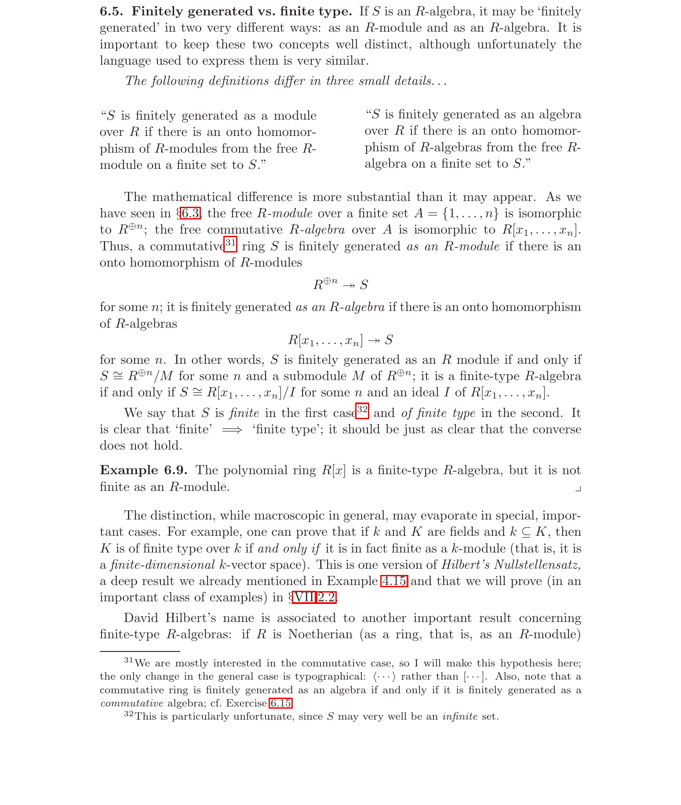
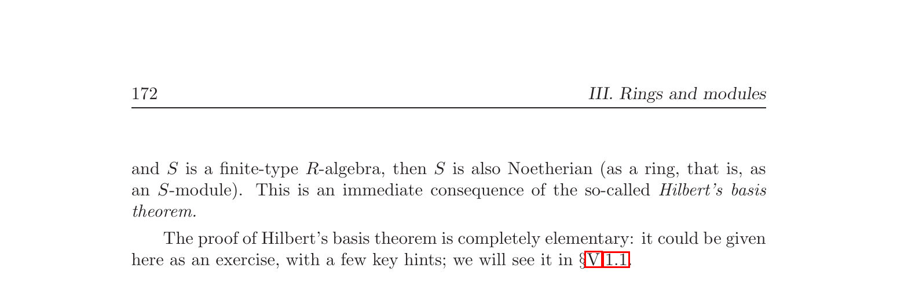

# III 6.5. Finitely generated vs. finite type｜模的有限生成与代数的有限型

[阅读目录](README.md) · [上一小节](11-III-6.4.md) · [下一小节](13-III-7.1.md)

**本节总任务：区分“只靠有限次线性组合生成”和“允许任意加乘生成”。**名字都含有限，允许的表达式却不同，结果可能相差无穷多个独立方向。

## 原书第 171 页：原文底本

完整保留本小节在此页的原文；PDF 阅读器页码为 194。原书习题区不在本次范围。

## 第 171 页句读：先说目的，再逐步展开

### 一、作者说两种定义只差三个字眼，真正差的是哪类运算？

**这段在干什么：**逐字翻译本页并排的定义，不把 module 与 algebra 当成可替换名词。

固定交换 $R$-代数 $S$。作为模有限生成，是说有 $s_1,\ldots,s_n$，每个元素都可写为

$$
r_1s_1+\cdots+r_ns_n,\qquad r_i\in R.
$$

生成元自身不能因此自动相乘出新的方向。系数只来自 $R$，不能偷偷改成来自整个 $S$。

作为代数有限生成，则允许把 $s_i$ 作任意有限次加、乘，并使用系数：

$$
\sum_{\nu}r_\nu s_1^{\nu_1}\cdots s_n^{\nu_n}.
$$

固定有限个生成元，次数仍可任意高。于是一个代数生成元可能提供无限多个模方向。

### 二、为什么对应的满射分别来自 Rⁿ 和 R[x₁,…,xₙ]？

**这段在干什么：**把两种生成概念放回自由对象的泛性质。

模的自由对象只提供线性组合，所以有满线性映射 $R^n\twoheadrightarrow S$，当且仅当有限模生成。

交换代数的自由对象提供全部多项式，所以有满代数同态

$$
R[x_1,\ldots,x_n]\twoheadrightarrow S
$$

当且仅当有限代数生成。第一同构定理于是分别将 $S$ 写成自由模的商与多项式环的商。

作者把第一种叫 **finite**，第二种叫 **finite type**。finite 不是说 $S$ 作为集合只有有限个元素；$\mathbb Z$ 作为自身模由 1 生成，仍是无限集合。

### 三、为什么 finite 推出 finite type，反向却不行？

**这段在干什么：**证明两种有限性的关系，并展开 Example III.6.9。

若 $s_1,\ldots,s_n$ 已作为模生成 $S$，包含它们及系数环的子代数必包含每个线性组合，所以已经是 $S$。故 finite 推出 finite type。

反例取非零环 $R$ 上的 $R[x]$。作为代数，一个 $x$ 就生成全部多项式；作为 $R$-模，不能只用有限个固定多项式。

假设模生成元为 $f_1,\ldots,f_t$，次数都不超过 $d$。系数从 $R$ 来，任意 $\sum r_if_i$ 的次数仍至多 $d$，所以不能得到 $x^{d+1}$，矛盾。这里要求 $R\ne0$，确保这个高次单项式非零。

对照 $\mathbb Q(\sqrt2)$：由 $1,\sqrt2$ 作 $\mathbb Q$-线性组合即可表达全部元素，所以它 finite，也 finite type。关系 $(\sqrt2)^2=2$ 让高次幂降回两个方向。

### 四、为什么“作为域只需一个生成元”也不能替代 finite type？

**这段在干什么：**为本页关于域的预告澄清另一个易混概念。

有理函数域 $\mathbb Q(t)$ 作为域由 $t$ 生成，允许对任意非零多项式求逆。但作为代数，有限生成只允许加乘，不能因目标恰是域就免费把所有逆元加入表达式。

事实上 $\mathbb Q(t)$ 不是有限型 $\mathbb Q$-代数。若由有限个有理函数生成，将它们分母相乘记为非零 $Q(t)$，它们加乘所得分母都可写成 $Q(t)$ 的幂。

选一个有理数 $a$ 使 $Q(a)\ne0$。那么 $1/(t-a)$ 不可能写成 $P(t)/Q(t)^N$：否则 $Q(t)^N=(t-a)P(t)$，代入 $a$ 矛盾。因此有限个分母无法提供整个函数域的所有逆元。

这项补充不是新习题，而是在解释“生成时准许哪些运算”为什么决定结论。

### 五、为什么一旦底环和目标都是域，两种有限性又可能合并？

**这段在干什么：**准确阅读作者的深结果预告，避免把一般反例误认为矛盾。

作者说：若 $k\subseteq K$ 都是域，而且 $K$ 作为 $k$-代数有限型，则实际上是有限维 $k$-向量空间。这是常称 Zariski 引理、与 Nullstellensatz 相连的重要结论。

它不适用于 $k[x]$，因为 $k[x]$ 不是域；也不被 $k(t)$ 推翻，因为刚才说明 $k(t)$ 不是有限型代数。

反方向“有限维就有限型”已由 finite 推 finite type 得到。难点在另一方向，本节不证明，原书也明确留待后章。当前记清假设与它解决的障碍即可。

## 原书第 172 页：原文底本

完整保留本小节在此页的原文；PDF 阅读器页码为 195。原书习题区不在本次范围。

## 第 172 页句读：先说目的，再逐步展开

### 六、Hilbert 基定理的预告：Noetherian 是相对哪个环说的？

**这段在干什么：**解释页首括号特别强调的 “as an S-module”。

若 $R$ Noetherian，$S$ 是有限型 $R$-代数，则 $S$ 作为环也 Noetherian。这来自 Hilbert 基定理与取商稳定性，后面会证明。

它说的是 $S$ 的每个理想作为 **S-模** 有限生成，不是说 $S$ 作为 **R-模** 有限生成或 Noetherian。

例如域 $k$ Noetherian，$k[x]$ 也 Noetherian 环；但 $k[x]$ 作为 $k$-向量空间无限维，连自己都不有限生成，当然不可能是 Noetherian $k$-模。

这说明同一个对象加上不同标量环，性质可以改变。看到“有限”“Noetherian”要连同“相对谁”一起读。

### 七、本节分级与推导总结

**这段在干什么：**把相近术语还原成不同表达式权限。

| 知识点与定位 | 等级 | 为什么重要 | 应达到的程度 |
|---|---|---|---|
| finite / finite type，p171 | A | 域论与几何中频繁出现 | 分别写自由模、自由代数的满射 |
| Example III.6.9，p171 | A | 最直接反例 | 用最高次数上界证明不有限模生成 |
| field generation 与 algebra generation 的区分 | B | 连接后续域扩张 | 知道逆元是否是允许生成运算 |
| 域情形的 Nullstellensatz 预告 | C | 后章重要目标 | 保存“目标也是域、有限型”的条件 |
| Hilbert 基定理预告，pp171–172 | C | 有限型环的结构保障 | 不提前证明，先分清 S-模与 R-模 |

模生成只准线性组合；代数生成额外准相乘；域生成再准求逆。相似词语背后，真正要检查的是这三套不同的运算权限。

---

[阅读目录](README.md) · [上一小节](11-III-6.4.md) · [下一小节](13-III-7.1.md)
