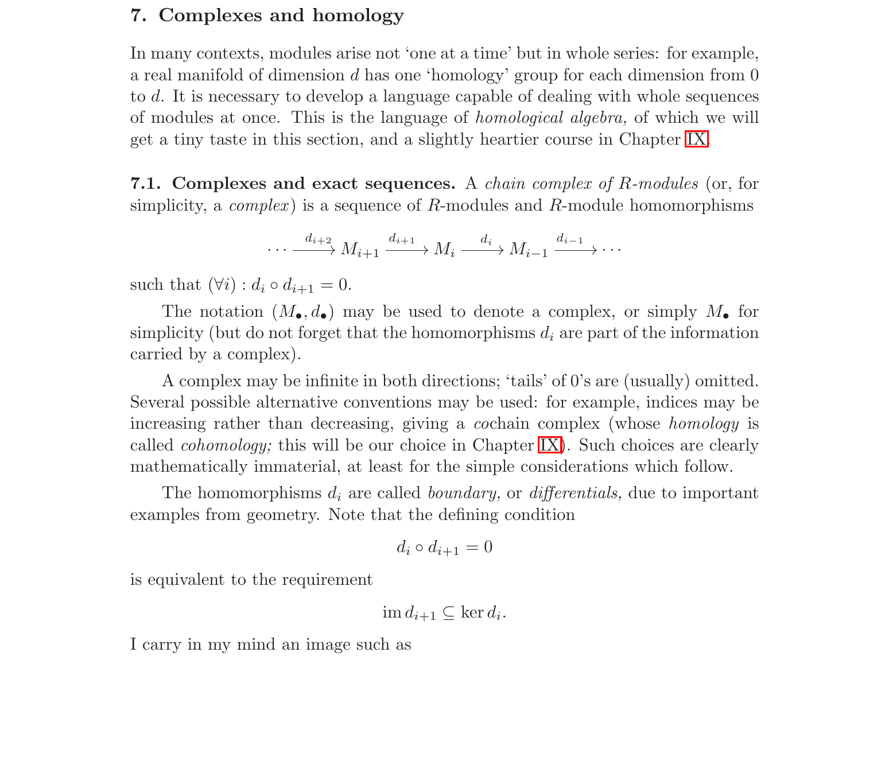
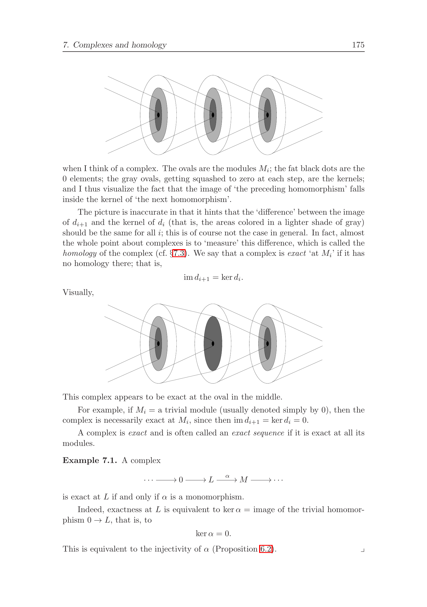
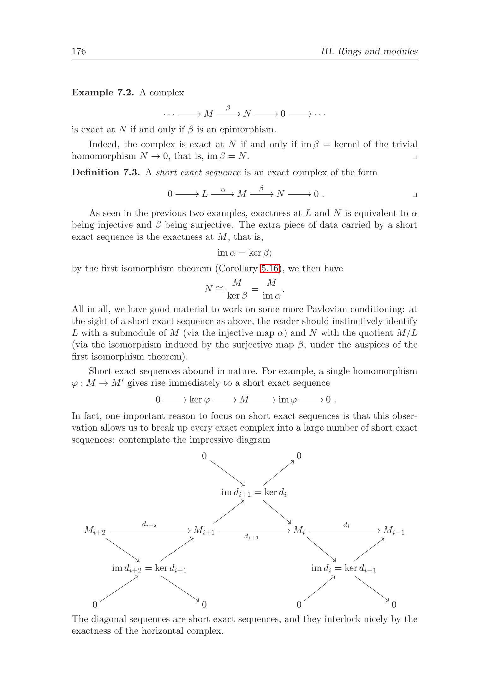
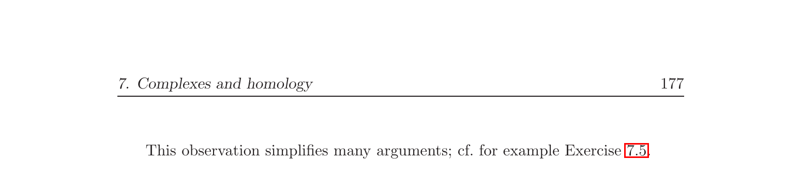

# III 7.1. Complexes and exact sequences｜从复合为零走到正合列

[阅读目录](README.md) · [上一小节](12-III-6.5.md) · [下一小节](14-III-7.2.md)

**本节总任务：不再只研究一条同态，而研究一整串模与映射；先要求相邻两步复合为零，再区分只是包含与恰好相等。**正合与同调都从这项差别开始。

## 原书第 174 页：原文底本

完整保留本小节在此页的原文；PDF 阅读器页码为 197。原书习题区不在本次范围。

## 第 174 页句读：先说目的，再逐步展开

### 一、为什么需要复形，而不只是继续研究核与像？

**这段在干什么：**解释 §7 导言如何从单个对象走向一串相互约束的对象。

许多问题在每个次数都有一个模，次数之间还有映射。这些模不是互不相干的名单：前一步的输出会进入后一步，并且常满足“再走一步变零”。

作者用

$$
\cdots\longrightarrow M_{i+1}
\xrightarrow{d_{i+1}}M_i
\xrightarrow{d_i}M_{i-1}\longrightarrow\cdots
$$

描述这种数据，并要求 $d_i d_{i+1}=0$。这叫链复形。映射也是数据的一部分；只列出各个 $M_i$，没有决定一个复形。

注意这里指标沿箭头下降。另一些书让指标上升，叫上链复形；符号会变化，核心关系仍是相邻复合为零。

### 二、复合为零为什么等于像包含在下一个核中？

**这段在干什么：**把定义翻译成一个可逐元素检查的包含关系。

若 $x=d_{i+1}(y)$ 来自前一步，便有

$$
d_i(x)=d_i(d_{i+1}(y))=0.
$$

因此 $\operatorname{im}d_{i+1}\subseteq\ker d_i$。反过来，若这个包含对所有前一步输出成立，复合自然处处为零。

所以复形说的是：**所有“刚从左边来”的元素，都会被下一步送成零。**但下一步的核里，可能还有不是左边来的元素。定义没有排除这些额外元素。

这就是下一页要观察的差距，不要提前把“复形”当成“正合”。

## 原书第 175 页：原文底本

完整保留本小节在此页的原文；PDF 阅读器页码为 198。原书习题区不在本次范围。

## 第 175 页句读：先说目的，再逐步展开

### 三、正合：下一个核里是否恰好全是上一步来的？

**这段在干什么：**解释原文灰色示意图与 exact at $M_i$ 的含义。

在 $M_i$ 处正合，要求更强的等式

$$
\operatorname{im}d_{i+1}=\ker d_i.
$$

除了“左边来的都到零”，还要求“到零的都能从左边找到原像”。这是两个包含，缺一不可。

给具体例子：$M_i=\mathbb Z^2$，让前一步的像是横轴 $\mathbb Z(1,0)$，下一步为零映射。复合为零当然成立，但下一步的核是全部 $\mathbb Z^2$，不是横轴，所以不正合。

若把下一步改成取第二坐标 $d_i(a,b)=b$，核恰为横轴，便在这个位置正合。

这说明是否正合既依赖对象，也依赖映射怎样放置；同一批模换箭头就可能改变。

### 四、为什么作者说要“测量差别”，却不能直接取集合差？

**这段在干什么：**为同调的商结构准备动机，解释图像只是辅助而非定义。

核与像都是子模，且像包含于核。集合差 $\ker d_i\setminus\operatorname{im}d_{i+1}$ 一般不含零，也不对加法封闭，不能保持模结构。

以后会取商 $\ker d_i/\operatorname{im}d_{i+1}$：把来自前一步的那部分当作零，保存其他核元素之间的加法、标量关系。这比只数一个“空隙有多大”精确。

原书图中的灰环只是帮助辨认核中额外部分；不同次数的差距可以完全不同，也不真是一个平面面积。

### 五、Example III.7.1：前面放一个零，为什么就编码单射？

**这段在干什么：**把 $0\to L\xrightarrow{\alpha}M$ 在 $L$ 处的正合条件展开。

$0\to L$ 的像只有零。若在 $L$ 正合，就要求 $\ker\alpha=\{0\}$，等价于 $\alpha$ 单射。

因此零不是可随便省掉的装饰，它指定前一步像为零，从而把单射性编码进整串等式。

若 $M_i=0$，则在那里无论两边映射怎样，像与核都只能为零，所以自动正合。但这不代表相邻非零模处也自动正合。

## 原书第 176 页：原文底本

完整保留本小节在此页的原文；PDF 阅读器页码为 199。原书习题区不在本次范围。

## 第 176 页句读：先说目的，再逐步展开

### 六、Example III.7.2：后面放一个零，为什么编码满射？

**这段在干什么：**解释与上一页镜像的 $M\xrightarrow{\beta}N\to0$。

$N\to0$ 把全部 $N$ 送成零，核是整个 $N$。在那里正合便要求 $\operatorname{im}\beta=N$，即满射。

一个零控制的是核，另一个零控制的是像。掌握这两次翻译，就不会把箭头端点的 0 当作省略号。

### 七、短正合列究竟比“左边单、右边满”多给了什么？

**这段在干什么：**解释 Definition III.7.3 的三处条件，并读出它描述的结构。

对

$$
0\longrightarrow L\xrightarrow{\alpha}M
\xrightarrow{\beta}N\longrightarrow0,
$$

正合要求：$\alpha$ 单射；$\beta$ 满射；并且 $\operatorname{im}\alpha=\ker\beta$。

前两项没有自动保证第三项。例如嵌入 $\mathbb Z\to\mathbb Z^2$ 为横轴，同时投影到第一坐标，分别单、满，但复合不为零，当然不是这条短正合列。

有第三项后，可用 $\alpha$ 将 $L$ 识别为 $M$ 的子模，再由第一同构定理得到

$$
N\cong M/\alpha(L).
$$

所以短正合列在说：中间对象含一份 $L$，把它合并成零以后，得到 $N$。

但这还没有说 $M\cong L\oplus N$，更没给怎样线性地选出 $N$ 的代表。下一小节“分裂”会补上这项额外要求。

### 八、为什么每条同态都自带一条短正合列？

**这段在干什么：**解释作者如何把单个映射的核—像数据装进短正合语言。

给 $f:M\to M'$，把目标先缩为 $\operatorname{im}f$，便有

$$
0\to\ker f\hookrightarrow M\twoheadrightarrow\operatorname{im}f\to0.
$$

包含单射、缩目标后的映射满射，中间核正是 $\ker f$，所以逐项正合。

若原来有长正合复形，在每个 $M_i$ 也可写

$$
0\to\ker d_i\to M_i\to\operatorname{im}d_i\to0.
$$

长列正合使 $\ker d_i$ 与上一段像相同，于是这些短列可以连接。书中的大图是在展示这项拼接，不要求读者把箭头画得复杂当成理解本身。

## 原书第 177 页：原文底本

完整保留本小节在此页的原文；PDF 阅读器页码为 200。原书习题区不在本次范围。

## 第 177 页句读：先说目的，再逐步展开

### 九、本节分级与推导总结

**这段在干什么：**在进入分裂之前，先固定三个不同强度的条件。

| 知识点与定位 | 等级 | 为什么重要 | 应达到的程度 |
|---|---|---|---|
| 链复形与 $d_id_{i+1}=0$，p174 | A | 同调能够定义的前提 | 与像含于核双向转换 |
| 在某处正合，p175 | A | 比复合为零更强 | 说清“所有被杀掉的都从前一步来” |
| 两端零与单、满，pp175–176 | A | 读正合图的基本语法 | 逐位置算像与核 |
| Definition III.7.3，p176 | A | 将子对象与商统一编码 | 不漏中间等式，不误推出直和 |
| 长列拆短列的图，pp176–177 | B | 复用局部结构 | 会写每段核—像短列并说明如何相接 |

强度依次是：复合为零仅有包含；正合要求相等；短正合再指定两端单满。下节的分裂还要更强，不能在这里提前获得。

---

[阅读目录](README.md) · [上一小节](12-III-6.5.md) · [下一小节](14-III-7.2.md)
