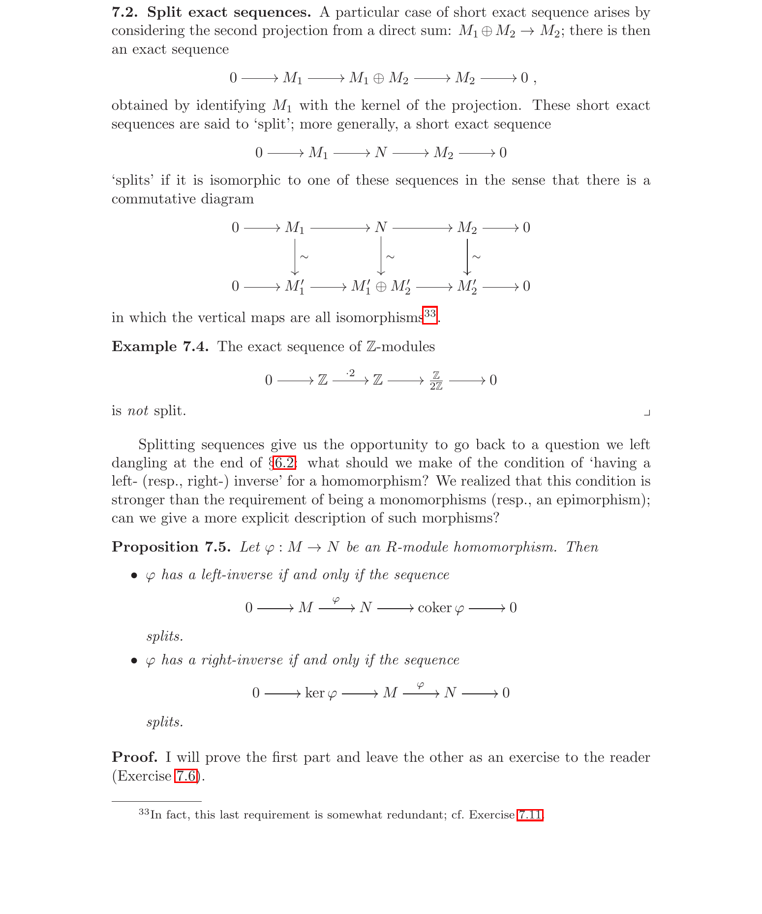
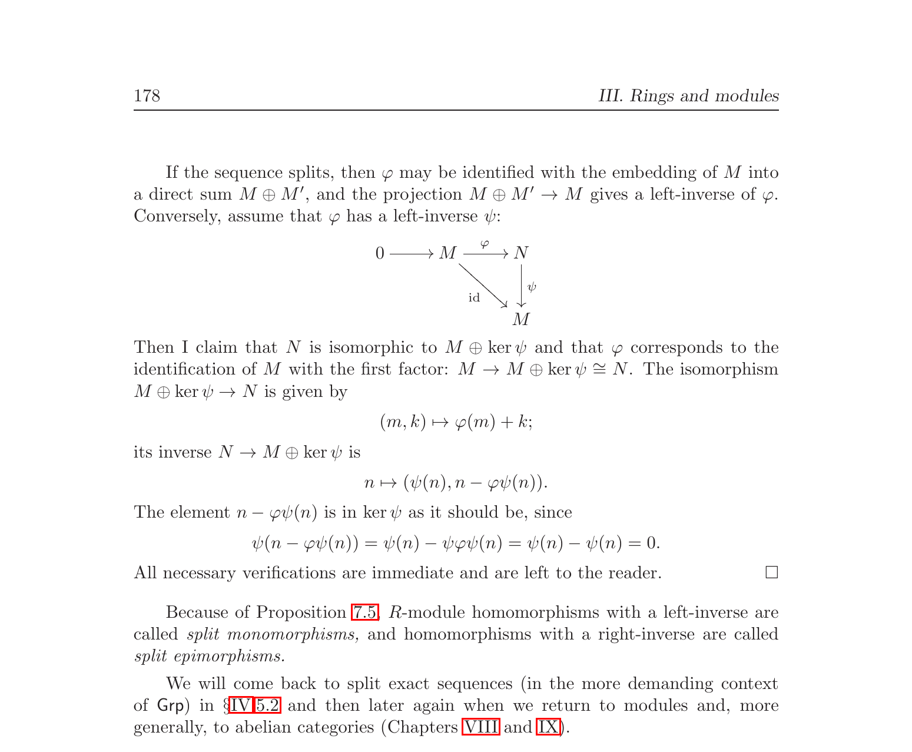

# III 7.2. Split exact sequences｜分裂意味着能按同态规则拆回两部分

[阅读目录](README.md) · [上一小节](13-III-7.1.md) · [下一小节](15-III-7.3.md)

**本节总任务：判断短正合列中的中间模，能否按既定箭头真正拆成左右两部分。**关键不是单纯选代表元，而是选得与加法、标量都相容。

## 原书第 177 页：原文底本

完整保留本小节在此页的原文；PDF 阅读器页码为 200。原书习题区不在本次范围。

## 第 177 页句读：先说目的，再逐步展开

### 一、为什么直和总给一条短正合列？

**这段在干什么：**从最容易拆开的模型出发，解释本节“split”的标准样子。

取 $M_1\oplus M_2$，嵌入 $i(m_1)=(m_1,0)$，投影 $p(m_1,m_2)=m_2$。有

$$
0\to M_1\xrightarrow{i}M_1\oplus M_2\xrightarrow{p}M_2\to0.
$$

$i$ 单射，$p$ 满射；$p$ 的核是第二分量为零的元素，恰为 $i(M_1)$，所以短正合。

它特别容易拆，是因为每个元素已经以唯一方式给出两部分。第一部分能直接取出，第二部分也有自然代表 $(0,m_2)$。

一般短正合列只有“含一个子模且商为另一个模”，并未提供这种线性坐标。若能通过与原箭头相容的同构化成上式，才叫分裂。

### 二、Example III.7.4：为什么整数的模 2 序列不分裂？

**这段在干什么：**说明正合不等于直和，并用一个结构不变量直接看出障碍。

序列

$$
0\to\mathbb Z\xrightarrow{\times2}\mathbb Z
\xrightarrow{\pi}\mathbb Z/2\mathbb Z\to0
$$

确实短正合：左图像是偶数，右图核也正是偶数。

若分裂，中间 $\mathbb Z$ 会与 $\mathbb Z\oplus\mathbb Z/2\mathbb Z$ 同构。但右边有非零元素 $(0,[1])$，两倍等于零；左边整数没有这种元素。因此不可能。

也可看代表元选择。若线性选择 $s([1])=n$，应有 $2n=s(2[1])=s(0)=0$，所以 $n=0$，不能代表奇数类。选 1 作代表只能是集合选择，不能保持加法。

这个反例正是在告诉我们：域上线性代数常见的补空间并不在任意环模中自动存在。

### 三、Proposition III.7.5：左逆、右逆与分裂分别对应什么？

**这段在干什么：**先列出要证明的准确条件，再看下一页的构造。

给 $f:M\to N$。左逆是 $g:N\to M$ 满足 $gf=\operatorname{id}_M$；它使 $f$ 必单射。命题说，这等价于 $M$ 能作为 $N$ 的一个直和分量，剩余部分对应余核。

右逆是 $s:N\to M$ 满足 $fs=\operatorname{id}_N$；它使 $f$ 必满射。命题说，这等价于能从每个目标元素线性地选一个原像，于是 $M$ 拆成核和一份 $N$。

不是“单就有左逆、满就有右逆”，而是多有这个逆映射时才叫 split mono、split epi。上一例说明差别确实存在。

还要留意：分裂的是包含箭头的数据的整列。同构需和嵌入、投影相容，不能随便给一个抽象对象同构就不检查图。

## 原书第 178 页：原文底本

完整保留本小节在此页的原文；PDF 阅读器页码为 201。原书习题区不在本次范围。

## 第 178 页句读：先说目的，再逐步展开

### 四、有左逆时，怎样从 N 中剥离出 M？

**这段在干什么：**逐项验证原文给的两个互逆映射，并说明剩余项为何在核中。

设 $gf=\operatorname{id}_M$。对任意 $n\in N$，先用 $g$ 取出它的 $M$ 部分，再送回 $N$，得到 $fg(n)$。余下

$$
k=n-fg(n)
$$

满足 $g(k)=g(n)-gfg(n)=0$，所以落在 $\ker g$。

于是定义

$$
H:N\to M\oplus\ker g,\quad
n\mapsto(g(n),\,n-fg(n)),
$$

以及

$$
F:M\oplus\ker g\to N,\quad
(m,k)\mapsto f(m)+k.
$$

两者线性，因为都由线性映射、和、差构成。检查复合：

$$
F(H(n))=fg(n)+n-fg(n)=n.
$$

对 $k\in\ker g$，有

$$
H(F(m,k))=
(gf(m)+g(k),\,f(m)+k-fg(f(m)+k))
=(m,k).
$$

因此 $N\cong M\oplus\ker g$。在这个同构下，$f(m)$ 对应 $(m,0)$，所以与原嵌入相容。

反向若已经有这样的直和分解，取第一坐标再经同构返回，就给 $f$ 的左逆。这完成当且仅当，而不是只证明一个方向。

### 五、有右逆时，怎样把 M 拆成核与目标？

**这段在干什么：**补上原文未展开的镜像构造，使“线性选原像”成为实际分解。

设 $fs=\operatorname{id}_N$。对 $m\in M$，$s(f(m))$ 是按固定规则选回的一份代表，而

$$
m-sf(m)\in\ker f
$$

因为 $f(m-sf(m))=f(m)-fsf(m)=0$。

定义

$$
H(m)=(m-sf(m),\,f(m))\in\ker f\oplus N,
$$

$$
F(k,n)=k+s(n).
$$

直接算 $FH(m)=m$，而

$$
HF(k,n)=(k+s(n)-sf(k+s(n)),\,f(k+s(n)))=(k,n).
$$

所以 $M\cong\ker f\oplus N$，原来的 $f$ 对应第二投影。反过来，直和中的嵌入 $n\mapsto(0,n)$ 给右逆。

这就是分裂的计算机制：**先按照目标选回一份，再用差值分离出核。**

### 六、在一般短正合列里，如何把两种说法放在一起？

**这段在干什么：**将上一页的定义与两个构造统一，而不只记逆映射方向。

设 $0\to A\xrightarrow{\alpha}B\xrightarrow{\beta}C\to0$。若有截面 $s:C\to B$ 满足 $\beta s=\operatorname{id}_C$，定义

$$
A\oplus C\to B,\qquad(a,c)\mapsto\alpha(a)+s(c).
$$

对任意 $b$，差值 $b-s\beta(b)$ 在 $\ker\beta=\operatorname{im}\alpha$，因此有唯一 $a$ 使它等于 $\alpha(a)$。这给逆映射，并显示分裂。

等价地，若有收缩 $r:B\to A$ 满足 $r\alpha=\operatorname{id}_A$，便用前一构造把 $B$ 拆成 $\alpha(A)$ 与 $\ker r$；$\beta$ 在后者上给到 $C$ 的同构。

这两种逆的选择可能不唯一，所以补分量一般也不是唯一的。分裂要求至少存在相容选择，不要求一个无需选择的标准分解。

### 七、为什么向量空间里的短正合列通常能分裂？

**这段在干什么：**把原有线性代数直觉放在正确条件下，并指向自由模的用途。

若右端 $C$ 是向量空间，选一组基，再为每个基向量在 $B$ 中选一个原像。因为基向量无额外线性关系，这些选择唯一线性延拓为 $s:C\to B$，且 $\beta s=\operatorname{id}_C$。

同样，右端若为自由模，也可用自由模泛性质完成这步。任意模却可能有关系，原像选择须保关系，未必做得到。$\mathbb Z/2$ 的 $2[1]=0$ 就造成阻碍。

所以自由对象的意义不只是“形式表达好看”，它使从满射中提升映射有了可能。完整投射模理论后面会系统研究。

### 八、本节分级与推导总结

**这段在干什么：**区分正合、不分裂与可线性拆分三种信息。

| 知识点与定位 | 等级 | 为什么重要 | 应达到的程度 |
|---|---|---|---|
| 分裂定义与 Example III.7.4，p177 | A | 防止把所有扩张当直和 | 说明需要箭头相容，复现整数障碍 |
| Proposition III.7.5，pp177–178 | A/B | 逆映射与结构分解的桥梁 | 判据会用，两个互逆构造读懂并可恢复 |
| 截面、收缩与差值分解 | A | 后面提升与同调不断使用 | 说明差值为什么落在核 |
| 自由模右端的提升解释 | B | 与前节自由泛性质相接 | 知道“任意赋值可延拓”解决了什么 |

正合告诉你子模和商是谁；分裂告诉你还能选择一套线性坐标将它们并排复原。缺失的是相容的选择，不是缺少集合上的代表元。

---

[阅读目录](README.md) · [上一小节](13-III-7.1.md) · [下一小节](15-III-7.3.md)
