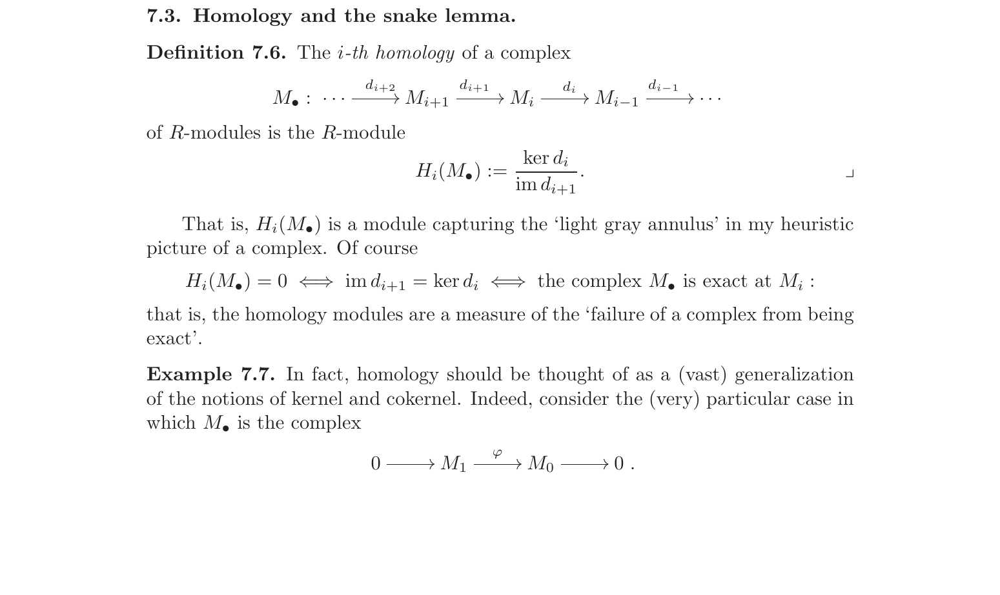
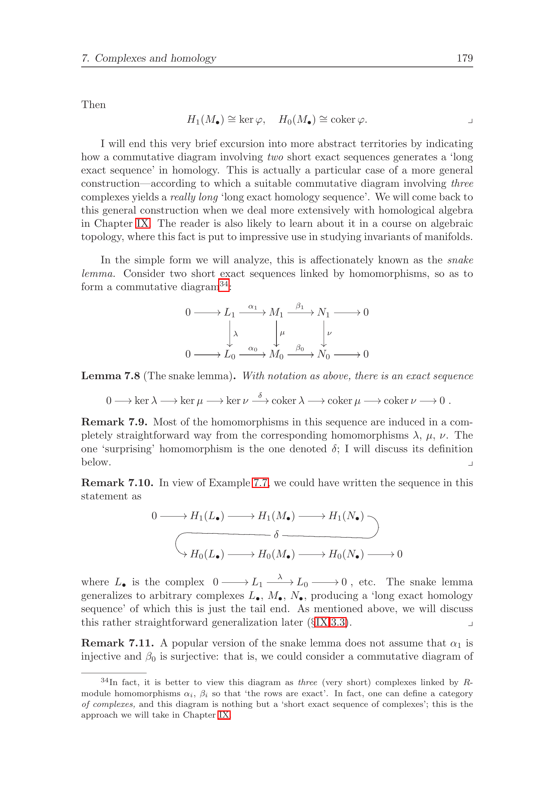
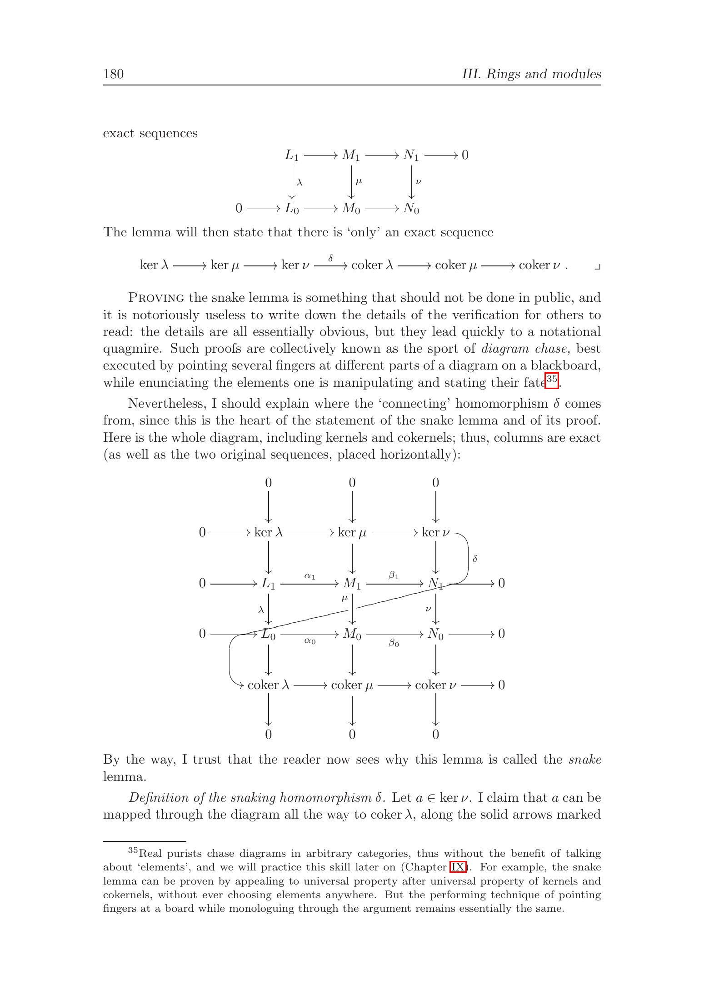
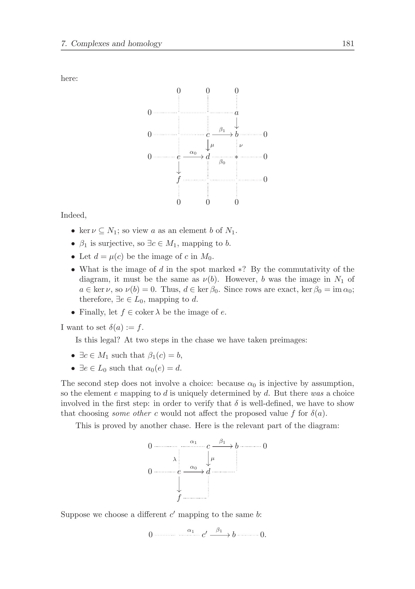
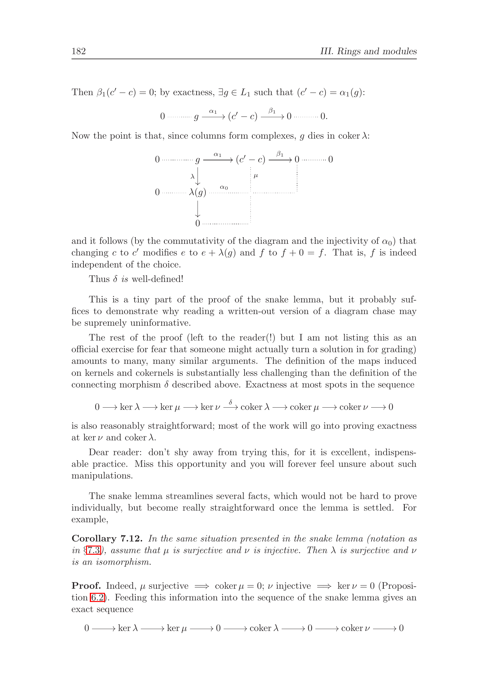
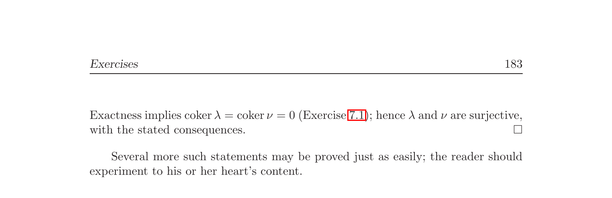

# III 7.3. Homology and the snake lemma｜同调怎样记录正合失败与连接障碍

[阅读目录](README.md) · [上一小节](14-III-7.2.md)

**本节总任务：把“复形没有正合的部分”保存为一个模，并说明两条短正合列之间的联系怎样产生新的连接映射。**最重要的并非蛇形图的外观，而是：一个原像选择为什么不能直接落在所需核里，以及取商怎样消掉选择造成的歧义。

## 原书第 178 页：原文底本

完整保留本小节在此页的原文；PDF 阅读器页码为 201。原书习题区不在本次范围。

## 第 178 页句读：先说目的，再逐步展开

### 一、Definition III.7.6：为什么同调必须是核除以像？

**这段在干什么：**从复形条件推出同调的合法性，并解释这个商想保留什么。

已有复形

$$
\cdots\to M_{i+1}\xrightarrow{d_{i+1}}M_i
\xrightarrow{d_i}M_{i-1}\to\cdots.
$$

核里是下一步会变零的元素，像里是上一步产生的元素。复合为零保证后者包含于前者，所以模商

$$
\boxed{H_i(M_\bullet)=\ker d_i/\operatorname{im}d_{i+1}}
$$

确实有定义。没有包含关系就不能这样取商。

为什么要商？因为希望将“只是从上一步来的”看成平凡，而保留其他仍被下一步杀掉的关系。两个核元素若相差一个上一步的像，就在同调中视为同一类。

这不是集合差，也不是简单比较两个集合大小。比如核与像都可能无限，但商仍可以是 $\mathbb Z/2$ 这样的有限非零对象。

$H_i=0$ 当且仅当所有核元素都来自上一步，即像等于核，也就是该处正合。于是同调将“是不是正合”升级为“若不正合，残留部分有什么代数结构”。

### 二、Example III.7.7：核与余核为什么是同调的特例？

**这段在干什么：**把新定义直接代进只有一条非零映射的复形。

考虑 $0\to M_1\xrightarrow{f}M_0\to0$，不要求它正合。

在次数 1，前一步像为零，故 $H_1=\ker f/0\cong\ker f$。在次数 0，下一步是零映射，核为整个 $M_0$，故

$$
H_0=M_0/\operatorname{im}f=\operatorname{coker}f.
$$

所以同调不是另造一个与核、余核无关的指标，而是让一整串映射在每个次数都能有类似的残留结构。

原文跨到下一页才写完这个例子，阅读时把两页连接成上述两次直接计算即可。

## 原书第 179 页：原文底本

完整保留本小节在此页的原文；PDF 阅读器页码为 202。原书习题区不在本次范围。

## 第 179 页句读：先说目的，再逐步展开

### 三、用三条边看见“边界的边界为零”和同调的区别

**这段在干什么：**为定义补一个可实际计算的图形模型，解释为什么几何里会出现这类复形。

取三个点 $v_1,v_2,v_3$ 与三条定向边 $e_{12},e_{23},e_{31}$。让 $C_1$ 是三条边自由生成的整数模，$C_0$ 是三个点自由生成的整数模。

定义边界

$$
d_1(e_{12})=v_2-v_1,\quad
d_1(e_{23})=v_3-v_2,\quad
d_1(e_{31})=v_1-v_3.
$$

三边之和 $z=e_{12}+e_{23}+e_{31}$ 的边界为零，各顶点相消。

若还填入一个三角面 $t$，定义 $d_2(t)=z$，便有 $d_1d_2(t)=0$。这就是这幅模型里的边界的边界为零。

算核：对 $ae_{12}+be_{23}+ce_{31}$，边界为

$$
(-a+c)v_1+(a-b)v_2+(b-c)v_3.
$$

为零当且仅当 $a=b=c$，故 $\ker d_1=\mathbb Zz$。

若只有边框、没有面，前一步像为零，$H_1=\mathbb Zz$；若有填面，$\operatorname{im}d_2=\mathbb Zz$，于是 $H_1=0$。

这个计算说明：核记录闭合的边组合；商掉面的边界，才能区分“闭合但没有填满”与“只是一个面的边界”。这里只用一个给定模型解释代数定义，不提前证明一般空间同调理论。

### 四、Lemma III.7.8 的图先读角色，不先追蛇

**这段在干什么：**固定两行、三列的对象与符号，明确引理试图联系哪些残留结构。

原图可重排为

$$
\begin{array}{ccccccccc}
0&\to&L_1&\xrightarrow{\alpha_1}&M_1&\xrightarrow{\beta_1}&N_1&\to&0\\
&&\downarrow\lambda&&\downarrow\mu&&\downarrow\nu\\
0&\to&L_0&\xrightarrow{\alpha_0}&M_0&\xrightarrow{\beta_0}&N_0&\to&0.
\end{array}
$$

两行都短正合；方块交换。顶行的下标是 1，底行是 0。每个竖直映射都可看成一个两项复形，所以有各自的核与余核。

引理说这些信息不是分散的六个对象，而可接成正合列：

$$
0\to\ker\lambda\to\ker\mu\to\ker\nu
\xrightarrow{\delta}\operatorname{coker}\lambda
\to\operatorname{coker}\mu
\to\operatorname{coker}\nu\to0.
$$

前三个核之间的映射沿顶行走，后三个余核之间的映射由底行下降。唯一需要新构造的是从右上核绕到左下余核的 $\delta$。

### 五、哪些映射直接就能写出？为什么它们合法？

**这段在干什么：**展开 Remark III.7.9 的 “straightforward”，把简单箭头与真正难点分开。

对 $l\in\ker\lambda$，$\mu\alpha_1(l)=\alpha_0\lambda(l)=0$，所以 $\alpha_1$ 限制为 $\ker\lambda\to\ker\mu$。

对 $m\in\ker\mu$，$\nu\beta_1(m)=\beta_0\mu(m)=0$，所以 $\beta_1$ 限制为 $\ker\mu\to\ker\nu$。

余核方向定义

$$
[l]\longmapsto[\alpha_0(l)],\qquad
[m]\longmapsto[\beta_0(m)].
$$

第一个若改变 $l$ 为 $l+\lambda(a)$，输出变化 $\alpha_0\lambda(a)=\mu\alpha_1(a)$，在余核 $\operatorname{coker}\mu$ 中为零，因此良定义。第二个同样用 $\beta_0\mu=\nu\beta_1$。

这些检查都只需交换性与“除去对应像”。连接箭头 $\delta$ 不能直接如此限制或投影，所以作者专门追踪原像。

## 原书第 180 页：原文底本

完整保留本小节在此页的原文；PDF 阅读器页码为 203。原书习题区不在本次范围。

## 第 180 页句读：先说目的，再逐步展开

### 六、连接映射先问什么问题：能否把一个核元素提到另一个核里？

**这段在干什么：**为 $\delta$ 的路线建立目的，不把反向找原像当成机械游走。

给 $a\in\ker\nu\subseteq N_1$。顶行 $\beta_1$ 满射，所以能找到 $c\in M_1$ 使 $\beta_1(c)=a$。

我们真正希望找到的，是同时满足 $\mu(c)=0$ 的原像，也就是 $c\in\ker\mu$。这样 $a$ 才来自前一个核。

任意选的 $c$ 未必满足。它的 $\mu(c)$ 就是当前选择的“偏差”。方块交换给

$$
\beta_0(\mu(c))=\nu(\beta_1(c))=\nu(a)=0.
$$

所以偏差不是任意的，它在 $\ker\beta_0=\operatorname{im}\alpha_0$，能由左下角某个 $e\in L_0$ 表达：

$$
\alpha_0(e)=\mu(c).
$$

问题于是转化：能否调整 $c$，让这个偏差消失？下一页的商类会恰好记录这件事。

### 七、为什么偏差最后要放进 coker λ，而不是直接记为 e？

**这段在干什么：**解释连接箭头的目标为何被选择独立性强迫出来。

若给 $c$ 加上 $\alpha_1(g)$，它仍映到相同 $a$，因为 $\beta_1\alpha_1=0$。但偏差变成

$$
\mu(c+\alpha_1(g))
=\alpha_0(e)+\alpha_0(\lambda(g))
=\alpha_0(e+\lambda(g)).
$$

所以新的左下元素是 $e+\lambda(g)$。$e$ 自己依赖原像选择，不能直接拿它当确定答案。

取余核 $\operatorname{coker}\lambda=L_0/\operatorname{im}\lambda$ 后，这项差别正好被除去。因此合理候选是

$$
\boxed{\delta(a)=e+\operatorname{im}\lambda.}
$$

这和商环良定义的逻辑相同：先说明允许选择怎样变化，再把选择造成的差别恰好消掉。不是随手选一个余核来让图画成蛇。

Remark III.7.11 还说，若不要求最左顶行单射、最右底行满射，仍有中间版本，但两端不能随意写 0。外侧单满条件正控制两端是否额外正合。

## 原书第 181 页：原文底本

完整保留本小节在此页的原文；PDF 阅读器页码为 204。原书习题区不在本次范围。

## 第 181 页句读：先说目的，再逐步展开

### 八、正式走完原像路线：每一步根据哪项假设？

**这段在干什么：**逐步落实作者列出的追图，并区分“存在原像”与“存在逆函数”。

从 $a\in\ker\nu$ 开始：

1. 将它看作 $N_1$ 的元素，这只是子模包含。
2. 因 $\beta_1$ 满，取 $c\in M_1$ 使 $\beta_1(c)=a$。这里可能有多种选择。
3. 沿 $\mu$ 得到 $d=\mu(c)\in M_0$。
4. 由方块交换和 $\nu(a)=0$，得 $\beta_0(d)=0$。
5. 底行正合使 $d\in\operatorname{im}\alpha_0$，取 $e$ 使 $\alpha_0(e)=d$。
6. 底行 $\alpha_0$ 单射，所以这个 $e$ 对已选 $c$ 是唯一的。
7. 取 $[e]\in L_0/\operatorname{im}\lambda$。

反向沿一条满射找原像，不是在宣称这条映射可逆。整套定义的难点正是第 2 步的选择是否影响第 7 步结果。

### 九、一个非零连接映射的具体计算

**这段在干什么：**让 $\delta$ 不只是一串抽象符号，并展示同一个类换代表时怎样相消。

取顶行为

$$
0\to\mathbb Z\xrightarrow{\times2}\mathbb Z
\xrightarrow{\bmod2}\mathbb Z/2\mathbb Z\to0,
$$

底行为 $0\to\mathbb Z\xrightarrow{\mathrm{id}}\mathbb Z\to0\to0$。三列取 $\lambda=\times2,\ \mu=\mathrm{id},\ \nu=0$。两个方块交换。

现在 $\ker\nu=\mathbb Z/2$，$\operatorname{coker}\lambda=\mathbb Z/2$。对 $a=[1]$，选顶行中间原像 $c=1$；沿 $\mu$ 仍为 1；沿底行恒等映射反向取 $e=1$；最后 $\delta([1])=[1]$。

若换 $c=3$，就取到 $e=3$，但模 2 后仍是 $[1]$。因此这幅图的连接映射实际是恒等，而不总是零映射。

它还说明障碍的含义：$[1]$ 虽在 $\ker\nu$，却不能找到 $\ker\mu=0$ 中的原像。非零的 $\delta([1])$ 正在记录这项失败。

## 原书第 182 页：原文底本

完整保留本小节在此页的原文；PDF 阅读器页码为 205。原书习题区不在本次范围。

## 第 182 页句读：先说目的，再逐步展开

### 十、怎样证明换任意原像都不会改变 δ？

**这段在干什么：**完整复现原书连接映射良定义的关键证明。

设 $\beta_1(c)=\beta_1(c')=a$。则 $c'-c\in\ker\beta_1=\operatorname{im}\alpha_1$，所以存在 $g\in L_1$ 使

$$
c'-c=\alpha_1(g).
$$

对应的 $e,e'$ 满足 $\alpha_0(e)=\mu(c)$、$\alpha_0(e')=\mu(c')$。于是

$$
\alpha_0(e'-e)
=\mu(c'-c)
=\mu\alpha_1(g)
=\alpha_0\lambda(g).
$$

$\alpha_0$ 单射，推出 $e'-e=\lambda(g)$。两者在余核中为同一类，所以 $\delta$ 良定义。

线性也可随同证明。对 $a,a'$，分别选原像 $c,c'$，便可选 $c+c'$ 作 $a+a'$ 的原像，对应左下值为 $e+e'$；对 $ra$ 选 $rc$，对应 $re$。因为结果不依赖选择，得到 $\delta(a+a')=\delta(a)+\delta(a')$ 与 $\delta(ra)=r\delta(a)$。

### 十一、为什么在 ker ν 处正合？这正是“偏差能否修掉”

**这段在干什么：**证明蛇列最关键的一个位置，并解释连接映射的零值意味着什么。

若 $a=\beta_1(c)$ 且 $c\in\ker\mu$，追图时可取 $e=0$，所以 $\delta(a)=0$。因此来自前一个核的元素都在 $\ker\delta$。

反过来，若 $\delta(a)=0$，取任意原像 $c$ 及相应 $e$。零商类意味着 $e=\lambda(g)$。将原像调整为

$$
c_0=c-\alpha_1(g).
$$

它仍映到 $a$，而

$$
\mu(c_0)=\alpha_0(e)-\alpha_0\lambda(g)=0.
$$

所以 $c_0\in\ker\mu$，$a$ 真来自前一个核。由此

$$
\operatorname{im}(\ker\mu\to\ker\nu)=\ker\delta.
$$

这给 $\delta$ 最清楚的理解：**它衡量一个下游的核元素，能否提升为上游的核元素。**

### 十二、为什么在 coker λ 处正合？

**这段在干什么：**证明另一个关键连接处，而不是笼统说其余位置显然。

若 $[e]=\delta(a)$，追图有 $\alpha_0(e)=\mu(c)$，所以它在 $\operatorname{coker}\mu$ 中为零。故 $\operatorname{im}\delta$ 包含于下一箭头的核。

反过来，若 $[e]\in\operatorname{coker}\lambda$ 经 $\alpha_0$ 后为零类，则 $\alpha_0(e)=\mu(c)$ 对某个 $c\in M_1$ 成立。

令 $a=\beta_1(c)$。交换性给

$$
\nu(a)=\beta_0\mu(c)=\beta_0\alpha_0(e)=0,
$$

因此 $a\in\ker\nu$。按定义追图便得 $\delta(a)=[e]$，完成另一包含。

所以这个位置的正合也来自“已经在中间余核消失的东西，恰好是连接障碍产生的像”。

### 十三、剩余位置的正合与 Corollary III.7.12 怎样核对？

**这段在干什么：**把余下验证压缩为各自的关键步骤，并解释推论从何读出。

核列第一个箭头单射来自 $\alpha_1$ 单射。在 $\ker\mu$ 处，若 $\beta_1(m)=0$，写 $m=\alpha_1(l)$；再由 $0=\mu(m)=\alpha_0\lambda(l)$ 和 $\alpha_0$ 单射，得 $l\in\ker\lambda$。

在 $\operatorname{coker}\mu$ 处，若 $[m]$ 经 $\beta_0$ 成零，写 $\beta_0(m)=\nu(a)$。先由顶行满射提 $a=\beta_1(c)$，则 $m-\mu(c)\in\ker\beta_0=\operatorname{im}\alpha_0$。因此 $[m]$ 来自前一个余核。逆包含由两行复合为零直接得。

最后 $\operatorname{coker}\mu\to\operatorname{coker}\nu$ 满射，因为底行 $\beta_0$ 满射。至此蛇列全部位置都有根据，不只验证了连接箭头。

若再假设 $\mu$ 满、$\nu$ 单，就有 $\operatorname{coker}\mu=0,\ker\nu=0$。代进蛇列，正合迫使 $\operatorname{coker}\lambda=0$ 及 $\operatorname{coker}\nu=0$。所以 $\lambda$ 满，$\nu$ 又单又满成为同构，正是推论。

## 原书第 183 页：原文底本

完整保留本小节在此页的原文；PDF 阅读器页码为 206。原书习题区不在本次范围。

## 第 183 页句读：先说目的，再逐步展开

### 十四、本节分级与整章推导总结

**这段在干什么：**收束前页推论，并标出同调定义与蛇引理细节的不同学习深度。

原书正文在本页完成 Corollary III.7.12，随后进入习题。本注到正文结束为止，不收录习题区。

| 知识点与定位 | 等级 | 为什么重要 | 应达到的程度 |
|---|---|---|---|
| Definition III.7.6，p178 | A | 精确保存正合失败 | 说明为何能取商、为何不能取集合差 |
| Example III.7.7，pp178–179 | A | 将新概念接回核与余核 | 按次数直接算两项复形 |
| Lemma III.7.8，p179 | B | 组织核余核之间的信息 | 识别各箭头来源与所需正合条件 |
| $\delta$ 的动机、构造与良定义，pp180–182 | B | 是可复用的选择独立性方法 | 说清原像改变如何落进 $\operatorname{im}\lambda$ |
| 全序列各处追图验证 | C | 当前先看整体作用，后续使用时深化 | 本注已展开，可回查，不要求现在全部背诵 |
| Corollary III.7.12，pp182–183 | B | 示范从长正合列直接读性质 | 用零核、零余核代入，而非重新追一遍图 |

整章后半程可以连成一条清晰路线：生成理想描述关系 → 商环实现关系 → 素与极大由商判断 → 模统一子对象与商 → 自由模组织生成元 → 核余核安排映射残留 → 正合要求没有残留 → 同调用商保存残留 → 蛇引理解释两行结构怎样共同产生连接障碍。

---

[阅读目录](README.md) · [上一小节](14-III-7.2.md)
