# 《Algebra: Chapter 0》第三章注疏：从 §4 开始

[阅读说明与分节目录](README.md) · [全篇推导总结](review-map.md)

底本：Paolo Aluffi, Algebra: Chapter 0，Chapter III。本注从整个 §3 之后的 §4 开始，覆盖 §§4–7 的 15 个正文小节，不收录或讲解习题。原文以完整影印保留。每个句读先说明目的，再展开定义、例子与证明。

## 目录

- [III 4.1 理想的生成与运算](#part-01)

- [III 4.2 把多项式关系变成可计算的商环](#part-02)

- [III 4.3 用商理解素理想、极大理想与几何前景](#part-03)

- [III 5.1 从环作用出发定义模](#part-04)

- [III 5.2 模范畴、线性映射与代数](#part-05)

- [III 5.3 子模、商模与商的泛性质](#part-06)

- [III 5.4 模同态分解与同构定理](#part-07)

- [III 6.1 积与余积为什么由同一个直和实现](#part-08)

- [III 6.2 核、余核及单满性的范畴解释](#part-09)

- [III 6.3 自由对象怎样由允许的运算决定](#part-10)

- [III 6.4 生成元与 Noetherian 性质](#part-11)

- [III 6.5 模的有限生成与代数的有限型](#part-12)

- [III 7.1 从复合为零走到正合列](#part-13)

- [III 7.2 分裂意味着能按同态规则拆回两部分](#part-14)

- [III 7.3 同调怎样记录正合失败与连接障碍](#part-15)

# III 4.1. Basic operations｜理想的生成与运算

[阅读目录](README.md) · [下一小节](02-III-4.2.md)

**本节总任务：把“哪些子集是理想”推进成“怎样从少数元素造出理想，并计算理想之间的关系”。**你已读完 §3，这里只调用商环和同构定理，不重写前节。阅读顺序是：一个生成元 → 多个生成元 → 连续加关系 → 理想的和、交、积。

## 原书第 144 页：原文底本

完整保留本小节在此页的原文；PDF 阅读器页码为 167。原书习题区不在本次范围。

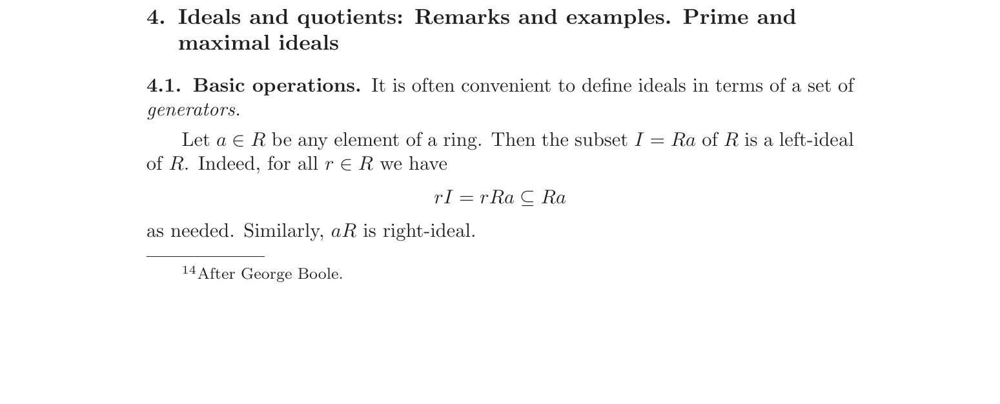

## 第 144 页句读：先说目的，再逐步展开

### 一、为什么首先写 Ra，而不是直接写“由 a 生成的理想”？

**这段在干什么：**从原文 “define ideals in terms of a set of generators” 出发，找出只给一个元素时必须补进哪些元素。

设大环为 $R$，指定一个元素 $a$。如果要造一个包含 $a$ 的左理想，仅放 $a$ 不够，因为左吸收要求：任意 $r\in R$ 乘上 $a$，结果仍在里面。

因此至少必须包含

$$
Ra=\{ra:r\in R\}.
$$

这个集合真是左理想吗？逐项检查：

1. 含零，因为 $0a=0$。
2. 对减法封闭，因为 $ra-sa=(r-s)a$。
3. 对大环任意左乘封闭，因为 $t(ra)=(tr)a$。

同时 $a=1a$ 在里面。若 $J$ 是任何包含 $a$ 的左理想，则全部 $ra$ 都在 $J$，因此 $Ra\subseteq J$。

**所以它不仅是一个可行左理想，而且是包含 a 的最小左理想。**“生成”表示补齐结构要求所强迫的元素，而不是任意扩大集合。

右理想同理为 $aR$。非交换时，两者可能不同；由 $a$ 生成的双边理想一般要允许有限和 $\sum r_i a s_i$，不能直接用 $Ra$ 代替。交换环中 $Ra=aR$，这才统一记为 $(a)$。

页底脚注 14 来自本页上方前节内容；这里只保留原页样貌，不把前节习题纳入本注。

## 原书第 145 页：原文底本

完整保留本小节在此页的原文；PDF 阅读器页码为 168。原书习题区不在本次范围。

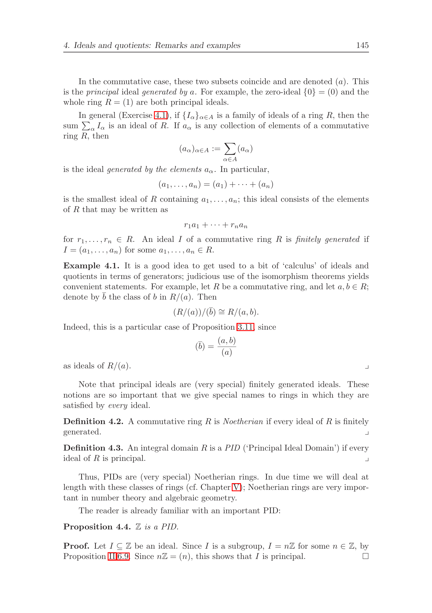

## 第 145 页句读：先说目的，再逐步展开

### 二、多个生成元：为什么是线性组合，而不是只收集它们的倍数？

**这段在干什么：**解释 $(a_1,\ldots,a_n)$ 的具体成员是什么，以及“最小”怎样证明。

从这里讨论交换环。若理想包含 $a_1,a_2$，它必须包含 $r_1a_1,r_2a_2$，又因加法封闭，必须包含它们的和。因此自然得到

$$
(a_1,\ldots,a_n)
=\{r_1a_1+\cdots+r_na_n:r_i\in R\}.
$$

这不是只取 $(a_1)\cup\cdots\cup(a_n)$。并集可能不对加法封闭，例如 $2\in(2)$、$3\in(3)$，但 $2+3=5$ 不在它们的并集中；生成理想却必须接住这个和。

证明最小性的模板是：

- 上述集合自己是理想，并包含所有 $a_i$。
- 任意包含所有 $a_i$ 的理想，都必须包含每一个有限线性组合。

所以这个集合包含于任何候选理想，正是最小那个。

生成元无限多时，也只允许**每个元素使用有限项**。环没有默认定义无穷级数，也没有默认拓扑让无穷和收敛。无限的是可选材料，不是每次表达式的长度。

### 三、Example 4.1：连续取商为什么等于一次加上两组关系？

**这段在干什么：**展开作者很快引用第三同构定理的地方，说明两个商环究竟怎样对应。

先在 $R$ 中令 $a=0$，得到 $R/(a)$。记 $b$ 在其中的像为 $\bar b$。再令 $\bar b=0$，得到 $(R/(a))/(\bar b)$。

从原环看，这等于同时要求 $a=0,b=0$，所以应当得到 $R/(a,b)$。但“看起来一样”还不是证明，我们构造映射：

$$
F:R\longrightarrow (R/(a))/(\bar b),
\qquad r\longmapsto (r+(a))+(\bar b).
$$

这是两次自然投影的复合，因此是满环同态。现在算核。$F(r)=0$，等价于在 $R/(a)$ 中有

$$
\bar r=\bar s\,\bar b
$$

对某个 $s\in R$ 成立。也就是 $r-sb\in(a)$，所以 $r=ta+sb$，即 $r\in(a,b)$。反过来，任何这种组合都会被两次投影杀掉。

因此 $\ker F=(a,b)$。第一同构定理给

$$
\boxed{(R/(a))/(\bar b)\cong R/(a,b).}
$$

比如整数里先模 6，再令 4 的类为零，得到 $\mathbb Z/(6,4)\cong\mathbb Z/2\mathbb Z$。新关系并不是“再模 4 所以模 24”；关系是相加生成一个理想。

### 四、Noetherian 与 PID：它们限制的是每一个理想，不只是环本身

**这段在干什么：**把 Definitions III.4.2–4.3 的量词展开，分清两种有限生成要求。

一个主理想只需一个生成元；一个有限生成理想允许有限多个。这两个条件不同。

Noetherian 环要求：**对环里的每一个理想，都能找到有限个生成元。**不同理想可以用不同数目的生成元，不要求全环有统一的数字上限。

PID 要求更强：环先是整环，而且每一个理想只需一个生成元。因此 PID 一定 Noetherian；反向不能直接推出。

特别不要说“$R$ 由 1 生成，所以 $R$ 是 Noetherian”。$R=(1)$ 只说明全环这个理想是主的，没有检查其他理想。

Proposition III.4.4 证明 $\mathbb Z$ 是 PID：任意理想先是加法子群，已知整数加法子群都是 $n\mathbb Z$，而 $n\mathbb Z=(n)$。这里作者真正复用的是群论已经获得的结构结论。

## 原书第 146 页：原文底本

完整保留本小节在此页的原文；PDF 阅读器页码为 169。原书习题区不在本次范围。

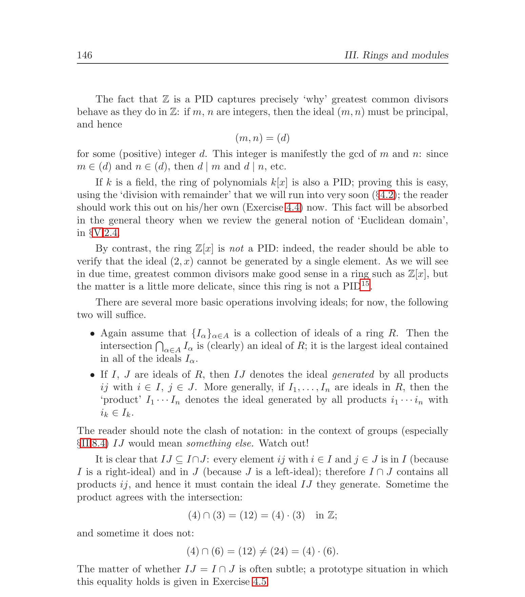

## 第 146 页句读：先说目的，再逐步展开

### 五、最大公因数为什么能写成一个理想的生成元？

**这段在干什么：**解释作者说 PID 捕捉了整数 gcd 行为的意思，并补出两个方向。

取两个不全为零的整数 $m,n$。因 $\mathbb Z$ 是 PID，

$$
(m,n)=(d)
$$

可取 $d>0$。因为 $m,n\in(d)$，有 $d\mid m,d\mid n$，所以 $d$ 是公因数。

另一方面 $d\in(m,n)$，因此存在整数 $u,v$ 使 $d=um+vn$。任意公因数 $c$ 都整除右边，故 $c\mid d$。这说明 $d$ 是最大公因数的整除意义版本，同时得到 Bézout 关系。

例如

$$
(12,18)=(6),\qquad 6=18-12.
$$

这里“最大”不是只比较大小，而是所有公因数都整除它。在一般整环中，整除语言比正负大小更稳妥。

### 六、为什么 k[x] 是 PID，而 Z[x] 未必？

**这段在干什么：**说明系数能否求逆怎样影响生成理想，防止把整数结论机械推广。

在域 $k$ 上，一个非零理想 $I\subseteq k[x]$ 有非零最低次数元素 $f$，可将它首项系数除成 1。任意 $g\in I$ 带余除以 $f$：

$$
g=qf+r,\qquad \deg r<\deg f.
$$

又因 $r=g-qf\in I$，若 $r\ne0$，就违背 $f$ 的最低次数选择。因此 $r=0$，所有 $g$ 都在 $(f)$，所以 $I=(f)$。

改成 $\mathbb Z[x]$，不能随意除首项系数。具体看 $I=(2,x)$。若 $I=(f)$，因 $2\in I$ 有 $2=fg$。在整环 $\mathbb Z[x]$ 中，次数相加迫使 $f$ 是常数。又因 $x\in I$，该常数整除 $x$ 的系数 1，只能为 $\pm1$。

这会推出 $I$ 是全环。但 $1\notin(2,x)$：若 $1=2u(x)+xv(x)$，令 $x=0$ 就得到 $1=2u(0)$，不可能。因此 $(2,x)$ 不是主理想。

这也说明：有 gcd，不自动代表能用同样的 Bézout 线性组合生成理想；后面 UFD、PID 的区别正在这里埋下伏笔。

### 七、交与积：为什么乘积必须允许有限和？

**这段在干什么：**逐项解释本页的两种理想运算及 $IJ\subseteq I\cap J$。

交 $I\cap J$ 收集同时在两者里的元素，所以仍满足减法和吸收条件。它是同时包含于 $I,J$ 的最大理想。

积 $IJ$ 却不是只取单个乘积 $ij$ 的集合，而是这些乘积生成的理想。对双边理想，它可具体写成有限和 $\sum i_kj_k$。单个乘积集合未必对加法封闭，必须补上有限和。

每个 $ij$ 在 $I$ 中，因为 $I$ 吸收右乘的 $j$；也在 $J$ 中，因为 $J$ 吸收左乘的 $i$。有限和仍同时在两者中，所以

$$
IJ\subseteq I\cap J.
$$

在整数里，

$$
(m)+(n)=(\gcd(m,n)),\quad
(m)\cap(n)=(\operatorname{lcm}(m,n)),\quad
(m)(n)=(mn)
$$

（取正生成元）。于是 $(4)\cap(6)=(12)$，但 $(4)(6)=(24)$，严格不同；$(4)\cap(3)=(12)=(4)(3)$。

原文提醒和群论符号冲突：群里的子群集合乘积与理想乘积不是同一种定义，不能见到相同字母就照搬。

### 八、本节分级与推导总结

**这段在干什么：**标出后续会反复调用的节点，而不是要求把全部例子等量背诵。

| 知识点与原书定位 | 等级 | 为什么重要 | 应达到的程度 |
|---|---|---|---|
| 生成理想、有限线性组合，pp144–145 | A | 以后所有关系与生成元计算都要用 | 会证明“自己合法且包含于所有候选” |
| Example III.4.1，p145 | A | 将连续取商翻译为加关系 | 会构造复合投影、算核 |
| Noetherian、PID，Definitions III.4.2–4.3 | B | 后面有专章展开 | 说清“每个理想”的量词，区分一个与有限个 |
| Proposition III.4.4 与 gcd，pp145–146 | A | 生成理想连接整除和 Bézout | 能复原两个方向 |
| 和、交、积，p146 | A | 决定后续商和包含计算 | 知道积含有限和，并会给积不等于交的例子 |

整条路线：从给定元素出发 → 补齐理想条件 → 生成元描述关系 → 用投影与核处理加关系 → 比较所有理想的生成方式 → 计算和、交、积。这里没有新增习题；上述证明与例子都用于解释原书正文。

---

[阅读目录](README.md) · [下一小节](02-III-4.2.md)

# III 4.2. Quotients of polynomial rings｜把多项式关系变成可计算的商环

[阅读目录](README.md) · [上一小节](01-III-4.1.md) · [下一小节](03-III-4.3.md)

**本节总任务：把“对一个多项式关系取商”变成能够实际加、减、乘的代数对象。**最重要的分界是：低次余式描述元素，但乘法必须先相乘再约化；它通常不是坐标逐项乘法。

## 原书第 146 页：原文底本

完整保留本小节在此页的原文；PDF 阅读器页码为 169。原书习题区不在本次范围。

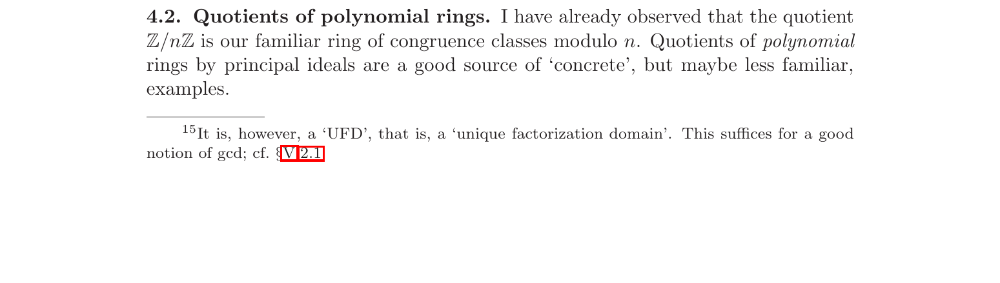

## 第 146 页句读：先说目的，再逐步展开

### 一、整数模 n 已熟悉，多项式模 f 要多做什么？

**这段在干什么：**解释本节开头为什么拿 $\mathbb Z/n\mathbb Z$ 作参照。

整数模 $n$ 时，每个整数都可用一个标准余数表示。例如模 5，12 与 2 代表同一类，因为相差 $2\cdot5$。运算时先算整数，再除去 5 的倍数。

现在把整数换成多项式，把 $n$ 换成 $f(x)$。希望用低次多项式代表一个类，并在乘法后除去 $f(x)$ 的倍数。

例如若要求 $x^2+1=0$，那么 $x^2$ 可替成 $-1$，高次幂便能反复降低。但这种替换要有统一、唯一的结果，否则不同算法可能给不同答案。下一页的首一条件和带余除法正是在解决这个问题。

## 原书第 147 页：原文底本

完整保留本小节在此页的原文；PDF 阅读器页码为 170。原书习题区不在本次范围。

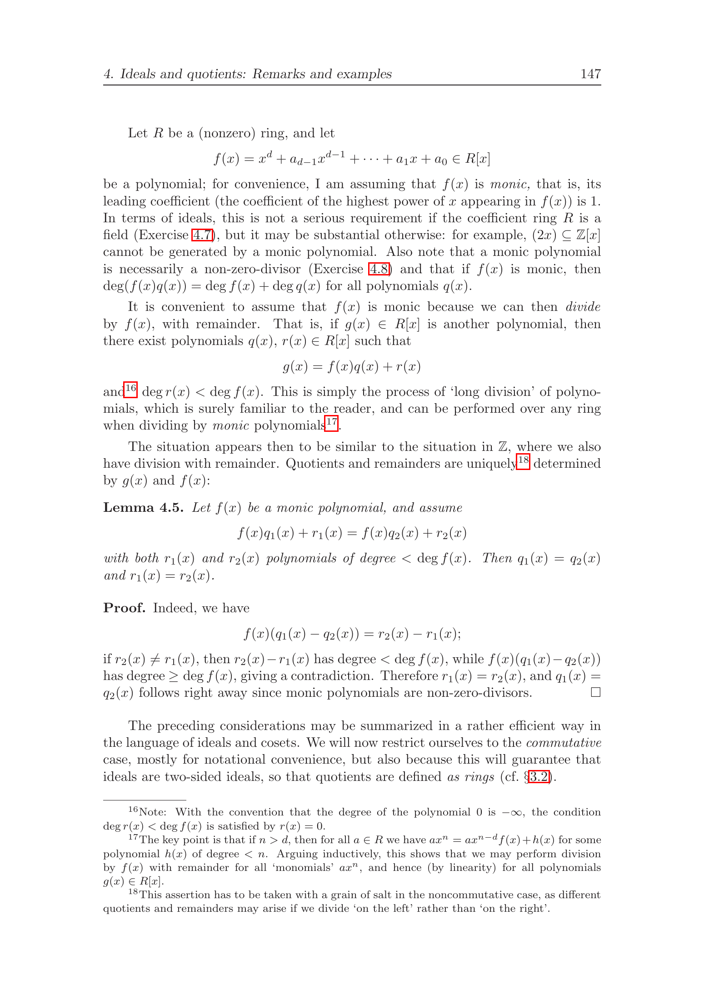

## 第 147 页句读：先说目的，再逐步展开

### 二、为什么作者要求 f 首一？

**这段在干什么：**说明首项系数为 1 为什么是长除法能在一般环上工作的重要条件。

设

$$
f(x)=x^d+a_{d-1}x^{d-1}+\cdots+a_0.
$$

要消去 $g$ 的最高项 $bx^n$，可以减去 $bx^{n-d}f(x)$，最高项恰好抵消。不需要除以任何系数。

若除数首项是 $2x^d$，消去 $x^n$ 就可能要用 $1/2$。在域里没问题，在 $\mathbb Z$ 里却不允许。因此“首一”不是为了排版整齐，而是避免要求系数环里本不存在的逆元。

在域 $k$ 中，任何非零多项式都可除以首项系数变首一，生成的理想不变，因为乘了一个单位。在 $\mathbb Z[x]$，$(2x)$ 却不能换成首一生成元。

### 三、带余除法怎样一步步得到低次代表？

**这段在干什么：**补出作者假定熟悉的长除法，并指出过程为什么会终止。

取 $f=x^2+1$、$g=x^4+2x^3+3x+5$。先减 $x^2f$：

$$
g-x^2f=2x^3-x^2+3x+5.
$$

再减 $2xf$：

$$
2x^3-x^2+3x+5-2xf=-x^2+x+5.
$$

最后减 $-f$，余下 $x+6$。因此

$$
g=(x^2+1)(x^2+2x-1)+(x+6).
$$

余式次数小于 2。每一步最高次数严格下降，不可能无限继续。这就说明为什么能得到 $g=fq+r$、$\deg r<d$。

这里先在交换环中算清楚；非交换环上需分左、右除法，原文脚注也明确提醒。接下来商环部分，作者正式限制为交换环。

### 四、Lemma III.4.5：为什么余式不会因消元顺序不同而改变？

**这段在干什么：**证明“余式”真的给出一个确定的函数，而不是任选结果。

假设有两种分解：

$$
g=fq_1+r_1=fq_2+r_2,\qquad \deg r_1,\deg r_2<d.
$$

相减得 $f(q_1-q_2)=r_2-r_1$。如果 $q_1-q_2\ne0$，由于 $f$ 首一，左边最高项系数正是 $q_1-q_2$ 的最高项系数，不会被环里的零因子消去，所以

$$
\deg(f(q_1-q_2))=d+\deg(q_1-q_2)\ge d.
$$

右边却要么为零，要么次数小于 $d$，不可能相等。因此 $q_1=q_2$，进而 $r_1=r_2$。

**关键不是把系数环假设成整环，而是首一保证最高项不会消失。**正因如此，该结果能在含零因子的交换环里继续使用。

零多项式的次数按作者约定为 $-\infty$，所以它也满足“次数小于 $d$”；不用为零余式另造一套结论。

## 原书第 148 页：原文底本

完整保留本小节在此页的原文；PDF 阅读器页码为 171。原书习题区不在本次范围。

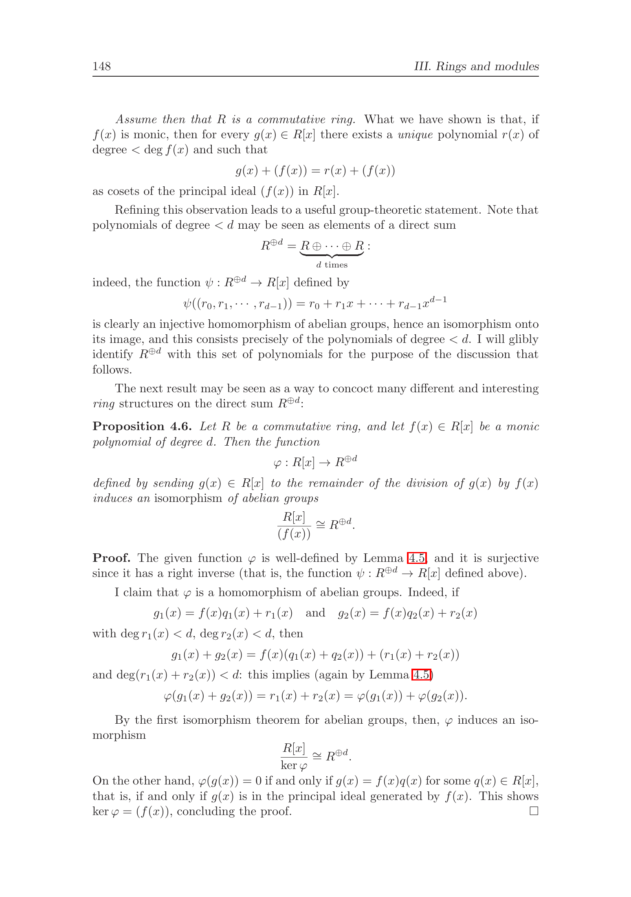

## 第 148 页句读：先说目的，再逐步展开

### 五、一个商类为什么对应唯一的 d 个系数？

**这段在干什么：**把带余除法翻译成商环语言，再解释 Proposition III.4.6 中的 $R^{\oplus d}$。

若 $g=fq+r$，则 $g-r\in(f)$，所以

$$
g+(f)=r+(f).
$$

商类没有因为换成余式而改变。又因余式唯一，每个商类可以恰好用

$$
r_0+r_1x+\cdots+r_{d-1}x^{d-1}
$$

表示。将它记成系数列 $(r_0,\ldots,r_{d-1})$，就得到与 $R^{\oplus d}$ 的一一对应。

但一一对应不自动是所需结构的同构。作者下一步要说明加法也吻合。

### 六、余式映射如何应用第一同构定理？

**这段在干什么：**逐项证明 III.4.6，不把“显然”或定理名称当作中间计算。

定义 $\varphi:R[x]\to R^{\oplus d}$ 为取余式系数。

**确定性。**上页唯一性保证同一个多项式不会得到两组输出。

**满射。**给任意系数列 $(r_0,\ldots,r_{d-1})$，直接取对应低次多项式，它自己就是余式，所以能被送到。

**保加法。**若 $g_i=fq_i+r_i$，则

$$
g_1+g_2=f(q_1+q_2)+(r_1+r_2).
$$

两余式之和仍低于 $d$ 次，所以唯一性告诉我们：它正是和的余式。因此 $\varphi(g_1+g_2)=\varphi(g_1)+\varphi(g_2)$。

**算核。**余式为零，当且仅当多项式是 $f$ 的倍数，所以 $\ker\varphi=(f)$。

由阿贝尔群的第一同构定理，

$$
\boxed{R[x]/(f)\cong R^{\oplus d}\quad\text{作为加法群}.}
$$

对交换环，其实还能看成 $R$-模同构，后面学模就能重新理解。但此刻书中只主张加法群同构，没有说右边原有的逐项乘法和商乘法相同。

### 七、为什么这里不能顺手写“环同构”？

**这段在干什么：**标清本命题保留了哪种结构，避免把忘掉乘法后的结论升级。

仍取 $d=2,f=x^2+1$。坐标 $(0,1)$ 代表 $x$。在商环里它的平方代表 $x^2=-1$，所以平方是 $(-1,0)$。

若在 $R^2$ 用普通逐坐标乘法，$(0,1)^2=(0,1)$，不是同一个结果。

作者说可以把商环乘法“搬到”$R^{\oplus d}$ 上，意思是另定义乘法：把坐标变回多项式 → 相乘 → 除以 $f$ 取余 → 再转回坐标。这样右边才成为与商环同构的环。

这个区别正体现范畴观点：在 $\mathbf{Ab}$ 里同构的两个对象，加上乘法后可能很不同。“同构”之前必须说明在哪个范畴。

## 原书第 149 页：原文底本

完整保留本小节在此页的原文；PDF 阅读器页码为 172。原书习题区不在本次范围。

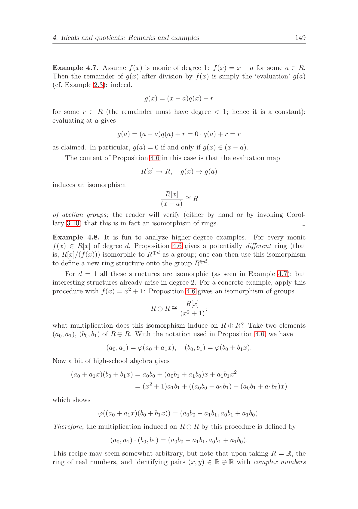

## 第 149 页句读：先说目的，再逐步展开

### 八、Example III.4.7：代入为什么就是除以 x−a 的余数？

**这段在干什么：**把熟悉的代入函数与新学的商环接起来。

除以一次首一式 $x-a$，余式只能是常数 $r$：

$$
g(x)=(x-a)q(x)+r.
$$

把 $x=a$ 代入，第一项为零，得到 $g(a)=r$。所以取余映射就是 $\operatorname{ev}_a:g\mapsto g(a)$。

它保加法、乘法与 1；任意常数都能到达；核是全部在 $a$ 处为零的多项式，也正是 $(x-a)$。因此这次可在环范畴用第一同构定理：

$$
\boxed{R[x]/(x-a)\cong R\quad\text{作为环}.}
$$

例如模 $x-2$ 时，$x^3+4x+1$ 的类等于常数 $17$ 的类。你不是把多项式的所有信息一概丢光，而是让“在代入 2 后无法分辨的多项式”成为同一类。

### 九、Example III.4.8：复数乘法为什么可以从商里算出来？

**这段在干什么：**把原文二次例子的乘法完整展开，说明新结构不是任意规定。

在 $R[x]/(x^2+1)$ 中，记 $u=x+(x^2+1)$，则 $u^2=-1$。每个元素唯一写成 $a+bu$。

先按分配律乘：

$$
(a+bu)(c+du)=ac+(ad+bc)u+bd\,u^2.
$$

再用强加的关系 $u^2=-1$：

$$
(a+bu)(c+du)=(ac-bd)+(ad+bc)u.
$$

所以搬到坐标上的乘法必须为

$$
\boxed{(a,b)\cdot(c,d)=(ac-bd,\ ad+bc).}
$$

不是先凭直觉定义一个古怪公式，再发现它好像有用。**投影要保乘法，加上 $u^2=-1$ 的关系，就把公式强迫出来了。**

取 $R=\mathbb R$，这与 $(a+bi)(c+di)$ 的复数乘法一致。比如 $(2+3u)(1-u)=5+u$，也就是坐标 $(2,3)\cdot(1,-1)=(5,1)$。

## 原书第 150 页：原文底本

完整保留本小节在此页的原文；PDF 阅读器页码为 173。原书习题区不在本次范围。

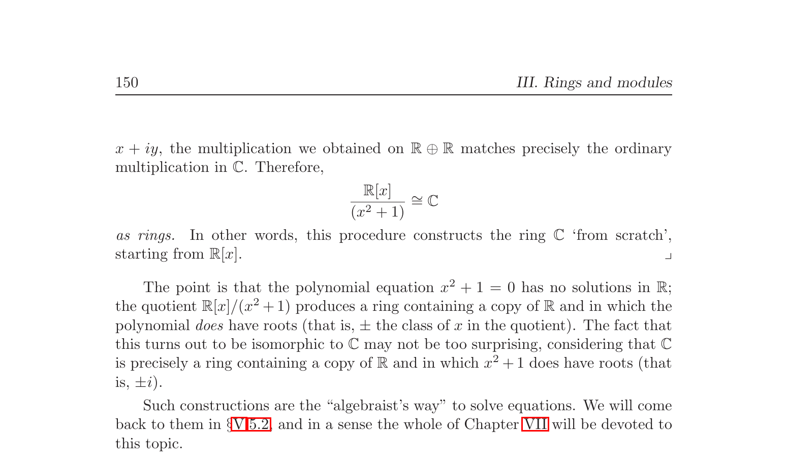

## 第 150 页句读：先说目的，再逐步展开

### 十、“代数学家解方程”：不是在旧环里硬找一个不存在的数

**这段在干什么：**解释作者为什么说商环是一种解方程的方法，并把它与泛性质连起来。

$x^2+1=0$ 在 $\mathbb R$ 中无解。我们不修改实数中的等式，而是构造新环 $\mathbb R[x]/(x^2+1)$；新元素 $u$ 按定义满足 $u^2+1=0$。再证明新环恰好是熟悉的 $\mathbb C$。

一般首一 $f$ 也能这样做。非零常数不可能是正次数首一 $f$ 的倍数，因此 $R$ 的常数像不会被意外合并，$R$ 可以自然嵌入这个新环；$u$ 则是 $f$ 在新环中的根。

还可以把“只加所需关系”说成明确的映射性质。若 $S$ 是交换 $R$-代数，已选好系数映射 $\alpha:R\to S$，并有 $b\in S$ 满足 $\alpha(f)(b)=0$，则代入给出 $R[x]\to S$，而 $(f)$ 被送为零，于是唯一下降为

$$
R[x]/(f)\longrightarrow S,\qquad u\longmapsto b.
$$

存在来自 $f(b)=0$，唯一来自系数像已定、$u$ 的像已定。这里没有声称所有新环都同构；它说任何满足这些条件的映射都必须经过这个商。

商里有根，也不自动表示商是域。例如 $k[x]/(x^2)$ 中非零的 $\bar x$ 平方为零；下一小节会说明什么时候商是整环或域。

### 十一、本节分级与推导总结

**这段在干什么：**将条件、计算与范畴层级放到同一张复习表里。

| 知识点与定位 | 等级 | 为什么重要 | 应达到的程度 |
|---|---|---|---|
| 首一与长除法，p147 | A | 保证一般系数环中仍能降次 | 会说明为何无需除系数 |
| Lemma III.4.5，p147 | A | 后面唯一代表全部靠它 | 用两分解相减与次数比较重建证明 |
| Proposition III.4.6，p148 | A | 给商环可计算的元素模型 | 逐项检验映射、核、像，注明加法群层级 |
| Example III.4.7，p149 | A | 反复用于商和代入 | 会算 $\ker\operatorname{ev}_a$ |
| Example III.4.8，pp149–150 | A | 展示加根和新乘法 | 会从关系推导坐标乘法 |
| 加根的泛性质，p150 的解释补充 | B | 连接作者全书的泛性质主线 | 分开说明映射存在与唯一 |

完整路线：首一让长除法可做 → 次数让余式唯一 → 余式给低次坐标 → 同构定理识别加法结构 → 乘法约化搬出新环结构 → 类 $u$ 成为指定方程的根。

---

[阅读目录](README.md) · [上一小节](01-III-4.1.md) · [下一小节](03-III-4.3.md)

# III 4.3. Prime and maximal ideals｜用商理解素理想、极大理想与几何前景

[阅读目录](README.md) · [上一小节](02-III-4.2.md) · [下一小节](04-III-5.1.md)

**本节总任务：不只问怎样构造商环，还问取商后是否留下零因子、是否能对所有非零元素求逆。**作者先按商的性质定义素理想与极大理想，再将它们翻回元素和包含关系。

## 原书第 150 页：原文底本

完整保留本小节在此页的原文；PDF 阅读器页码为 173。原书习题区不在本次范围。

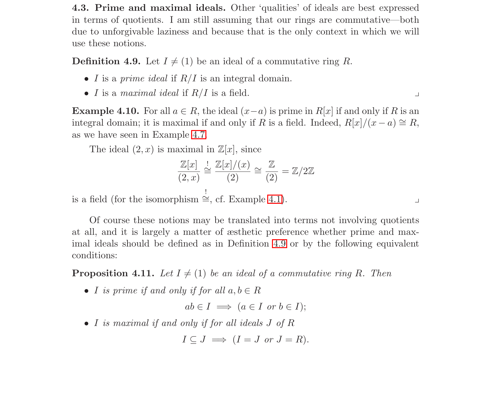

## 第 150 页句读：先说目的，再逐步展开

### 一、为什么定义理想的性质，却去看 R/I？

**这段在干什么：**解释 Definition III.4.9 的动机与真理想条件。

理想 $I$ 表示我们准备视为零的一组关系。商环 $R/I$ 就是施加这些关系以后留下的结构。判断关系是否使乘法退化、是否产生足够多逆元，直接看商最自然。

作者定义：

$$
I\text{ 素}\iff R/I\text{ 是整环},\qquad
I\text{ 极大}\iff R/I\text{ 是域}.
$$

这里 $R$ 是交换环，且 $I\ne R$。真理想条件不是可省的形式：若 $I=R$，商只有一个元素，$1=0$，而本书整环、域都要求非零。

“素”首先意味着商里两个非零类相乘不会成零；“极大”首先意味着商里每个非零类都有逆。后面的等价条件会解释这些名字为什么贴切。

### 二、Example III.4.10：已知商，比直接查理想省多少事？

**这段在干什么：**说明上一节的商计算现在怎样立即给出理想性质。

已知 $R[x]/(x-a)\cong R$，因此 $(x-a)$ 素当且仅当 $R$ 是整环，极大当且仅当 $R$ 是域。无需重新对无限多个多项式检查定义。

再看 $\mathbb Z[x]$ 中的 $(2,x)$。把 $x$ 设为零，再将整数模 2，得到满同态

$$
F:\mathbb Z[x]\to\mathbb F_2,\qquad
g\longmapsto g(0)\pmod2.
$$

若 $F(g)=0$，常数项为偶数，便可写 $g=2c+xh(x)$，所以核正是 $(2,x)$。因此商为 $\mathbb F_2$，它是域，理想极大。

注意同一理想 $(2,x)$ 在上一节用于说明“非主”，这里用于说明“极大”。主理想与极大理想考察不同方面，不能凭一个名字推另一个性质。

### 三、素理想判据：为什么会出现 ab∈I 就有一个因子在 I？

**这段在干什么：**把 Proposition III.4.11 的第一条从商里逐字翻译出来。

商里 $\bar a=0$ 当且仅当 $a\in I$；$\bar a\bar b=0$ 当且仅当 $ab\in I$。

整环要求

$$
\bar a\bar b=0\Longrightarrow
(\bar a=0\text{ 或 }\bar b=0).
$$

换回原环就是

$$
\boxed{ab\in I\Longrightarrow(a\in I\text{ 或 }b\in I).}
$$

例如 $(6)\subset\mathbb Z$ 不素：$2\cdot3\in(6)$，但两因子都不在里面；对应商里 $[2]_6,[3]_6$ 是非零零因子。

这解释“素”为什么是素数整除性质的推广：$(p)$ 的成员就是 $p$ 的倍数，条件变成 $p\mid ab$ 时 $p\mid a$ 或 $p\mid b$。

## 原书第 151 页：原文底本

完整保留本小节在此页的原文；PDF 阅读器页码为 174。原书习题区不在本次范围。

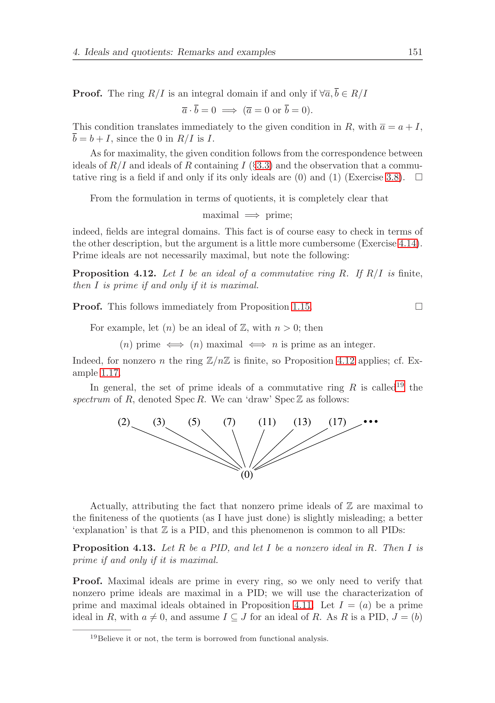

## 第 151 页句读：先说目的，再逐步展开

### 四、极大理想为什么没有真正的中间理想？

**这段在干什么：**补全 III.4.11 第二条的证明，说明“最大”不是指元素多寡。

先证明一个辅助事实：非零交换环 $S$ 是域，当且仅当仅有理想 $(0)$ 与 $S$。

若是域，非零理想里取非零 $a$，乘 $a^{-1}$ 得 1，理想就是全环。反过来，若仅有这两个理想，对任意非零 $a$，$(a)\ne0$，所以 $(a)=S$，于是 $1=ra$，$a$ 有逆。

再用理想对应：$R/I$ 的理想对应 $R$ 中包含 $I$ 的理想。零理想对应 $I$，全商环对应 $R$。所以商为域，当且仅当

$$
I\subseteq J\subseteq R\Longrightarrow J=I\text{ 或 }J=R.
$$

这就是说 $I$ 与 $R$ 之间没有严格中间理想。不是在全体真理想中存在唯一“最大的一个”。例如 $\mathbb Z$ 中 $(2)$ 与 $(3)$ 都极大，却互不包含。

### 五、极大为什么一定素，而素不一定极大？

**这段在干什么：**用商的结构解释蕴含方向，并指出逆向失败的具体原因。

域一定是整环，因此 $R/I$ 是域就没有非零零因子，立即得极大推出素。

逆向看 $\mathbb Z$ 的 $(0)$：商仍是 $\mathbb Z$，没有零因子，所以素；但 2 没有整数逆元，所以不是域，因此不极大。

也可以不用商检查极大推出素。若 $ab\in I$ 而 $a\notin I$，则理想 $I+(a)$ 严格大于 $I$，极大性迫使它等于 $R$。所以 $1=i+ra$，乘 $b$：

$$
b=ib+rab\in I.
$$

这里每一步都有作用：加上 $a$ 迫使全环出现；写出 1 的表达式，才把 $b$ 拉回 $I$。商证明更短，元素证明则把机制摊开，两者值得对照。

### 六、有限商为什么让素与极大合并？

**这段在干什么：**解释 Proposition III.4.12 调用了哪一个先前结论。

有限非零整环一定是域。理由是对非零 $a$，乘法映射 $x\mapsto ax$ 因无零因子而单射；有限集合中单射就是满射，所以能找到 $b$ 使 $ab=1$。

因此若 $R/I$ 有限，素已经足以保证商为域，也就保证极大。

例如 $\mathbb Z/(n)$ 在 $n>0$ 时有限，所以非零真整数理想 $(n)$ 的素、极大条件合并为 $n$ 是素数。不能把“有限”删掉再沿用这条证明；刚才的 $\mathbb Z/(0)$ 就是反例。

### 七、Proposition III.4.13：为什么 PID 能不靠有限性得到同样结论？

**这段在干什么：**逐步使用“理想都是主的”证明非零素理想极大。

设 $I=(a)$ 是非零素理想，取任何包含它的理想 $J$。PID 使 $J=(b)$。因 $a\in(b)$，有 $a=bc$。

素性给两种可能。若 $b\in(a)$，则 $(b)\subseteq(a)$，结合原来的包含，$J=I$。

另一种 $c\in(a)$，写 $c=da$，得到 $a=bda$。接下来要用 $a\ne0$ 和整环消去，这正是条件不能删的地方。

## 原书第 152 页：原文底本

完整保留本小节在此页的原文；PDF 阅读器页码为 175。原书习题区不在本次范围。

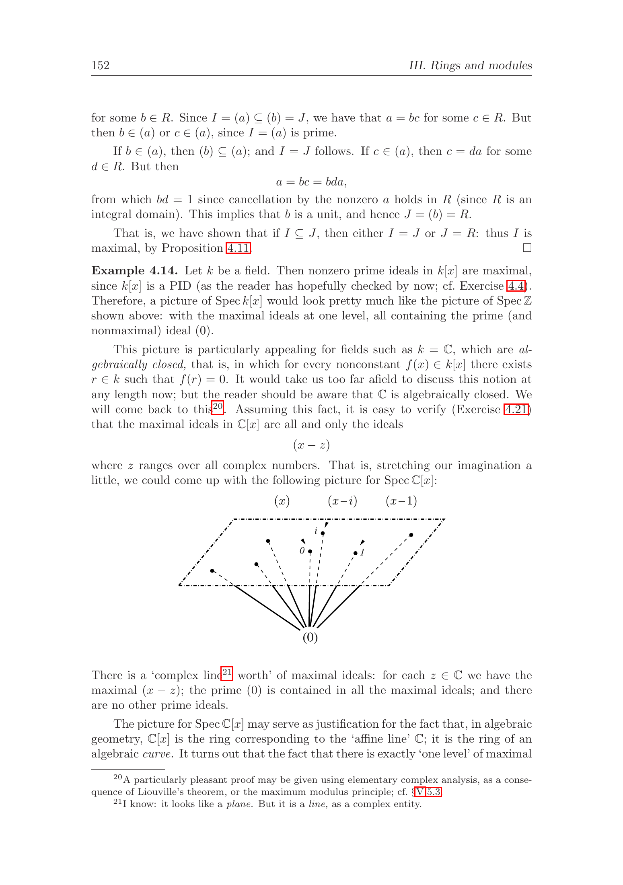

## 第 152 页句读：先说目的，再逐步展开

### 八、PID 证明的收尾：为何另一分支一定给全环？

**这段在干什么：**接上前页计算，并清点所有假设各在哪一步使用。

从 $a=bda$，因为 $a\ne0$，消去 $a$ 得 $1=bd$。于是 $b$ 是单位，$(b)=R$。

所以任何 $I\subseteq J$ 都只能 $J=I$ 或 $J=R$，$I$ 极大。完整证明使用：

- PID：把 $I,J$ 都写成一个生成元。
- 素性：从 $a=bc\in I$ 拆出两分支。
- 整环且 $a\ne0$：进行最后一次消去。

若删“非零”，$(0)\subset\mathbb Z$ 已经是素而非极大。反例与证明中的消去位置正好一一对应。

### 九、Spec 是在收集什么？先读包含关系，不急着把它当一张普通图

**这段在干什么：**解释 Examples III.4.14–4.15 的几何前景。

$\operatorname{Spec}R$ 先定义为所有素理想组成的集合。对 $\mathbb Z$，有 $(0)$ 和各个 $(p)$；$(0)$ 包含在每个 $(p)$ 中，各个非零素理想都极大。

书中的图先画这种包含层次，不是已经把 Zariski 拓扑的全部内容定义完。作者把一个环的结构改由理想之间的关系呈现，几何语言由此进入。

在 $\mathbb C[x]$，每个极大理想为 $(x-z)$。理由也可以一步步核对：多项式环是 PID，所以极大理想写成 $(f)$；它不可能由非零常数生成，否则是全环，也不可能是零理想，因为 $(0)$ 不是这里的极大理想。

因 $\mathbb C$ 上非常数多项式有根，写 $f=(x-z)g$。若 $\deg f>1$，便有严格中间理想

$$
(f)\subsetneq(x-z)\subsetneq\mathbb C[x].
$$

左边严格是因为低次的 $x-z$ 不可能成为高次 $f$ 的倍数；右边严格是因为代入 $z$ 会把 $(x-z)$ 全送为零，却不把 1 送为零。这与极大性矛盾，所以生成元只能一次。

因此一个复数点 $z$ 对应“在该点取值为零”的理想 $(x-z)$。代入取值把点与环之间接上，而不只是给抽象理想起几何外号。

这里用到 $\mathbb C$ 代数闭；本节不证明这一事实，原书也将它留待后面。

## 原书第 153 页：原文底本

完整保留本小节在此页的原文；PDF 阅读器页码为 176。原书习题区不在本次范围。

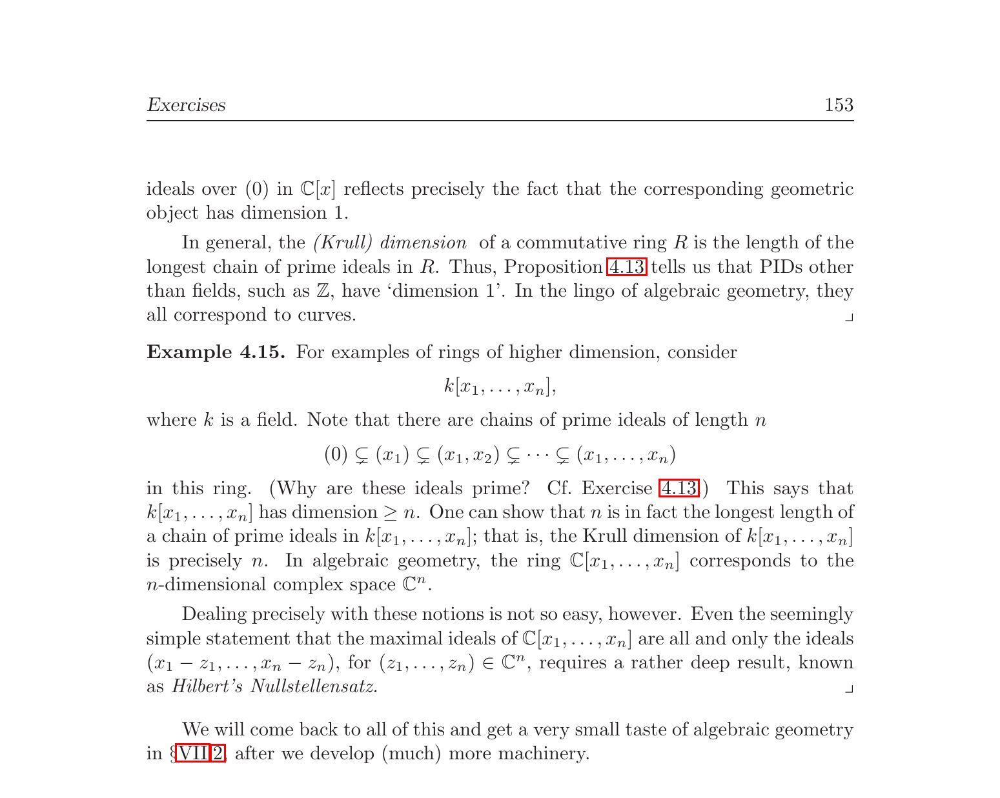

## 第 153 页句读：先说目的，再逐步展开

### 十、Krull 维数为什么数理想链的严格包含次数？

**这段在干什么：**说明末段把“维数”转成哪一种可以在环内讨论的数据。

链

$$
P_0\subsetneq P_1\subsetneq\cdots\subsetneq P_n
$$

长度为 $n$：有 $n+1$ 个理想，但严格上升 $n$ 次。Krull 维数取这种长度的上确界；若可以任意长，就为无穷，不一定存在一本书口语说的“最长链”。

在 $k[x_1,\ldots,x_n]$，链

$$
(0)\subsetneq(x_1)\subsetneq(x_1,x_2)
\subsetneq\cdots\subsetneq(x_1,\ldots,x_n)
$$

中的理想都是素的：依次取商，就是把对应变量设零，剩下的多项式环仍是整环。因此先证明维数至少为 $n$。

“没有更长链”是另一条上界证明，不能从写出一条链直接推出。作者在这里预告最终恰好等于 $n$，完整机器后面才发展。

极大理想都来自点 $(z_1,\ldots,z_n)$ 的一般结论也需要 Nullstellensatz。当前知道它在回答“几何点是否全能由取值理想描述”即可，不额外展开那项大定理。

### 十一、本节分级与推导总结

**这段在干什么：**把必须掌握的商翻译与几何预告分开，避免阅读深度失衡。

| 知识点与定位 | 等级 | 为什么重要 | 应达到的程度 |
|---|---|---|---|
| Definition III.4.9，p150 | A | 把商的域、整环性质搬回理想 | 记住交换、真理想条件 |
| Proposition III.4.11，pp150–151 | A | 实际判断理想与看商相互转换 | 重建元素判据与包含判据 |
| 极大推出素，p151 | A | 高频结构蕴含 | 会短证明与 $(0)\subset\mathbb Z$ 逆向反例 |
| Propositions III.4.12–4.13 | B | 展示有限性与 PID 两种不同机制 | 指出单满等价、主生成元、非零消去各自作用 |
| Examples III.4.14–4.15，pp152–153 | C | 几何与后章路线图 | 知道点理想、Spec、维数在问什么，不提前证明大定理 |

主线是：商没有零因子 → 素；商全部非零可逆 → 极大；再将这两句话翻译成原环语言。几何前景是在这条明确翻译基础上出现，不应反过来用尚未定义的几何术语解释基本理想。

---

[阅读目录](README.md) · [上一小节](02-III-4.2.md) · [下一小节](04-III-5.1.md)

# III 5.1. Definition of (left-) R-module｜从环作用出发定义模

[阅读目录](README.md) · [上一小节](03-III-4.3.md) · [下一小节](05-III-5.2.md)

**本节总任务：把“环中的元素”看成作用在加法群上的算子，并建立一种能同时容纳子对象与商对象的语言。**模既推广向量空间，也补齐前面环范畴里不够整齐的构造。

## 原书第 156 页：原文底本

完整保留本小节在此页的原文；PDF 阅读器页码为 179。原书习题区不在本次范围。

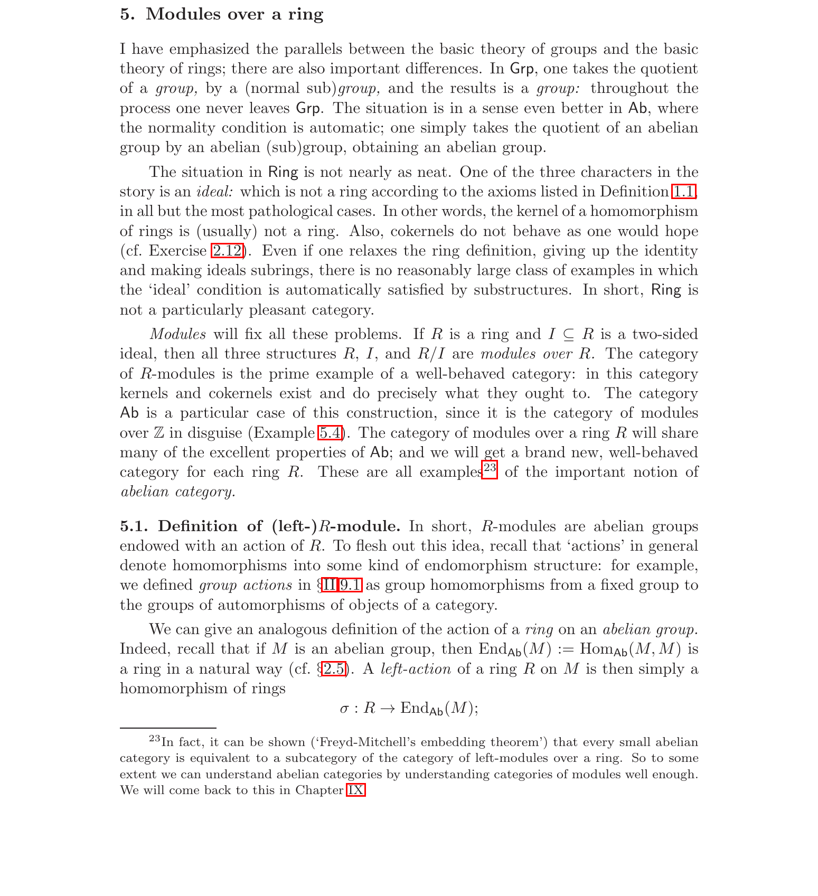

## 第 156 页句读：先说目的，再逐步展开

### 一、作者为什么突然说 Ring 不够“舒服”？

**这段在干什么：**解释 §5 导言的转折，不让模看起来只是新加的一串公理。

群同态的核是群，商群也是群；阿贝尔群的子群又自动正规，因此子群、原群、商群始终处在同一种范畴里。

环里却不如此。$2\mathbb Z$ 是 $\mathbb Z$ 的理想，但它不含大环的 1。按本书含幺环、保幺同态的约定，它不是 $\mathbb Z$ 的子环。环同态的核通常也不包含 1，因此不像群那样直接成为同类子对象。

现在看同一个例子：$2\mathbb Z,\mathbb Z,\mathbb Z/2\mathbb Z$ 都能加，都能乘整数。若暂时只保留加法与“整数怎样作用”，三者就统一成 $\mathbb Z$-模。

这就是作者说模块修复问题的具体意思：**选择合适的对象类别，让核、子对象、商回到同一种结构。**不是宣称环不好、不重要，而是有些问题换到模里更自然。

### 二、环作用为什么映入 End，而群作用映入 Aut？

**这段在干什么：**说明原文用 $\sigma:R\to\operatorname{End}_{\mathbf{Ab}}(M)$ 定义模的来由。

先选一个阿贝尔群 $(M,+)$。每个 $r\in R$ 都要给出一个保持加法的操作 $\sigma(r):M\to M$。

这些操作不必可逆。例如整数 2 在 $\mathbb Z$ 上作用为 $m\mapsto2m$，它不是满射，却完全是合法标量作用。0 则作用为零映射，通常更不可能可逆。所以要用所有自同态的环 End，不只用可逆的 Aut。

End 的加法按输出逐点相加，乘法是复合。要求 $\sigma$ 是保幺环同态，就意味着：

- 环中加标量，对应把两个操作的输出相加。
- 环中乘标量，对应先后执行操作。
- 标量 1 对应什么也不改的恒等操作。

这比先记四条公理更能说明模究竟在记录什么。

## 原书第 157 页：原文底本

完整保留本小节在此页的原文；PDF 阅读器页码为 180。原书习题区不在本次范围。

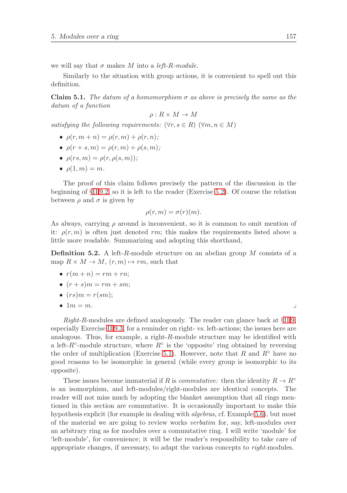

## 第 157 页句读：先说目的，再逐步展开

### 三、Claim III.5.1：怎样从算子同态拆出四条模公理？

**这段在干什么：**逐项证明原文声称“同一数据”的两种写法确实等价。

定义 $rm=\sigma(r)(m)$。因为每个 $\sigma(r)$ 保加法，

$$
r(m+n)=\sigma(r)(m+n)=\sigma(r)(m)+\sigma(r)(n)=rm+rn.
$$

因为 $\sigma$ 保环加法，

$$
(r+s)m=(\sigma(r)+\sigma(s))(m)=rm+sm.
$$

因为它保环乘法，而 End 里的乘法是复合，

$$
(rs)m=(\sigma(r)\circ\sigma(s))(m)=r(sm).
$$

最后 $\sigma(1)=\operatorname{id}_M$，所以 $1m=m$。四条公理各自来自一个明确要求，没有多添无缘无故的条件。

反过来，若给了满足四条公理的标量作用，定义 $\sigma(r)(m)=rm$。第一条保证每个 $\sigma(r)$ 是加法群同态；第二条保证 $\sigma$ 保加法；第三条保证保乘法；第四条保证保幺。因此确实得到环同态。

**这不是两个不同定义凑巧都适用，而是可以双向恢复同一份数据。**

### 四、模像向量空间，但哪里不再能照搬线性代数？

**这段在干什么：**用熟悉例子定位新概念，同时指出标量不是域带来的变化。

向量空间的标量来自域，任何非零标量可逆。模的标量只来自环，非零标量可能不能除，也可能是零因子。

例如 $M=\mathbb Z/6\mathbb Z$ 是整数模，定义 $r[a]=[ra]$。取非零 $[3]$，有 $2[3]=[0]$。不能像向量空间那样两边除以非零标量 2，推出 $[3]=0$。

相反，当 $R=k$ 本来就是域，模公理与向量空间公理完全一样。模没有推翻线性代数，而是把“标量一定能除”的前提放开，再追踪哪些结论仍成立。

还可取 $R=M_2(k)$、$M=k^2$，用矩阵作用于列向量。$AB$ 的作用是先 $B$ 后 $A$，正好体现 $(rs)m=r(sm)$。因此一个“标量”本身也可能是矩阵，关键是它怎样作用，而不是它看起来像不像普通数。

### 五、左模与右模为什么不能总用换个写法解决？

**这段在干什么：**解释本页末尾 opposite ring 的必要性。

左模写 $(rs)m=r(sm)$，右模写 $m(rs)=(mr)s$。若把右作用写到左边，执行次序会反过来，所以对应的不是随便原封不动的 $R$，而是反乘法环 $R^{\mathrm{op}}$。

在 $R^{\mathrm{op}}$ 中定义 $r*s=sr$。将右模定义为左作用 $r\cdot m=mr$，便有

$$
r\cdot(s\cdot m)=(ms)r=m(sr)=(r*s)\cdot m.
$$

若 $R$ 交换，反乘法根本不改变环，左右模没有实质区别。非交换时，顺序就是结构的一部分，不能看见一对括号便随手移位。

本章后面主要可先采用交换环，或始终采用左模；作者将“module”简称为左模。所有计算应保持同一约定。

### 六、本节分级与推导总结

**这段在干什么：**把算子观点、四公理与例子一起整理。

| 知识点与原书定位 | 等级 | 为什么重要 | 应达到的程度 |
|---|---|---|---|
| §5 导言，p156 | A | 交代为什么改变对象类别 | 用 $2\mathbb Z,\mathbb Z,\mathbb Z/2$ 说明统一了什么 |
| Claim III.5.1，pp156–157 | A | 是环作用和公式定义的桥梁 | 双向逐项恢复数据 |
| Definition III.5.2，p157 | A | 全部后文的前提 | 会给整数模、向量空间、矩阵作用例子 |
| 与向量空间的区别 | A | 防止非法除法及自由性误判 | 知道非零标量未必可约去 |
| 右模与 opposite ring，p157 | B | 非交换结构的重要边界 | 能说明为何次序反向，不要求另展开右模全套理论 |

总路线：核与商需要统一的类别 → 给阿贝尔群添加环作用 → 把环乘法解释为操作复合 → 展开为四条公理 → 认出向量空间与阿贝尔群是重要特例。

---

[阅读目录](README.md) · [上一小节](03-III-4.3.md) · [下一小节](05-III-5.2.md)

# III 5.2. The category R-Mod｜模范畴、线性映射与代数

[阅读目录](README.md) · [上一小节](04-III-5.1.md) · [下一小节](06-III-5.3.md)

**本节总任务：规定模之间什么映射算“保持结构”，再把阿贝尔群、向量空间、代数与 Hom 空间放回同一张关系图。**

## 原书第 158 页：原文底本

完整保留本小节在此页的原文；PDF 阅读器页码为 181。原书习题区不在本次范围。

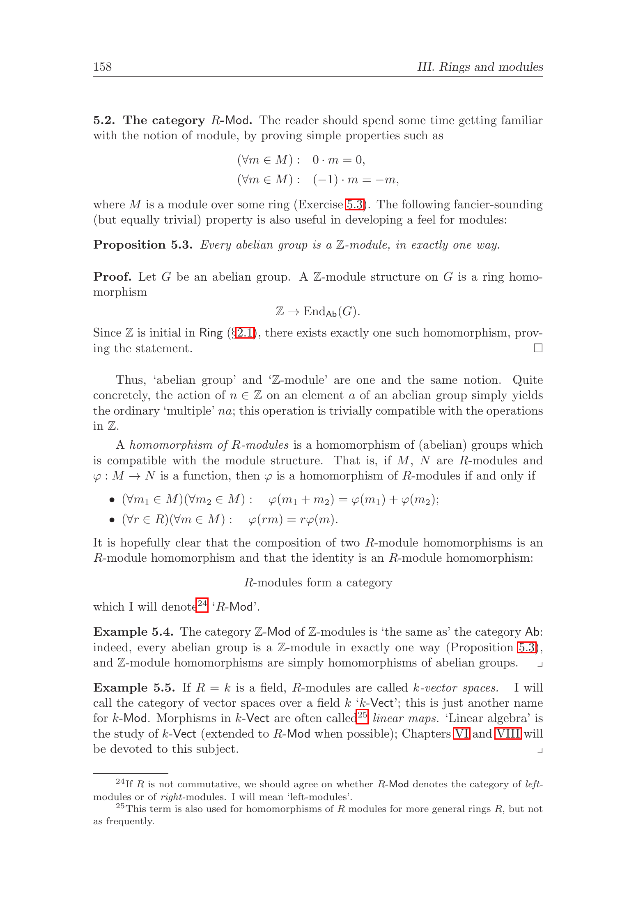

## 第 158 页句读：先说目的，再逐步展开

### 一、零标量与负号不是要额外添加的公理

**这段在干什么：**补出本页开头建议熟悉的基本运算，让四条模公理真正可使用。

由 $(0_R+0_R)m=0_Rm+0_Rm$，而左边等于 $0_Rm$，在阿贝尔群中消去一项，得到 $0_Rm=0_M$。

再由 $(1_R+(-1_R))m=0_M$，得 $m+(-1_R)m=0_M$，所以 $(-1_R)m=-m$。

同样 $r(0_M+0_M)=r0_M+r0_M$，推出 $r0_M=0_M$。两个零分别来自环和模，写法常省略下标，但证明时知道它们属于哪里更稳妥。

### 二、Proposition III.5.3：每个阿贝尔群为什么只有一种整数模结构？

**这段在干什么：**解释作者如何用初始对象一句话完成一个本可很长的公理验证。

整数模结构等价于保幺环同态

$$
\mathbb Z\longrightarrow\operatorname{End}_{\mathbf{Ab}}(G).
$$

但 $\mathbb Z$ 是 Ring 的初始对象：到任何含幺环恰好有一个这样的同态。所以结构存在且唯一。

具体看，$1$ 必须作用为恒等；$n>0$ 是 $n$ 个 1 的和，所以 $ng$ 必须是 $n$ 次加 $g$；0、负整数的作用再由上面的规则决定。没有再选择另一种整数标量乘法的余地。

这展示作者的范畴方法：不重复验证所有整数情形，而先认出“环作用是一条同态”，再调用初始性完成存在与唯一。

### 三、模同态为什么要同时保加法和标量作用？

**这段在干什么：**定义 R-Mod 的态射，并区分“函数”“群同态”“模同态”三个层级。

给定两个已选好 $R$ 作用的模 $M,N$，映射 $f:M\to N$ 要满足

$$
f(m+n)=f(m)+f(n),\qquad f(rm)=rf(m).
$$

第一条保住原有阿贝尔群；第二条保住额外的环作用。不是任何加法同态都自动满足第二条。

例如复共轭 $f:\mathbb C\to\mathbb C$ 保加法，但作为复向量空间映射，它不保复标量：$f(i\cdot1)=-i$，而 $if(1)=i$。若只把两边当实向量空间，它却是线性的。**是否为模同态，必须连同底环说清楚。**

复合仍保两条规则，恒等映射也保，因此组成范畴 $R$-Mod。当 $R=\mathbb Z$，群同态本就保持整数倍，所以 $\mathbb Z$-Mod 与 Ab 相同；当 $R=k$ 为域，便得到 $k$-Vect，态射就是线性映射。

## 原书第 159 页：原文底本

完整保留本小节在此页的原文；PDF 阅读器页码为 182。原书习题区不在本次范围。

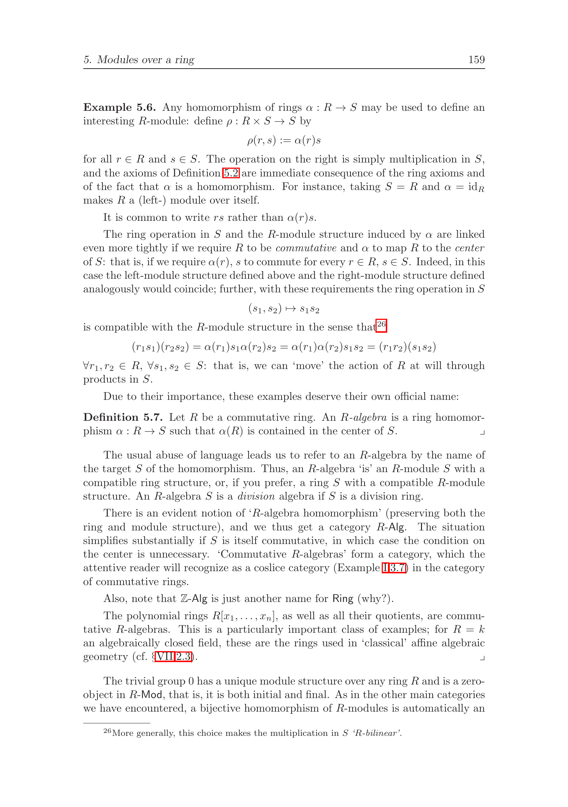

## 第 159 页句读：先说目的，再逐步展开

### 四、环同态怎样让一个环成为另一个环的模？

**这段在干什么：**展开 Example III.5.6 的“通过 α 使用标量”，不把 $rs$ 的简写误当成天然包含。

给定 $\alpha:R\to S$。要让 $r\in R$ 作用在 $s\in S$，先把 $r$ 送到 $S$，再在 $S$ 里相乘：

$$
r\cdot s:=\alpha(r)s.
$$

于是

$$
(r_1r_2)\cdot s
=\alpha(r_1)\alpha(r_2)s
=r_1\cdot(r_2\cdot s),
$$

保加法和保 1 的两项也同样来自 $\alpha$ 是环同态。

这里不要求 $\alpha$ 单射。例如商投影 $R\to R/I$ 给商环一个自然 $R$-模结构。记作 $rs$ 时，背后仍是 $\alpha(r)s$，不是说两个环元素原来就住在同一个集合。

取 $\alpha=\operatorname{id}_R$，就得到 $R$ 作为自身的左模，后面子模会认出左理想。

### 五、R-algebra 为什么不只是一个既叫环又叫模的东西？

**这段在干什么：**解释 Definition III.5.7 的相容条件，以及为什么要求像进入中心。

现在希望 $S$ 同时有自己的环乘法和 $R$ 的标量作用。两种结构不能互不相干。作者取 $R$ 交换，并要求

$$
\alpha(R)\subseteq Z(S),
$$

即每个标量像与 $S$ 的所有元素交换。这样计算

$$
(r_1s_1)(r_2s_2)
=\alpha(r_1)s_1\alpha(r_2)s_2
=\alpha(r_1)\alpha(r_2)s_1s_2
=(r_1r_2)(s_1s_2)
$$

才可在中间移动 $\alpha(r_2)$。中心条件准确解决的就是这一步，不是因为“通常默认交换”。

这样的结构叫 $R$-代数。它可以是非交换环，如 $M_n(k)$ 是 $k$-代数，标量映成标量矩阵；也可以是交换代数，如 $R[x]/(f)$。

代数同态不仅保环运算，还要和固定的标量映射相容。若 $f:S\to T$，条件是 $f\circ\alpha_S=\alpha_T$，等价于相应的 $R$-线性要求。

### 六、为什么交换 R-代数构成一个 coslice 范畴？

**这段在干什么：**把本页的范畴提示翻译成具体对象和交换三角形。

固定 $R$，对象不是单独一个交换环 $S$，而是一条箭头 $\alpha_S:R\to S$。两个对象间的态射为使

$$
R\xrightarrow{\alpha_S}S\xrightarrow{f}T
\quad\text{等于}\quad
R\xrightarrow{\alpha_T}T
$$

的环同态 $f$。这正是从固定对象 $R$ 出发的 coslice 构造 $R/\mathbf{CRing}$。

不要把 coslice 当作另加实体，它只是把“保住同一套系数来源”组织成范畴。$\mathbb Z$ 的箭头唯一且整数像总居中心，所以 $\mathbb Z$-Alg 便恢复 Ring。

本页末尾的零群有唯一模结构。到任意模、从任意模的线性映射都只能是零映射，所以它既初始又终结，即零对象。下一节的核、余核将依靠这些零映射表达。

## 原书第 160 页：原文底本

完整保留本小节在此页的原文；PDF 阅读器页码为 183。原书习题区不在本次范围。

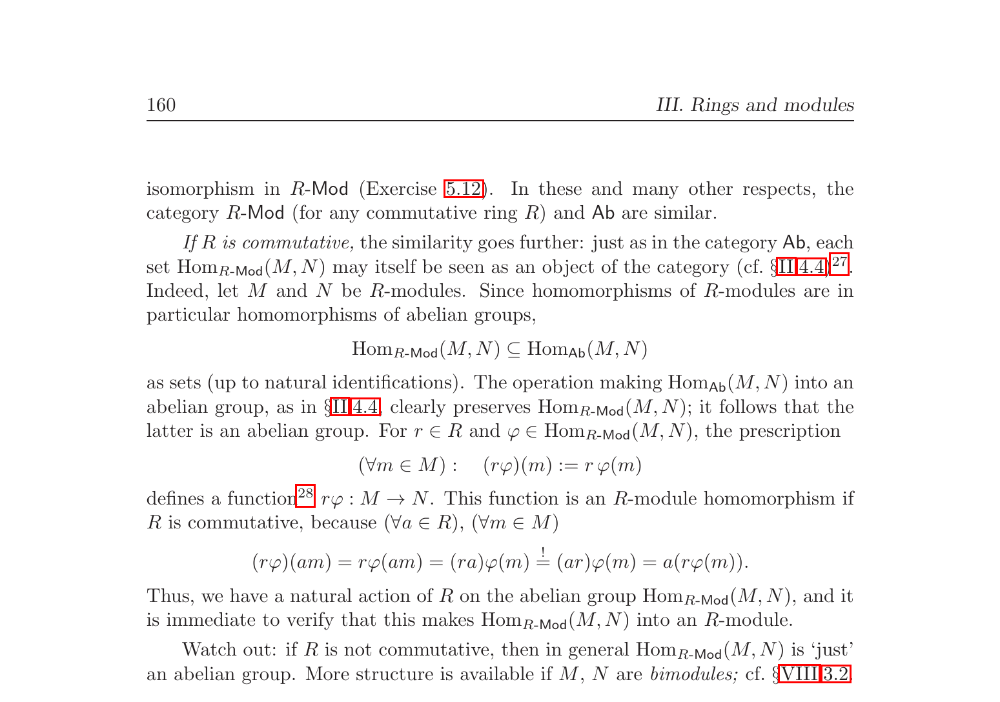

## 第 160 页句读：先说目的，再逐步展开

### 七、为什么 Hom 集合本身也能相加？

**这段在干什么：**把“线性映射的集合”进一步看作有加法结构的对象。

给两个 $R$-线性映射 $f,g:M\to N$，逐点定义 $(f+g)(m)=f(m)+g(m)$。验证：

$$
(f+g)(m+n)=f(m)+f(n)+g(m)+g(n).
$$

因为 $N$ 加法交换，可重排为 $(f+g)(m)+(f+g)(n)$；标量相容也由分配律成立。因此 Hom 集在逐点加法下是阿贝尔群，零是零映射，负号逐点取。

这并不要求底环交换。它是后面“加性范畴”的一个具体来源，而不只是一个新定义。

### 八、为什么让 Hom 再成为 R-模，就需要额外交换条件？

**这段在干什么：**展开原文标了感叹号的等式，检查标量倍映射是否仍在线性映射集合里。

尝试定义 $(rf)(m)=r f(m)$。要它仍是 $R$-线性，必须对任意 $a\in R$ 有

$$
(rf)(am)=r\,a\,f(m)
\quad\stackrel{?}{=}\quad
a\,r\,f(m)=a(rf)(m).
$$

正是 $ra=ar$ 这一处需要交换。因此交换环下 Hom 自然成为 $R$-模。

非交换时并非纯技术问题。取 $R=M_2(k)$、$M=N=R$ 为左模，$f=\operatorname{id}$，取矩阵单位 $r=E_{12},a=E_{21}$。在 $m=1$ 处，左边是 $ra=E_{11}$，右边是 $ar=E_{22}$，不同。

所以不能因为“函数逐点乘标量很自然”，就跳过它是否保留线性的检查。一般仍有 Ab 结构；若只用中心标量，则还能得到相应的中心模结构。

### 九、本节分级与推导总结

**这段在干什么：**把同一页出现的多个“结构升级”分清。

| 知识点与定位 | 等级 | 为什么重要 | 应达到的程度 |
|---|---|---|---|
| Proposition III.5.3，p158 | A | 连接 Ab 与模 | 用整数初始性和重复加法两种方式说明 |
| 模同态、R-Mod，p158 | A | 后文全部映射的类型 | 检查保加法与标量，说明底环改变的影响 |
| Examples III.5.4–5.6 | A | 统一向量空间、阿贝尔群、环的标量限制 | 会写 $r\cdot s=\alpha(r)s$ |
| Definition III.5.7，p159 | B | 连接系数环与对象内部乘法 | 指出中心条件在哪一步使用 |
| coslice 与零对象，p159 | B | 理解作者范畴组织方法 | 说出对象、态射及交换条件 |
| Hom 的 Ab/模结构，p160 | A/B | 后续对偶和线性运算频繁使用 | 加法为 A；标量相容的交换条件须理解 |

主线不是同时记很多类别名称，而是逐步问：对象有什么运算？映射保哪些运算？这些映射本身还能作哪些运算？每次“还能”都必须检查封闭与相容。

---

[阅读目录](README.md) · [上一小节](04-III-5.1.md) · [下一小节](06-III-5.3.md)

# III 5.3. Submodules and quotients｜子模、商模与商的泛性质

[阅读目录](README.md) · [上一小节](05-III-5.2.md) · [下一小节](07-III-5.4.md)

**本节总任务：确定哪些加法子群可以作为模的子对象，随后使商上的标量作用真正有定义。**路线与你给出的商环解读平行，但现在只需检查一个外部标量作用，不再要求商自身有环乘法。

## 原书第 160 页：原文底本

完整保留本小节在此页的原文；PDF 阅读器页码为 183。原书习题区不在本次范围。

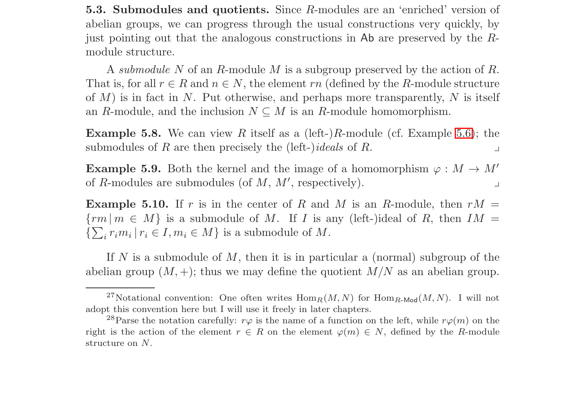

## 第 160 页句读：先说目的，再逐步展开

### 一、子模：加法子群还需要对哪种操作稳定？

**这段在干什么：**解释本节第一段的 “preserved by the action of R”。

设 $M$ 已是 $R$-模，$N\subseteq M$。因为模有加法与标量乘法，子对象必须同时继承它们。因此先要求 $N$ 为加法子群，再要求

$$
r\in R,\ n\in N\Longrightarrow rn\in N.
$$

这是子模条件。不能只检查“$N$ 里的元素之间怎样运算”，因为标量来自整个 $R$。

例如 $\mathbb Z^2$ 的整数倍向量全体 $\mathbb Z(2,1)$ 是子模；仿射集合 $(1,0)+\mathbb Z(2,1)$ 一般不含零，不是子模。向量空间里“过原点的子空间”与“一条平移直线”的区别在这里仍在。

同一个子集是否为子模，也依赖所选的底环作用。$M=\mathbb C$ 时，$\mathbb R$ 是实子空间，却不是复子空间，因为 $i\cdot1\notin\mathbb R$。

### 二、Examples III.5.8–5.9：为什么核与像自动稳定？

**这段在干什么：**把原环理想与模子对象对上，并验证后面要用的两个典型子模。

把 $R$ 看作自身左模，子模正好是左理想：同样是加法子群并吸收大环左乘。若 $R$ 交换，就是普通理想。这将前面熟悉的对象放进了新类别。

给模同态 $f:M\to M'$，若 $m\in\ker f$，则

$$
f(rm)=rf(m)=r0=0,
$$

所以核对标量稳定。若 $y=f(m)$ 在像中，则 $ry=f(rm)$ 仍在像中。加法子群部分已经由保加法得到，因此核、像都是子模。

这两次计算才是“同态保结构，所以相应子集保结构”的实际内容。

### 三、Example III.5.10：为什么 rM 要求 r 在中心，而 IM 用左理想？

**这段在干什么：**辨认原文例子里的两个相似但条件不同的构造。

取 $rM=\{rm:m\in M\}$。它对加法封闭，但再乘 $a\in R$ 时，

$$
a(rm)=(ar)m.
$$

若 $r$ 在中心，可换成 $(ra)m=r(am)$，所以回到 $rM$。如果不能换序，这个论证便断了，故原文加上中心条件。

再取左理想 $I$，定义

$$
IM=\left\{\sum_{j=1}^n i_jm_j:i_j\in I,\ m_j\in M\right\}.
$$

这里本来就允许有限和。任意 $a\in R$ 左作用后，变成 $\sum(ai_j)m_j$；左理想保证 $ai_j\in I$。因此它是子模，不要求将 $a$ 与 $i_j$ 换序。

要区分“同一个 $r$ 的像”和“一个理想中许多系数的有限和”，不能因为都像倍数就省略条件。

## 原书第 161 页：原文底本

完整保留本小节在此页的原文；PDF 阅读器页码为 184。原书习题区不在本次范围。

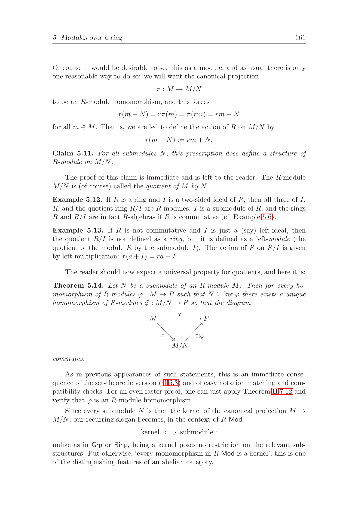

## 第 161 页句读：先说目的，再逐步展开

### 四、先有加法商，再问标量必须怎样定义

**这段在干什么：**完全展开作者 “there is only one reasonable way” 的推导。

$M$ 加法交换，所以子群 $N$ 自动正规，$M/N$ 已经是阿贝尔群。现在要把它升级为 $R$-模。

要求自然投影 $\pi(m)=m+N$ 是 $R$-线性，就必须

$$
r(m+N)=r\pi(m)=\pi(rm)=rm+N.
$$

因此标量作用的公式没有自由选择。真正要检查的是：若改换 $m$ 的代表元，结果会不会变？

假设 $m+N=m'+N$，等价于 $m'-m\in N$。则

$$
rm'-rm=r(m'-m)\in N
$$

正好由子模稳定条件保证。于是 $rm'+N=rm+N$，作用与代表元无关。

如果只有加法子群而不稳定，这一步可能失败。例如把 $\mathbb C$ 当复向量空间，取加法子群 $N=\mathbb R$，则 $0+N=1+N$，但乘 $i$ 后得到 $0+N$ 与 $i+N$，不同。因此这个加法商不能直接继承复数标量作用。

### 五、Claim III.5.11：良定义以后怎样继承模公理？

**这段在干什么：**将“公理显然继承”实际核验一遍，标明先后逻辑。

先有良定义，才有资格用任意代表元计算。然后

$$
r((m+N)+(m'+N))
=r(m+m')+N
=(rm+N)+(rm'+N),
$$

以及

$$
(rs)(m+N)=(rs)m+N=r(sm)+N=r(s(m+N)).
$$

标量加法的分配律同样从 $M$ 继承；$1(m+N)=m+N$。这样 $M/N$ 真成为模，且投影按构造线性。

这里要学的是一种通用顺序：**先由希望投影保结构推定运算，再证明与代表元无关，最后继承公理。**不能颠倒为“公式像模公理，所以肯定合法”。

### 六、Example III.5.13：左理想商为什么能是模，却不是环？

**这段在干什么：**给出环商与模商所需条件不同的具体非交换例子。

取 $R=M_2(k)$，$I=RE_{11}$，即第二列为零的矩阵全体。左乘任意矩阵，第二列仍零，所以是左理想。

但 $E_{11}\in I$ 而 $E_{11}E_{12}=E_{12}\notin I$，所以不右吸收，不是双边理想。

左模商 $R/I$ 仍可定义 $r(a+I)=ra+I$，因为所需检查只有 $rI\subseteq I$。

若想定义环乘法，因 $E_{11}+I=0+I$，它与 $E_{12}+I$ 的乘积应为零；按代表元相乘却得到 $E_{12}+I\ne0$。因此环乘法不良定义。

**少要求一种运算，就少需要一种吸收条件。**模不是凑合的环，它在研究不同的结构数据。

### 七、Theorem III.5.14：商的泛性质到底在承诺什么？

**这段在干什么：**逐项构造唯一下降映射，并说明核条件为何必要。

给 $f:M\to P$ 线性，且 $N\subseteq\ker f$。若要 $f=\widetilde f\circ\pi$，每个商类的像只能定义为

$$
\widetilde f(m+N)=f(m).
$$

若换代表元，$m'-m\in N$，于是 $f(m')-f(m)=f(m'-m)=0$，所以良定义。

保加法由 $f$ 保加法得到；对标量，

$$
\widetilde f(r(m+N))
=\widetilde f(rm+N)
=f(rm)=rf(m)=r\widetilde f(m+N).
$$

所以它是模同态。任何下降映射都必须在每个 $m+N$ 上取这个值，因此唯一；背后是投影满射，每个商元素都有代表。

条件也必要：若 $f=\widetilde f\pi$，则所有 $n\in N$ 经 $\pi$ 都成零，故 $f(n)=0$。因此泛性质准确刻画“哪些映射允许在合并 $N$ 后仍保留”。

### 八、kernel ⇔ submodule 为什么比环情形整齐？

**这段在干什么：**解释本页末尾的范畴评价，并总结学习等级。

已证每个模同态的核是子模。反过来，任意子模 $N$ 都是投影 $M\to M/N$ 的核。于是所有子模都能实现为核，不必另筛正常性或双边条件。

| 知识点与定位 | 等级 | 为什么重要 | 应达到的程度 |
|---|---|---|---|
| 子模与核、像，p160 | A | 后续所有商与正合构造依赖 | 逐项检查加法、标量稳定 |
| Claim III.5.11，p161 | A | 商上继承结构的基本模板 | 从投影线性推出公式，再做代表元检查 |
| Examples III.5.12–5.13 | B | 解释模怎样统一环中的不同角色 | 用左理想例子区分环商与模商 |
| Theorem III.5.14，p161 | A | 全部下降映射的依据 | 分开证明存在、线性、唯一 |
| kernel 与 submodule 的对应 | A | 为后面阿贝尔范畴语言提供实际内容 | 指出两方向各是哪条构造 |

---

[阅读目录](README.md) · [上一小节](05-III-5.2.md) · [下一小节](07-III-5.4.md)

# III 5.4. Canonical decomposition and isomorphism theorems｜模同态分解与同构定理

[阅读目录](README.md) · [上一小节](06-III-5.3.md) · [下一小节](08-III-6.1.md)

**本节总任务：把熟悉的核—像分解、子对象对应和两次取商统一搬到模。**原文只有一页，省略了许多证明；这里把它们依靠的映射逐个写清。

## 原书第 162 页：原文底本

完整保留本小节在此页的原文；PDF 阅读器页码为 185。原书习题区不在本次范围。

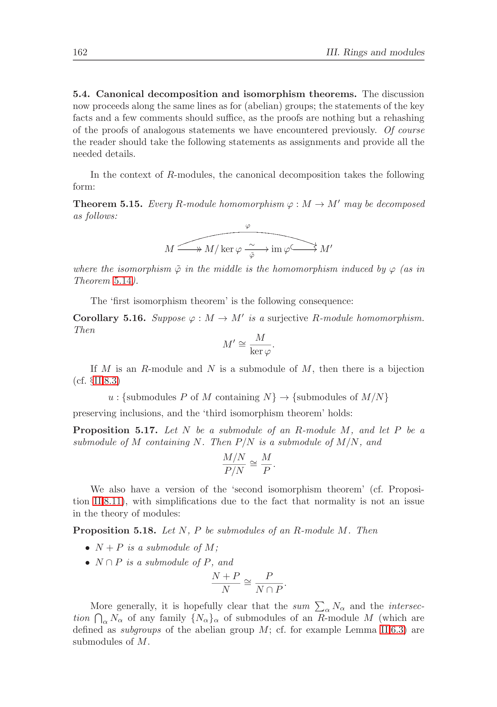

## 第 162 页句读：先说目的，再逐步展开

### 一、Theorem III.5.15：先合并哪些元素，才能消除同态的不单射？

**这段在干什么：**从同态的输出相同出发，推出正确的商，而不是先背分解图。

给模同态 $f:M\to M'$，有

$$
f(m)=f(n)\iff f(m-n)=0
\iff m-n\in\ker f.
$$

所以输出不能分辨的元素，恰好属于同一个 $\ker f$ 商类。记 $K=\ker f$，令

$$
\bar f:M/K\to\operatorname{im}f,\qquad m+K\mapsto f(m).
$$

良定义正由上面等价保证。若两商类输出相等，同样等价使它们相同，所以单射；任何像元素本就为某个 $f(m)$，所以满射。

它还线性：

$$
\bar f(r(m+K))=f(rm)=rf(m)=r\bar f(m+K),
$$

加法同理。因此

$$
\boxed{M\twoheadrightarrow M/\ker f
\xrightarrow[\cong]{\bar f}\operatorname{im}f
\hookrightarrow M'.}
$$

第一步只合并必要的元素；中间成为一一对应且保模结构；最后只是把像看进原目标。

### 二、Corollary III.5.16：满射为什么能直接识别商？

**这段在干什么：**说明第一同构定理的使用方法，并算一个完整具体例子。

若 $f$ 满射，像就是全部 $M'$，于是 $M/\ker f\cong M'$。关键工作通常不是重证定理，而是找对 $f$ 并准确算核。

例如取整数模映射

$$
f:\mathbb Z^2\to\mathbb Z,\qquad f(a,b)=2a+3b.
$$

它保加法与整数倍，且 $f(-1,1)=1$，所以满射。核由 $2a+3b=0$ 描述：3 整除 $a$，写 $a=3t$，则 $b=-2t$。因此

$$
\ker f=\mathbb Z(3,-2),\qquad
\mathbb Z^2/\mathbb Z(3,-2)\cong\mathbb Z.
$$

同构不是“去掉一个坐标”这么模糊，而是明确送 $(a,b)+\mathbb Z(3,-2)$ 到 $2a+3b$。例如 $(1,0)$ 与 $(4,-2)$ 差 $(3,-2)$，同像都是 2。

### 三、子模对应：为什么只对应包含 N 的子模？

**这段在干什么：**展开本页的包含保持双射，分清元素投影与子模集合的对应。

给 $\pi:M\to M/N$。若子模 $P\subseteq M$ 包含 $N$，其像为 $P/N$。反过来，给商内子模 $Q$，取逆像 $\pi^{-1}(Q)$。

逆像是子模，因为线性映射下的加法与标量检查都能送过去完成；而且它含 $N$，因为 $N$ 全送为零，零在任何子模里。

两操作互逆：

$$
\pi^{-1}(P/N)=P.
$$

证明是：若 $\pi(m)=\pi(p)$、$p\in P$，则 $m-p\in N\subseteq P$，所以 $m\in P$。这里正用到 $P$ 含 $N$。另一方向 $\pi(\pi^{-1}(Q))=Q$ 用投影满射。

所以它是两类**子模组成的集合**之间的双射，不是说 $\pi$ 在每个元素上单射。

### 四、Proposition III.5.17：先除 N 再除 P/N，为何等于直接除 P？

**这段在干什么：**选出第三同构定理的实际映射并算核。

设 $N\subseteq P\subseteq M$。定义

$$
g:M/N\to M/P,\qquad m+N\mapsto m+P.
$$

若代表元差在 $N$，也在 $P$，所以良定义。它显然线性并满射；被送成零的类是 $m\in P$ 的那些，故 $\ker g=P/N$。

第一同构定理立刻给

$$
\boxed{(M/N)/(P/N)\cong M/P.}
$$

例如 $\mathbb Z$ 中 $12\mathbb Z\subseteq4\mathbb Z$，先模 12，再合并 4 的倍数类，最后等于直接模 4。这里的第二个“除”是除一个子模，不是把模数做数字除法。

### 五、Proposition III.5.18：P 加进 N 后，哪些信息真的新增加了？

**这段在干什么：**从限制投影推出第二同构定理，说明交为何自然成为核。

$N+P=\{n+p:n\in N,p\in P\}$ 是子模：加法与标量都逐项保持这种形式。$N\cap P$ 当然也是子模。

定义

$$
h:P\to(N+P)/N,\qquad p\mapsto p+N.
$$

它满射，因为任意 $(n+p)+N=p+N$；核是那些同时在 $P$ 和 $N$ 的元素，即 $N\cap P$。所以

$$
\boxed{P/(N\cap P)\cong(N+P)/N.}
$$

大白话说：把 $P$ 加进已经忽略的 $N$ 后，$P$ 里本来就属于 $N$ 的部分不会提供新信息，必须先在左边除掉。

整数例子 $N=6\mathbb Z,P=10\mathbb Z$，和为 $2\mathbb Z$、交为 $30\mathbb Z$，于是 $10\mathbb Z/30\mathbb Z\cong2\mathbb Z/6\mathbb Z$。映射明确为 $10t+30\mathbb Z\mapsto10t+6\mathbb Z$，不是只凭两边各有三个元素猜同构。

### 六、本节分级与推导总结

**这段在干什么：**把四种结论还原成少数可重复使用的证明动作。

| 知识点与定位 | 等级 | 为什么重要 | 应达到的程度 |
|---|---|---|---|
| Theorem III.5.15、Corollary III.5.16 | A | 识别商模的基本工具 | 会找同态并算核、像 |
| 子模对应，p162 | A | 正确追踪商前后的子对象 | 写出像与逆像，知道包含 $N$ 用在哪里 |
| Proposition III.5.17 | B | 群论模板在模中的复用 | 找到 $m+N\mapsto m+P$ 即能重建 |
| Proposition III.5.18 | A/B | 后面 Noetherian 证明立刻调用 | 结论会用，证明抓住限制投影的核 |

每条同构都来自同一个策略：先看要保留什么 → 构造自然线性映射 → 说明为什么满 → 说明什么被杀掉 → 第一同构定理。范畴语言没有免掉证明，而是帮你识别哪些证明其实是同一个构造。

---

[阅读目录](README.md) · [上一小节](06-III-5.3.md) · [下一小节](08-III-6.1.md)

# III 6.1. Products and coproducts｜积与余积为什么由同一个直和实现

[阅读目录](README.md) · [上一小节](07-III-5.4.md) · [下一小节](09-III-6.2.md)

**本节总任务：给两个模造一个共同对象，使“同时映进去”和“分别映出来”都得到唯一映射。**有限情况下，这两个相反要求由同一个直和实现。

## 原书第 164 页：原文底本

完整保留本小节在此页的原文；PDF 阅读器页码为 187。原书习题区不在本次范围。

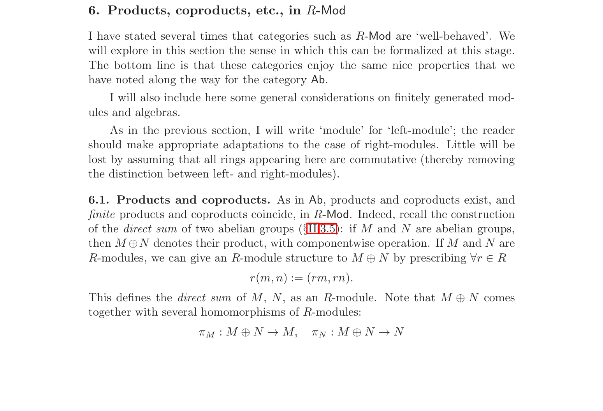

## 第 164 页句读：先说目的，再逐步展开

### 一、先造对象：把两个模并排放，不把它们的元素混加

**这段在干什么：**解释 §6 导言和 6.1 开头的逐分量结构。

给 $R$-模 $M,N$，取有序对集合 $M\times N$。定义

$$
(m,n)+(m',n')=(m+m',n+n'),\qquad
r(m,n)=(rm,rn).
$$

每条模公理在两个分量分别成立，因此这真是一个模，记 $M\oplus N$。

零元是 $(0_M,0_N)$。不要把 $M,N$ 当作原来就能互相相加的同一集合：对 $(m,n)$ 的描述，是为两类分量分配各自位置。

这个对象带四种自然映射。投影取出分量，$\pi_M(m,n)=m,\pi_N(m,n)=n$；嵌入把另一个分量填零，$i_M(m)=(m,0),i_N(n)=(0,n)$。

投影往外看各分量，嵌入从分量往里放。积、余积的两种泛性质就分别依靠它们。

## 原书第 165 页：原文底本

完整保留本小节在此页的原文；PDF 阅读器页码为 188。原书习题区不在本次范围。

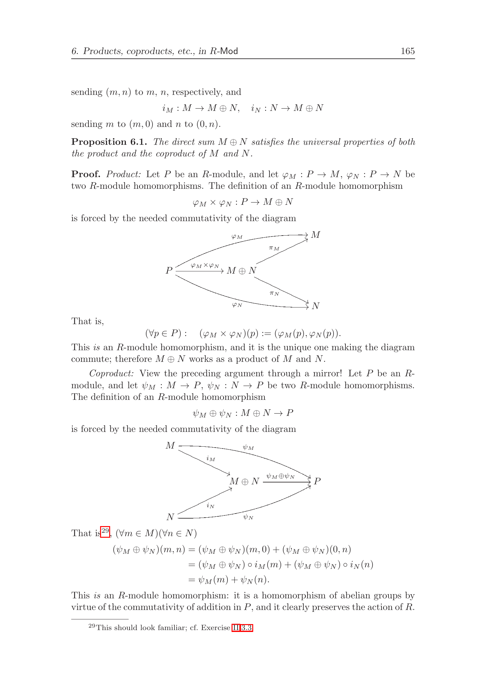

## 第 165 页句读：先说目的，再逐步展开

### 二、积的泛性质：已知一个对象到 M、N 的映射，怎样一次打包？

**这段在干什么：**逐项证明 Proposition III.6.1 的 product 部分，说明唯一性是怎样被投影逼出的。

给一个模 $P$ 和两条线性映射 $f:P\to M,g:P\to N$。要找 $h:P\to M\oplus N$ 满足

$$
\pi_Mh=f,\qquad\pi_Nh=g.
$$

这两个条件已经规定了 $h(p)$ 的两个坐标，所以只能

$$
h(p)=(f(p),g(p)).
$$

因此唯一性先有了候选理由，接着检查候选确实线性：

$$
h(p+p')=(f(p)+f(p'),g(p)+g(p'))=h(p)+h(p'),
$$

$$
h(rp)=(rf(p),rg(p))=rh(p).
$$

投影关系也按定义成立。于是存在且唯一，这才完成泛性质。

大白话：分别知道同一个输入送到两处哪里，就能把两份输出放进一个有序对。积解决的是**箭头从共同来源进来**的问题。

### 三、余积的泛性质：分别给出 M、N 的输出，怎样合并？

**这段在干什么：**证明 product 的“镜像”结论，并解释加法交换在哪里使用。

现在箭头反过来，给 $f:M\to P,g:N\to P$。要找 $h:M\oplus N\to P$ 满足

$$
hi_M=f,\qquad hi_N=g.
$$

每个 $(m,n)$ 都有固定分解 $(m,0)+(0,n)$。若 $h$ 线性，便必须

$$
h(m,n)=f(m)+g(n).
$$

再检查候选。对两对元素相加，左边给

$$
f(m)+f(m')+g(n)+g(n'),
$$

右边 $h(m,n)+h(m',n')$ 给

$$
f(m)+g(n)+f(m')+g(n').
$$

它们相等用到 $P$ 的加法交换。标量相容则由分配律得到。嵌入关系明显成立，唯一性已由分解强迫。

因此同一个 $M\oplus N$ 也是余积。余积解决的是**从各个来源向共同目标出去**的问题。

### 四、为什么“同一个对象满足两种泛性质”不是把两种概念合并？

**这段在干什么：**分清对象的构造与它连同哪些结构映射一起被使用。

作为积，重要数据是两个投影；作为余积，重要数据是两个嵌入。泛性质比较的图和箭头方向不同，只是有限模情形可由同一底层对象同时实现，常称双积。

例如两个映射 $P\to M,N$ 的合并公式是有序对；两个映射 $M,N\to P$ 的合并公式是输出相加。它们不是把同一个等式左右翻一下，而是解决不同的映射问题。

范畴论的作用是明确“要和所有其他对象怎样联系”，而非只在某个集合里找到两个坐标。

## 原书第 166 页：原文底本

完整保留本小节在此页的原文；PDF 阅读器页码为 189。原书习题区不在本次范围。

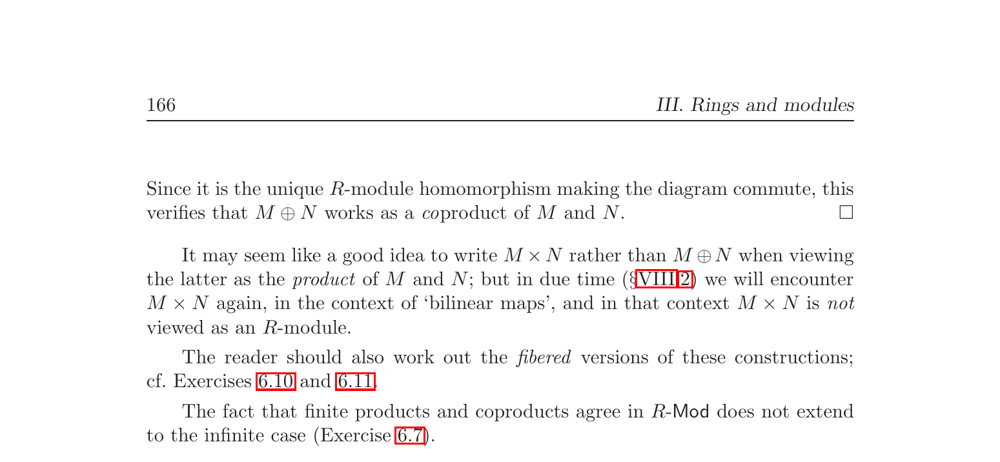

## 第 166 页句读：先说目的，再逐步展开

### 五、无限多个模时，有限直和的结论哪里失效？

**这段在干什么：**解释原文末尾的警告，指出“每个元素只用有限项”的作用。

对一族 $M_a$，积 $\prod_aM_a$ 允许任意坐标族；直和 $\bigoplus_aM_a$ 只允许有限多个非零坐标。有限指标下两者一样，指标无限时一般不同。

积仍按所有投影打包输入。余积则要把各分量映到同一目标，公式是

$$
h((m_a))=\sum_a f_a(m_a).
$$

直和的有限支撑保证这个和有定义：普通模没有给一般无穷和额外意义。

取可数个 $\mathbb Z$。直和所有有限支撑整数列是可数集合；积包含所有 0、1 无限列，已不可数。因此它们甚至不可能是集合上一一对应的对象，更不可能模同构。

这比仅说“我写不出一个无穷和”更强：它给出确凿的不一样例子。

### 六、为什么作者以后写 M×N 时，又可能不把它当这个模？

**这段在干什么：**说明双线性问题与线性问题的类型区别，不让记号造成误读。

同一个有序对集合可以被用于不同问题。例如 $k\times k\to k$ 的乘法 $(a,b)\mapsto ab$ 对每个变量分别线性，但不是按直和模结构的线性映射：

$$
(1,0)+(0,1)=(1,1),\qquad
1\cdot1\ne1\cdot0+0\cdot1.
$$

所以“分别线性”与“对整个有序对线性”不同。后面张量积正为双线性问题服务；本节仍在讨论普通模同态的积与余积。

### 七、本节分级与推导总结

**这段在干什么：**用映射方向和有限支撑两条线索保存整节内容。

| 知识点与定位 | 等级 | 为什么重要 | 应达到的程度 |
|---|---|---|---|
| 逐分量模与四个自然映射，pp164–165 | A | 后续分裂、自由模都使用 | 会写投影、嵌入及其类型 |
| Proposition III.6.1，p165 | A | 是两种泛性质的典型实算 | 从交换条件推出唯一公式并检验线性 |
| 无限积与直和，p166 的提示 | A | 决定自由模和泛性质是否合法 | 说明有限支撑为何是必要构造 |
| 双线性记号提示，p166 | C | 为后章作边界标记 | 不将分别线性误当整体线性 |

积靠坐标由投影确定；余积靠有限分解与加法确定。两种唯一性有不同来源，却在有限模上相遇。

---

[阅读目录](README.md) · [上一小节](07-III-5.4.md) · [下一小节](09-III-6.2.md)

# III 6.2. Kernels and cokernels｜核、余核及单满性的范畴解释

[阅读目录](README.md) · [上一小节](08-III-6.1.md) · [下一小节](10-III-6.3.md)

**本节总任务：把核、余核写成明确的泛性质，并用它们判断单态、满态。**同时要分清：单、满不自动提供线性逆向选择。

## 原书第 166 页：原文底本

完整保留本小节在此页的原文；PDF 阅读器页码为 189。原书习题区不在本次范围。

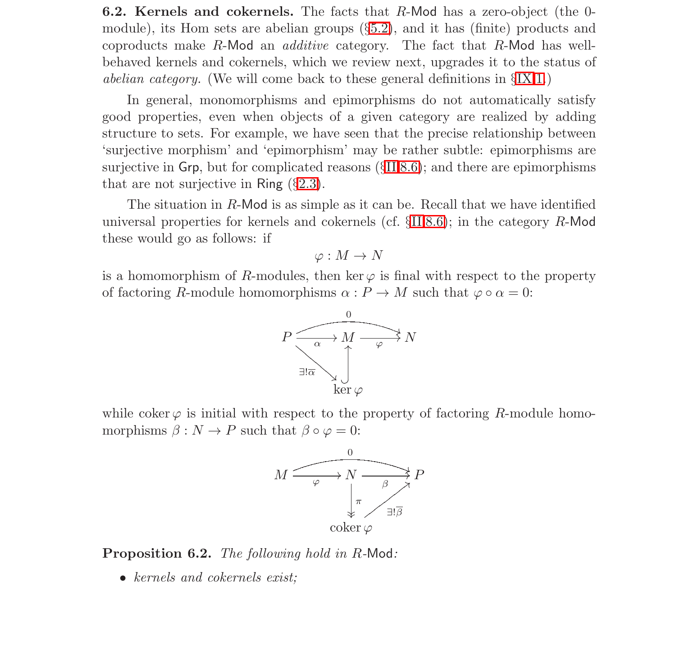

## 第 166 页句读：先说目的，再逐步展开

### 一、“模范畴好用”现在有哪些具体证据？

**这段在干什么：**解释 additive、abelian 这些名字在本页先指向哪些已完成的构造。

我们已得到零对象，任意 Hom 集能相加，有限积和余积又由同一个直和实现。它们让线性映射可以相加、相减，并在多个对象间打包。

接下来还要能稳定地取核与余核，使每个子模都能成为某个核、每个合适商都能成为某个余核。满足完整相应公理的类别称阿贝尔范畴，正式定义在后面章节。

当前不要把几个例子当作完整抽象定义；先看“好用”具体是下面哪些操作真的存在并满足所需性质。

### 二、核的泛性质：所有被 f 送成零的输入，怎样统一收进去？

**这段在干什么：**读懂原文关于 kernel 的交换图，并解释终对象方向。

给 $f:M\to N$，取 $K=\{m:f(m)=0\}$ 和包含 $i:K\hookrightarrow M$。它满足 $fi=0$。

若另有 $a:P\to M$ 满足 $fa=0$，则每个 $a(p)$ 都在 $K$。因此存在唯一

$$
\bar a:P\to K,\qquad \bar a(p)=a(p)
$$

使 $i\bar a=a$。线性没有改变，因为只把输出目标收窄到子模。

所以核把所有“送到 $M$ 后会被 $f$ 杀掉”的映射统一接收；这些候选最后都唯一映向 $K$，这就是该问题中的终对象性质。

不是只有元素集合 $K$ 重要，包含箭头也在数据中。只给一个抽象同构模而不说明它怎样进入 $M$，还没有完整交代核。

### 三、余核的泛性质：怎样作最少的合并，让 f 的输出全部成为零？

**这段在干什么：**为 cokernel 找具体对象，而不是只把 kernel 图反着背。

要在目标 $N$ 上让 $f(M)$ 全成零，最自然是除去像：

$$
C=N/\operatorname{im}f,\qquad q:N\to C.
$$

若 $b:N\to P$ 满足 $bf=0$，则 $\operatorname{im}f\subseteq\ker b$。商的泛性质给唯一

$$
\bar b:C\to P,\qquad n+\operatorname{im}f\mapsto b(n)
$$

使 $\bar bq=b$。因此 $C$ 是余核。

核是把允许输入收窄到子对象；余核是在目标里作合并。两者方向相反，但都由一个“复合为零”的要求和唯一分解规定。

## 原书第 167 页：原文底本

完整保留本小节在此页的原文；PDF 阅读器页码为 190。原书习题区不在本次范围。

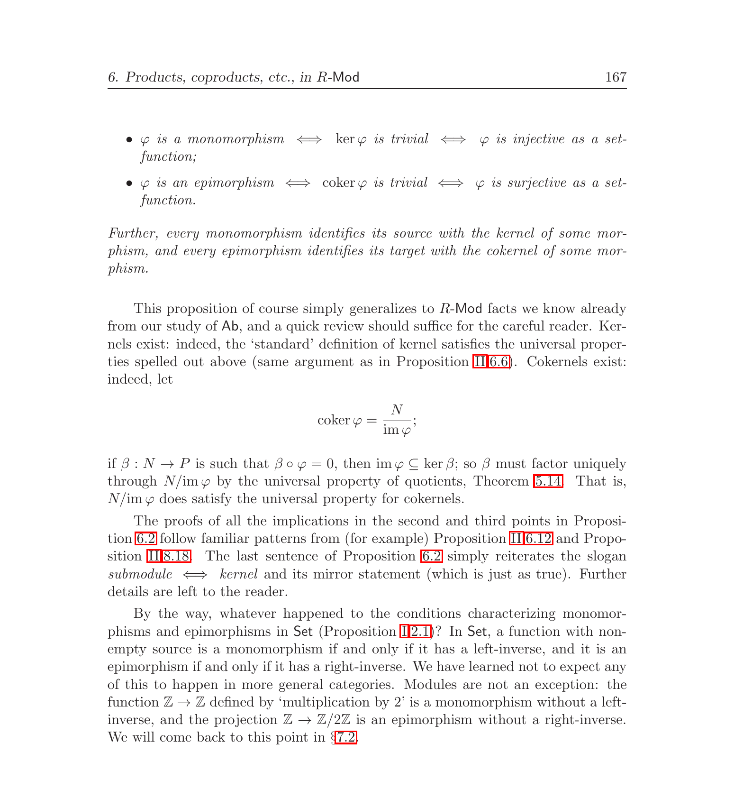

## 第 167 页句读：先说目的，再逐步展开

### 四、Proposition III.6.2：为什么 mono 等价于核为零，也等价于单射？

**这段在干什么：**给范畴消去条件一个元素可检验的版本。

若核为零，$f(m)=f(n)$ 就使 $m-n$ 在核中，故 $m=n$。反过来，单射显然只把零送到零。

单射满足范畴 mono 的左消去：若 $fa=fb$，逐元素由单射得 $a=b$。

反过来，若 $f$ 是 mono，取任意 $m\in\ker f$，构造两个线性映射

$$
u,v:R\to M,\qquad u(r)=rm,\quad v(r)=0.
$$

$fu=fv=0$。mono 迫使 $u=v$，代入 $r=1$ 得 $m=0$。因此核为零。

这个证明说明为什么把 $R$ 当测试对象能探测元素：每个 $m$ 都由 $1\mapsto m$ 的线性映射编码。

### 五、为什么 epi 等价于余核为零，也等价于满射？

**这段在干什么：**用余核投影检验范畴满态，而非把环范畴的情况误搬过来。

若 $f$ 满射，任何 $a,b:N\to P$ 满足 $af=bf$，都在所有 $N$ 元素上相等，所以 $a=b$，是 epi。

若 $f$ 是 epi，取余核投影 $q:N\to N/\operatorname{im}f$。因为 $qf=0f$，epi 迫使 $q=0$。但 $q$ 又满射，因此商只能为零，即 $\operatorname{im}f=N$。

所以三者等价。这里与 Ring 不同：$\mathbb Z\hookrightarrow\mathbb Q$ 是环范畴的非满射 epi，但作为整数模映射，它的余核 $\mathbb Q/\mathbb Z$ 非零，所以不是 epi。

“epi 就是满射”必须带上范畴；模里成立不表示任何加结构的集合类别里都成立。

### 六、每个单态是核、每个满态是余核，应怎样准确理解？

**这段在干什么：**说明 III.6.2 最后一条并非再增加一个未构造的新对象。

若 $f:M\to N$ 单射，它将 $M$ 同构到 $\operatorname{im}f$；而后者正是 $N\to N/\operatorname{im}f$ 的核。因此在这项同构识别下，$f$ 就是某个映射的核箭头。

若 $f$ 满射，由第一同构定理 $N\cong M/\ker f$；所以同构识别后，它是 $\ker f\hookrightarrow M$ 的余核箭头。

这里需要“通过自然同构识别”，不要求不同底层集合字面完全相同。范畴性质关心映射与其分解关系，允许同构替换对象。

### 七、为什么单射、满射还不保证能在线性范畴里倒着选？

**这段在干什么：**解释页末两个反例，并为分裂正合列提出真正的问题。

整数模映射 $f:\mathbb Z\to\mathbb Z$、$f(n)=2n$ 单射。若有线性左逆 $g$，则

$$
1=g(2)=2g(1),
$$

整数里不可能。所以不能像在实向量空间里那样直接写“除以 2”。

投影 $\pi:\mathbb Z\to\mathbb Z/2\mathbb Z$ 满射。若有线性右逆 $s$，令 $m=s([1])$，则 $2m=s(2[1])=s(0)=0$。整数无非零有限阶元，故 $m=0$，与 $\pi(m)=[1]$ 矛盾。

按集合选代表元可以选 0、1，但这个选择不保加法：$[1]+[1]=[0]$，而 $1+1\ne0$。因此不是合法模态射。后面“分裂”正要判断能否作这种**保持结构的选择**。

### 八、本节分级与推导总结

**这段在干什么：**保留判据与适用边界，而不让抽象名称代替构造。

| 知识点与定位 | 等级 | 为什么重要 | 应达到的程度 |
|---|---|---|---|
| kernel、cokernel 泛性质，pp166–167 | A | 为正合与同调提供基本材料 | 写清对象、箭头、复合为零、唯一分解 |
| Proposition III.6.2 的 mono/epi 判据 | A | 允许在范畴与元素之间切换 | 会用 $R$ 探针及余核投影证明反向 |
| 单满态实现为核余核，p167 | B | 连接阿贝尔范畴观点 | 知道需要哪条自然投影与同构 |
| 两个不分裂的整数例子，p167 | A | 防止将集合逆或域上线性直觉误用 | 指出逆映射为何不能线性 |
| 一般 abelian category 定义 | C | 后章抽象化 | 先掌握模里的具体构造即可 |

---

[阅读目录](README.md) · [上一小节](08-III-6.1.md) · [下一小节](10-III-6.3.md)

# III 6.3. Free modules and free algebras｜自由对象怎样由允许的运算决定

[阅读目录](README.md) · [上一小节](09-III-6.2.md) · [下一小节](11-III-6.4.md)

**本节总任务：给定一批名字，造出只满足模公理、没有额外线性关系的对象；再看换成代数范畴时，允许的运算改变了，为什么自由对象也要改变。**

## 原书第 167 页：原文底本

完整保留本小节在此页的原文；PDF 阅读器页码为 190。原书习题区不在本次范围。

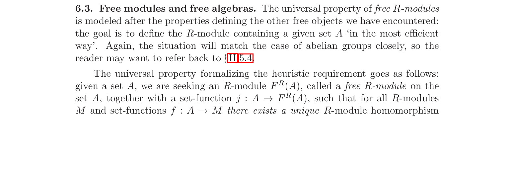

## 第 167 页句读：先说目的，再逐步展开

### 一、“自由”先用映射要求表达，而不是凭外观判断

**这段在干什么：**解释本节开头的泛性质为何允许对生成元任意指定像。

给一个集合 $A$，其中元素先只是标签。希望有 $j:A\to F_R(A)$，使任意模 $M$、任意集合函数 $f:A\to M$ 都唯一延拓成线性映射

$$
\Phi:F_R(A)\to M,\qquad \Phi\circ j=f.
$$

任意指定像意味着标签之间不能预先添加某条额外关系。例如若强行让 $2j(a)=0$，映到 $\mathbb Z$ 时就不能任取 $f(a)=1$。这会违反泛性质。

唯一延拓又要求自由对象里每个元素能由这些标签和模运算确定，不能另藏一批与生成元无关、映射还可随意选择的元素。

所以“没有多余关系”和“没有多余元素”在这个泛性质中同时受到约束。接下来不是再添加定义，而是找一个确实满足它的构造。

## 原书第 168 页：原文底本

完整保留本小节在此页的原文；PDF 阅读器页码为 191。原书习题区不在本次范围。

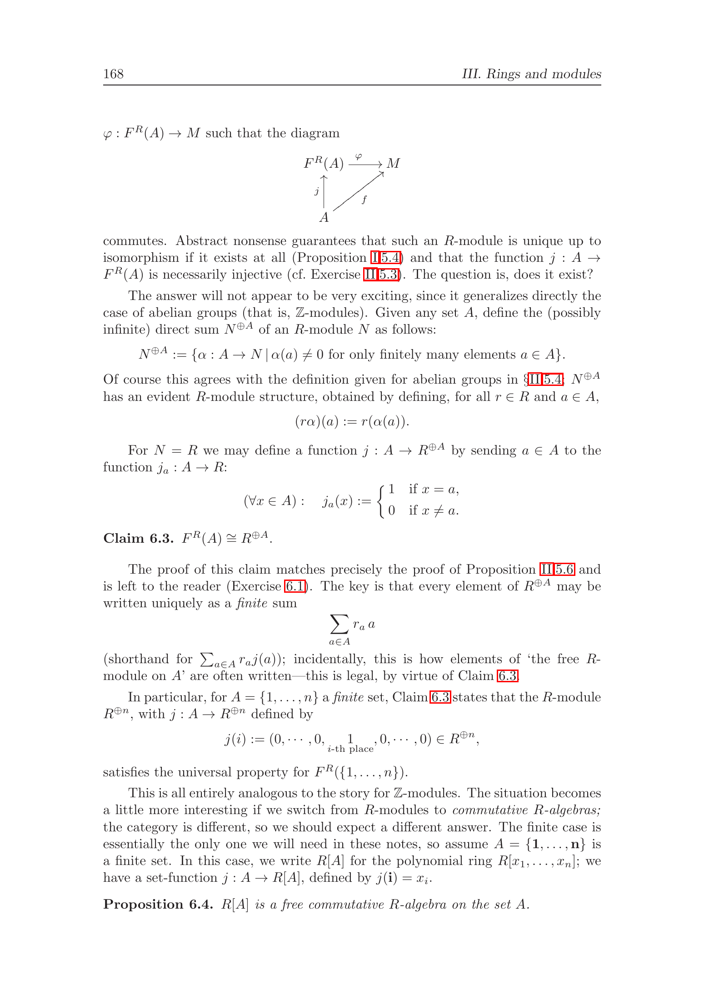

## 第 168 页句读：先说目的，再逐步展开

### 二、为什么自由模用有限支撑函数造，而不是所有函数？

**这段在干什么：**解释 $R^{\oplus A}$ 的成员及其与形式线性组合的关系。

一个元素可写成函数 $\alpha:A\to R$，只在有限多个标签上非零。把 $\alpha(a)=r_a$，就可等价写成有限形式和

$$
\sum_{a\in A}r_a e_a.
$$

$e_a$ 是在位置 $a$ 为 1、其他位置为 0 的函数。有限支撑保证每个元素真是有限线性组合，而不是未经定义的无穷和。

例如 $A=\{u,v,w,\ldots\}$，元素 $2e_u-3e_w$ 记录 $u$ 位置系数 2、$w$ 位置系数 $-3$。标签可无限，单个元素仍只使用有限部分。

逐点加法与标量乘法使它成为模。若 $\sum r_ae_a=0$，看每个坐标就得到所有 $r_a=0$；这解释“自由”对应的唯一表达。

这里通常取非零环。若 $R$ 为零环，保幺模只有零模，自由对象仍存在，但 $A\to0$ 不一定单射。原文说 $j$ 必单射时，需要这项非退化条件，不能把它当对零环也无例外的结论。

### 三、Claim III.6.3：存在、线性、唯一各由什么保证？

**这段在干什么：**补全作者省略的自由模泛性质证明。

给任意 $f:A\to M$，唯一期望的公式是

$$
\Phi\left(\sum_a r_ae_a\right)=\sum_a r_af(a).
$$

**有定义。**每次只有有限项，并且坐标表达唯一，不会因另一种表达得到另一输出。

**线性。**两个输入相加时系数逐项相加，分配律给输出相加；左乘 $s$ 后，系数为 $sr_a$，于是输出为 $\sum(sr_a)f(a)=s\sum r_af(a)$。

**延拓。**代入 $e_a$ 就得到 $\Phi(e_a)=f(a)$。

**唯一。**任何线性映射若在每个 $e_a$ 上取 $f(a)$，对任意有限组合都必须按上式取值，无处再作选择。

因此 $F_R(A)\cong R^{\oplus A}$。抽象泛性质与具体函数模型完成对接。

### 四、有限自由模为什么就是 Rⁿ，而有限生成模未必自由？

**这段在干什么：**解释本页有限集合特例，并预防下一节的常见误判。

$A=\{1,\ldots,n\}$ 时，一切函数都自动有限支撑，得到 $R^n$，$e_i$ 就是标准坐标向量。任意线性映射由这 $n$ 个向量的像唯一决定。

但“有 $n$ 个生成元”只保证表达存在，不保证唯一。$\mathbb Z/2\mathbb Z$ 由 $[1]$ 生成，却有 $2[1]=0$，所以不同整数系数给同一元素，不能成为自由 $\mathbb Z$-模。

因此模理论不能把向量空间里“从生成集删去冗余得到基”的结论无条件搬来。额外关系可能无法通过简单删除生成元消失。

### 五、自由交换代数为什么是多项式环，而不是 Rⁿ？

**这段在干什么：**解释 Proposition III.6.4 提出的问题为什么变了。

模只允许加法与标量乘法，因此从标签 $a,b$ 造出的元素是 $ra+sb$ 等线性组合。

代数还允许对象内部相乘，于是必须包含 $a^2,ab,b^3$ 等新元素。若要求交换，便由交换多项式记录，得到 $R[x_1,\ldots,x_n]$。

换了范畴，态射还得保乘法；自由对象自然不同。“在一个集合上自由生成”并没有脱离范畴的唯一固定答案。

## 原书第 169 页：原文底本

完整保留本小节在此页的原文；PDF 阅读器页码为 192。原书习题区不在本次范围。

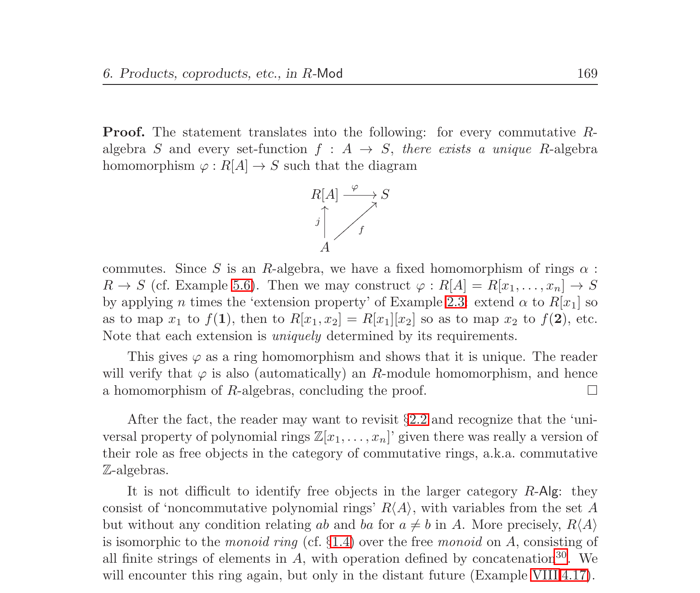

## 第 169 页句读：先说目的，再逐步展开

### 六、Proposition III.6.4：为什么任意指定变量像就唯一得到代数同态？

**这段在干什么：**把本页延拓证明写成明确公式，并说明系数像已经是对象数据。

固定交换环 $R$ 和交换 $R$-代数 $\alpha:R\to S$。给变量的任意像 $b_1,\ldots,b_n\in S$，定义

$$
\Phi\left(\sum_{\nu}r_\nu x_1^{\nu_1}\cdots x_n^{\nu_n}\right)
=\sum_\nu\alpha(r_\nu)b_1^{\nu_1}\cdots b_n^{\nu_n}.
$$

每个多项式只有有限项，所以计算合法。加法显然保；乘法由 $S$ 的交换性保证可按相同指数合并；1 保住；系数 $r$ 被送为 $\alpha(r)$。

因此 $\Phi$ 是环同态。还要核对标量：$\Phi(rp)=\Phi(r)\Phi(p)=\alpha(r)\Phi(p)=r\Phi(p)$，所以它确实保固定 $R$ 作用，是代数同态。唯一性来自每个多项式都由系数和变量经加乘构成，这些像一旦定好就全部定好。

原文逐个延拓变量，与上面一次写出公式是同一件事。前者强调构造过程，后者方便直接看每个多项式的像。

### 七、若目标代数不交换，为什么普通多项式环不够自由？

**这段在干什么：**解释作者末尾引入 $R\langle A\rangle$ 的动机，而不另展开完整构造理论。

普通多项式环内 $xy=yx$。若将 $x,y$ 任意送到非交换目标里的矩阵 $B,C$，环同态就会迫使 $BC=CB$，而任意矩阵未必满足。这说明普通多项式环只适合相应交换目标。

若希望不限制变量像彼此交换，就必须把 $xy$ 与 $yx$ 保留为不同的词。用所有有限词作基，乘法为连接词，得到非交换多项式环 $R\langle A\rangle$；空词作 1。

它和自由群的“词”相似，但没有自动逆元，也没有 $aa^{-1}$ 消去。作者这里只预告以后会再用，知道构造为何需要改变就够。

### 八、本节分级与推导总结

**这段在干什么：**把不同自由对象的运算权限与泛性质一一对齐。

| 知识点与定位 | 等级 | 为什么重要 | 应达到的程度 |
|---|---|---|---|
| 自由模泛性质，pp167–168 | A | 此后生成、表示、提升都依赖 | 清楚对象、集合映射、唯一下降箭头 |
| Claim III.6.3，p168 | A | 把抽象对象具体化 | 从有限支撑构造延拓并检验唯一 |
| 自由与有限生成区别 | A | 模理论不同于域上线性代数的关键 | 区分存在表达与唯一表达 |
| Proposition III.6.4，pp168–169 | A | 多项式环在代数范畴里的角色 | 根据变量像写出唯一同态 |
| 非交换自由代数，p169 | C | 后章结构入口 | 知道为什么需要保留词序 |

一句推导总结：给定标签以后，先看允许加、乘、标量中的哪些运算，再造只受这些公理约束的形式表达；泛性质证明所有赋值都能且只能以一种方式延拓。

---

[阅读目录](README.md) · [上一小节](09-III-6.2.md) · [下一小节](11-III-6.4.md)

# III 6.4. Submodule generated by a subset; Noetherian modules｜生成元与 Noetherian 性质

[阅读目录](README.md) · [上一小节](10-III-6.3.md) · [下一小节](12-III-6.5.md)

**本节总任务：把自由模映到一个已有模，取得生成子模；再问有限生成是否能对子模与商稳定。**Noetherian 条件正是为控制这项稳定性出现的。

## 原书第 169 页：原文底本

完整保留本小节在此页的原文；PDF 阅读器页码为 192。原书习题区不在本次范围。

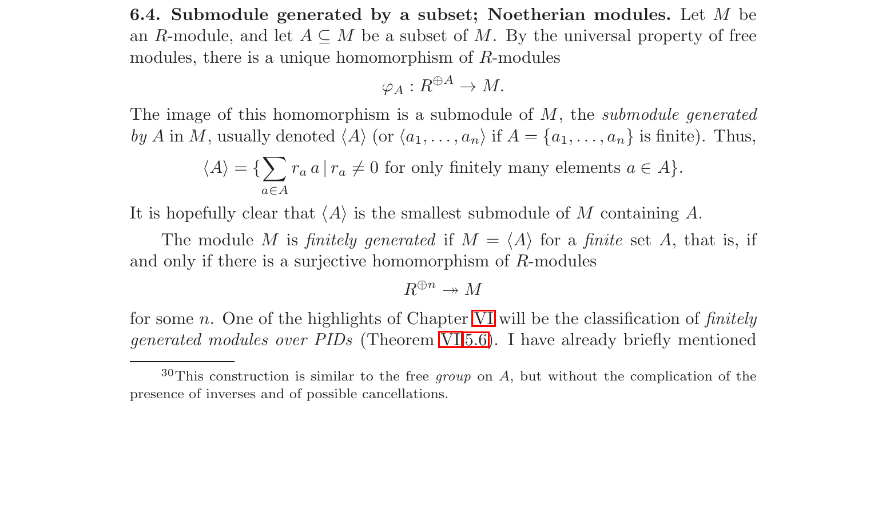

## 第 169 页句读：先说目的，再逐步展开

### 一、为什么生成子模是自由模映射的像？

**这段在干什么：**解释作者不是重新凭空定义线性组合，而是在使用前节的泛性质。

给子集 $A\subseteq M$。已有包含集合映射 $A\to M$，自由模性质给唯一线性映射

$$
\varphi_A:R^{\oplus A}\to M,\qquad
\sum r_ae_a\longmapsto\sum r_aa.
$$

它的像就是所有由 $A$ 作有限线性组合得到的元素，记为 $\langle A\rangle$。

像是子模，因此这套线性组合自动形成子模。任意包含 $A$ 的子模都必须包含所有这种有限组合，所以它又是最小的。这里“像的构造”与“最小封闭子对象”给同一个结果。

例如在 $\mathbb Z^2$，由 $(2,0),(0,3)$ 生成的是全部 $(2a,3b)$，不是整个 $\mathbb Z^2$。若换底环为 $\mathbb Q$ 并放在 $\mathbb Q^2$ 中，它们却能生成全部空间。生成问题仍依赖标量来源。

### 二、有限生成为什么等价于某个 Rⁿ 满射到 M？

**这段在干什么：**将生成元语言换成映射语言，为后面的证明准备可使用的箭头。

若 $M$ 由 $m_1,\ldots,m_n$ 生成，定义

$$
F:R^n\to M,\qquad(r_1,\ldots,r_n)\mapsto\sum r_im_i.
$$

生成的意思正是任意元素都能这样写，所以 $F$ 满射。反过来，若给这样的满射，每个元素都来自某个坐标列，由线性可用 $F(e_1),\ldots,F(e_n)$ 生成。

因此“有限生成”不要求映射单射。核记录生成元间的关系；自由 $R^n$ 与它的商可能很不一样。这是以后有限表示与关系矩阵的入口，但这里先不额外展开后章理论。

## 原书第 170 页：原文底本

完整保留本小节在此页的原文；PDF 阅读器页码为 193。原书习题区不在本次范围。

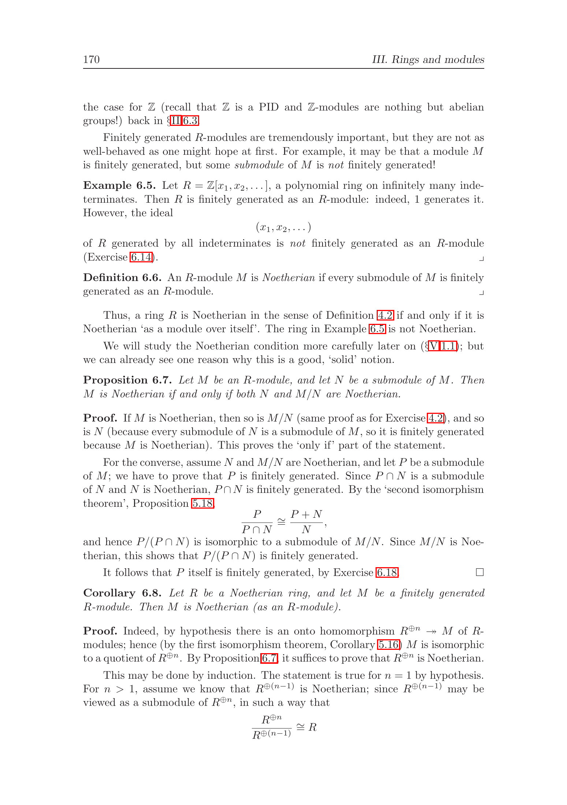

## 第 170 页句读：先说目的，再逐步展开

### 三、Example III.6.5：为什么全模一个生成元，子模却可能要无限多个？

**这段在干什么：**把原文反例的真正障碍证明出来，不用有限维向量空间直觉代替判断。

取 $R=\mathbb Z[x_1,x_2,\ldots]$。作为自身模，$1$ 就生成全部 $R$。但理想 $I=(x_1,x_2,\ldots)$ 不有限生成。

假设它由有限多项式 $f_1,\ldots,f_s$ 生成。这些多项式总共只使用有限多个变量，设在 $x_1,\ldots,x_N$ 内（可重排标签）。

把这些变量全部设零，其他变量保留。每个 $f_i$ 都在 $I$，没有纯整数常数项，所以全部变零。因此它们生成的任意组合也变零。

但 $x_{N+1}\in I$ 在这个代入下仍为 $x_{N+1}\ne0$，矛盾。

要注意不能只说“系数含不到新变量”，因为乘上任意 $R$ 元素本来就可能带新变量。正确证明是选择一个环同态，让有限生成元同时消失，却让漏掉的变量不消失。

### 四、Noetherian 模比有限生成多要求了什么？

**这段在干什么：**解释 Definition III.6.6 的全称量词及它与前面 Noetherian 环的关系。

有限生成只看 $M$ 自己。Noetherian 模要求 $M$ 的**每一个子模**都有限生成，包括 $M$ 自身。

因此 Noetherian 模一定有限生成，反向刚才的 $R$ 例子已经否定。对交换环 $R$，自身的子模正是理想，所以 $R$ 是 Noetherian 环，当且仅当 $R$ 作为自身模 Noetherian。

这不是两套偶然同名的概念，而是一般模块条件在正则模 $R$ 上的特例。

### 五、Proposition III.6.7 的正向：为什么子模与商都继承 Noetherian？

**这段在干什么：**把“显然继承”和“同上一道证明”展开成可检查构造。

设 $M$ Noetherian，$N\subseteq M$。任意 $N$ 的子模也是 $M$ 的子模，因此有限生成，故 $N$ Noetherian。

对 $M/N$ 中任意子模 $Q$，取逆像 $P\subseteq M$。$P$ 有有限生成元 $p_1,\ldots,p_s$。投影后的 $\bar p_1,\ldots,\bar p_s$ 生成 $Q$：因为每个 $Q$ 元素都有 $P$ 中原像，可先在线性组合里表达再投影。

因此商也 Noetherian。商的有限生成元从原像里取出，不是从商里无凭据地猜。

### 六、III.6.7 的反向：怎样把商里生成的部分与核里残留的部分拼起来？

**这段在干什么：**补出原文留给其他地方的有限生成拼合步骤，是全节最重要的证明方法。

设 $N$ 与 $M/N$ 都 Noetherian。任取子模 $P\subseteq M$，要证明它有限生成。

第一步，$P\cap N$ 是 $N$ 的子模，所以由有限个 $u_1,\ldots,u_s$ 生成。

第二步，$\pi(P)\subseteq M/N$ 是子模，所以由有限个像 $\pi(p_1),\ldots,\pi(p_t)$ 生成，可取 $p_i\in P$。

第三步，给任意 $p\in P$，在商里先表达

$$
\pi(p)=\sum_{i=1}^t r_i\pi(p_i).
$$

把表达提回 $P$，差值 $p-\sum r_ip_i$ 的像为零，所以在 $N$；它又在 $P$，因此落在 $P\cap N$。再写成 $\sum s_ju_j$。

于是

$$
p=\sum r_ip_i+\sum s_ju_j.
$$

这证明有限个 $p_i,u_j$ 生成 $P$。注意不是说商生成元随意提回就已生成全部，而是还必须补上核中残留的生成元。

原文用第二同构定理识别 $P/(P\cap N)\cong(P+N)/N$，与这里写 $\pi(P)$ 是同一结构。

### 七、Corollary III.6.8：Noetherian 环为什么能控制所有有限生成模？

**这段在干什么：**把有限自由模与上一命题连起来，解释结论中底环条件不可省。

若 $M$ 有限生成，存在 $R^n\twoheadrightarrow M$。只要 $R^n$ Noetherian，它的商 $M$ 也 Noetherian。

怎样证明 $R^n$？$n=1$ 就是底环假设。归纳时嵌入 $R^{n-1}$ 为前 $n-1$ 个坐标，其商为最后一个坐标的 $R$。子模与商都 Noetherian，由刚才命题推出 $R^n$ Noetherian。

再经满射取商，得到 $M$ 的结论。整个证明只用了“有限自由模先控制，再控制其商”，没有假设所有有限生成模都自由。

## 原书第 171 页：原文底本

完整保留本小节在此页的原文；PDF 阅读器页码为 194。原书习题区不在本次范围。

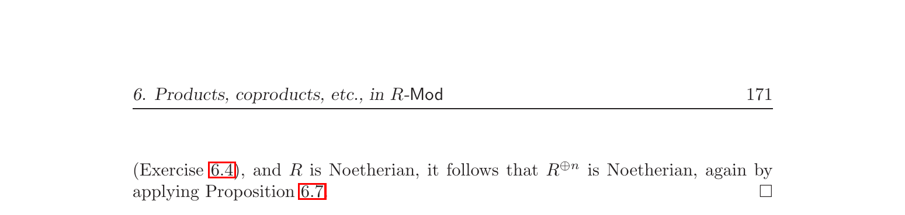

## 第 171 页句读：先说目的，再逐步展开

### 八、这一页证明的收尾：有限生成、Noetherian、自由三者别串线

**这段在干什么：**收束上页归纳，并用三种不同性质说明能推什么、不能推什么。

原文开头完成 $R^n/R^{n-1}\cong R$ 的归纳，因此得：在 Noetherian 环上，有限生成模自动 Noetherian，子模也随之有限生成。

但自由不在这个蕴含中。例如 $\mathbb Z/2\mathbb Z$ 有限生成，而且因 $\mathbb Z$ Noetherian 也 Noetherian，却不是自由整数模。

另一方面，若底环不 Noetherian，即使自由、甚至仅一个生成元的模 $R$，仍可能有不有限生成的子模，正是 Example III.6.5。

所以必须分别问：表达是否存在有限生成？表达是否唯一自由？所有子模是否也能有限生成？

### 九、本节分级与推导总结

**这段在干什么：**突出“先在商中解决、再处理核中差值”的可迁移方法。

| 知识点与定位 | 等级 | 为什么重要 | 应达到的程度 |
|---|---|---|---|
| 生成子模与自由模像，p169 | A | 把生成元问题换成同态问题 | 会写映射与最小性证明 |
| 有限生成与 $R^n$ 满射 | A | 后文关系、表示的入口 | 分清满射与同构 |
| Example III.6.5，p170 | B | 纠正子空间直觉 | 理解用代入同态击破有限生成假设 |
| Definition III.6.6 | A | 有限性的重要稳定条件 | 说清“所有子模”的量词 |
| Proposition III.6.7 | B | 核与商拼合的典型证明 | 读懂并能恢复“先投影、提回、补差值” |
| Corollary III.6.8，pp170–171 | A/B | 结论后面频繁使用 | 会用结论，并指出底环假设及归纳结构 |

---

[阅读目录](README.md) · [上一小节](10-III-6.3.md) · [下一小节](12-III-6.5.md)

# III 6.5. Finitely generated vs. finite type｜模的有限生成与代数的有限型

[阅读目录](README.md) · [上一小节](11-III-6.4.md) · [下一小节](13-III-7.1.md)

**本节总任务：区分“只靠有限次线性组合生成”和“允许任意加乘生成”。**名字都含有限，允许的表达式却不同，结果可能相差无穷多个独立方向。

## 原书第 171 页：原文底本

完整保留本小节在此页的原文；PDF 阅读器页码为 194。原书习题区不在本次范围。

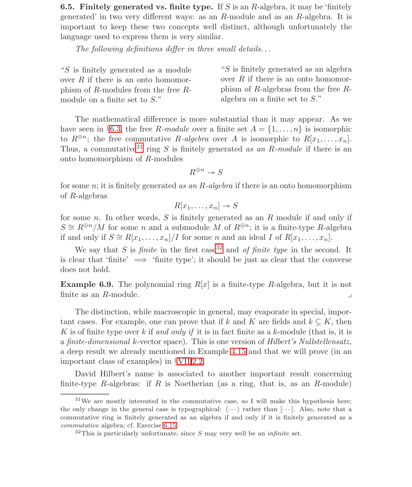

## 第 171 页句读：先说目的，再逐步展开

### 一、作者说两种定义只差三个字眼，真正差的是哪类运算？

**这段在干什么：**逐字翻译本页并排的定义，不把 module 与 algebra 当成可替换名词。

固定交换 $R$-代数 $S$。作为模有限生成，是说有 $s_1,\ldots,s_n$，每个元素都可写为

$$
r_1s_1+\cdots+r_ns_n,\qquad r_i\in R.
$$

生成元自身不能因此自动相乘出新的方向。系数只来自 $R$，不能偷偷改成来自整个 $S$。

作为代数有限生成，则允许把 $s_i$ 作任意有限次加、乘，并使用系数：

$$
\sum_{\nu}r_\nu s_1^{\nu_1}\cdots s_n^{\nu_n}.
$$

固定有限个生成元，次数仍可任意高。于是一个代数生成元可能提供无限多个模方向。

### 二、为什么对应的满射分别来自 Rⁿ 和 R[x₁,…,xₙ]？

**这段在干什么：**把两种生成概念放回自由对象的泛性质。

模的自由对象只提供线性组合，所以有满线性映射 $R^n\twoheadrightarrow S$，当且仅当有限模生成。

交换代数的自由对象提供全部多项式，所以有满代数同态

$$
R[x_1,\ldots,x_n]\twoheadrightarrow S
$$

当且仅当有限代数生成。第一同构定理于是分别将 $S$ 写成自由模的商与多项式环的商。

作者把第一种叫 **finite**，第二种叫 **finite type**。finite 不是说 $S$ 作为集合只有有限个元素；$\mathbb Z$ 作为自身模由 1 生成，仍是无限集合。

### 三、为什么 finite 推出 finite type，反向却不行？

**这段在干什么：**证明两种有限性的关系，并展开 Example III.6.9。

若 $s_1,\ldots,s_n$ 已作为模生成 $S$，包含它们及系数环的子代数必包含每个线性组合，所以已经是 $S$。故 finite 推出 finite type。

反例取非零环 $R$ 上的 $R[x]$。作为代数，一个 $x$ 就生成全部多项式；作为 $R$-模，不能只用有限个固定多项式。

假设模生成元为 $f_1,\ldots,f_t$，次数都不超过 $d$。系数从 $R$ 来，任意 $\sum r_if_i$ 的次数仍至多 $d$，所以不能得到 $x^{d+1}$，矛盾。这里要求 $R\ne0$，确保这个高次单项式非零。

对照 $\mathbb Q(\sqrt2)$：由 $1,\sqrt2$ 作 $\mathbb Q$-线性组合即可表达全部元素，所以它 finite，也 finite type。关系 $(\sqrt2)^2=2$ 让高次幂降回两个方向。

### 四、为什么“作为域只需一个生成元”也不能替代 finite type？

**这段在干什么：**为本页关于域的预告澄清另一个易混概念。

有理函数域 $\mathbb Q(t)$ 作为域由 $t$ 生成，允许对任意非零多项式求逆。但作为代数，有限生成只允许加乘，不能因目标恰是域就免费把所有逆元加入表达式。

事实上 $\mathbb Q(t)$ 不是有限型 $\mathbb Q$-代数。若由有限个有理函数生成，将它们分母相乘记为非零 $Q(t)$，它们加乘所得分母都可写成 $Q(t)$ 的幂。

选一个有理数 $a$ 使 $Q(a)\ne0$。那么 $1/(t-a)$ 不可能写成 $P(t)/Q(t)^N$：否则 $Q(t)^N=(t-a)P(t)$，代入 $a$ 矛盾。因此有限个分母无法提供整个函数域的所有逆元。

这项补充不是新习题，而是在解释“生成时准许哪些运算”为什么决定结论。

### 五、为什么一旦底环和目标都是域，两种有限性又可能合并？

**这段在干什么：**准确阅读作者的深结果预告，避免把一般反例误认为矛盾。

作者说：若 $k\subseteq K$ 都是域，而且 $K$ 作为 $k$-代数有限型，则实际上是有限维 $k$-向量空间。这是常称 Zariski 引理、与 Nullstellensatz 相连的重要结论。

它不适用于 $k[x]$，因为 $k[x]$ 不是域；也不被 $k(t)$ 推翻，因为刚才说明 $k(t)$ 不是有限型代数。

反方向“有限维就有限型”已由 finite 推 finite type 得到。难点在另一方向，本节不证明，原书也明确留待后章。当前记清假设与它解决的障碍即可。

## 原书第 172 页：原文底本

完整保留本小节在此页的原文；PDF 阅读器页码为 195。原书习题区不在本次范围。

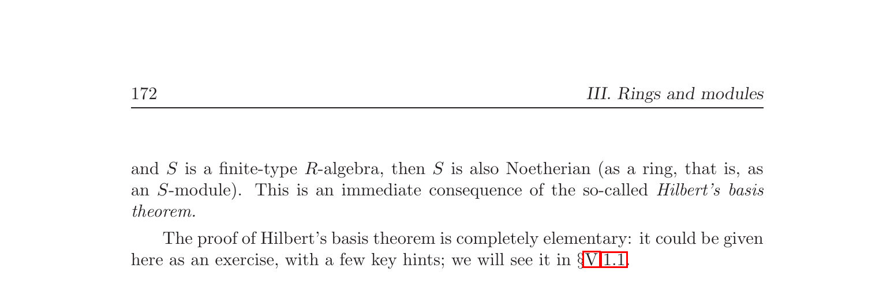

## 第 172 页句读：先说目的，再逐步展开

### 六、Hilbert 基定理的预告：Noetherian 是相对哪个环说的？

**这段在干什么：**解释页首括号特别强调的 “as an S-module”。

若 $R$ Noetherian，$S$ 是有限型 $R$-代数，则 $S$ 作为环也 Noetherian。这来自 Hilbert 基定理与取商稳定性，后面会证明。

它说的是 $S$ 的每个理想作为 **S-模** 有限生成，不是说 $S$ 作为 **R-模** 有限生成或 Noetherian。

例如域 $k$ Noetherian，$k[x]$ 也 Noetherian 环；但 $k[x]$ 作为 $k$-向量空间无限维，连自己都不有限生成，当然不可能是 Noetherian $k$-模。

这说明同一个对象加上不同标量环，性质可以改变。看到“有限”“Noetherian”要连同“相对谁”一起读。

### 七、本节分级与推导总结

**这段在干什么：**把相近术语还原成不同表达式权限。

| 知识点与定位 | 等级 | 为什么重要 | 应达到的程度 |
|---|---|---|---|
| finite / finite type，p171 | A | 域论与几何中频繁出现 | 分别写自由模、自由代数的满射 |
| Example III.6.9，p171 | A | 最直接反例 | 用最高次数上界证明不有限模生成 |
| field generation 与 algebra generation 的区分 | B | 连接后续域扩张 | 知道逆元是否是允许生成运算 |
| 域情形的 Nullstellensatz 预告 | C | 后章重要目标 | 保存“目标也是域、有限型”的条件 |
| Hilbert 基定理预告，pp171–172 | C | 有限型环的结构保障 | 不提前证明，先分清 S-模与 R-模 |

模生成只准线性组合；代数生成额外准相乘；域生成再准求逆。相似词语背后，真正要检查的是这三套不同的运算权限。

---

[阅读目录](README.md) · [上一小节](11-III-6.4.md) · [下一小节](13-III-7.1.md)

# III 7.1. Complexes and exact sequences｜从复合为零走到正合列

[阅读目录](README.md) · [上一小节](12-III-6.5.md) · [下一小节](14-III-7.2.md)

**本节总任务：不再只研究一条同态，而研究一整串模与映射；先要求相邻两步复合为零，再区分只是包含与恰好相等。**正合与同调都从这项差别开始。

## 原书第 174 页：原文底本

完整保留本小节在此页的原文；PDF 阅读器页码为 197。原书习题区不在本次范围。

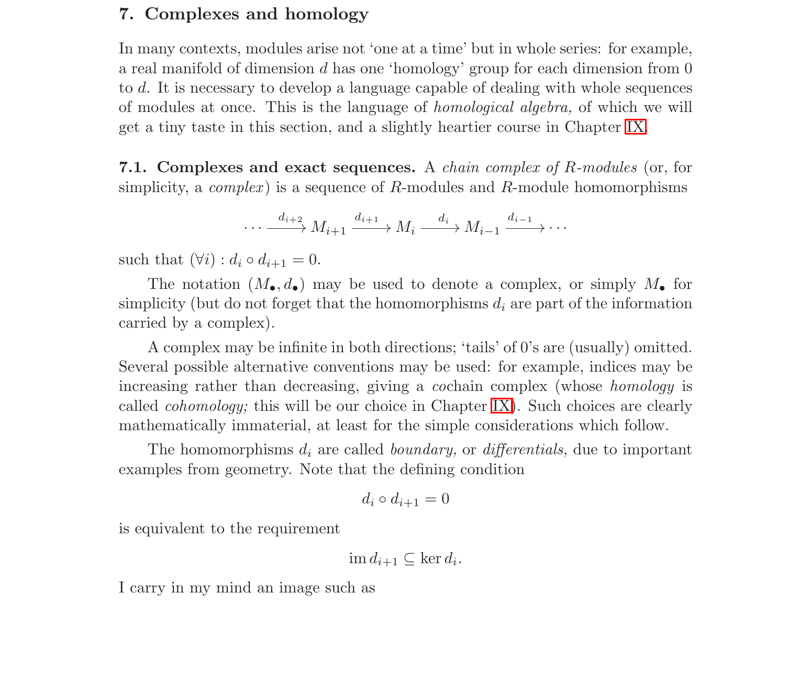

## 第 174 页句读：先说目的，再逐步展开

### 一、为什么需要复形，而不只是继续研究核与像？

**这段在干什么：**解释 §7 导言如何从单个对象走向一串相互约束的对象。

许多问题在每个次数都有一个模，次数之间还有映射。这些模不是互不相干的名单：前一步的输出会进入后一步，并且常满足“再走一步变零”。

作者用

$$
\cdots\longrightarrow M_{i+1}
\xrightarrow{d_{i+1}}M_i
\xrightarrow{d_i}M_{i-1}\longrightarrow\cdots
$$

描述这种数据，并要求 $d_i d_{i+1}=0$。这叫链复形。映射也是数据的一部分；只列出各个 $M_i$，没有决定一个复形。

注意这里指标沿箭头下降。另一些书让指标上升，叫上链复形；符号会变化，核心关系仍是相邻复合为零。

### 二、复合为零为什么等于像包含在下一个核中？

**这段在干什么：**把定义翻译成一个可逐元素检查的包含关系。

若 $x=d_{i+1}(y)$ 来自前一步，便有

$$
d_i(x)=d_i(d_{i+1}(y))=0.
$$

因此 $\operatorname{im}d_{i+1}\subseteq\ker d_i$。反过来，若这个包含对所有前一步输出成立，复合自然处处为零。

所以复形说的是：**所有“刚从左边来”的元素，都会被下一步送成零。**但下一步的核里，可能还有不是左边来的元素。定义没有排除这些额外元素。

这就是下一页要观察的差距，不要提前把“复形”当成“正合”。

## 原书第 175 页：原文底本

完整保留本小节在此页的原文；PDF 阅读器页码为 198。原书习题区不在本次范围。

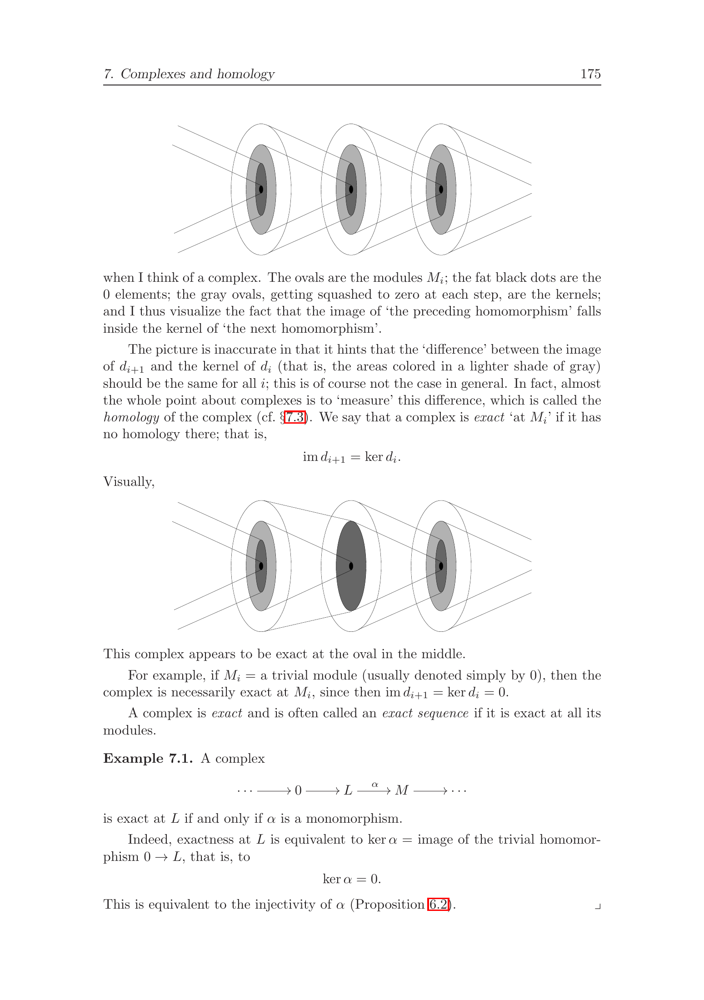

## 第 175 页句读：先说目的，再逐步展开

### 三、正合：下一个核里是否恰好全是上一步来的？

**这段在干什么：**解释原文灰色示意图与 exact at $M_i$ 的含义。

在 $M_i$ 处正合，要求更强的等式

$$
\operatorname{im}d_{i+1}=\ker d_i.
$$

除了“左边来的都到零”，还要求“到零的都能从左边找到原像”。这是两个包含，缺一不可。

给具体例子：$M_i=\mathbb Z^2$，让前一步的像是横轴 $\mathbb Z(1,0)$，下一步为零映射。复合为零当然成立，但下一步的核是全部 $\mathbb Z^2$，不是横轴，所以不正合。

若把下一步改成取第二坐标 $d_i(a,b)=b$，核恰为横轴，便在这个位置正合。

这说明是否正合既依赖对象，也依赖映射怎样放置；同一批模换箭头就可能改变。

### 四、为什么作者说要“测量差别”，却不能直接取集合差？

**这段在干什么：**为同调的商结构准备动机，解释图像只是辅助而非定义。

核与像都是子模，且像包含于核。集合差 $\ker d_i\setminus\operatorname{im}d_{i+1}$ 一般不含零，也不对加法封闭，不能保持模结构。

以后会取商 $\ker d_i/\operatorname{im}d_{i+1}$：把来自前一步的那部分当作零，保存其他核元素之间的加法、标量关系。这比只数一个“空隙有多大”精确。

原书图中的灰环只是帮助辨认核中额外部分；不同次数的差距可以完全不同，也不真是一个平面面积。

### 五、Example III.7.1：前面放一个零，为什么就编码单射？

**这段在干什么：**把 $0\to L\xrightarrow{\alpha}M$ 在 $L$ 处的正合条件展开。

$0\to L$ 的像只有零。若在 $L$ 正合，就要求 $\ker\alpha=\{0\}$，等价于 $\alpha$ 单射。

因此零不是可随便省掉的装饰，它指定前一步像为零，从而把单射性编码进整串等式。

若 $M_i=0$，则在那里无论两边映射怎样，像与核都只能为零，所以自动正合。但这不代表相邻非零模处也自动正合。

## 原书第 176 页：原文底本

完整保留本小节在此页的原文；PDF 阅读器页码为 199。原书习题区不在本次范围。

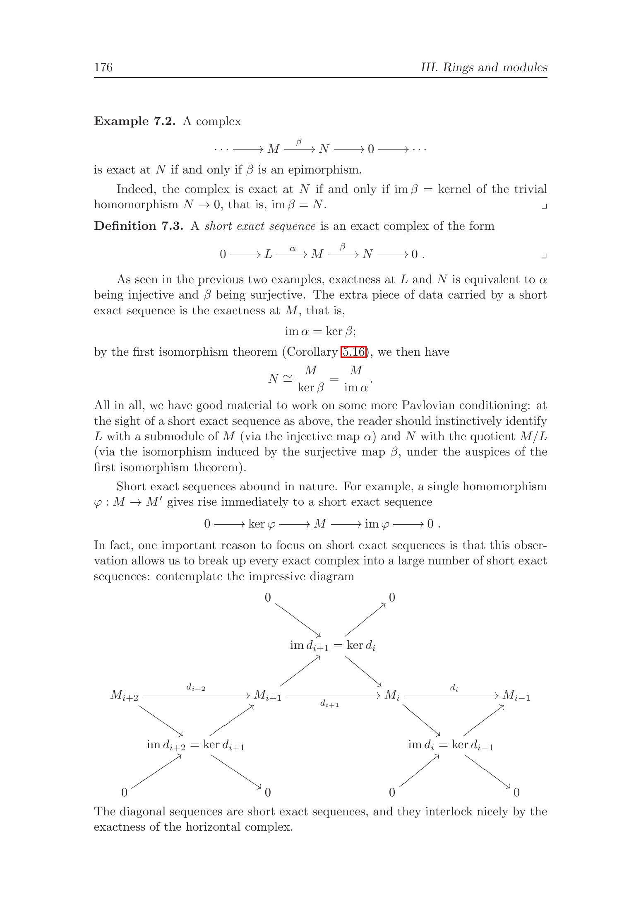

## 第 176 页句读：先说目的，再逐步展开

### 六、Example III.7.2：后面放一个零，为什么编码满射？

**这段在干什么：**解释与上一页镜像的 $M\xrightarrow{\beta}N\to0$。

$N\to0$ 把全部 $N$ 送成零，核是整个 $N$。在那里正合便要求 $\operatorname{im}\beta=N$，即满射。

一个零控制的是核，另一个零控制的是像。掌握这两次翻译，就不会把箭头端点的 0 当作省略号。

### 七、短正合列究竟比“左边单、右边满”多给了什么？

**这段在干什么：**解释 Definition III.7.3 的三处条件，并读出它描述的结构。

对

$$
0\longrightarrow L\xrightarrow{\alpha}M
\xrightarrow{\beta}N\longrightarrow0,
$$

正合要求：$\alpha$ 单射；$\beta$ 满射；并且 $\operatorname{im}\alpha=\ker\beta$。

前两项没有自动保证第三项。例如嵌入 $\mathbb Z\to\mathbb Z^2$ 为横轴，同时投影到第一坐标，分别单、满，但复合不为零，当然不是这条短正合列。

有第三项后，可用 $\alpha$ 将 $L$ 识别为 $M$ 的子模，再由第一同构定理得到

$$
N\cong M/\alpha(L).
$$

所以短正合列在说：中间对象含一份 $L$，把它合并成零以后，得到 $N$。

但这还没有说 $M\cong L\oplus N$，更没给怎样线性地选出 $N$ 的代表。下一小节“分裂”会补上这项额外要求。

### 八、为什么每条同态都自带一条短正合列？

**这段在干什么：**解释作者如何把单个映射的核—像数据装进短正合语言。

给 $f:M\to M'$，把目标先缩为 $\operatorname{im}f$，便有

$$
0\to\ker f\hookrightarrow M\twoheadrightarrow\operatorname{im}f\to0.
$$

包含单射、缩目标后的映射满射，中间核正是 $\ker f$，所以逐项正合。

若原来有长正合复形，在每个 $M_i$ 也可写

$$
0\to\ker d_i\to M_i\to\operatorname{im}d_i\to0.
$$

长列正合使 $\ker d_i$ 与上一段像相同，于是这些短列可以连接。书中的大图是在展示这项拼接，不要求读者把箭头画得复杂当成理解本身。

## 原书第 177 页：原文底本

完整保留本小节在此页的原文；PDF 阅读器页码为 200。原书习题区不在本次范围。

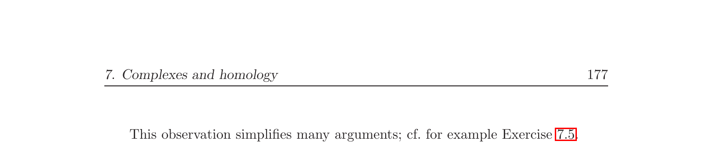

## 第 177 页句读：先说目的，再逐步展开

### 九、本节分级与推导总结

**这段在干什么：**在进入分裂之前，先固定三个不同强度的条件。

| 知识点与定位 | 等级 | 为什么重要 | 应达到的程度 |
|---|---|---|---|
| 链复形与 $d_id_{i+1}=0$，p174 | A | 同调能够定义的前提 | 与像含于核双向转换 |
| 在某处正合，p175 | A | 比复合为零更强 | 说清“所有被杀掉的都从前一步来” |
| 两端零与单、满，pp175–176 | A | 读正合图的基本语法 | 逐位置算像与核 |
| Definition III.7.3，p176 | A | 将子对象与商统一编码 | 不漏中间等式，不误推出直和 |
| 长列拆短列的图，pp176–177 | B | 复用局部结构 | 会写每段核—像短列并说明如何相接 |

强度依次是：复合为零仅有包含；正合要求相等；短正合再指定两端单满。下节的分裂还要更强，不能在这里提前获得。

---

[阅读目录](README.md) · [上一小节](12-III-6.5.md) · [下一小节](14-III-7.2.md)

# III 7.2. Split exact sequences｜分裂意味着能按同态规则拆回两部分

[阅读目录](README.md) · [上一小节](13-III-7.1.md) · [下一小节](15-III-7.3.md)

**本节总任务：判断短正合列中的中间模，能否按既定箭头真正拆成左右两部分。**关键不是单纯选代表元，而是选得与加法、标量都相容。

## 原书第 177 页：原文底本

完整保留本小节在此页的原文；PDF 阅读器页码为 200。原书习题区不在本次范围。

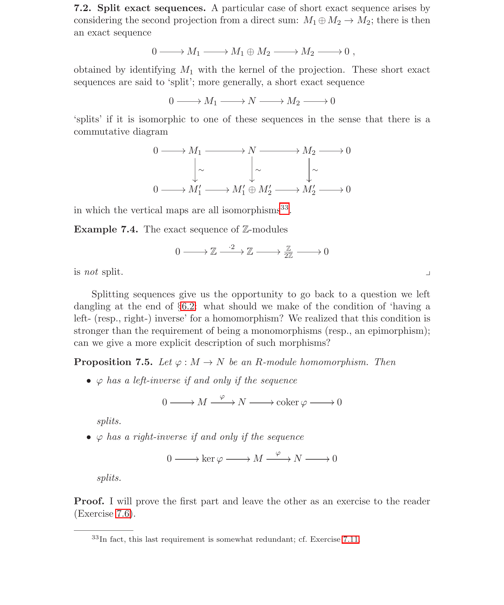

## 第 177 页句读：先说目的，再逐步展开

### 一、为什么直和总给一条短正合列？

**这段在干什么：**从最容易拆开的模型出发，解释本节“split”的标准样子。

取 $M_1\oplus M_2$，嵌入 $i(m_1)=(m_1,0)$，投影 $p(m_1,m_2)=m_2$。有

$$
0\to M_1\xrightarrow{i}M_1\oplus M_2\xrightarrow{p}M_2\to0.
$$

$i$ 单射，$p$ 满射；$p$ 的核是第二分量为零的元素，恰为 $i(M_1)$，所以短正合。

它特别容易拆，是因为每个元素已经以唯一方式给出两部分。第一部分能直接取出，第二部分也有自然代表 $(0,m_2)$。

一般短正合列只有“含一个子模且商为另一个模”，并未提供这种线性坐标。若能通过与原箭头相容的同构化成上式，才叫分裂。

### 二、Example III.7.4：为什么整数的模 2 序列不分裂？

**这段在干什么：**说明正合不等于直和，并用一个结构不变量直接看出障碍。

序列

$$
0\to\mathbb Z\xrightarrow{\times2}\mathbb Z
\xrightarrow{\pi}\mathbb Z/2\mathbb Z\to0
$$

确实短正合：左图像是偶数，右图核也正是偶数。

若分裂，中间 $\mathbb Z$ 会与 $\mathbb Z\oplus\mathbb Z/2\mathbb Z$ 同构。但右边有非零元素 $(0,[1])$，两倍等于零；左边整数没有这种元素。因此不可能。

也可看代表元选择。若线性选择 $s([1])=n$，应有 $2n=s(2[1])=s(0)=0$，所以 $n=0$，不能代表奇数类。选 1 作代表只能是集合选择，不能保持加法。

这个反例正是在告诉我们：域上线性代数常见的补空间并不在任意环模中自动存在。

### 三、Proposition III.7.5：左逆、右逆与分裂分别对应什么？

**这段在干什么：**先列出要证明的准确条件，再看下一页的构造。

给 $f:M\to N$。左逆是 $g:N\to M$ 满足 $gf=\operatorname{id}_M$；它使 $f$ 必单射。命题说，这等价于 $M$ 能作为 $N$ 的一个直和分量，剩余部分对应余核。

右逆是 $s:N\to M$ 满足 $fs=\operatorname{id}_N$；它使 $f$ 必满射。命题说，这等价于能从每个目标元素线性地选一个原像，于是 $M$ 拆成核和一份 $N$。

不是“单就有左逆、满就有右逆”，而是多有这个逆映射时才叫 split mono、split epi。上一例说明差别确实存在。

还要留意：分裂的是包含箭头的数据的整列。同构需和嵌入、投影相容，不能随便给一个抽象对象同构就不检查图。

## 原书第 178 页：原文底本

完整保留本小节在此页的原文；PDF 阅读器页码为 201。原书习题区不在本次范围。

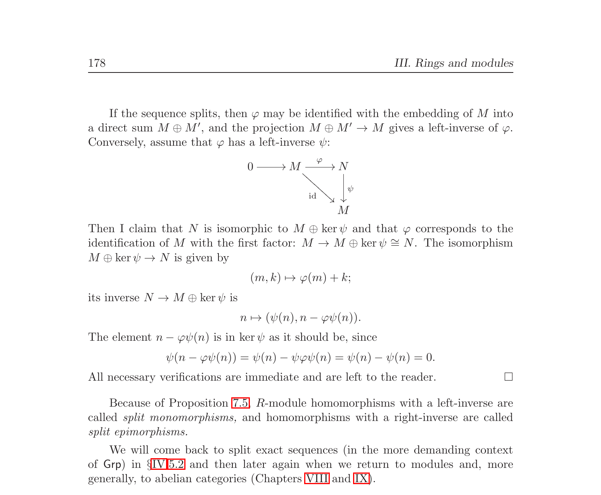

## 第 178 页句读：先说目的，再逐步展开

### 四、有左逆时，怎样从 N 中剥离出 M？

**这段在干什么：**逐项验证原文给的两个互逆映射，并说明剩余项为何在核中。

设 $gf=\operatorname{id}_M$。对任意 $n\in N$，先用 $g$ 取出它的 $M$ 部分，再送回 $N$，得到 $fg(n)$。余下

$$
k=n-fg(n)
$$

满足 $g(k)=g(n)-gfg(n)=0$，所以落在 $\ker g$。

于是定义

$$
H:N\to M\oplus\ker g,\quad
n\mapsto(g(n),\,n-fg(n)),
$$

以及

$$
F:M\oplus\ker g\to N,\quad
(m,k)\mapsto f(m)+k.
$$

两者线性，因为都由线性映射、和、差构成。检查复合：

$$
F(H(n))=fg(n)+n-fg(n)=n.
$$

对 $k\in\ker g$，有

$$
H(F(m,k))=
(gf(m)+g(k),\,f(m)+k-fg(f(m)+k))
=(m,k).
$$

因此 $N\cong M\oplus\ker g$。在这个同构下，$f(m)$ 对应 $(m,0)$，所以与原嵌入相容。

反向若已经有这样的直和分解，取第一坐标再经同构返回，就给 $f$ 的左逆。这完成当且仅当，而不是只证明一个方向。

### 五、有右逆时，怎样把 M 拆成核与目标？

**这段在干什么：**补上原文未展开的镜像构造，使“线性选原像”成为实际分解。

设 $fs=\operatorname{id}_N$。对 $m\in M$，$s(f(m))$ 是按固定规则选回的一份代表，而

$$
m-sf(m)\in\ker f
$$

因为 $f(m-sf(m))=f(m)-fsf(m)=0$。

定义

$$
H(m)=(m-sf(m),\,f(m))\in\ker f\oplus N,
$$

$$
F(k,n)=k+s(n).
$$

直接算 $FH(m)=m$，而

$$
HF(k,n)=(k+s(n)-sf(k+s(n)),\,f(k+s(n)))=(k,n).
$$

所以 $M\cong\ker f\oplus N$，原来的 $f$ 对应第二投影。反过来，直和中的嵌入 $n\mapsto(0,n)$ 给右逆。

这就是分裂的计算机制：**先按照目标选回一份，再用差值分离出核。**

### 六、在一般短正合列里，如何把两种说法放在一起？

**这段在干什么：**将上一页的定义与两个构造统一，而不只记逆映射方向。

设 $0\to A\xrightarrow{\alpha}B\xrightarrow{\beta}C\to0$。若有截面 $s:C\to B$ 满足 $\beta s=\operatorname{id}_C$，定义

$$
A\oplus C\to B,\qquad(a,c)\mapsto\alpha(a)+s(c).
$$

对任意 $b$，差值 $b-s\beta(b)$ 在 $\ker\beta=\operatorname{im}\alpha$，因此有唯一 $a$ 使它等于 $\alpha(a)$。这给逆映射，并显示分裂。

等价地，若有收缩 $r:B\to A$ 满足 $r\alpha=\operatorname{id}_A$，便用前一构造把 $B$ 拆成 $\alpha(A)$ 与 $\ker r$；$\beta$ 在后者上给到 $C$ 的同构。

这两种逆的选择可能不唯一，所以补分量一般也不是唯一的。分裂要求至少存在相容选择，不要求一个无需选择的标准分解。

### 七、为什么向量空间里的短正合列通常能分裂？

**这段在干什么：**把原有线性代数直觉放在正确条件下，并指向自由模的用途。

若右端 $C$ 是向量空间，选一组基，再为每个基向量在 $B$ 中选一个原像。因为基向量无额外线性关系，这些选择唯一线性延拓为 $s:C\to B$，且 $\beta s=\operatorname{id}_C$。

同样，右端若为自由模，也可用自由模泛性质完成这步。任意模却可能有关系，原像选择须保关系，未必做得到。$\mathbb Z/2$ 的 $2[1]=0$ 就造成阻碍。

所以自由对象的意义不只是“形式表达好看”，它使从满射中提升映射有了可能。完整投射模理论后面会系统研究。

### 八、本节分级与推导总结

**这段在干什么：**区分正合、不分裂与可线性拆分三种信息。

| 知识点与定位 | 等级 | 为什么重要 | 应达到的程度 |
|---|---|---|---|
| 分裂定义与 Example III.7.4，p177 | A | 防止把所有扩张当直和 | 说明需要箭头相容，复现整数障碍 |
| Proposition III.7.5，pp177–178 | A/B | 逆映射与结构分解的桥梁 | 判据会用，两个互逆构造读懂并可恢复 |
| 截面、收缩与差值分解 | A | 后面提升与同调不断使用 | 说明差值为什么落在核 |
| 自由模右端的提升解释 | B | 与前节自由泛性质相接 | 知道“任意赋值可延拓”解决了什么 |

正合告诉你子模和商是谁；分裂告诉你还能选择一套线性坐标将它们并排复原。缺失的是相容的选择，不是缺少集合上的代表元。

---

[阅读目录](README.md) · [上一小节](13-III-7.1.md) · [下一小节](15-III-7.3.md)

# III 7.3. Homology and the snake lemma｜同调怎样记录正合失败与连接障碍

[阅读目录](README.md) · [上一小节](14-III-7.2.md)

**本节总任务：把“复形没有正合的部分”保存为一个模，并说明两条短正合列之间的联系怎样产生新的连接映射。**最重要的并非蛇形图的外观，而是：一个原像选择为什么不能直接落在所需核里，以及取商怎样消掉选择造成的歧义。

## 原书第 178 页：原文底本

完整保留本小节在此页的原文；PDF 阅读器页码为 201。原书习题区不在本次范围。

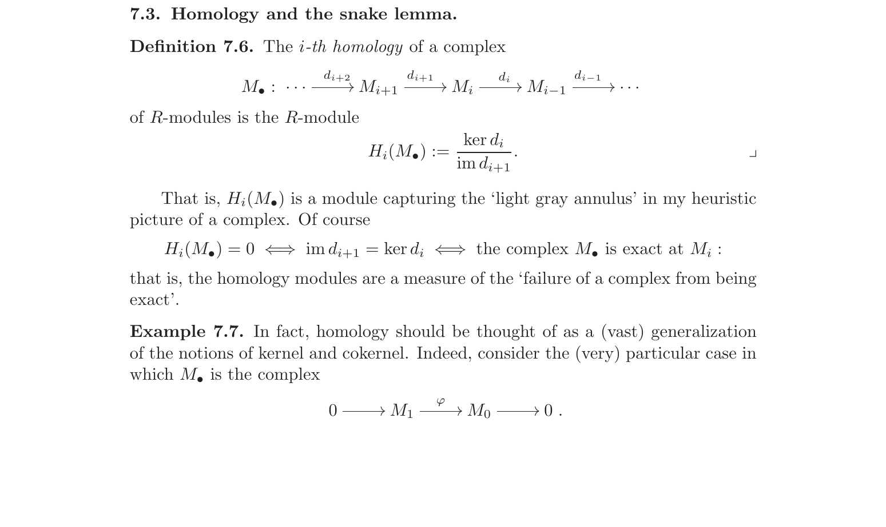

## 第 178 页句读：先说目的，再逐步展开

### 一、Definition III.7.6：为什么同调必须是核除以像？

**这段在干什么：**从复形条件推出同调的合法性，并解释这个商想保留什么。

已有复形

$$
\cdots\to M_{i+1}\xrightarrow{d_{i+1}}M_i
\xrightarrow{d_i}M_{i-1}\to\cdots.
$$

核里是下一步会变零的元素，像里是上一步产生的元素。复合为零保证后者包含于前者，所以模商

$$
\boxed{H_i(M_\bullet)=\ker d_i/\operatorname{im}d_{i+1}}
$$

确实有定义。没有包含关系就不能这样取商。

为什么要商？因为希望将“只是从上一步来的”看成平凡，而保留其他仍被下一步杀掉的关系。两个核元素若相差一个上一步的像，就在同调中视为同一类。

这不是集合差，也不是简单比较两个集合大小。比如核与像都可能无限，但商仍可以是 $\mathbb Z/2$ 这样的有限非零对象。

$H_i=0$ 当且仅当所有核元素都来自上一步，即像等于核，也就是该处正合。于是同调将“是不是正合”升级为“若不正合，残留部分有什么代数结构”。

### 二、Example III.7.7：核与余核为什么是同调的特例？

**这段在干什么：**把新定义直接代进只有一条非零映射的复形。

考虑 $0\to M_1\xrightarrow{f}M_0\to0$，不要求它正合。

在次数 1，前一步像为零，故 $H_1=\ker f/0\cong\ker f$。在次数 0，下一步是零映射，核为整个 $M_0$，故

$$
H_0=M_0/\operatorname{im}f=\operatorname{coker}f.
$$

所以同调不是另造一个与核、余核无关的指标，而是让一整串映射在每个次数都能有类似的残留结构。

原文跨到下一页才写完这个例子，阅读时把两页连接成上述两次直接计算即可。

## 原书第 179 页：原文底本

完整保留本小节在此页的原文；PDF 阅读器页码为 202。原书习题区不在本次范围。

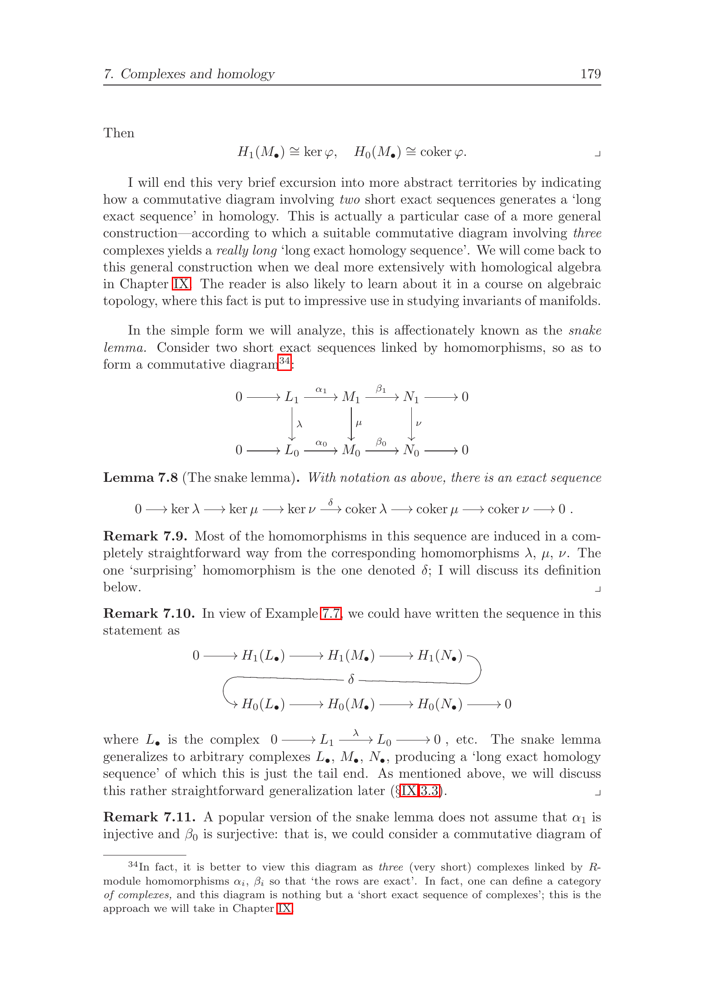

## 第 179 页句读：先说目的，再逐步展开

### 三、用三条边看见“边界的边界为零”和同调的区别

**这段在干什么：**为定义补一个可实际计算的图形模型，解释为什么几何里会出现这类复形。

取三个点 $v_1,v_2,v_3$ 与三条定向边 $e_{12},e_{23},e_{31}$。让 $C_1$ 是三条边自由生成的整数模，$C_0$ 是三个点自由生成的整数模。

定义边界

$$
d_1(e_{12})=v_2-v_1,\quad
d_1(e_{23})=v_3-v_2,\quad
d_1(e_{31})=v_1-v_3.
$$

三边之和 $z=e_{12}+e_{23}+e_{31}$ 的边界为零，各顶点相消。

若还填入一个三角面 $t$，定义 $d_2(t)=z$，便有 $d_1d_2(t)=0$。这就是这幅模型里的边界的边界为零。

算核：对 $ae_{12}+be_{23}+ce_{31}$，边界为

$$
(-a+c)v_1+(a-b)v_2+(b-c)v_3.
$$

为零当且仅当 $a=b=c$，故 $\ker d_1=\mathbb Zz$。

若只有边框、没有面，前一步像为零，$H_1=\mathbb Zz$；若有填面，$\operatorname{im}d_2=\mathbb Zz$，于是 $H_1=0$。

这个计算说明：核记录闭合的边组合；商掉面的边界，才能区分“闭合但没有填满”与“只是一个面的边界”。这里只用一个给定模型解释代数定义，不提前证明一般空间同调理论。

### 四、Lemma III.7.8 的图先读角色，不先追蛇

**这段在干什么：**固定两行、三列的对象与符号，明确引理试图联系哪些残留结构。

原图可重排为

$$
\begin{array}{ccccccccc}
0&\to&L_1&\xrightarrow{\alpha_1}&M_1&\xrightarrow{\beta_1}&N_1&\to&0\\
&&\downarrow\lambda&&\downarrow\mu&&\downarrow\nu\\
0&\to&L_0&\xrightarrow{\alpha_0}&M_0&\xrightarrow{\beta_0}&N_0&\to&0.
\end{array}
$$

两行都短正合；方块交换。顶行的下标是 1，底行是 0。每个竖直映射都可看成一个两项复形，所以有各自的核与余核。

引理说这些信息不是分散的六个对象，而可接成正合列：

$$
0\to\ker\lambda\to\ker\mu\to\ker\nu
\xrightarrow{\delta}\operatorname{coker}\lambda
\to\operatorname{coker}\mu
\to\operatorname{coker}\nu\to0.
$$

前三个核之间的映射沿顶行走，后三个余核之间的映射由底行下降。唯一需要新构造的是从右上核绕到左下余核的 $\delta$。

### 五、哪些映射直接就能写出？为什么它们合法？

**这段在干什么：**展开 Remark III.7.9 的 “straightforward”，把简单箭头与真正难点分开。

对 $l\in\ker\lambda$，$\mu\alpha_1(l)=\alpha_0\lambda(l)=0$，所以 $\alpha_1$ 限制为 $\ker\lambda\to\ker\mu$。

对 $m\in\ker\mu$，$\nu\beta_1(m)=\beta_0\mu(m)=0$，所以 $\beta_1$ 限制为 $\ker\mu\to\ker\nu$。

余核方向定义

$$
[l]\longmapsto[\alpha_0(l)],\qquad
[m]\longmapsto[\beta_0(m)].
$$

第一个若改变 $l$ 为 $l+\lambda(a)$，输出变化 $\alpha_0\lambda(a)=\mu\alpha_1(a)$，在余核 $\operatorname{coker}\mu$ 中为零，因此良定义。第二个同样用 $\beta_0\mu=\nu\beta_1$。

这些检查都只需交换性与“除去对应像”。连接箭头 $\delta$ 不能直接如此限制或投影，所以作者专门追踪原像。

## 原书第 180 页：原文底本

完整保留本小节在此页的原文；PDF 阅读器页码为 203。原书习题区不在本次范围。

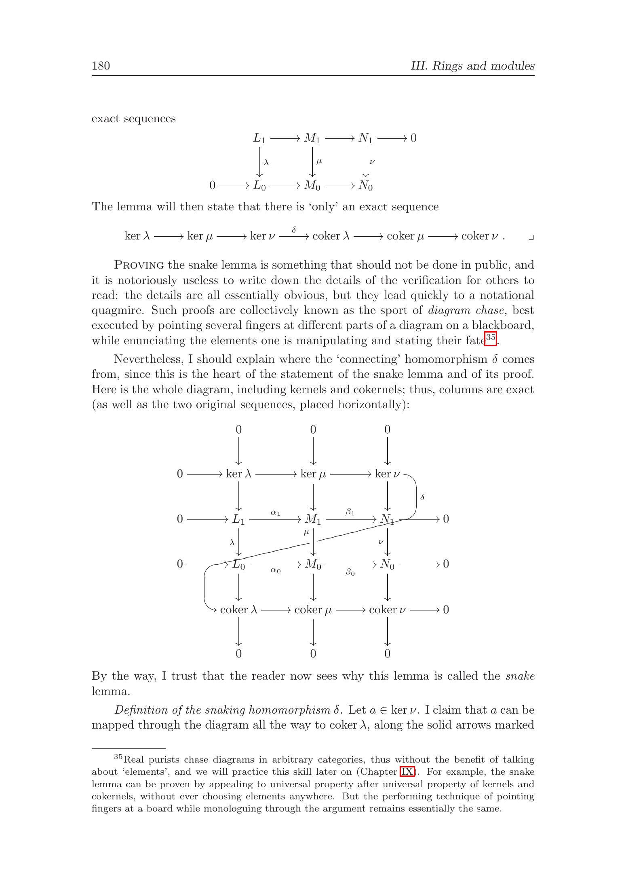

## 第 180 页句读：先说目的，再逐步展开

### 六、连接映射先问什么问题：能否把一个核元素提到另一个核里？

**这段在干什么：**为 $\delta$ 的路线建立目的，不把反向找原像当成机械游走。

给 $a\in\ker\nu\subseteq N_1$。顶行 $\beta_1$ 满射，所以能找到 $c\in M_1$ 使 $\beta_1(c)=a$。

我们真正希望找到的，是同时满足 $\mu(c)=0$ 的原像，也就是 $c\in\ker\mu$。这样 $a$ 才来自前一个核。

任意选的 $c$ 未必满足。它的 $\mu(c)$ 就是当前选择的“偏差”。方块交换给

$$
\beta_0(\mu(c))=\nu(\beta_1(c))=\nu(a)=0.
$$

所以偏差不是任意的，它在 $\ker\beta_0=\operatorname{im}\alpha_0$，能由左下角某个 $e\in L_0$ 表达：

$$
\alpha_0(e)=\mu(c).
$$

问题于是转化：能否调整 $c$，让这个偏差消失？下一页的商类会恰好记录这件事。

### 七、为什么偏差最后要放进 coker λ，而不是直接记为 e？

**这段在干什么：**解释连接箭头的目标为何被选择独立性强迫出来。

若给 $c$ 加上 $\alpha_1(g)$，它仍映到相同 $a$，因为 $\beta_1\alpha_1=0$。但偏差变成

$$
\mu(c+\alpha_1(g))
=\alpha_0(e)+\alpha_0(\lambda(g))
=\alpha_0(e+\lambda(g)).
$$

所以新的左下元素是 $e+\lambda(g)$。$e$ 自己依赖原像选择，不能直接拿它当确定答案。

取余核 $\operatorname{coker}\lambda=L_0/\operatorname{im}\lambda$ 后，这项差别正好被除去。因此合理候选是

$$
\boxed{\delta(a)=e+\operatorname{im}\lambda.}
$$

这和商环良定义的逻辑相同：先说明允许选择怎样变化，再把选择造成的差别恰好消掉。不是随手选一个余核来让图画成蛇。

Remark III.7.11 还说，若不要求最左顶行单射、最右底行满射，仍有中间版本，但两端不能随意写 0。外侧单满条件正控制两端是否额外正合。

## 原书第 181 页：原文底本

完整保留本小节在此页的原文；PDF 阅读器页码为 204。原书习题区不在本次范围。

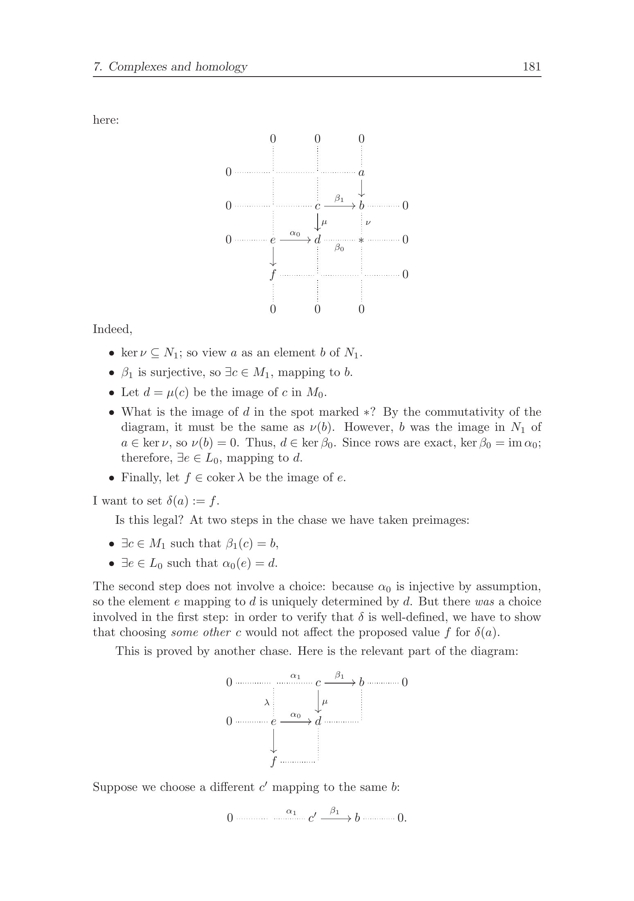

## 第 181 页句读：先说目的，再逐步展开

### 八、正式走完原像路线：每一步根据哪项假设？

**这段在干什么：**逐步落实作者列出的追图，并区分“存在原像”与“存在逆函数”。

从 $a\in\ker\nu$ 开始：

1. 将它看作 $N_1$ 的元素，这只是子模包含。
2. 因 $\beta_1$ 满，取 $c\in M_1$ 使 $\beta_1(c)=a$。这里可能有多种选择。
3. 沿 $\mu$ 得到 $d=\mu(c)\in M_0$。
4. 由方块交换和 $\nu(a)=0$，得 $\beta_0(d)=0$。
5. 底行正合使 $d\in\operatorname{im}\alpha_0$，取 $e$ 使 $\alpha_0(e)=d$。
6. 底行 $\alpha_0$ 单射，所以这个 $e$ 对已选 $c$ 是唯一的。
7. 取 $[e]\in L_0/\operatorname{im}\lambda$。

反向沿一条满射找原像，不是在宣称这条映射可逆。整套定义的难点正是第 2 步的选择是否影响第 7 步结果。

### 九、一个非零连接映射的具体计算

**这段在干什么：**让 $\delta$ 不只是一串抽象符号，并展示同一个类换代表时怎样相消。

取顶行为

$$
0\to\mathbb Z\xrightarrow{\times2}\mathbb Z
\xrightarrow{\bmod2}\mathbb Z/2\mathbb Z\to0,
$$

底行为 $0\to\mathbb Z\xrightarrow{\mathrm{id}}\mathbb Z\to0\to0$。三列取 $\lambda=\times2,\ \mu=\mathrm{id},\ \nu=0$。两个方块交换。

现在 $\ker\nu=\mathbb Z/2$，$\operatorname{coker}\lambda=\mathbb Z/2$。对 $a=[1]$，选顶行中间原像 $c=1$；沿 $\mu$ 仍为 1；沿底行恒等映射反向取 $e=1$；最后 $\delta([1])=[1]$。

若换 $c=3$，就取到 $e=3$，但模 2 后仍是 $[1]$。因此这幅图的连接映射实际是恒等，而不总是零映射。

它还说明障碍的含义：$[1]$ 虽在 $\ker\nu$，却不能找到 $\ker\mu=0$ 中的原像。非零的 $\delta([1])$ 正在记录这项失败。

## 原书第 182 页：原文底本

完整保留本小节在此页的原文；PDF 阅读器页码为 205。原书习题区不在本次范围。

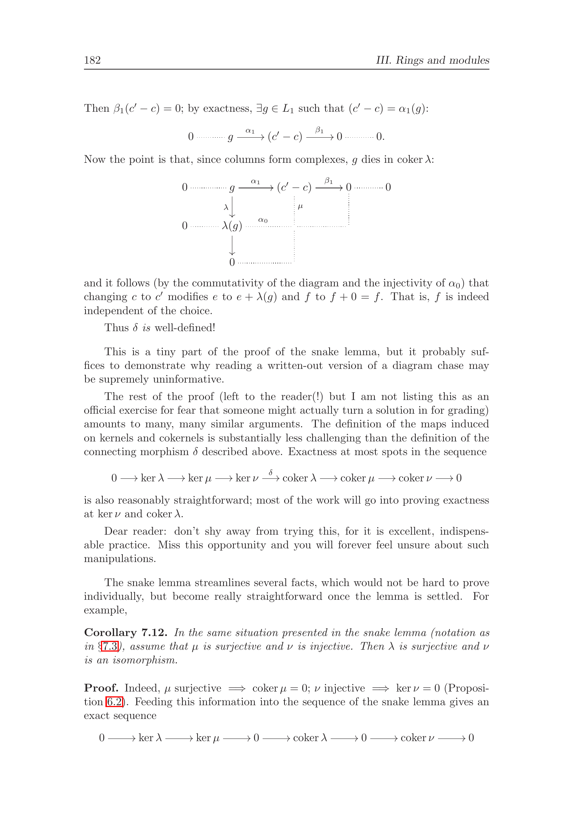

## 第 182 页句读：先说目的，再逐步展开

### 十、怎样证明换任意原像都不会改变 δ？

**这段在干什么：**完整复现原书连接映射良定义的关键证明。

设 $\beta_1(c)=\beta_1(c')=a$。则 $c'-c\in\ker\beta_1=\operatorname{im}\alpha_1$，所以存在 $g\in L_1$ 使

$$
c'-c=\alpha_1(g).
$$

对应的 $e,e'$ 满足 $\alpha_0(e)=\mu(c)$、$\alpha_0(e')=\mu(c')$。于是

$$
\alpha_0(e'-e)
=\mu(c'-c)
=\mu\alpha_1(g)
=\alpha_0\lambda(g).
$$

$\alpha_0$ 单射，推出 $e'-e=\lambda(g)$。两者在余核中为同一类，所以 $\delta$ 良定义。

线性也可随同证明。对 $a,a'$，分别选原像 $c,c'$，便可选 $c+c'$ 作 $a+a'$ 的原像，对应左下值为 $e+e'$；对 $ra$ 选 $rc$，对应 $re$。因为结果不依赖选择，得到 $\delta(a+a')=\delta(a)+\delta(a')$ 与 $\delta(ra)=r\delta(a)$。

### 十一、为什么在 ker ν 处正合？这正是“偏差能否修掉”

**这段在干什么：**证明蛇列最关键的一个位置，并解释连接映射的零值意味着什么。

若 $a=\beta_1(c)$ 且 $c\in\ker\mu$，追图时可取 $e=0$，所以 $\delta(a)=0$。因此来自前一个核的元素都在 $\ker\delta$。

反过来，若 $\delta(a)=0$，取任意原像 $c$ 及相应 $e$。零商类意味着 $e=\lambda(g)$。将原像调整为

$$
c_0=c-\alpha_1(g).
$$

它仍映到 $a$，而

$$
\mu(c_0)=\alpha_0(e)-\alpha_0\lambda(g)=0.
$$

所以 $c_0\in\ker\mu$，$a$ 真来自前一个核。由此

$$
\operatorname{im}(\ker\mu\to\ker\nu)=\ker\delta.
$$

这给 $\delta$ 最清楚的理解：**它衡量一个下游的核元素，能否提升为上游的核元素。**

### 十二、为什么在 coker λ 处正合？

**这段在干什么：**证明另一个关键连接处，而不是笼统说其余位置显然。

若 $[e]=\delta(a)$，追图有 $\alpha_0(e)=\mu(c)$，所以它在 $\operatorname{coker}\mu$ 中为零。故 $\operatorname{im}\delta$ 包含于下一箭头的核。

反过来，若 $[e]\in\operatorname{coker}\lambda$ 经 $\alpha_0$ 后为零类，则 $\alpha_0(e)=\mu(c)$ 对某个 $c\in M_1$ 成立。

令 $a=\beta_1(c)$。交换性给

$$
\nu(a)=\beta_0\mu(c)=\beta_0\alpha_0(e)=0,
$$

因此 $a\in\ker\nu$。按定义追图便得 $\delta(a)=[e]$，完成另一包含。

所以这个位置的正合也来自“已经在中间余核消失的东西，恰好是连接障碍产生的像”。

### 十三、剩余位置的正合与 Corollary III.7.12 怎样核对？

**这段在干什么：**把余下验证压缩为各自的关键步骤，并解释推论从何读出。

核列第一个箭头单射来自 $\alpha_1$ 单射。在 $\ker\mu$ 处，若 $\beta_1(m)=0$，写 $m=\alpha_1(l)$；再由 $0=\mu(m)=\alpha_0\lambda(l)$ 和 $\alpha_0$ 单射，得 $l\in\ker\lambda$。

在 $\operatorname{coker}\mu$ 处，若 $[m]$ 经 $\beta_0$ 成零，写 $\beta_0(m)=\nu(a)$。先由顶行满射提 $a=\beta_1(c)$，则 $m-\mu(c)\in\ker\beta_0=\operatorname{im}\alpha_0$。因此 $[m]$ 来自前一个余核。逆包含由两行复合为零直接得。

最后 $\operatorname{coker}\mu\to\operatorname{coker}\nu$ 满射，因为底行 $\beta_0$ 满射。至此蛇列全部位置都有根据，不只验证了连接箭头。

若再假设 $\mu$ 满、$\nu$ 单，就有 $\operatorname{coker}\mu=0,\ker\nu=0$。代进蛇列，正合迫使 $\operatorname{coker}\lambda=0$ 及 $\operatorname{coker}\nu=0$。所以 $\lambda$ 满，$\nu$ 又单又满成为同构，正是推论。

## 原书第 183 页：原文底本

完整保留本小节在此页的原文；PDF 阅读器页码为 206。原书习题区不在本次范围。

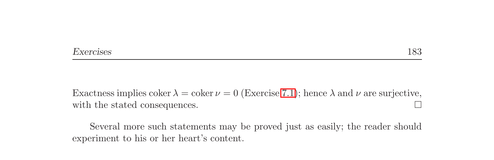

## 第 183 页句读：先说目的，再逐步展开

### 十四、本节分级与整章推导总结

**这段在干什么：**收束前页推论，并标出同调定义与蛇引理细节的不同学习深度。

原书正文在本页完成 Corollary III.7.12，随后进入习题。本注到正文结束为止，不收录习题区。

| 知识点与定位 | 等级 | 为什么重要 | 应达到的程度 |
|---|---|---|---|
| Definition III.7.6，p178 | A | 精确保存正合失败 | 说明为何能取商、为何不能取集合差 |
| Example III.7.7，pp178–179 | A | 将新概念接回核与余核 | 按次数直接算两项复形 |
| Lemma III.7.8，p179 | B | 组织核余核之间的信息 | 识别各箭头来源与所需正合条件 |
| $\delta$ 的动机、构造与良定义，pp180–182 | B | 是可复用的选择独立性方法 | 说清原像改变如何落进 $\operatorname{im}\lambda$ |
| 全序列各处追图验证 | C | 当前先看整体作用，后续使用时深化 | 本注已展开，可回查，不要求现在全部背诵 |
| Corollary III.7.12，pp182–183 | B | 示范从长正合列直接读性质 | 用零核、零余核代入，而非重新追一遍图 |

整章后半程可以连成一条清晰路线：生成理想描述关系 → 商环实现关系 → 素与极大由商判断 → 模统一子对象与商 → 自由模组织生成元 → 核余核安排映射残留 → 正合要求没有残留 → 同调用商保存残留 → 蛇引理解释两行结构怎样共同产生连接障碍。

---

[阅读目录](README.md) · [上一小节](14-III-7.2.md)
