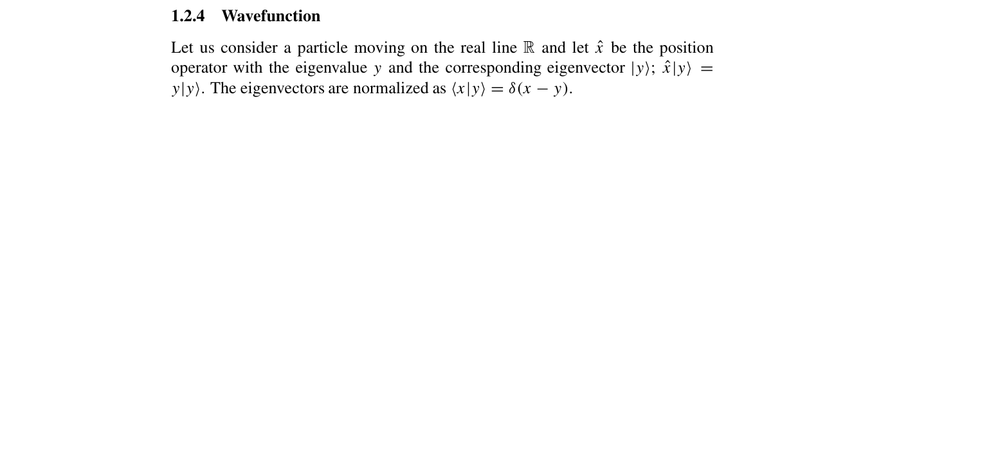
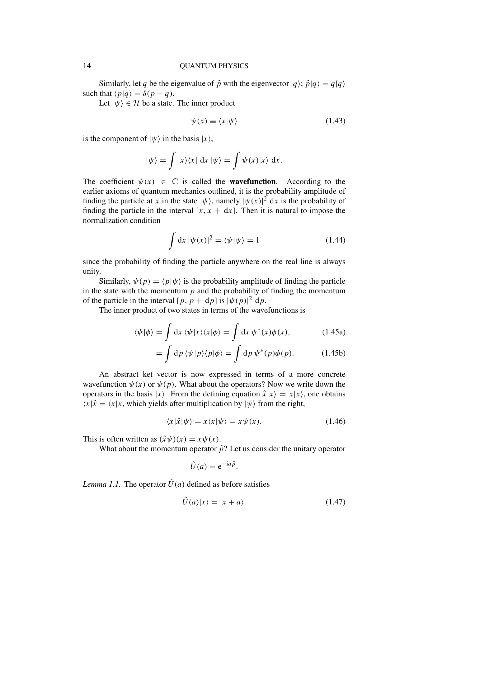
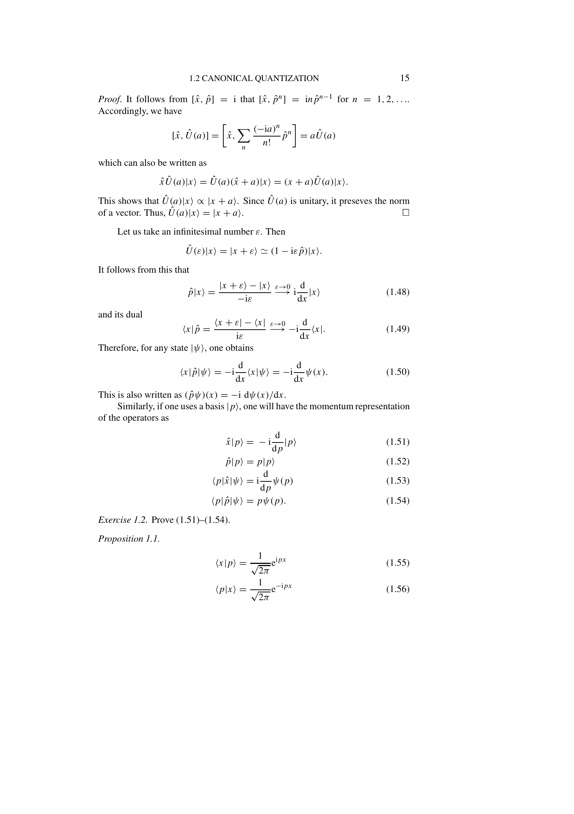
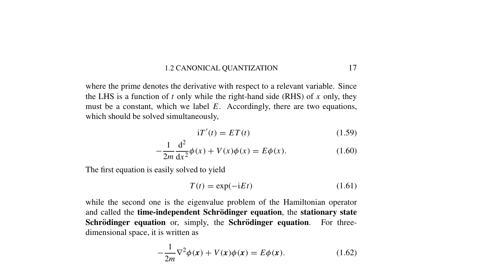

# 1.2.4 Wavefunction｜波函数

[总目录](README.md) · [下一小节](02-1.2.5.md)

本节承接你已写到的 1.2.3。那里讨论同一个量子理论怎样把时间变化放在态或算符上；这里讨论另一个问题：抽象的态矢量怎样变成可以求解、可以与实验比较的函数。下面只在解释中恢复 $\hbar$；影印原文继续保留作者的单位约定。

## 原书第 13 页：原文底本

以下影印块是本小节在该页的完整原文；相邻小节在同页交接时按标题分界。PDF 页码为 36。

## 第 13 页句读与集注

### 句读：“a particle moving on the real line”

先把物理场景说清楚：只关心一个粒子沿一条直线的位置，不关心它的内部结构、自旋或其他粒子。直线是配置空间，不是态空间。一个可能的位置是实数 $x$；一个量子态却是能够给出各种测量概率的整体对象 $|\psi\rangle$。把这两种“空间”分开，后面就不会把波函数的横坐标与 Hilbert 空间中的向量坐标混在一起。

“position operator”不是一台仪器本身，而是理论中编码位置测量结果及其概率的对象。关系 $\hat x|y\rangle=y|y\rangle$ 的物理读法是：在理想的确定位置态中，测位置得到 $y$。符号 $y$ 是测量结果，$|y\rangle$ 是与这个结果对应的理想态，两者不能互换。

### 疏：为什么归一化是 δ 函数，而不是 1？

离散正交基满足 $\langle i|j\rangle=\delta_{ij}$。位置取连续值，所以连续版本是 $\langle x|y\rangle=\delta(x-y)$，相应的展开由求和变成积分。这里的 $\delta$ 是分布，靠

$$
\int dy\,\delta(x-y)f(y)=f(x)
$$

规定作用。不能把 $x=y$ 代入后把“$\delta(0)=\infty$”当作普通数来运算。严格确定位置的 $|y\rangle$ 不是通常 $L^2(\mathbb R)$ 中的单位向量；真实制备的态有有限宽度。作者使用广义本征态是为了方便连续谱计算。这与分析中的分布方法相接，不表示实验能把粒子压成宽度为零的点而不付出任何代价。

本页的数学逻辑是：连续测量结果需要连续谱；连续谱的“基”需要 δ 归一化。这个选择服务于测量问题，不是先随意写一个 δ 再寻找物理意义。

## 原书第 14 页：原文底本

以下影印块是本小节在该页的完整原文；相邻小节在同页交接时按标题分界。PDF 页码为 37。

## 第 14 页句读与集注

### 句读式 (1.43)：波函数是态的一个表示

原文先说 $\psi(x)=\langle x|\psi\rangle$ 是 “component”，再称它为 “probability amplitude”。这两句话承担不同工作。第一句说怎样从抽象态取出位置表示；第二句给这个表示以实验意义。你在线性代数中用基展开向量，这里也在展开，只是基由连续变量标记：

$$
|\psi\rangle=\int dx\,|x\rangle\psi(x).
$$

态本身没有因为选位置表示而改变。以后选动量表示、能量表示，也是在回答不同测量问题时使用不同坐标。不要把 $\psi(x)$ 理解成藏在粒子内部、可以直接像温度那样读出的复数属性。

### 句读 “probability amplitude”：为什么不直接用概率？

因为实验中的替代过程会发生干涉。若到达某处有两条没有被测量区分的通路，理论先加振幅：

$$
P=|a_1+a_2|^2
=|a_1|^2+|a_2|^2+2\operatorname{Re}(a_1^*a_2).
$$

最后一项既可增加，也可减少概率。只记录两条通路各自的非负概率，就没有足够信息确定这一项。复振幅保留了相位信息；相位差决定增强还是抵消。这是使用复向量空间的重要物理动机。单凭“能写成复数”当然推不出 Born 规则；概率取模平方仍是量子理论的物理公设，需要实验支持。

若每次只以经典概率 $1/2$ 选一个态，得到的是混合制备；若制备相干叠加 $(|\psi_1\rangle+|\psi_2\rangle)/\sqrt2$，通常存在交叉项。两者即使看起来都“各有一半”，也不是同一种物理状态。给整个态乘同一个常相位不改变任何测量概率；改变叠加项之间的相对相位则可能改变结果。

### 句读式 (1.44)：密度、归一化和量纲

精确说法是

$$
\Pr\{x\in[a,b]\}=\int_a^b|\psi(x)|^2\,dx.
$$

$|\psi(x)|^2$ 是概率密度，不是“粒子恰好在一个点的概率”。连续分布中单点概率通常为零。归一化保证对所有互斥位置区间相加，得到总概率 1。一维中若 $x$ 有长度单位，$\psi$ 的单位就是长度的 $-1/2$ 次方；因此波函数值本身大于 1 没有矛盾。

同理，动量空间有密度 $|\widetilde\psi(p)|^2$，其积分变量和量纲都与位置密度不同。本注用波浪号区分两种函数；原文都记作 $\psi$，靠自变量区分。

### 句读式 (1.45)–(1.47)：从坐标到算符

内积写成 $\int\psi^*\phi$，说明位置表示保持了原来的 Hilbert 空间结构。$\hat x$ 变成乘法算符，是因为位置基已经把位置测量对角化。于是

$$
\langle\hat x\rangle=\int dx\,x|\psi(x)|^2.
$$

接着作者引入 $U(a)=e^{-ia\hat p/\hbar}$。这里开始回答“动量为什么和导数有关”。关键物理线索是：动量生成空间平移。平移的意思是把整个制备向右移动 $a$，测量分布也整体向右移动，而不是把粒子速度增加 $a$。指数中的 $a\hat p/\hbar$ 必须无量纲。

## 原书第 15 页：原文底本

以下影印块是本小节在该页的完整原文；相邻小节在同页交接时按标题分界。PDF 页码为 38。

## 第 15 页句读与集注

### 句读引理 1.1：从对易关系读出平移

由 $[\hat x,\hat p]=i\hbar$ 得到

$$
\hat xU(a)=U(a)(\hat x+a).
$$

把它作用在 $|x\rangle$ 上，就知道 $U(a)|x\rangle$ 是位置本征值 $x+a$ 的态。这一步说明“生成平移”与正则对易关系相互呼应。对易关系不是说两个普通数的乘法忽然失效；它描述两种操作作用在量子态上时次序不能任意交换。

**校记：**原文从“酉性保持范数”直接得到 $U(a)|x\rangle=|x+a\rangle$。单靠酉性只能固定比例因子的模，不能排除相位。这里还隐含了位置本征态相位的相容选择；广义本征态的“范数”本来也不是普通单位向量的范数。采用通常的直线位置表示，可以使用作者的等式。把这一约定补上，比把论证当作无条件的有限维归一化计算更准确。

### 疏式 (1.48)–(1.50)：导数的负号从哪里来？

看整个波函数比对单个广义 ket 求导更直观。若 $U(a)$ 把态向右平移，平移后的新波函数在 $x$ 处，等于原波函数在 $x-a$ 处：

$$
\langle x|U(a)|\psi\rangle=\psi(x-a)
=\psi(x)-a\partial_x\psi(x)+O(a^2).
$$

另一方面，

$$
U(a)=1-\frac{ia}{\hbar}\hat p+O(a^2).
$$

比较一次项，得到 $\hat p=-i\hbar\partial_x$。负号来自主动右移图形时，函数自变量要写 $x-a$。这也是数值分析中常见的平移算子与微分生成元的关系；这里生成元同时具有可测量的动量意义。

期望动量是 $\int\psi^*(-i\hbar\partial_x)\psi\,dx$。分部积分时边界条件决定它是否具有要求的对称性、自伴性。对于整条直线上足够衰减的态，边界项消失。换成有限区间或圆周时，算符的定义域与边界条件会进入物理，不能只拿微分表达式就宣称所有问题相同。

### 句读式 (1.51)–(1.56)：两种测量表示为什么交换角色？

在动量表示中，$\hat p$ 是乘法，$\hat x=i\hbar\partial_p$。这不是空间位置真的变成了“动量的变化率”，而是同一抽象算符在另一组基中的写法。可直接检验：

$$
[x,-i\hbar\partial_x]f=i\hbar f.
$$

原文最后提出位置态与动量态的重叠。这个重叠就是变换两套连续坐标的核；它必须满足动量本征方程，所以会是平面波。下一页的证明将说明 Fourier 变换如何从物理测量结构中出现。

## 原书第 16 页：原文底本

以下影印块是本小节在该页的完整原文；相邻小节在同页交接时按标题分界。PDF 页码为 39。

## 第 16 页句读与集注

### 句读命题 1.1 的证明：平面波不是随意猜出来的

把动量本征态放进位置表示，记 $u_p(x)=\langle x|p\rangle$，则

$$
-i\hbar\,u_p'(x)=p\,u_p(x).
$$

因此 $u_p(x)=C e^{ipx/\hbar}$。位置越向右，相位以固定速率增长；这个空间频率是 $p/\hbar$，对应 de Broglie 关系 $p=\hbar k$。平面波的模不随位置变化，故它不是整条直线上可归一化的单粒子波包，而是合成波包所用的连续谱模式。

由 $\int dp\,|p\rangle\langle p|=1$ 和 δ 函数的 Fourier 表示可定出

$$
\langle x|p\rangle=\frac{e^{ipx/\hbar}}{\sqrt{2\pi\hbar}},
\qquad
\widetilde\psi(p)=
\frac1{\sqrt{2\pi\hbar}}\int dx\,e^{-ipx/\hbar}\psi(x).
$$

这解释了为什么动量分布与空间波形的 Fourier 频谱有关。一个很窄的空间波包需要许多不同波数来合成；因此它的动量分布通常很宽。这是位置—动量不确定性的直观来源。它不是测量仪器粗糙所造成的计算误差，也不是说动量只有“目前不知道的一个固定值”。

### 句读式 (1.58)：薛定谔偏微分方程从何而来？

你已经在 1.2.3 见过 $i\hbar\partial_t|\psi\rangle=H|\psi\rangle$。这里没有再增加一条不同的动力学公设，只是左乘 $\langle x|$，并把 $\hat p,\hat x$ 换成位置表示：

$$
i\hbar\partial_t\psi
=-\frac{\hbar^2}{2m}\partial_x^2\psi+V(x)\psi.
$$

二阶空间导数来自经典动能 $p^2/(2m)$。势能是位置乘法项，表示不同位置积累不同的局部相位。由于方程线性，叠加态也按同一个规律演化；由于哈密顿量自伴，演化保持内积，因而保持总概率。

若想把“概率随时间流动”想得更具体，可将方程乘 $\psi^*$，减去共轭方程乘 $\psi$，得到

$$
\partial_t|\psi|^2+\partial_xj=0,\qquad
j=\frac{\hbar}{m}\operatorname{Im}(\psi^*\partial_x\psi).
$$

这是概率的连续性方程：一段区间内概率减少，等于概率流从边界净流出。它不把波函数变成物质密度，却说明理论的概率解释与演化是相容的。这个补充也可参看 [MIT 8.04 第六讲](https://ocw.mit.edu/courses/8-04-quantum-physics-i-spring-2016/d87c768c4e1181fde8d4366112169719_MIT8_04S16_LecNotes6.pdf) 对概率密度与概率流的处理。

### 疏：分离变量究竟假设了什么？

原文写 “Suppose a solution ... $T(t)\phi(x)$”。重点在“一个这样的解”。对于不显含时间的 $V$，可以寻找能量本征态形式的解，并用它们合成一般解；不能据此断言任何态都只有一个时间因子。对整个方程除以 $T\phi$ 也应在非零区域理解，再用原微分方程延拓到节点。

## 原书第 17 页：原文底本

以下影印块是本小节在该页的完整原文；相邻小节在同页交接时按标题分界。PDF 页码为 40。

## 第 17 页句读与集注

### 句读式 (1.59)–(1.62)：常数 E 为什么是能量？

分离变量得到 $H\phi=E\phi$。$H$ 原本就代表能量测量，所以 $E$ 不只是一个为了分离变量而引入的积分常数，它是能量本征值。时间部分为

$$
\psi_E(x,t)=e^{-iEt/\hbar}\phi_E(x).
$$

这个态的位置密度 $|\phi_E(x)|^2$ 不随时间改变，故称定态。定态不是“粒子在每一瞬间都有某条静止轨迹”。在有简并、角动量等结构的情形，定态还可能具有非零概率流。此处只需把“概率分布不随时间变”和“经典质点不动”分开。

两个能量分量的叠加

$$
c_1e^{-iE_1t/\hbar}\phi_1+
c_2e^{-iE_2t/\hbar}\phi_2
$$

会出现随 $(E_1-E_2)t/\hbar$ 变化的干涉项，因此一般会有时间变化。能量差对应可观测的相对相位变化率，给整个哈密顿量加常数只增加共同相位。下一小节的离散能级，就要通过本征问题和态的可归一化条件来确定。

三维的 $\nabla^2$ 是三个方向二阶导数之和，来源仍是动能 $(p_x^2+p_y^2+p_z^2)/(2m)$。此处还没有引入相对论、自旋或粒子数改变。

**回看问题：**为什么 $|\psi(x)|^2$ 是密度？整体相位与相对相位有何不同？平移态向右时为什么函数写成 $\psi(x-a)$？Fourier 变换为什么在动量测量中出现？定态为什么仍然有时间相位？能用自己的话连续回答这些问题，就已经抓住本节物理主线。

---

[总目录](README.md) · [下一小节](02-1.2.5.md)
