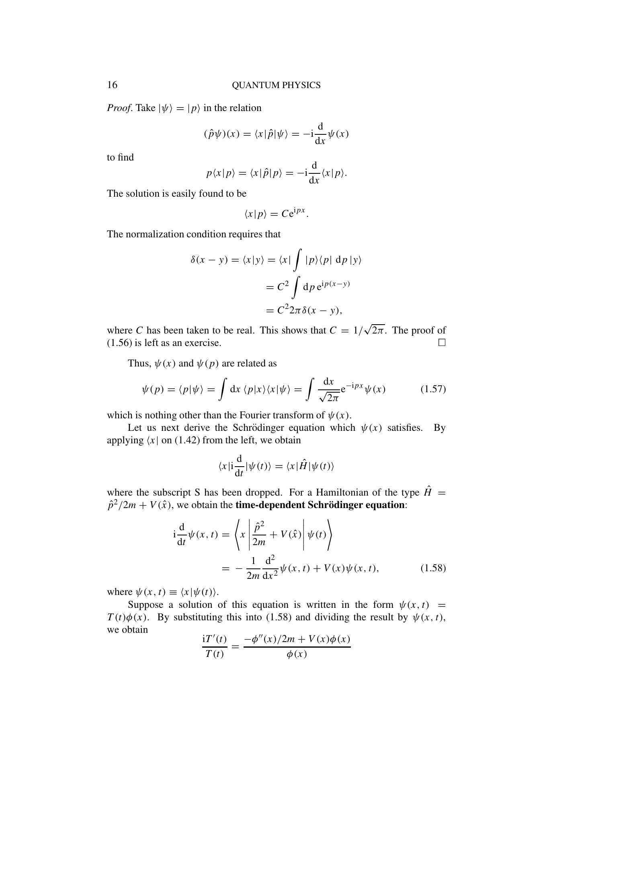

# 1.2.4 Wavefunction｜波函数

[阅读目录](README.md) · [下一小节](02-1.2.5.md)

**这一节要完成的事：把“量子态”变成能用来算位置、动量和测量概率的函数。**你不需要先把量子力学全部学完。我们先弄清实验问什么，再看作者为什么引入这些符号。

## 原书第 13 页：原文底本

本块保留该页属于本小节的完整原文。PDF 阅读器页码为 36。

## 第 13 页：先说目的，再逐步解读

### 一、作者先把问题缩小：只问一个粒子在直线上的位置

**这段在干什么：**规定一个最简单的研究对象，并说明“确定在某个位置”怎样写进数学。

原文从 “a particle moving on the real line” 开始。可以想象一个只能沿细长轨道运动的粒子。我们暂时不问它向上还是向下，也不问它的内部结构，只用一个数记录位置。

例如轨道上选好原点后，$y=2$ 表示在原点右边 2 个长度单位。作者把“位置确定为 $y$ 的理想状态”记为 $|y\rangle$。竖线和尖括号只是量子态的一种记号，不是绝对值。

于是

$$
\hat x|y\rangle=y|y\rangle
$$

可以先读成一句话：**如果系统处在这个理想状态，测量位置会确定得到 $y$。**

$\hat x$ 是位置算符。你可以先把算符理解为“作用在状态上的数学操作”。它和某种测量对应，但不是把实验仪器画成一个字母。这里的本征方程恰好表达“测量结果没有不确定性”的情形。

### 二、δ 归一化：把“按编号求和”改成“沿整条直线积分”

**这段在干什么：**让位置取连续值时，仍能像线性代数那样展开一个状态。

你熟悉离散正交基：不同基向量内积为零，相同基向量内积为一。矩阵里用 $\delta_{ij}$ 表示这件事。

位置却不是只许取 1、2、3；两点之间还可以有任意实数位置。作者于是用连续版本 $\delta(x-y)$。它最有用的性质是：

$$
\int dy\,\delta(x-y)f(y)=f(x).
$$

用大白话说：在整个 $y$ 轴上积分，这个符号只把 $y=x$ 处的函数值挑出来。这正好能接替离散公式中 $\delta_{ij}$ 的工作。

这里先不要把 $\delta(0)$ 当作某个可以代入的普通数。$|y\rangle$ 也是理想化的“位置完全精确”的状态；实际准备的粒子位置总有一定宽度。作者用这种理想状态作展开工具，类似用理想点光源或理想质点建模。你已经学过分析，之后可以用分布和连续谱把它说得更严格；当前先掌握它的用途。

## 原书第 14 页：原文底本

本块保留该页属于本小节的完整原文。PDF 阅读器页码为 37。

## 第 14 页：先说目的，再逐步解读

### 三、波函数：给每一个可能位置安排一个计算用的数

**这段在干什么：**解释式 (1.43) 定义的函数是什么，以及它和整个量子态有什么关系。

先比较一个你熟悉的例子。平面向量可以用两个坐标 $(v_1,v_2)$ 表示。向量是一整个对象，坐标是在选定坐标轴后描述这个对象的数字。

量子态 $|\psi\rangle$ 也是一整个对象。若我们关心位置，就按位置来描述它：每个 $x$ 对应一个数 $\psi(x)$。作者写

$$
\psi(x)=\langle x|\psi\rangle,
\qquad
|\psi\rangle=\int dx\,\psi(x)|x\rangle.
$$

第一式相当于“取出对应 $x$ 的坐标”；第二式相当于“用全部坐标把整个对象拼回来”。因为位置连续，拼接时用积分。

**$\psi(x)$ 叫波函数。**但现在还缺最重要的一步：这个计算用的数怎样和实验结果联系？作者接着称它为概率振幅，就是要补上这一层意思。

### 四、先别急着背“概率振幅”：为什么光有概率还不够？

**这段在干什么：**解释作者为什么不直接给每个位置一个概率，而要先给一个叫“振幅”的数。

先从普通概率想起。假设一个盒子里有红球和蓝球，你摸出一个球。摸到红球与摸到蓝球是两个互斥结果。要算“摸到红球或蓝球”的概率，可以把两个概率相加。这种加法很好理解：两类结果各算一次，不会互相抵消。

现在换一个实验：粒子从左边发出，经过两条可供通过的路径，最后到右边探测器。我们关心的是某个探测器最后有没有记录到粒子。实验可以反复做很多次，再数记录次数。

在合适条件下，两条路径同时参与时，某个探测器的记录次数会增加，也可能减少到零。尤其奇怪的是：**多开一条路，不一定让这里更容易收到粒子。**

这叫干涉。先记住这个词的实际意思：两部分过程合起来，结果可能加强，也可能抵消。我们需要一套能算出这两种结果的办法。

普通的非负概率相加只能增加，不能解释这种抵消。因此量子力学的计算分成两步：

1. 先给每条不能被区分的过程安排一个“振幅”，把这些振幅相加。
2. 再把总振幅换成最终的探测概率。

这里“不能被区分”不是说你暂时没去看记录，而是说装置中没有留下能够标明路径的记录，并且两路之间的关系没有被环境打乱。若装置留下了明确的路径记录，通常就不能再照着这条简单的振幅相加公式计算。

### 五、一个算得出来的例子：正负号改变结果，但不产生负概率

**这段在干什么：**用数字说明“加强”和“抵消”究竟是怎样算出来的。

先只用实数，把复杂性降到最低。在一个简化的两路计算中，设某个探测结果的两路振幅贡献为

$$
a_1=\frac12,\qquad a_2=\frac12.
$$

先相加，得到总振幅 $1$。再平方，得到这个结果的概率 $1$。

现在设装置让第二路的振幅反过号：

$$
a_1=\frac12,\qquad a_2=-\frac12.
$$

先相加，得到 $0$。再平方，得到概率 $0$。**负号出现在振幅里，没有出现在最终概率里。**

你可能马上追问：那么只知道两路各自“有多大”，能不能判断最后结果？不能。因为

$$
\left|\frac12\right|^2
=\left|-\frac12\right|^2=\frac14.
$$

平方以后，正负号被抹掉了。两种情形的每一路振幅大小相同，但它们相加时一个加强、一个抵消。只保留平方后的两个数，就无法分辨这两种情况。

因此，**提前把正负方向的信息丢掉，就没法算两路合起来会怎样。**

这里的 $a_1,a_2$ 是同一个装置中、同一个探测结果的两部分计算贡献，不能一律当成“堵住另一条路以后测得的概率”的平方根；堵路可能改变制备和归一化。这个例子只是把相加规则清楚算给你看。概率在各个可能结果之间重新分布，粒子没有被相消成负数量，也没有凭空增加。

### 六、相位：把“同号还是反号”推广成“两个箭头朝什么方向”

**这段在干什么：**解释“相位”这个词，不要求你先接受一句没有画面的定义。

实数只有沿数轴向右、向左两种方向。复数则可以画成平面上的箭头：

$$
z=r(\cos\theta+i\sin\theta).
$$

$r$ 是箭头长度，$\theta$ 是它和正实轴的夹角。**这个角度就叫相位。**相位差，就是两个箭头方向相差多少角度。

现在把两路振幅当成两根复平面上的箭头。箭头同向，相加后变长；箭头反向且等长，相加后变成零；方向相差直角，则得到斜向的合箭头。

例如

$$
\left|\frac12+\frac12\right|^2=1,\qquad
\left|\frac12-\frac12\right|^2=0,\qquad
\left|\frac12+\frac i2\right|^2=\frac12.
$$

因此相位不是一句神秘的“额外信息”：它在这套计算里就是箭头朝向，决定相加后的箭头有多长。

这也和你高中见过的波有关。两个相同波动，一个正好处在波峰、另一个也在波峰，会加强；一个波峰遇到一个波谷，会抵消。周期运动进行到哪一步，也可以用一个角度记录。复数非常适合记录这种大小与周期进程。不过粒子波函数不是水面的实际高度，我们借用波来帮助理解相加规则，不把电子直接说成一团水。

### 七、Born 规则：算出振幅之后，怎样得到实验概率？

**这段在干什么：**把“用于计算的复数”与“多次实验中出现的频率”明确接起来。

若某个离散结果的总振幅是 $a=u+iv$，量子力学使用

$$
P=|a|^2=u^2+v^2.
$$

也就是：先量出复平面箭头的长度，再平方。例如 $a=0.3+0.4i$，得到 $P=0.09+0.16=0.25$，即 25%。

这项从振幅到概率的规则，叫 Born 规则。名字不难，内容就是上面这一步。它不是因为“复数很方便”就必然成立的数学定理，而是理论用来连接实验的一条基本规则；这套规则算出的结果需要与实际统计相符。

你现在只需分清两件事：复数帮助我们保留方向并相加；模平方告诉我们怎样把相加结果换成概率。这两步应当分开理解。

### 八、位置是连续的，为什么还要乘 dx？

**这段在干什么：**解释式 (1.44) 为什么是积分，以及 $|\psi(x)|^2$ 为什么不直接叫一个点的概率。

实际探测器总有宽度。你可以问粒子落在从 1 厘米到 1.1 厘米的区域里的概率，而不是要求探测器报告一个无限精确的实数。

作者规定

$$
\Pr\{a\le x\le b\}=\int_a^b|\psi(x)|^2\,dx.
$$

$|\psi(x)|^2$ 是概率密度：它表示这一带概率分布得有多密。密度大，不等于单点概率大；还要看取的区间多宽。

例如某小段上密度近似为每厘米 $0.2$，探测区间宽 $0.1$ 厘米，则概率近似为 $0.2\times0.1=0.02$。把整个可能区域的概率加起来应为 1，所以有 $\int|\psi|^2dx=1$。这就是归一化。

### 九、为什么后面又出现动量波函数和位置算符？

**这段在干什么：**说明同一个状态可以用来回答不同测量问题，不需要每换一个问题就换一个粒子。

$\psi(x)$ 回答位置问题。$\widetilde\psi(p)$ 则用来算动量落在某个范围的概率。对于高中范围的运动，动量是 $p=mv$；在量子理论里，动量仍是能测量的物理量，但测量前的状态一般不能直接当成一个确定的 $p$。

在位置表示里，$\hat x$ 的作用很简单：把函数乘以自变量 $x$。于是平均位置就是熟悉的加权平均：

$$
\langle x\rangle=\int dx\,x|\psi(x)|^2.
$$

本页末尾引入 $U(a)$，准备研究“把整个位置分布向右挪 $a$”。作者接下来要说明：这个平移操作为什么和动量有关。先知道它要完成这个任务，再读指数符号，就不会把它当作凭空增加的一条公式。

## 原书第 15 页：原文底本

本块保留该页属于本小节的完整原文。PDF 阅读器页码为 38。

## 第 15 页：先说目的，再逐步解读

### 十、平移：先用一张函数图像理解 U(a)

**这段在干什么：**说明引理 1.1 所说的操作是什么，并从平移一步步找出动量的微分表达式。

设原波形集中在 $x=0$ 附近。把整个图形向右挪 3 个单位，新图形就集中在 $x=3$ 附近。这个操作记作 $U(3)$。对理想位置态，它把 $|x\rangle$ 变成 $|x+3\rangle$。

对函数，向右挪 $a$ 却写成 $\psi(x-a)$。例如原函数峰值在自变量 0，新函数要在 $x=a$ 达到峰值，所以里面必须是 $x-a$。这个负号来自平移图形，与你熟悉的高中函数平移相同。

作者已经给出正则关系 $[\hat x,\hat p]=i\hbar$。方括号的定义是 $AB-BA$。由它可证明

$$
\hat xU(a)=U(a)(\hat x+a).
$$

再作用到 $|x\rangle$，可得 $U(a)|x\rangle$ 对应的位置是 $x+a$。所以指数 $U(a)=e^{-ia\hat p/\hbar}$ 真的实现了平移。这里的 $\hbar$ 是一个基本物理常数，负责把位置、动量的乘积换成无量纲数；本书常把它设为 1 以缩短公式。

再让 $a$ 很小，一边展开函数：

$$
\psi(x-a)=\psi(x)-a\psi'(x)+O(a^2).
$$

另一边展开算符指数：

$$
U(a)\psi=\psi-\frac{ia}{\hbar}\hat p\psi+O(a^2).
$$

比较两边关于 $a$ 的一次项，

$$
-\frac i\hbar\hat p\psi=-\psi',
\qquad
\boxed{\hat p\psi=-i\hbar\psi'.}
$$

因此动量算符中的导数不是随便猜的：**导数描述小平移怎样改变函数，而动量正是这套量子理论中控制空间平移的量。**

原文证明末尾还省略了对位置态相位的选择。它不改变这里的计算主线，详细说明放在 [公式核对附录](formula-checks.md)；第一次读到这里，可以先掌握这两次展开怎样比较。

### 十一、动量表示：换一种坐标，算符的样子也会改变

**这段在干什么：**解释式 (1.51)–(1.56) 为什么把“乘法”和“微分”的角色交换了。

在位置表示里，状态写成 $\psi(x)$。此时位置测量最容易处理，$\hat x$ 就乘 $x$；动量则写成 $-i\hbar\,d/dx$。

若改用动量表示，状态写成 $\widetilde\psi(p)$，动量测量变得最容易处理，$\hat p$ 就乘 $p$；位置算符则写成 $i\hbar\,d/dp$。

这类似同一个线性变换换基后矩阵会变。物理操作没有变，变的是表示方法。

页末的 $\langle x|p\rangle$ 接着问：一个“动量确定为 $p$”的理想状态，写成位置函数以后是什么样？下一页就是求这个函数。它将把你熟悉的 Fourier 变换引进来。

## 原书第 16 页：原文底本

本块保留该页属于本小节的完整原文。PDF 阅读器页码为 39。

## 第 16 页：先说目的，再逐步解读

### 十二、Fourier 变换：为什么动量和波的频率接上了？

**这段在干什么：**求出动量确定时的位置波形，说明为什么从位置函数转到动量函数要做 Fourier 变换。

令 $u_p(x)=\langle x|p\rangle$。因为它是动量为 $p$ 的状态，必须满足

$$
-i\hbar u_p'(x)=p\,u_p(x).
$$

这是你会解的一阶方程：

$$
u_p'(x)=\frac{ip}{\hbar}u_p(x),
\qquad
u_p(x)=C e^{ipx/\hbar}.
$$

利用 Euler 公式，它包含 $\cos(px/\hbar)$ 与 $\sin(px/\hbar)$。$p/\hbar$ 控制随位置变化的快慢：动量越大，空间振荡越快。这就是 $p=\hbar k$，其中 $k$ 叫波数。

一般波函数可以由不同快慢的这些波形叠加。Fourier 变换正好负责回答“每种波数占多少”，于是也就负责把位置表示换成动量表示：

$$
\widetilde\psi(p)=
\frac1{\sqrt{2\pi\hbar}}
\int dx\,e^{-ipx/\hbar}\psi(x).
$$

它不是另外添加的一种物理运动，而是同一个状态换写法。位置分布很窄时，需要许多不同波数共同合成，所以动量分布往往较宽；以后的位置—动量不确定关系会把这个联系精确写出来。

### 十三、薛定谔方程：用今天的波函数算下一刻的波函数

**这段在干什么：**将上一小节的抽象演化方程，改写成一个能实际求解的偏微分方程。

你在 1.2.3 已经记过 $i\hbar\partial_t|\psi\rangle=H|\psi\rangle$。现在状态能写成函数，位置、动量也已有具体写法，所以直接代入

$$
H=\frac{\hat p^2}{2m}+V(\hat x)
$$

即可。动量用 $-i\hbar\partial_x$ 替代，平方后成为 $-\hbar^2\partial_x^2$；势能用位置函数乘法替代。得到

$$
\boxed{
i\hbar\partial_t\psi(x,t)
=-\frac{\hbar^2}{2m}\partial_x^2\psi(x,t)+V(x)\psi(x,t).
}
$$

左边描述函数随时间如何变化；右边由动能和势能决定。给定初始波函数、势能和适当边界条件，就可以求后来函数，再算各处的探测概率。

这不是一条直接画出粒子轨迹的方程。它首先给出随时间变化的概率计算方法。你可以像理解热方程、波动方程那样关注它的初值问题，但要保留量子力学自己的概率解释。

### 十四、分离变量：为什么先找 ψ(x,t)=T(t)φ(x) 这样的解？

**这段在干什么：**把难解的含时间方程，拆成能量问题和时间问题，为下一页的“定态”作准备。

如果势能不随时间变，作者先找空间形状与时间因子可以分开的解：

$$
\psi(x,t)=T(t)\phi(x).
$$

代入方程，再除去共同因子，得到一边只含 $t$，另一边只含 $x$。要让它们对所有位置和时间都相等，只能共同等于一个常数 $E$。

于是问题拆成

$$
i\hbar T'=ET,\qquad H\phi=E\phi.
$$

后一式是能量本征问题。先找到这些特别的解，再把它们叠加，就能组织更一般的运动。这和求线性方程时先找一批基本解的思路相同，不表示所有解都只能有一个乘积形式。

## 原书第 17 页：原文底本

本块保留该页属于本小节的完整原文。PDF 阅读器页码为 40。

## 第 17 页：先说目的，再逐步解读

### 十五、定态：概率分布不变，并不等于一颗小球停在那里

**这段在干什么：**解释式 (1.59)–(1.62) 的解为什么叫定态，并说明能量怎样进入时间因子。

时间方程直接解得

$$
\psi_E(x,t)=e^{-iEt/\hbar}\phi_E(x).
$$

指数前面的因子在复平面上一直转，但长度始终为 1。所以

$$
|\psi_E(x,t)|^2=|\phi_E(x)|^2.
$$

**相同制备反复做位置测量，得到的位置统计分布不随等待时间改变。**这就是这里“定态”的意思。它没有提供一条小球轨迹，也没有说每次都测在同一个位置。

若把两个不同能量的解相加，它们转动速度不同。开始同向的两根箭头，过一会儿方向可能错开；某些地方的加强、抵消就会随时间变化。因此一般叠加态的位置分布会变化。

### 十六、这一节复习：把整条推理重新说一遍

**这段在干什么：**把本节内容整理成一条可以复述的路线，并明确现在需要掌握到哪里。

先问粒子可能在哪。为回答位置问题，把状态写成 $\psi(x)$。为了处理干涉，这个函数保留复数方向；对一个区间积分 $|\psi|^2$，得到探测概率。为研究位置如何移动，引入平移，由此得到动量的导数表达。动量本征函数是平面波，因此位置与动量表示靠 Fourier 变换相连。最后，把动能和势能代进演化方程，就得到波函数的薛定谔方程。

| 内容 | 等级 | 用自己的话应能做到什么 |
|---|---|---|
| 波函数与概率密度 | A | 说明为什么还要对区间积分 |
| 振幅、相位、干涉 | A | 用两根箭头和一组数字解释加强、抵消 |
| 平移与动量 | A | 从两次小量展开得到 $-i\hbar\partial_x$ |
| 位置与动量表示 | A | 说明是同一状态换写法 |
| 定态 | A | 解释为什么时间因子在变而位置分布不变 |
| 连续谱、严格定义域 | B | 以后补细节，当前不让它打断主线 |

你现在可以检验自己：$1/2$ 和 $-1/2$ 的模平方一样，为什么参与相加后结果不同？如果能从“振幅先相加”一步一步答出来，就掌握了振幅与概率的这项重要区别。

---

[阅读目录](README.md) · [下一小节](02-1.2.5.md)
