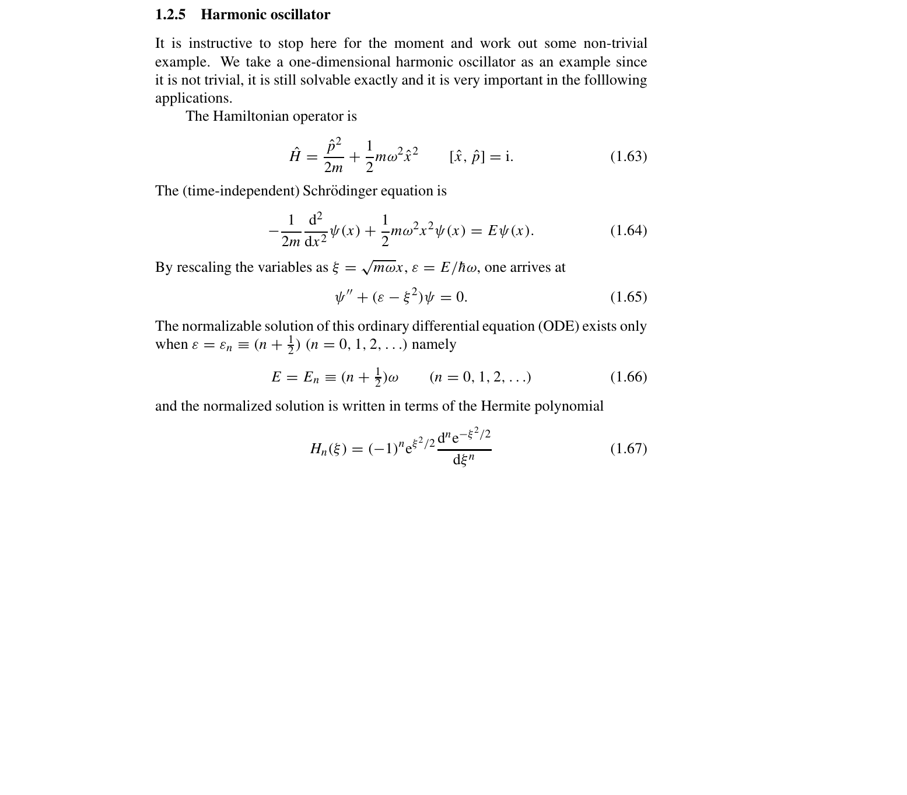
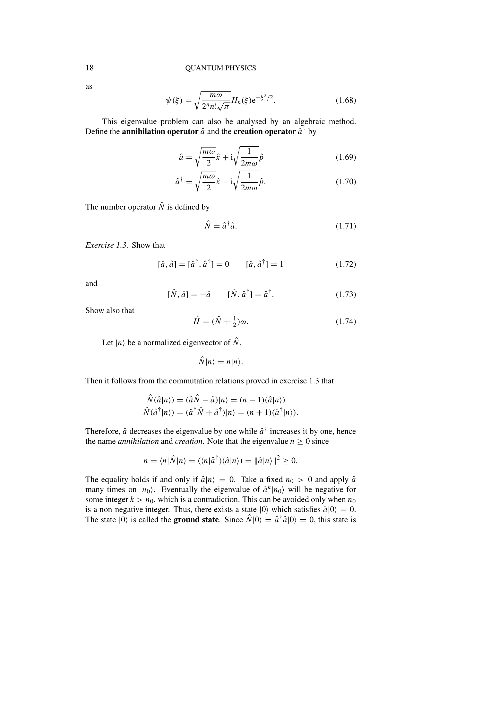
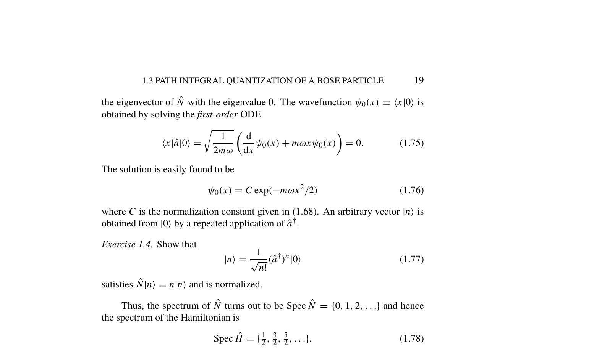

# 1.2.5 Harmonic oscillator｜谐振子的算符量子化

[总目录](README.md) · [上一小节](01-1.2.4.md) · [下一小节](03-1.3.1.md)

本节先用微分方程，再用算符代数研究同一个系统。两种方法交叉核对，是后面理解路径积分和场量子化的起点。

## 原书第 17 页：原文底本

以下影印块是本小节在该页的完整原文；相邻小节在同页交接时按标题分界。PDF 页码为 40。

## 第 17 页句读与集注

### 句读开头：“not trivial ... solvable exactly”

谐振子最初来自弹簧，但它的重要性远超过弹簧。设一个系统在稳定平衡点 $x_0$ 附近运动，令 $q=x-x_0$。势能展开为

$$
V(x)=V(x_0)+\underbrace{V'(x_0)}_{0}q+
\frac12V''(x_0)q^2+O(q^3).
$$

稳定性要求二次项系数为正，写成 $m\omega^2$。舍去不影响运动的常数及较小的高阶项，就得到谐振子。这说明它描述稳定平衡附近普遍存在的小振动。多个自由度的二次型在适当条件下可以化成独立的正常模式，每个模式又是谐振子。以后“自由场等于无穷多个振子”的说法，正沿着这条线发展。

### 疏式 (1.63)–(1.66)：离散能级不是先规定的

恢复单位，

$$
H=-\frac{\hbar^2}{2m}\frac{d^2}{dx^2}
+\frac12m\omega^2x^2.
$$

自然长度 $\ell=\sqrt{\hbar/(m\omega)}$ 平衡了动能与势能的尺度。令 $\xi=x/\ell$、$\varepsilon=E/(\hbar\omega)$，直接代入得到

$$
\psi''(\xi)+(2\varepsilon-\xi^2)\psi(\xi)=0.
$$

**校记：**影印原文 (1.65) 在给定 $\varepsilon=E/(\hbar\omega)$ 后写成 $\psi''+(\varepsilon-\xi^2)\psi=0$，少了系数 2；同时该段在 $\hbar=1$ 和恢复 $\hbar$ 的记号间切换。检验方法很简单：把基态 $e^{-\xi^2/2}$ 代进去，它给出 $2\varepsilon=1$。这与原文随后能级一致，却与印出的 (1.65) 不一致。

在很大 $|\xi|$ 下，解可能急剧增长或衰减。物理态需要平方可积，必须剔除增长部分。进一步写 $\psi=e^{-\xi^2/2}h(\xi)$，得到

$$
h''-2\xi h'+(2\varepsilon-1)h=0.
$$

可接受的多项式解要求 $2\varepsilon-1=2n$，于是 $E_n=\hbar\omega(n+\tfrac12)$。边界和归一化条件挑出谱，这与 Sturm–Liouville 问题的思路相接。连续坐标并不保证连续能量；空间束缚和谱的离散性完全可以同时存在。

### 校记式 (1.67)：两套 Hermite 约定不可混用

原文给出的 Rodrigues 公式是概率论常用的 $He_n$ 约定；与本页振子尺度及下一页 $e^{-\xi^2/2}$ 搭配时，需要物理学常用的

$$
H_n(\xi)=(-1)^n e^{\xi^2}
\frac{d^n}{d\xi^n}e^{-\xi^2}.
$$

两套多项式都合法，但变量缩放和归一化必须一起改变。这里把冲突指出，避免你在代入验证时误以为是自己不会解 ODE。

## 原书第 18 页：原文底本

以下影印块是本小节在该页的完整原文；相邻小节在同页交接时按标题分界。PDF 页码为 41。

## 第 18 页句读与集注

### 句读式 (1.68)：用归一化核对公式

按上一页澄清后的约定，位置波函数为

$$
\psi_n(x)=
\left(\frac{m\omega}{\pi\hbar}\right)^{1/4}
\frac{H_n(\sqrt{m\omega/\hbar}\,x)}{\sqrt{2^n n!}}
e^{-m\omega x^2/(2\hbar)}.
$$

若把它视为 $\xi$ 的函数并以 $d\xi$ 归一化，则前面改为 $\pi^{-1/4}/\sqrt{2^n n!}$。**校记：**原文 (1.68) 的系数与变量、Hermite 约定存在不一致；以 $n=0$ 做 Gaussian 积分就能核对。归一化必须明确针对 $dx$ 还是 $d\xi$，因为它们相差 Jacobian。

### 疏式 (1.69)–(1.74)：为什么要把位置和动量合起来？

先构造无量纲变量 $Q=\sqrt{m\omega/\hbar}\,x$、$P=p/\sqrt{m\hbar\omega}$。哈密顿量正比于 $Q^2+P^2$，对易关系是 $[Q,P]=i$。于是定义

$$
a=\frac{Q+iP}{\sqrt2},\qquad
a^\dagger=\frac{Q-iP}{\sqrt2}.
$$

这像把二维相平面组合成复坐标，但 $Q,P$ 是算符，乘法顺序留下一个不可忽略的常数：

$$
a^\dagger a
=\frac12(Q^2+P^2+i[Q,P])
=\frac12(Q^2+P^2-1).
$$

所以 $H=\hbar\omega(N+\tfrac12)$。零点项并非凭空添上，而是由非对易性带出的。

“creation/annihilation”在这里指增加、减少一个振动激发量。对一个被困住的粒子，$a^\dagger$ 通常使它的振动能提高 $\hbar\omega$，不是再创造一颗相同的被困粒子。到了量子场论，正常模式的激发才能进一步解释成粒子占据数。先辨清这两层意思，后面的术语才不会误导。

### 疏：为什么 N 的谱必须是非负整数？

$\langle v|N|v\rangle=\|av\|^2\ge0$ 给出下界。$[N,a]=-a$ 则说明，若 $a|n\rangle$ 不为零，它的本征值是 $n-1$。假设某个本征值是非整数 $n=k+r$，$0<r<1$；下降到 $r$ 后，再作用一次 $a$ 的范数平方仍为 $r>0$，不会消失，却要得到负本征值 $r-1$，矛盾。整数谱则可以在 0 处停止，因为 $\|a|0\rangle\|^2=0$。

这个补充把原文“反复下降，否则负数”的简述补全：必须同时知道下降后的向量何时可能成为零向量。否则只画一条向下的能级梯子，还不算证明。

## 原书第 19 页：原文底本

以下影印块是本小节在该页的完整原文；相邻小节在同页交接时按标题分界。PDF 页码为 42。

## 第 19 页句读与集注

### 句读式 (1.75)–(1.77)：真空条件如何给出 Gaussian？

$a|0\rangle=0$ 在位置表示中成为

$$
\left(\frac{d}{dx}+\frac{m\omega}{\hbar}x\right)\psi_0=0.
$$

一阶积分得到 $\psi_0=C e^{-m\omega x^2/(2\hbar)}$。Gaussian 不只是“因为许多现象服从正态分布”，而是最低能态的下降算符必须把它消去。它也恰好满足位置—动量不确定关系的等号：

$$
\Delta x=\sqrt{\frac{\hbar}{2m\omega}},\quad
\Delta p=\sqrt{\frac{m\hbar\omega}{2}},\quad
\Delta x\Delta p=\frac{\hbar}{2}.
$$

若要求粒子完全待在势能最低点，$\Delta x$ 极小，动量涨落和平均动能就会变大。最低总能量是在两者之间取得平衡，因此不能把基态理解为经典弹簧完全停住的状态。

由 $\|a^\dagger|n\rangle\|^2=n+1$，可逐级定出归一化：

$$
|n\rangle=\frac{(a^\dagger)^n}{\sqrt{n!}}|0\rangle,\quad
a|n\rangle=\sqrt n\,|n-1\rangle.
$$

**校记式 (1.78)：**本页最后把 $H$ 的谱列为半整数，若未另行令 $\omega=1$，应补乘 $\omega$；恢复单位则补乘 $\hbar\omega$。检验任何能级公式时，都应检查是否具有能量量纲。

**回看问题：**为什么二次势具有普遍性？能量离散来自什么条件？零点能是否意味着能量守恒失效？$a^\dagger$ 在本节增加的究竟是什么？这些问题比背下 Hermite 多项式显式表达式更能支撑后续阅读。

---

[总目录](README.md) · [上一小节](01-1.2.4.md) · [下一小节](03-1.3.1.md)
