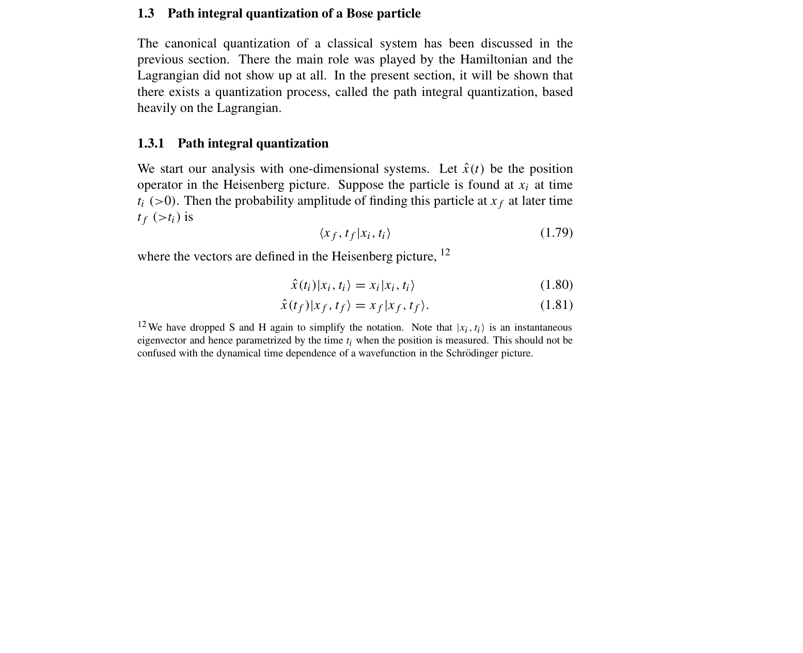
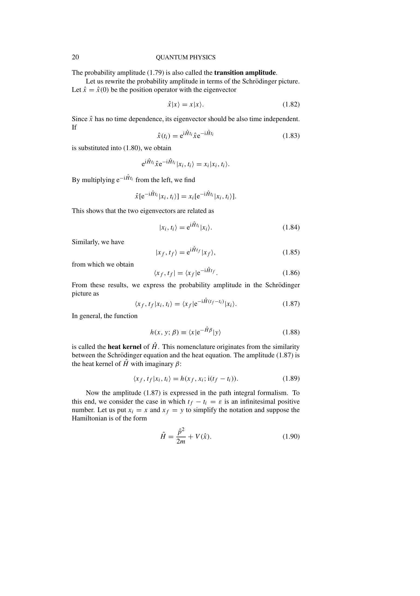
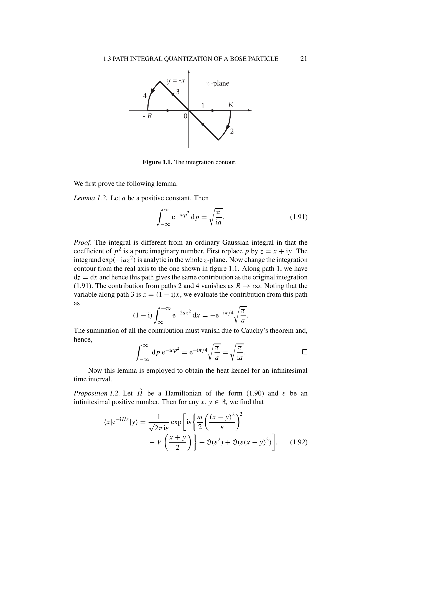
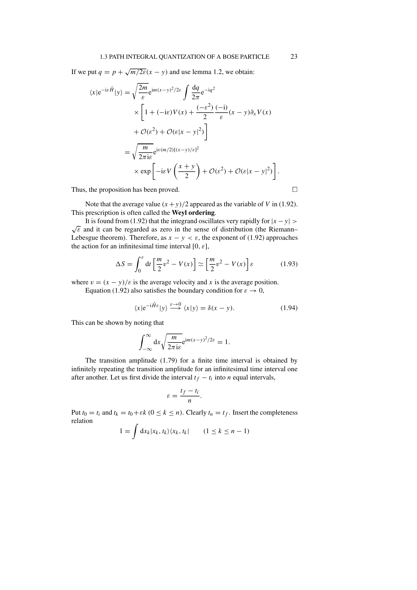
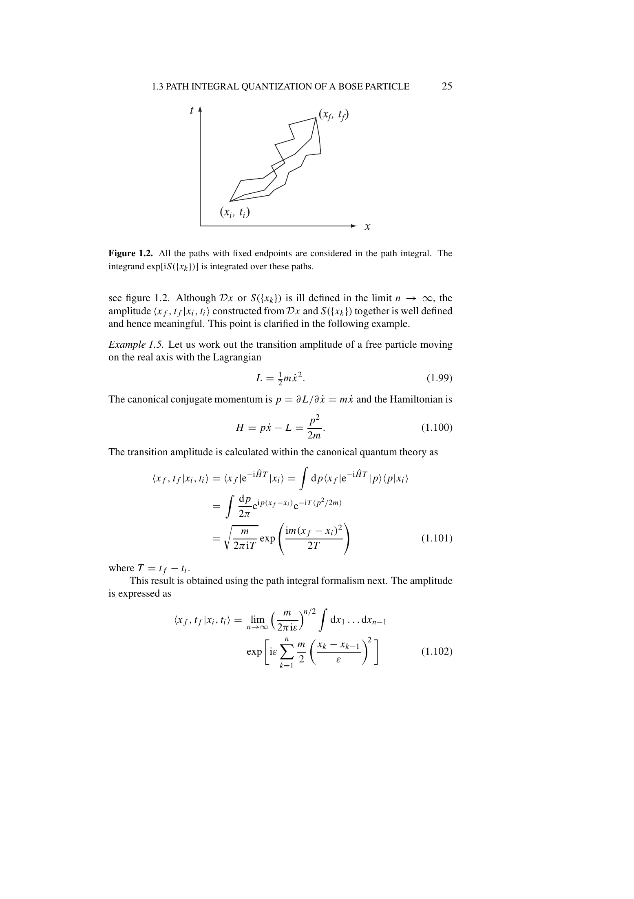
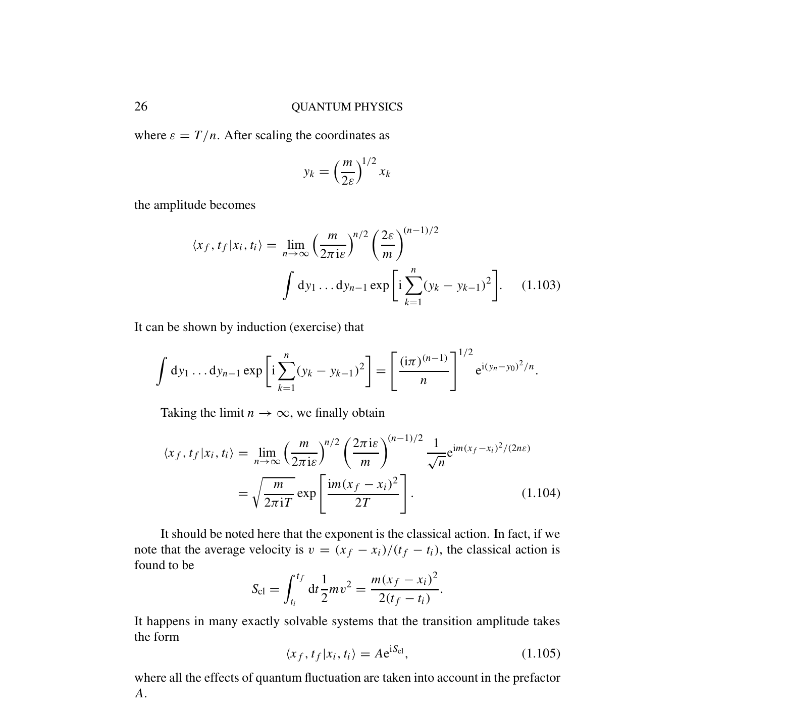

# 1.3.1 Path integral quantization｜玻色粒子的路径积分

[总目录](README.md) · [上一小节](02-1.2.5.md) · [下一小节](04-1.3.2.md)

本文件包括 1.3 的导言和 1.3.1。路径积分并不是让你遗忘算符理论，改信另一套图像；作者在本节从同一个时间演化算符出发，把矩阵乘法的连续版本改写成路径上的积分。

## 原书第 19 页：原文底本

以下影印块是本小节在该页的完整原文；相邻小节在同页交接时按标题分界。PDF 页码为 42。

## 第 19 页句读与集注

### 句读导言：为什么换到 Lagrangian？

哈密顿形式直接给出能量、态空间和时间演化；拉格朗日形式把理论组织成作用量，较容易把时空对称性和场的局部相互作用写在一起。作者希望后面讨论场、规范结构和拓扑，因此需要一个以作用量为中心的入口。两者描述同一系统时应当给出同一组可观测结果，不能把“换了一种量子化写法”理解为改变了实验规律。

### 句读式 (1.79)–(1.81)：带时间的位置本征态是什么意思？

$|x_i,t_i\rangle$ 是 Heisenberg 位置算符 $\hat x(t_i)$ 的本征态。脚注 12 特别提醒：这里的时间标签标明“在哪个时刻问位置问题”，不要直接把它等同于 Schrödinger 绘景中一个固定初态的动力学演化。

$\langle x_f,t_f|x_i,t_i\rangle$ 叫跃迁振幅。它回答：以初始位置为边界条件，后来在终点探测的复振幅是什么。由于理想位置态是 δ 归一化，核的模平方不能不加说明就当作两个精确点之间的普通概率。实验中应使用有限宽度的初始波包和有限分辨率的探测区间。

## 原书第 20 页：原文底本

以下影印块是本小节在该页的完整原文；相邻小节在同页交接时按标题分界。PDF 页码为 43。

## 第 20 页句读与集注

### 句读式 (1.82)–(1.87)：先回到熟悉的演化算符

把 Heisenberg 算符 $\hat x(t)=e^{iHt/\hbar}\hat x e^{-iHt/\hbar}$ 代入本征方程，就得到原文的态变换。最终真正要计算的是

$$
K(x_f,t_f;x_i,t_i)=
\langle x_f|e^{-iH(t_f-t_i)/\hbar}|x_i\rangle.
$$

这就是演化算符在位置表示中的积分核。若初始态是 $\psi_i$，

$$
\psi_f(x_f)=\int dx_i\,K(x_f,t_f;x_i,t_i)\psi_i(x_i).
$$

这条式子给传播子一个具体用途：它把初始波形变成后来波形。对熟悉数值线性代数的你，可以把它类比为矩阵指数作用在向量上，但这里的矩阵行列指标是连续位置。

### 疏式 (1.88)–(1.90)：为什么叫热核？

将振荡演化换为 $e^{-\beta H}$，它满足 $\partial_\beta h=-H_xh$。若 $H=-\hbar^2\partial_x^2/(2m)$，这就是扩散型方程；而真实时间演化前有 $i$，保持的是概率振幅的酉演化。这个形式联系让分析中的热方程方法进入量子理论，但热扩散的正核与真实时间的复振幅，物理解释仍须区分。

下面限定 $H=p^2/(2m)+V(x)$。这项限定很重要：若哈密顿量含位置依赖的质量、矢势、曲空间动能或非平凡算符排序，短时核和积分测度都要相应处理。本节的简单公式不能无条件套用到所有系统。

## 原书第 21 页：原文底本

以下影印块是本小节在该页的完整原文；相邻小节在同页交接时按标题分界。PDF 页码为 44。

## 第 21 页句读与集注

### 句读引理 1.2 与图 1.1：振荡积分需要怎样理解？

$\int e^{-iap^2}dp$ 不像实 Gaussian 那样绝对可积。旋转积分路径，是利用复解析性把振荡问题连到衰减问题，并确定平方根的相位。结果中的 $\sqrt{1/i}=e^{-i\pi/4}$ 不能随意换号；它影响传播子的初值和组合规律。

一个便于核对的办法是先计算

$$
\int dp\,e^{-(\eta+ia)p^2}
=\sqrt{\frac{\pi}{\eta+ia}},\qquad \eta>0,
$$

再让 $\eta\downarrow0$。这说明答案带着一个极限处方。图 1.1 不是画粒子的运动轨迹，而是画计算复积分时使用的积分路径；两种“路径”不要混淆。

### 疏命题 1.2：短时核为什么长得像经典作用量？

先把正确量纲写清楚。对短时间 $\epsilon$，领先阶为

$$
K_\epsilon(x,y)\simeq
\sqrt{\frac{m}{2\pi i\hbar\epsilon}}\,
\exp\left[\frac{i}{\hbar}
\left(\frac{m(x-y)^2}{2\epsilon}
-\epsilon V\!\left(\frac{x+y}{2}\right)\right)\right].
$$

括号里是“动能乘时间减势能乘时间”：平均速度是 $(x-y)/\epsilon$。这不是先凭物理直觉把 $e^{iS/\hbar}$ 猜进去；下一页的动量积分会把它算出来。

**校记：**本页印出的 (1.92) 前因子缺少 $\sqrt m$，动能括号还出现 $(x-y)^2/\epsilon$ 再平方的写法。与本节证明末尾第 23 页及量纲核对，应该使用上式的 $(x-y)/\epsilon$ 作为速度。影印保留原式，注中不把排印错误沿用到推导。

## 原书第 22 页：原文底本

以下影印块是本小节在该页的完整原文；相邻小节在同页交接时按标题分界。PDF 页码为 45。

## 第 22 页句读与集注

### 句读证明：插入动量完备关系在做什么？

动能在动量表示里对角，势能在位置表示里对角。作者插入 $\int dp\,|p\rangle\langle p|$，是为了把这两种便利结合起来。用短时分解写出主线：

$$
K_\epsilon(x,y)\simeq
\int\frac{dp}{2\pi\hbar}
\exp\left\{\frac{i}{\hbar}
\left[p(x-y)-\epsilon\frac{p^2}{2m}
-\epsilon V\left(\frac{x+y}{2}\right)\right]\right\}.
$$

注意，$e^{A+B}$ 通常不等于 $e^Ae^B$，因为 $\hat p^2$ 与 $V(\hat x)$ 不对易。这里只是在时间切片及相应排序规则下构造极限；更系统的表达是 Trotter 乘积公式或对称短时分解。

完成平方：

$$
p(x-y)-\frac{\epsilon p^2}{2m}
=-\frac{\epsilon}{2m}
\left(p-\frac{m(x-y)}{\epsilon}\right)^2
+\frac{m(x-y)^2}{2\epsilon}.
$$

第一项用 Gaussian 积分给前因子，第二项留下短时动能作用量。这样，为什么出现拉格朗日量就清楚了：消去动量之后，哈密顿表达 $p\dot x-H$ 变成了 $L$。

原文逐行搬动 $\partial_x$ 和 $e^{ikx}$，实质是在谨慎处理微分算符的作用对象。末尾特意保留的“$\cdot1$”提醒你：导数还可能作用在后面的势函数上，只有最终作用到常数时才归零。不能因为 $\partial_x1=0$，就把整段指数里的所有导数提前删掉。

## 原书第 23 页：原文底本

以下影印块是本小节在该页的完整原文；相邻小节在同页交接时按标题分界。PDF 页码为 46。

## 第 23 页句读与集注

### 句读中点处方与短时极限

原文的 $V((x+y)/2)$ 对应中点处方。在本节简单的 $p^2/(2m)+V(x)$ 情形，不同相容的短时近似可给出同一连续极限；当 $x,p$ 混合出现时，离散化与算符排序的对应更关键。作者称其为 Weyl ordering，目的是提醒这种对应，不能把“取中点”理解成粒子必然只感受空间中点的势。

核满足

$$
\lim_{\epsilon\downarrow0}K_\epsilon(x,y)=\delta(x-y)
$$

是分布意义的极限：应先与合适函数积分，再取极限。对固定 $x\ne y$，振幅的模并不简单地趋于零，前因子还随 $\epsilon^{-1/2}$ 增长；真正起作用的是不同位置的快速相位振荡相互抵消。因此原文关于“远处可视为零”的话要按分布与积分中的抵消理解。

**尺度提醒：**短时量子涨落的典型尺度与 $\sqrt{\hbar\epsilon/m}$ 有关，而非笼统的 $|x-y|<\epsilon$。后者甚至混合了长度和时间的量纲。也正因为涨落并不按普通光滑轨迹的方式缩小，下一页才强调速度只是形式符号。

### 疏：为什么要把时间切开？

演化算符有组合律。以中间时刻 $t$ 为例，

$$
K(f;i)=\int dx\,K(f;x,t)K(x,t;i).
$$

这是连续基下的矩阵乘法。中间位置没有被实际测量；插入完备关系不会造成测量坍缩。它只是把同一个算符的计算拆开。若真的测量并记录了中间位置，实验问题以及干涉结构都会改变。

## 原书第 24 页：原文底本

以下影印块是本小节在该页的完整原文；相邻小节在同页交接时按标题分界。PDF 页码为 47。

## 第 24 页句读与集注

### 句读式 (1.95)：所谓“所有路径”先是有限多个积分

把 $T$ 分成 $n$ 段后，端点固定，只有 $x_1,\ldots,x_{n-1}$ 是积分变量：

$$
K_n=\left(\frac{m}{2\pi i\hbar\epsilon}\right)^{n/2}
\int dx_1\cdots dx_{n-1}\,
e^{iS_n(x_0,\ldots,x_n)/\hbar}.
$$

每选定一组中间位置，就可以画一条折线路径。积分遍历这些位置，便可以简称为“对路径求和”。这句话来源于有限维积分的重新组织，不要求你相信粒子以经典方式依次访问每条折线。

前因子有 $n$ 份而独立位置只有 $n-1$ 个，是因为有 $n$ 段短时传播，但两个端点不积分。这个计数关系能帮助核对自由粒子的答案，也解释为什么不能把测度中的全部常数随手扔掉。

### 疏式 (1.96)–(1.98)：为什么作者反复说 formal？

时间步长缩小时，典型路径未必可微；差商 $(x_k-x_{k-1})/\epsilon$ 甚至会发散。因而 $\int\mathcal Dx\,e^{iS[x]/\hbar}$ 不能一律当作“某个普通无限维 Lebesgue 测度上，对光滑函数的积分”。本节实际可操作的定义是带有规范化、边界条件和极限处方的离散表达。

这不是理论随意，而是提醒先明确所用的数学对象。欧氏时间下某些势能条件允许用 Wiener 测度和 Feynman–Kac 公式做严格处理；真实时间的一般路径积分还要另外分析。就当前阅读，记住“离散定义先于漂亮的连续符号”即可，不必停下来先修完所有严格构造。

## 原书第 25 页：原文底本

以下影印块是本小节在该页的完整原文；相邻小节在同页交接时按标题分界。PDF 页码为 48。

## 第 25 页句读与集注

### 句读图 1.2：“多条路径”为什么仍会出现经典轨迹？

若作用量变化远大于 $\hbar$，附近路径的相位变化很快，积分中大量抵消。在 $\delta S=0$ 的路径附近，相位的一阶变化消失，邻近贡献较容易保留下来。这是驻相近似把经典方程带回来的机制。经典路径不是另外贴在量子理论上的限制，而是在合适尺度下从振幅叠加中显现。

“驻相”与“最小作用量”不应混用。真实时间作用量的驻点不一定是最小值。量子涨落也没有在经典轨迹之外全部消失；只是宏观条件下，许多不同路径的贡献互相抵消。

### 句读例 1.5：自由粒子也有非平凡传播

自由粒子没有势能，却不是“态永远不变”。不同动量分量具有不同能量 $p^2/(2m)$，积累不同相位，波包可以展宽。动量积分给出

$$
K_0(x_f,x_i;T)=
\sqrt{\frac{m}{2\pi i\hbar T}}
\exp\left[\frac{im(x_f-x_i)^2}{2\hbar T}\right].
$$

指数是连接两端点的匀速经典路径的作用量，但前因子来自对所有中间涨落的积分。不要从答案只含 $S_{\rm cl}$，误以为推导中只保留了这一条轨迹。

位置本征态到位置本征态的这个核，模随端点距离并不衰减；它不是一个归一化的最终位置概率分布。与实际初始波包卷积后，才得到可归一化的最终态及其概率。这也再次说明传播振幅与概率分布需要区分。

## 原书第 26 页：原文底本

以下影印块是本小节在该页的完整原文；相邻小节在同页交接时按标题分界。PDF 页码为 49。

## 第 26 页句读与集注

### 句读离散 Gaussian 计算：怎样消去中间点？

每积去一个中间位置，就是把两个短时核合成为一个较长时间核。例如

$$
\int dz\,K_0(x,z;t_2)K_0(z,y;t_1)
=K_0(x,y;t_1+t_2).
$$

完成平方后，$z$ 的中心位于连接两端点的匀速插值位置；其余 Gaussian 积分贡献归一化。反复使用，就得到原文的归纳式。你可以用有限维三对角二次型的行列式复核同一过程，这与离散差分 Laplacian 的计算有关。

### 句读式 (1.105)：经典作用量之外还有什么？

作者写 $K=Ae^{iS_{\rm cl}}$，并说涨落被装进 $A$。对二次作用量，围绕经典解的展开在二阶精确终止，所以这个结构可以精确成立。一般非线性系统还有高阶涨落，$A$ 也可能包含更复杂的量子修正；不能把本例当作所有路径积分都已被经典轨迹精确求尽。

本节的完整因果链现在可以重述：酉演化有组合律；连续基的组合律插入中间位置积分；短时核的动量积分产生 $p\dot x-H=L$；连乘短时相位产生总作用量；在经典尺度下，驻相条件又产生 Euler–Lagrange 方程。

**回看问题：**插入完备关系是否等于做一次测量？为什么短时核前因子不能删？路径积分中的速度为什么只是形式记号？经典极限依靠什么抵消机制？自由核的模平方为什么不能直接当最终位置概率？

---

[总目录](README.md) · [上一小节](02-1.2.5.md) · [下一小节](04-1.3.2.md)
