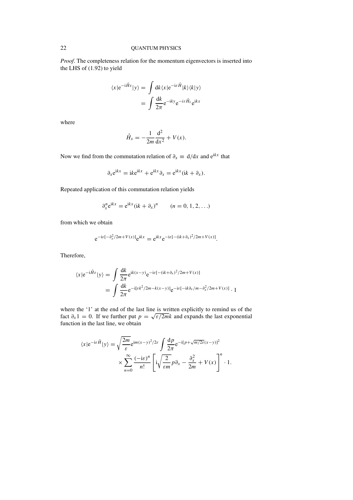
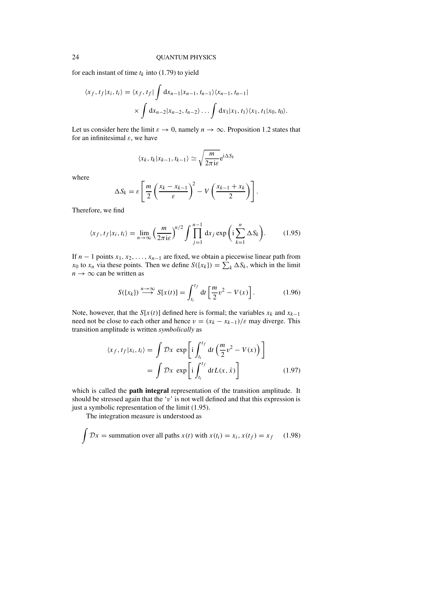

# 1.3.1 Path integral quantization｜玻色粒子的路径积分

[阅读目录](README.md) · [上一小节](02-1.2.5.md) · [下一小节](04-1.3.2.md)

**这一节在做什么：换一种办法计算粒子从起点到终点的振幅。**先把一段长时间拆成许多短时间，再把每一小段的计算连起来，“路径积分”就是这样出现的。

## 原书第 19 页：原文底本

本块保留该页属于本小节的完整原文。PDF 阅读器页码为 42。

## 第 19 页：先说目的，再逐步解读

### 一、为什么作者从 Hamiltonian 换回 Lagrangian？

**这段在干什么：**说明新方法仍在回答同一个物理问题，并交代作者为什么要引入它。

前面的方法是：先写能量算符 $H$，再让它控制状态随时间变化。现在作者想把同一个计算改写成作用量的形式。作用量就是你在经典力学笔记里见过的 $S=\int L\,dt$。

为什么值得换？因为处理许多相互联系的坐标、尤其是处理场时，直接写一个统一的作用量通常更方便。以后要看时空对称、局部相互作用和拓扑，作用量的写法也更容易显出结构。

这里不是说之前的方法错了。新方法若描述同一个系统，就必须算出同一个实验概率。

### 二、先说清楚要算的数：跃迁振幅

**这段在干什么：**把“粒子如何运动”的大问题缩成一个明确的起点、终点计算。

作者固定初始时刻 $t_i$、初始位置 $x_i$，以及后来时刻 $t_f$、终点位置 $x_f$，要算

$$
K=\langle x_f,t_f|x_i,t_i\rangle.
$$

它叫跃迁振幅。意思是：以指定的初始位置作为条件，后来在指定终点出现的计算振幅是什么。

因为位置是连续的，精确位置态是理想工具，这个核不能直接当作某个小探测器的概率。实际计算要把它和初始波函数结合，再对有宽度的探测区域积分。作者先研究这个核，是因为知道它以后，就可以处理许多不同的初始波形。

## 原书第 20 页：原文底本

本块保留该页属于本小节的完整原文。PDF 阅读器页码为 43。

## 第 20 页：先说目的，再逐步解读

### 三、传播核：一张“初始波形怎样变成后来波形”的计算表

**这段在干什么：**把前页的振幅改写成你已学过的时间演化算符，并说明它能拿来做什么。

式 (1.82)–(1.87) 来回转换两种绘景，最后得到

$$
K(x_f,t_f;x_i,t_i)=
\langle x_f|e^{-iH(t_f-t_i)/\hbar}|x_i\rangle.
$$

你可以先把 $K$ 想成一张由起点、终点标记的表。给它不同起点 $x_i$，它告诉你这些起点对终点 $x_f$ 的振幅贡献。把所有起点的贡献按初始波函数相加，就得到

$$
\psi_f(x_f)=\int dx_i\,K(x_f,t_f;x_i,t_i)\psi_i(x_i).
$$

这和矩阵乘向量很像：原来的求和指标换成连续起点，所以用积分。称它为“核”，就是因为它放在这个积分里面执行状态变化。

### 四、作者为什么先研究极短的一小段？

**这段在干什么：**为后面的时间切片作准备，先找一个短时间里比较容易算的公式。

直接计算很长一段时间的 $e^{-iHT/\hbar}$ 往往困难。但时间很短时，指数可以展开，动能和势能的作用也较容易分开处理。

本节限定

$$
H=\frac{p^2}{2m}+V(x).
$$

这表示动能是高中熟悉的 $p^2/(2m)$，势能只随位置变化。不要先把含磁场、弯曲空间等更复杂问题放进来。

页中提到的热核，是把振荡的指数换成衰减的指数后得到的对象。作者稍后专门解释虚时间；现在只需知道它和同一个能量算符有关，不必在这里提前理解统计物理。

## 原书第 21 页：原文底本

本块保留该页属于本小节的完整原文。PDF 阅读器页码为 44。

## 第 21 页：先说目的，再逐步解读

### 五、为什么一上来先算一个看起来不相关的积分？

**这段在干什么：**准备动量积分需要的工具，确定振荡 Gaussian 积分怎样计算。

普通 Gaussian 积分里有 $e^{-ap^2}$，$a>0$。$p$ 越大，函数越小，所以积分会收敛。这里却出现 $e^{-iap^2}$，长度不衰减，只在复平面上转动。

作者画图 1.1，改变的是复平面中的积分路线，不是粒子真实走的路线。这样能把振荡积分连到会衰减的 Gaussian 积分上。

一种清楚的理解方式是：先加一点衰减，算

$$
\int dp\,e^{-(\eta+ia)p^2}
=\sqrt{\frac{\pi}{\eta+ia}},\qquad \eta>0,
$$

最后让 $\eta$ 逐渐趋于零。这样既得到数值，也确定平方根应选的相位。第一次读时，先知道这项工具是为下一步消去动量准备的。

### 六、短时公式先看结构：它记录这一小段的动能和势能

**这段在干什么：**说明命题 1.2 的公式每一部分对应什么，不先陷进长证明。

恢复 $\hbar$ 后，短时间 $\epsilon$ 的主要表达为

$$
K_\epsilon(x,y)\simeq
\sqrt{\frac{m}{2\pi i\hbar\epsilon}}\,
\exp\left[
\frac i\hbar\left(
\frac{m(x-y)^2}{2\epsilon}
-\epsilon V\left(\frac{x+y}{2}\right)\right)\right].
$$

看指数里的括号：平均速度是 $(x-y)/\epsilon$，所以第一项等于“平均动能乘时间”。第二项是“势能乘时间”，带负号。两项合起来就是这一小段的作用量。

公式前面的平方根是归一化因子，后面连乘短时核时不能删掉。原书 (1.92) 的前因子和速度平方有排印问题，可对照它第 23 页的证明末尾；详细校记仍保存在附录。

## 原书第 22 页：原文底本

本块保留该页属于本小节的完整原文。PDF 阅读器页码为 45。

## 第 22 页：先说目的，再逐步解读

### 七、动量积分怎样把 Hamiltonian 变成 Lagrangian？

**这段在干什么：**补出短时核证明的主干，让你看见作用量并不是凭空猜进答案的。

作者插入动量完备关系，是因为在动量表示中 $p^2/(2m)$ 很好处理。略去需要单独控制的高阶小量，核心积分是

$$
\int\frac{dp}{2\pi\hbar}
\exp\left[\frac i\hbar
\left(p(x-y)-\epsilon\frac{p^2}{2m}-\epsilon V\right)\right].
$$

对 $p$ 完成平方：

$$
p(x-y)-\frac{\epsilon p^2}{2m}
=-\frac{\epsilon}{2m}
\left(p-\frac{m(x-y)}{\epsilon}\right)^2
+\frac{m(x-y)^2}{2\epsilon}.
$$

第一项放进上页准备的 Gaussian 积分，产生平方根前因子；第二项不含待积分的 $p$，留下来和势能合成短时作用量。

所以整条逻辑是：**先有时间演化算符，再插入动量，最后积分掉动量，得到动能减势能。**这和经典关系 $L=p\dot x-H$ 也接了起来。

原文逐行移动导数与指数，是在处理它们不一定可交换的问题。你可以先把这条主干算通，再回来核对精细余项；不要先让算符重排遮住为什么要做动量积分。

## 原书第 23 页：原文底本

本块保留该页属于本小节的完整原文。PDF 阅读器页码为 46。

## 第 23 页：先说目的，再逐步解读

### 八、短时以后再短一点，为什么核应变成 δ？

**这段在干什么：**检查刚得到的短时公式是否符合“时间为零时状态不应被改变”。

若根本没有经过时间，初始波函数就应该原样留下。核此时必须执行

$$
\int dy\,K_0(x,y)\psi(y)=\psi(x).
$$

所以 $K_0(x,y)$ 应该是 $\delta(x-y)$。这给短时公式一项非常具体的核对。

注意，短时核不是因为远处的每一个值都变小才实现这个效果；远处的相位变化很快，把它们和波函数一起积分时，许多贡献相互抵消。因而这里必须先积分、再讨论极限，不能把振荡复数当成普通钟形概率密度。

### 九、为什么在中间位置插入积分？

**这段在干什么：**利用演化的分段性质，把长时间传播改写成短时间传播的连接。

假设先从起点传播到中间时刻，再从那里传播到终点。中间位置可能取很多值，于是

$$
K(f;i)=\int dz\,K(f;z)K(z;i).
$$

两个相邻过程的振幅相乘，所有中间位置的贡献再相加。这和矩阵乘法里对中间指标求和完全平行。

这里没有真的安装仪器测中间位置。插入完备关系只是改写计算；若实际测量并留下记录，会改变干涉问题，不能当作同一个计算。

## 原书第 24 页：原文底本

本块保留该页属于本小节的完整原文。PDF 阅读器页码为 47。

## 第 24 页：先说目的，再逐步解读

### 十、路径积分先是一个普通的多重积分

**这段在干什么：**说明式 (1.95) 为什么可以被读成“对许多条路径求和”。

把时间分成 $n$ 段。两端固定，中间有 $n-1$ 个位置 $x_1,\ldots,x_{n-1}$，每个都要积分。

若选定这些中间位置，可以把相邻点连成一条折线。换一组位置，就得到另一条折线。所以原来的多重积分，也可以说成“遍历所有这些折线”。

$$
K_n=C_n\int dx_1\cdots dx_{n-1}\,
\exp\left(\frac i\hbar\sum_{k=1}^n\Delta S_k\right).
$$

每一段有一个短时作用量 $\Delta S_k$；指数相乘时作用量相加，所以出现总作用量。$C_n$ 汇集每一段的归一化，不能事后随意设成 1。

### 十一、连续的路径符号为什么只是简写？

**这段在干什么：**解释原文反复提醒 “formal” 的原因，防止把每条积分路径都理解成光滑经典轨迹。

让时间段越来越短、中间点越来越多，作者把前面的极限简写成

$$
K=\int\mathcal Dx\,e^{iS[x]/\hbar}.
$$

$\mathcal Dx$ 提醒你积分变量已不是一个数，而是一整条路径。它的具体含义仍要回到前面的时间切片、归一化和边界条件。

中间点不必按光滑速度靠近，所以许多路径不能像高中轨迹那样处处求速度。原文自己指出这一点。当前先把离散公式当作计算根据，不要认为写出 $\mathcal Dx$ 就已经解决了所有无限维积分的严格定义。

## 原书第 25 页：原文底本

本块保留该页属于本小节的完整原文。PDF 阅读器页码为 48。

## 第 25 页：先说目的，再逐步解读

### 十二、这么多路径为什么还能回到经典力学？

**这段在干什么：**解释图 1.2 的众多路径，与经典力学的一条轨迹有什么关系。

每条路径贡献一个长度由测度等因素控制、方向由 $S/\hbar$ 决定的复振幅。邻近路径的作用量若差很多，箭头方向就转得很快，许多相加后会抵消。

在经典解附近，稍微改动路径时，作用量的一阶变化为零。因此邻近箭头没有那么快散开，更容易共同留下贡献。这就是“驻相”的意思：附近的相位变化比较慢。

当相关作用量变化相对 $\hbar$ 很大时，这种选择更明显，经典轨迹便成为有效近似。不是先规定粒子只能走经典路径，再把其他路径当作装饰。

### 十三、自由粒子：没有受力，为什么波函数仍会改变？

**这段在干什么：**用最简单的例子核对新方法，并提醒“无受力”不等于量子态不变。

自由粒子取 $V=0$。不同动量分量的能量是 $p^2/(2m)$，所以它们随时间转动的快慢不同。原来共同拼成窄波包的成分，后来会以不同关系相加，波包便可能展宽。

直接做动量积分，作者得到

$$
K_0(x_f,x_i;T)=
\sqrt{\frac{m}{2\pi i\hbar T}}
\exp\left[\frac{im(x_f-x_i)^2}{2\hbar T}\right].
$$

下一页用时间切片再算一次。两种结果相同，才说明路径积分确实复现了原来的量子演化。

## 原书第 26 页：原文底本

本块保留该页属于本小节的完整原文。PDF 阅读器页码为 49。

## 第 26 页：先说目的，再逐步解读

### 十四、例题末尾：为什么答案里出现经典作用量？

**这段在干什么：**把自由粒子的最后结果拆成“经典轨迹部分”和“其他路径的共同贡献”。

经典自由粒子从 $x_i$ 到 $x_f$，用时 $T$，速度是 $(x_f-x_i)/T$。其作用量为

$$
S_{\rm cl}=
T\cdot\frac m2\left(\frac{x_f-x_i}{T}\right)^2
=\frac{m(x_f-x_i)^2}{2T}.
$$

这正好是传播核指数中的量。但前面的平方根仍然存在，它来自其余路径的积分。答案里能写出 $S_{\rm cl}$，并不表示计算时只保留了经典路径。

自由粒子和谐振子都是二次问题，围绕经典解的积分可以精确做完。更复杂的势一般没有这么简单，后面的近似方法会继续处理。

### 十五、这一节复习：不要先背“粒子走所有路径”

**这段在干什么：**用可计算的步骤重述路径积分，代替一句容易误解的口号。

完整路线是：想算长时间振幅 → 分成短时间 → 中间插入位置积分 → 每小段做动量 Gaussian 积分 → 短时作用量相加 → 把多重积分简写成路径积分。

| 内容 | 等级 | 自测 |
|---|---|---|
| 传播核 | A | 能写出它怎样把初始波函数变成后来波函数 |
| 时间切片 | A | 能说明中间积分不是实际测量 |
| $e^{iS/\hbar}$ | A | 知道它由短时核连乘得到 |
| 经典极限 | A | 能用邻近箭头的抵消解释驻相 |
| 无限维积分的严格构造 | C | 知道需要条件，当前不用先补完这一整门理论 |

最值得动手复算的是完成平方那一步：它直接回答作者为什么能从 Hamiltonian 方法走到 Lagrangian 方法。

---

[阅读目录](README.md) · [上一小节](02-1.2.5.md) · [下一小节](04-1.3.2.md)
