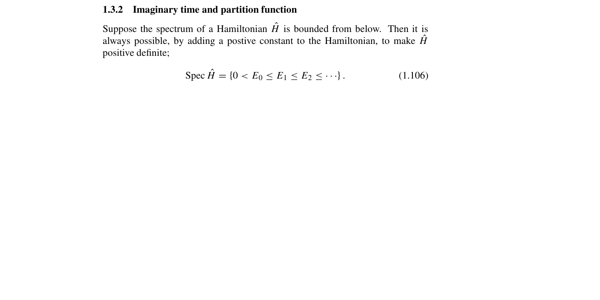
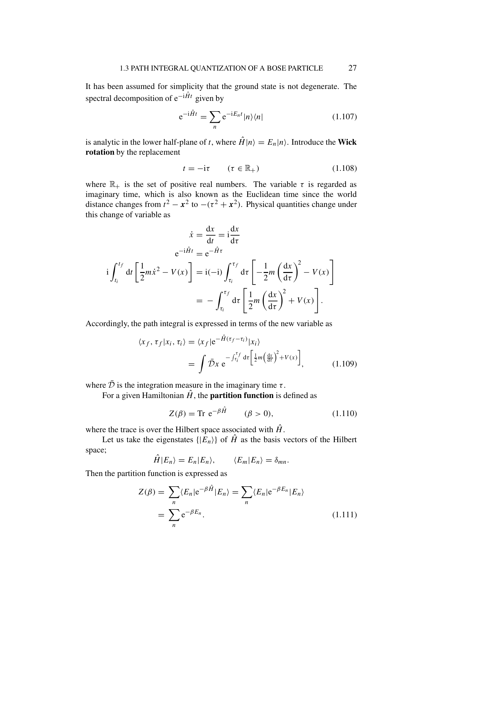
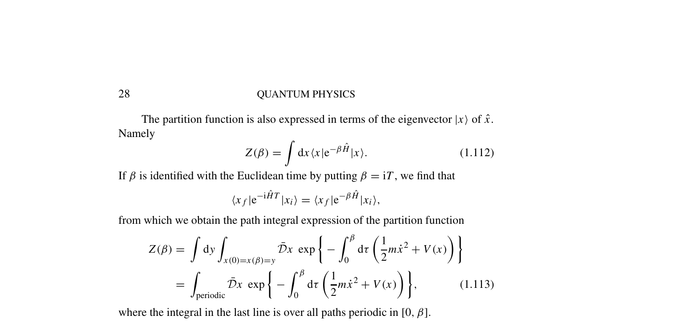

# 1.3.2 Imaginary time and partition function｜虚时间与配分函数

[阅读目录](README.md) · [上一小节](03-1.3.1.md) · [下一小节](05-1.3.3.md)

**这一节在做什么：把量子演化的计算，连到温度下的状态统计。**“虚时间”首先是改写公式的方法；“配分函数”首先是把各种状态的概率安排好。

## 原书第 26 页：原文底本

本块保留该页属于本小节的完整原文。PDF 阅读器页码为 49。

## 第 26 页：先说目的，再逐步解读

### 一、作者为什么先要求能量有下界？

**这段在干什么：**保证系统不会通过不断降低能量而永远没有最低状态。

想象一个没有底的势能坑。若系统能一直往下掉、释放越来越多能量，就很难有通常意义的稳定基态。作者先排除这种情形，要求能量不能无限降低。

然后可以把整个能量零点平移，使所有能量为正。例如原先最低能量是 $-5$，整体加 6，就成为最低 1。能级差没有变，通常的跃迁和归一化概率也没有变。

但能量有下界，还不保证后面的无限求和一定有限。例如自由粒子若可待在无限大的空间，光是位置范围就会带来无限体积。实际计算仍可能需要有限盒子或合适的束缚条件。

## 原书第 27 页：原文底本

本块保留该页属于本小节的完整原文。PDF 阅读器页码为 50。

## 第 27 页：先说目的，再逐步解读

### 二、虚时间：把一直转动的因子，换成会衰减的因子

**这段在干什么：**说明式 (1.108) 的替换改变了什么，以及它为什么能简化计算。

能量为 $E_n$ 的成分，在真实时间里乘上 $e^{-iE_nt/\hbar}$。这个复数一直转动，长度不变。

现在作数学替换 $t=-i\tau$：

$$
e^{-iE_nt/\hbar}\longrightarrow e^{-E_n\tau/\hbar}.
$$

右边不再转动，而是衰减。若两个能量为 1 和 3，经过同样长的 $\tau$ 后，能量为 3 的成分衰减得更快。于是长时间之后，较低能量的成分相对突出。

这种替换叫 Wick 旋转，$\tau$ 叫欧氏时间或虚时间。它不是让实验中的钟读出虚数，也不是声称粒子在某个看不见的时间里真实运动。我们是在利用同一个能谱的另一种数学表达。

### 三、为什么作用量里变成“动能加势能”？

**这段在干什么：**把时间替换落实到路径积分，说明为什么会得到更容易处理的衰减权重。

替换时间时，两处都要改变：

$$
dt=-i\,d\tau,\qquad
\frac{dx}{dt}=i\frac{dx}{d\tau}.
$$

因此

$$
\frac{iS}{\hbar}
=-\frac1\hbar\int d\tau
\left[\frac m2\left(\frac{dx}{d\tau}\right)^2+V(x)\right].
$$

将积分内的新量记为欧氏作用量 $S_E$，路径权重就写成 $e^{-S_E/\hbar}$。原来不同路径靠复数转动相互抵消，现在在适当实势条件下，可用衰减大小来组织积分。

这里不是把负号随意改成正号，而是时间微分与速度一起替换的结果。

### 四、配分函数：先给不同能量安排热权重，再把总和调成 1

**这段在干什么：**解释式 (1.110)–(1.111) 所算的物理量，而不只给它一个名字。

一个小系统与固定温度的环境接触后，不一定总待在最低能量。环境可能给它能量，它也可能把能量交回环境。热平衡理论给能量 $E_n$ 的状态安排权重

$$
w_n=e^{-\beta E_n},\qquad \beta=\frac1{k_BT}.
$$

温度低时，$\beta$ 大，高能态被压得很厉害；温度高时，高能态也有机会参与。这里 $k_B$ 是把温度单位换成能量单位的常数。

权重还不是概率，因为它们的和未必为 1。于是定义

$$
Z=\sum_n e^{-\beta E_n},\qquad
P_n=\frac{e^{-\beta E_n}}Z.
$$

**$Z$ 就是配分函数：它首先负责让全部状态的概率加起来等于 1。**

例如只有两级 $0,\Delta$，就有 $Z=1+e^{-\beta\Delta}$。低温几乎全在能量 0；高温两级概率接近各一半。这个具体用途应当先于“热迹”这个术语。

## 原书第 28 页：原文底本

本块保留该页属于本小节的完整原文。PDF 阅读器页码为 51。

## 第 28 页：先说目的，再逐步解读

### 五、取迹为什么让路径首尾接起来？

**这段在干什么：**解释式 (1.112)–(1.113) 为什么出现周期边界，而不是要粒子做真实的周期运动。

矩阵的迹是把对角元素相加。用位置来标记行列，对角元素就是“起点位置和终点位置相同”的矩阵元：

$$
Z=\int dy\,\langle y|e^{-\beta H}|y\rangle.
$$

每个矩阵元中，路径从 $y$ 出发，又回到 $y$。接着再对所有 $y$ 积分。所以最后不是固定某个点的小圈，而是遍历所有允许的闭合欧氏路径。

这就是 $x(0)=x(\beta)$ 的来源：**迹要求首尾标签相同。**它不表示真实粒子每隔一个由温度决定的时间就必须回原位。

本书设 $\hbar=1$，直接将欧氏时间长度与 $\beta$ 相认。恢复单位时，长度应为 $\hbar\beta$；不能把秒和能量倒数不经换算当成同一种单位。

### 六、这一节复习：三个问题不要混在一起

**这段在干什么：**把演化、低能筛选和热平衡分开记。

真实时间的 $e^{-itH/\hbar}$ 算系统怎样演化；欧氏 $e^{-\tau H/\hbar}$ 会相对压低高能成分；热配分函数还要把 $e^{-\beta H}$ 取迹，给全部热状态归一化。

你应能回答：为什么低温压低高能态？为什么一个固定端点传播核还不是整个 $Z$？为什么闭合路径不等于真实周期轨道？这三点都属于 A 级。解析延拓的一般条件可以随后补，不必在这一节先研究任意算符的全部严格理论。

---

[阅读目录](README.md) · [上一小节](03-1.3.1.md) · [下一小节](05-1.3.3.md)
