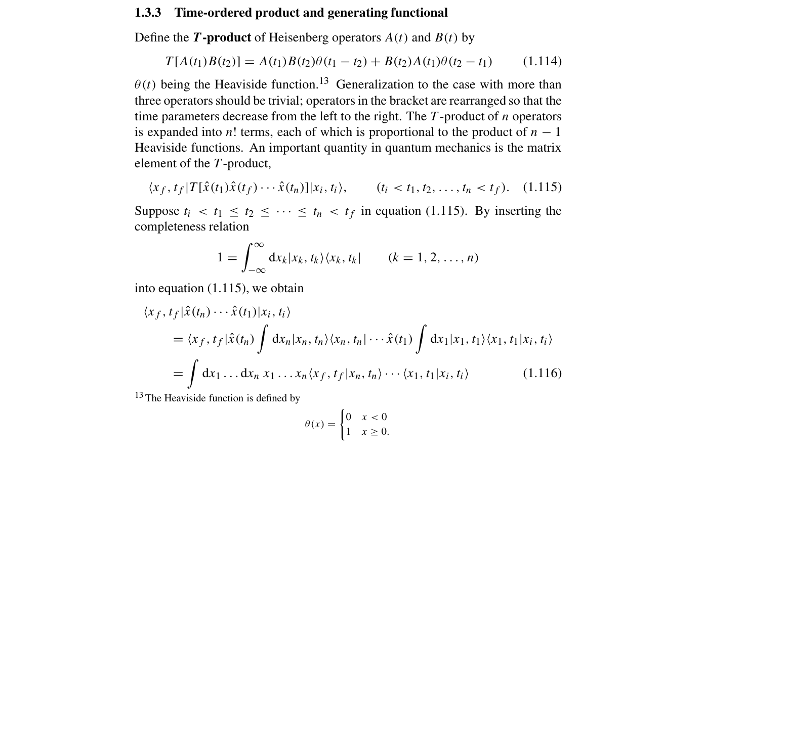
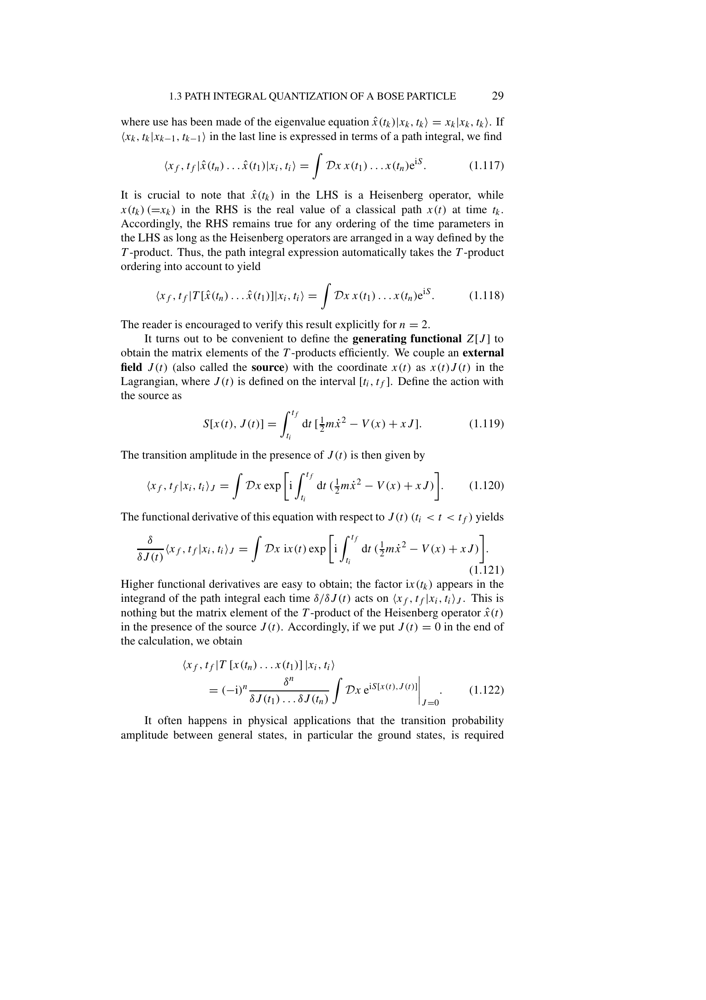
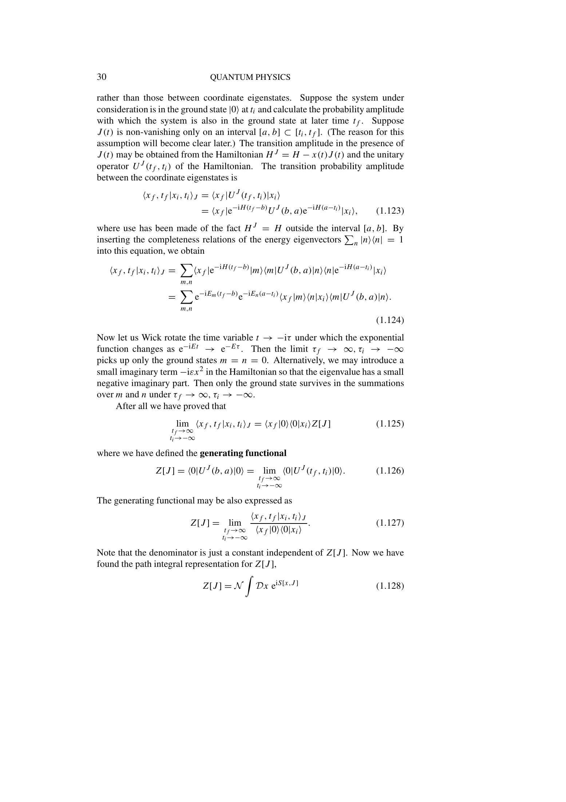
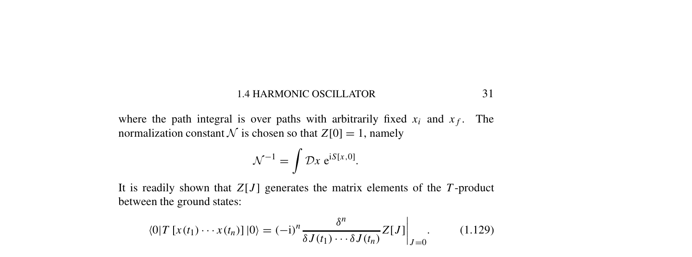

# 1.3.3 Time-ordered product and generating functional｜编时乘积与生成泛函

[阅读目录](README.md) · [上一小节](04-1.3.2.md) · [下一小节](06-1.4.1.md)

**这一节在做什么：除了算“从哪里到哪里”，还要算不同时间的观测之间有什么联系。**作者用编时乘积规定顺序，再用一个带辅助函数的总公式把许多关联计算装在一起。

## 原书第 28 页：原文底本

本块保留该页属于本小节的完整原文。PDF 阅读器页码为 51。

## 第 28 页：先说目的，再逐步解读

### 一、编时：为什么要把晚的时刻写在左边？

**这段在干什么：**规定式 (1.114) 中多个不同时刻的算符应按什么次序相乘。

矩阵作用在列向量上时，最右边先作用。若先在 $t_1$ 做一件事，再在较晚的 $t_2$ 做一件事，算符写法自然是 $B(t_2)A(t_1)$。

量子算符一般不能交换顺序，因此作者定义一个 $T$：它把较晚的时刻排到左边。于是

$$
T[A(t_1)B(t_2)]=
\begin{cases}
B(t_2)A(t_1),&t_2>t_1,\\
A(t_1)B(t_2),&t_1>t_2.
\end{cases}
$$

这叫编时乘积。先记住它只是“按时间重新排好算符”的规则。费米算符以后还要加交换负号；本页先处理位置这类玻色算符。

页中带 $t_f$ 的中间指标排印应结合紧接的说明读成 $t_1,\ldots,t_n$，不必把它误当成新定义。

## 原书第 29 页：原文底本

本块保留该页属于本小节的完整原文。PDF 阅读器页码为 52。

## 第 29 页：先说目的，再逐步解读

### 二、路径积分中的 x(t) 为什么不是算符？

**这段在干什么：**解释式 (1.117)–(1.118) 怎样把算符关联改写成路径积分。

先按时间排好算符，在每个插入时刻放入位置完备关系。$\hat x(t_k)$ 遇到自己的位置本征态，会给出一个普通数 $x_k$。

于是左边是一串算符，右边变成

$$
\int\mathcal Dx\,x(t_1)\cdots x(t_n)e^{iS[x]/\hbar}.
$$

右边的 $x(t_k)$ 是某一条待积分路径在该时刻的数值；不是粒子已经测得的全部历史，也不是仍在作用的算符。

普通数可以交换顺序，不表示左边算符也可以随便交换。右边之所以代表左边，正是因为推导已经把时间顺序固定好了。

### 三、外源 J：给系统加一个可以随时改变的小推动

**这段在干什么：**为式 (1.119)–(1.122) 引入一个辅助函数，使求导可以取出想研究的位置量。

给拉格朗日量加 $J(t)x(t)$。若 $J$ 真的是外界施加的量，它就像一项随时间变化的外力。我们也可以只把它当作计算工具，算完后再令 $J=0$。

定义含它的振幅

$$
Z_{\rm end}[J]=\int\mathcal Dx\,
e^{\frac i\hbar(S+\int dt\,J(t)x(t))}.
$$

现在改变某个时刻 $s$ 的 $J$。因为指数里 $J$ 乘的正是 $x$，求导就会把该时刻的 $x(s)$ 带出来：

$$
\frac{\hbar}{i}\frac{\delta Z_{\rm end}}{\delta J(s)}
=\int\mathcal Dx\,x(s)e^{\frac i\hbar(S+\int Jx)}.
$$

再求一次，会多出另一个时刻的位置。于是一个总公式能产生许多一时、两时、三时关联，这就是“生成泛函”的意思。“泛函”只提醒你自变量是整个函数 $J(t)$。

例如两时关联不是两个普通概率简单相乘，而是用来描述不同时刻的量子涨落如何联系。后面求振动频率与响应时，这类信息比只知道平均位置更丰富。

## 原书第 30 页：原文底本

本块保留该页属于本小节的完整原文。PDF 阅读器页码为 53。

## 第 30 页：先说目的，再逐步解读

### 四、为什么接下来特别挑出基态到基态？

**这段在干什么：**把两端固定位置的问题，改成两端都以最低能状态为条件的问题。

作者让 $J$ 只在中间一段时间存在。远处的过去和未来都没有外源，因此两端可以用同一个无源系统的能量状态描述。

再利用上一节的欧氏演化：高能态相对低能态衰减快。两端拉得足够远，并作适当归一化，就能挑出基态的贡献。

这不是说系统在真实时间里不接触环境也会自动散热。这里用的是数学上的衰减筛选，和真实的耗散过程不同。

原文直接写大时间极限时，省略了共同基态能因子和边界处方。你先抓住“换边界状态”的目的，精确极限如何归一化可查附录。

## 原书第 31 页：原文底本

本块保留该页属于本小节的完整原文。PDF 阅读器页码为 54。

## 第 31 页：先说目的，再逐步解读

### 五、为什么还要除以没有外源时的结果？

**这段在干什么：**解释式 (1.128)–(1.129) 中归一化常数的作用。

如果我们只关心外源带来的变化，整段演化的公共乘子就不应影响答案。因此使用

$$
Z[J]=
\frac{\int\mathcal Dx\,e^{\frac i\hbar(S+\int Jx)}}
{\int\mathcal Dx\,e^{iS/\hbar}},
\qquad Z[0]=1.
$$

像普通概率要除以总权重，这里也先去掉公共的无源因子。然后对 $J$ 求导，就能直接读出归一化的真空编时关联。

“真空”在这里指所研究系统的基态，不是“所有数值永远为零”。谐振子基态有位置和动量涨落，所以真空关联也可以非零。

### 六、这一节复习：Z 是一本能求导的总账

**这段在干什么：**把每一步的目的整理出来，避免记成几个相似的指数。

先想研究多时刻关系 → 因算符不对易而规定编时 → 插入完备关系改成路径值 → 用 $Jx$ 把所需位置放进指数 → 对 $J$ 求导把它取出 → 选好边界态并归一化。

本节 $Z[J]$ 与上节热配分函数 $Z(\beta)$ 不是同一个问题：前者带源、常取真空边界；后者取热迹。看到 $Z$ 先问它算什么，不凭同一个字母把它们混起来。这一整条逻辑属于 A；真空极限的全部分析细节可作 B 级补读。

---

[阅读目录](README.md) · [上一小节](04-1.3.2.md) · [下一小节](06-1.4.1.md)
