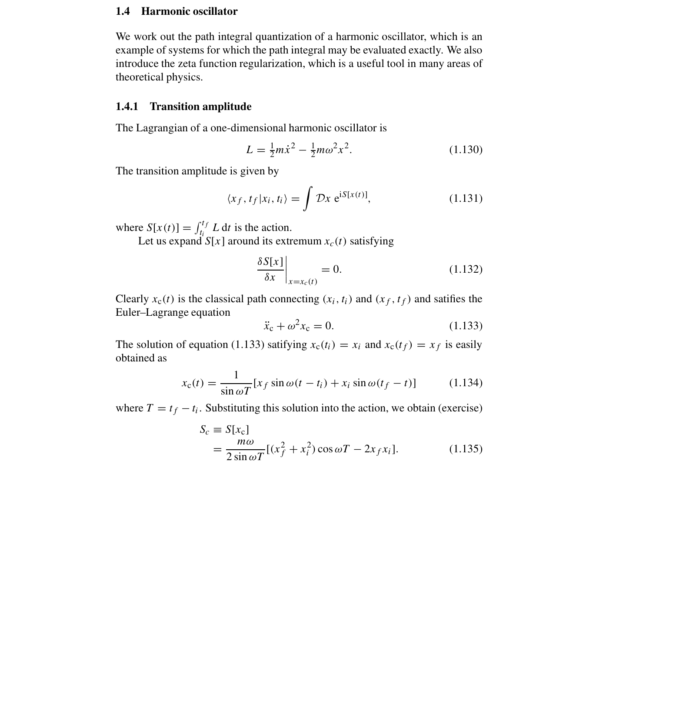
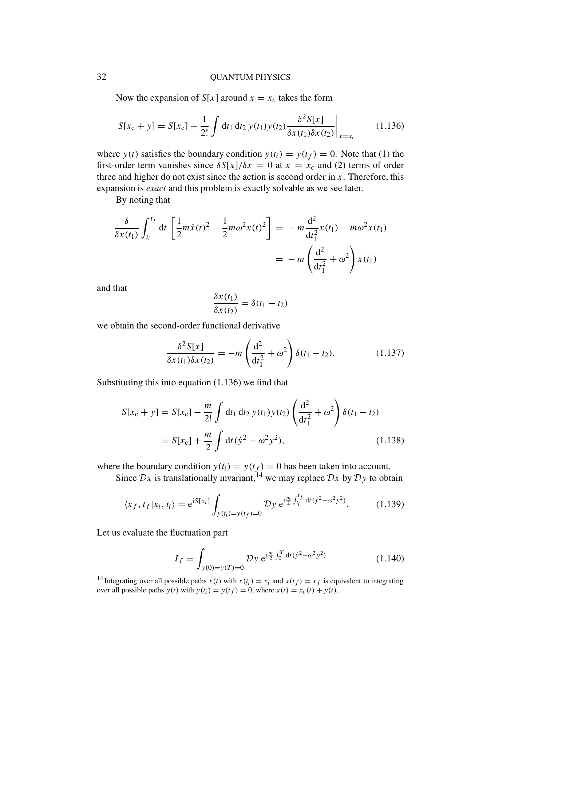
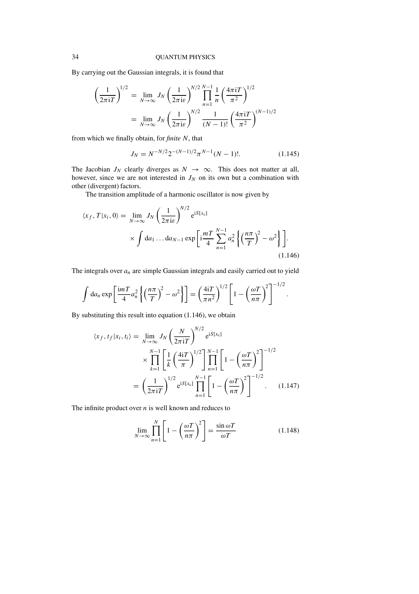
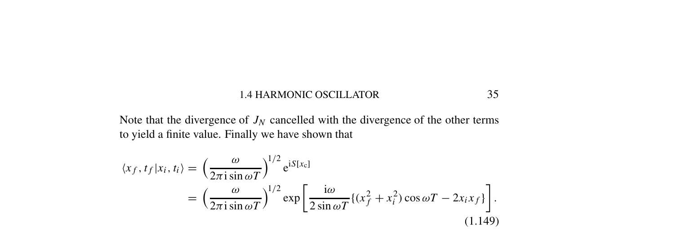

# 1.4.1 Transition amplitude｜谐振子的传播振幅

[总目录](README.md) · [上一小节](05-1.3.3.md) · [下一小节](07-1.4.2.md)

本节再次研究谐振子，但计算对象从能谱改成传播振幅。重点是展示“经典解＋涨落”怎样变成一个可计算的精确分解。

## 原书第 31 页：原文底本

以下影印块是本小节在该页的完整原文；相邻小节在同页交接时按标题分界。PDF 页码为 54。

## 第 31 页句读与集注

### 句读式 (1.130)–(1.135)：先找连接两端点的经典路径

这里不是给定初始位置和速度，而是给定初、末位置。因而解的是两点边值问题。满足 $\ddot x_c+\omega^2x_c=0$ 的路径由正弦和余弦组合而成；原文 (1.134) 把系数直接整理成符合两个端点的形式。

为什么先找经典解？因为围绕它展开作用量，一阶变化消失，剩下的积分结构最简单。这个步骤在数学上与围绕驻点展开函数相似；但真实时间的作用量一般不是凸函数，所以不要把它无条件理解成全局最小化。

经典作用量可用一个比逐项三角积分更短的计算得到。沿经典解，

$$
\frac d{dt}(x_c\dot x_c)
=\dot x_c^2+x_c\ddot x_c
=\dot x_c^2-\omega^2x_c^2.
$$

故 $S_c=\frac m2[x_c\dot x_c]_{t_i}^{t_f}$。把端点和端点速度代入，就得到 (1.135)。这说明二次系统的在壳作用量可以化成边界量。

式中 $\sin\omega T$ 在某些时间为零，提示两点边值问题会出现特殊情况。此时不能继续把普通函数公式硬代下去；传播核应按分布和正确相位延续理解。

## 原书第 32 页：原文底本

以下影印块是本小节在该页的完整原文；相邻小节在同页交接时按标题分界。PDF 页码为 55。

## 第 32 页句读与集注

### 句读式 (1.136)：为什么涨落必须在端点为零？

令 $x=x_c+y$。原始路径和经典路径都连接同一对端点，因此差值满足 $y(t_i)=y(t_f)=0$。涨落边界不是为了方便随意添加的，它表达的是“比较的是同一个传播问题中的所有路径”。

直接展开：

$$
S[x_c+y]=S_c+
m\int dt\,(\dot x_c\dot y-\omega^2x_cy)
+\frac m2\int dt\,(\dot y^2-\omega^2y^2).
$$

中间项分部积分后为

$$
m[\dot x_cy]_{t_i}^{t_f}
-m\int dt\,(\ddot x_c+\omega^2x_c)y=0.
$$

边界条件消去第一项，经典方程消去第二项。于是只剩二次涨落，且没有三次以上项。这一步同时解释原文两条理由：驻点消一次项，二次理论没有高阶项。

### 疏式 (1.137)–(1.140)：Hessian 为何是微分算符？

对函数求二阶导得到矩阵；对路径作用量求二阶变分得到带两个时间指标的核：

$$
\frac{\delta^2S}{\delta x(t)\delta x(s)}
=-m(\partial_t^2+\omega^2)\delta(t-s).
$$

它告诉你不同形状的微小变动怎样改变作用量。借助分部积分，这个核等价于涨落算符 $-m(\partial_t^2+\omega^2)$，连同固定端点的定义域一起组成完整问题。换了边界条件，谱和行列式都会改变。

把 $x$ 平移为 $x_c+y$ 后，有限切片积分的 Jacobian 为 1，因此

$$
K=e^{iS_c/\hbar}I_f.
$$

$I_f$ 是对全部涨落的积分，不能因为经典解已经找到就设为 1。它控制幅度、相位，以及后面热配分函数的归一化。

## 原书第 33 页：原文底本

以下影印块是本小节在该页的完整原文；相邻小节在同页交接时按标题分界。PDF 页码为 56。

## 第 33 页句读与集注

### 句读式 (1.141)：为什么选正弦展开？

正弦函数在 $0,T$ 两端为零，正好适合固定端点涨落。将 $y$ 展开后，每一个 Fourier 系数 $a_n$ 表示一种独立的时间形状；二次型在这些模式上对角化：

$$
\int_0^T(\dot y^2-\omega^2y^2)\,dt
=\frac T2\sum_{n\ge1}
\left[\left(\frac{n\pi}{T}\right)^2-\omega^2\right]a_n^2.
$$

这样，泛函积分就变成许多普通 Gaussian 积分。这是“无穷维 Gaussian”最可操作的直观：先截断为有限模式，再计算二次型的谱。

### 句读式 (1.142)–(1.144)：为什么用自由粒子定归一化？

从切片值 $y_k$ 到模式系数 $a_n$ 是有限维线性换元，其 Jacobian 依赖模式的归一化方式。作者用同样换元的自由粒子结果来校准，是要让不依赖势能的测度因子彼此抵消。

更稳妥的主线是直接考虑比值：

$$
\frac{I_f(\omega)}{I_f(0)}
=\prod_{n=1}^\infty
\left[1-\left(\frac{\omega T}{n\pi}\right)^2\right]^{-1/2}.
$$

分母自由核的归一化已知，便不用给每个单独的无穷常数赋值。这个思路类似用参照问题消去公共归一化。

**校记：**原文从 (1.143) 起的若干前因子没有保留一般质量 $m$，与前文含 $m$ 的自由核不一致；也没有在这里明确宣布改取 $m=1$。使用一般单位时，自由前因子是 $\sqrt{m/(2\pi i\hbar T)}$。下面不逐个沿抄这些漏项，而以行列式比值和自由极限核对最终结果。

## 原书第 34 页：原文底本

以下影印块是本小节在该页的完整原文；相邻小节在同页交接时按标题分界。PDF 页码为 57。

## 第 34 页句读与集注

### 句读式 (1.145)–(1.148)：无穷乘积究竟统计了什么？

每个模式积分贡献一个特征值的 $-1/2$ 次方。振子相对自由粒子的第 $n$ 个特征值比为 $1-(\omega T/n\pi)^2$。乘遍模式，就统计了全部独立涨落形状的贡献。

利用

$$
\frac{\sin z}{z}
=\prod_{n=1}^\infty\left(1-\frac{z^2}{n^2\pi^2}\right)
$$

得到 $I_f(\omega)/I_f(0)=(\sin\omega T/\omega T)^{-1/2}$。模式很多时，分别写出的测度与积分常数可能发散；这里有意义的是同一离散化下组合起来的核或相对行列式。不能把两个来源不同、截断方式不同的“无穷大”直接约掉。

本页的有限维 Jacobian 详细式不是理解物理的前提，但需要知道为什么保持有限切片数有用：在有限维，变量个数、换元行列式、Gaussian 常数都可以逐项检查；最后再取相容的极限。先跳到形式无限乘积，反而容易丢掉常数和相位。

### 疏：哪些地方属于精确解，哪些属于一般方法？

“找驻点，再算 Hessian”是普遍的近似方法；谐振子特别之处是没有高阶项，因此这里精确。一般势中，三阶、四阶变分产生非 Gaussian 涨落，之后的费曼图与微扰展开便是在处理这些项。

## 原书第 35 页：原文底本

以下影印块是本小节在该页的完整原文；相邻小节在同页交接时按标题分界。PDF 页码为 58。

## 第 35 页句读与集注

### 句读式 (1.149)：恢复单位后的传播核

在避开焦点并选择连续相位分支的区间内，

$$
K=
\sqrt{\frac{m\omega}{2\pi i\hbar\sin\omega T}}\,
\exp\left[
\frac{im\omega}{2\hbar\sin\omega T}
\bigl((x_f^2+x_i^2)\cos\omega T-2x_fx_i\bigr)
\right].
$$

令 $\omega\to0$，利用 $\sin\omega T\sim\omega T$、$\cos\omega T\sim1$，就回到自由粒子核。这是很重要的物理与量纲核对；原文在 $m=1$ 的写法下才能与此直接比较。

### 疏：分母为零是不是概率无限大？

在 $T=k\pi/\omega$，经典振子会把位置按周期性关系聚焦，核变成带相位的 δ 型分布，不能继续当普通函数解释。“前因子发散”提示表示形式失效，并不说明归一化波包的总概率发散。

跨越这些时间时，还要跟踪平方根相位，即常说的 Maslov 相位。初学时不必把一般焦散理论学完，但应保留这个边界：原文的单个平方根公式需要相位处方，不能在所有 $T$ 上独立取主值后就宣称得到正确酉演化。

**回看问题：**为什么 $y$ 的端点为零？为什么二次展开精确？正弦模式由哪项物理条件选定？行列式与涨落有什么关系？怎样用自由极限核对传播核？

---

[总目录](README.md) · [上一小节](05-1.3.3.md) · [下一小节](07-1.4.2.md)
