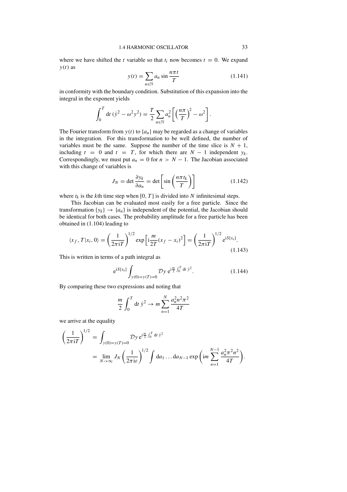

# 1.4.1 Transition amplitude｜谐振子的传播振幅

[阅读目录](README.md) · [上一小节](05-1.3.3.md) · [下一小节](07-1.4.2.md)

**这一节在做什么：把路径积分用在谐振子上，并真正算出起点到终点的振幅。**作者先找一条容易描述的参考路径，再把其他路径写成对它的偏离。

## 原书第 31 页：原文底本

本块保留该页属于本小节的完整原文。PDF 阅读器页码为 54。

## 第 31 页：先说目的，再逐步解读

### 一、为什么先求一条经典轨迹？

**这段在干什么：**在式 (1.130)–(1.135) 中找一个合适的展开中心，让剩余积分变简单。

我们固定初始位置 $x_i$、最终位置 $x_f$ 和间隔 $T$。经典轨迹满足 $\ddot x_c+\omega^2x_c=0$，并且经过这两个端点。

这与高中常见“给初始位置和速度求以后运动”略有不同：这里给的是两端位置，所以是一个边值问题。

先求 $x_c$，不是认定粒子只有这条量子路径，而是因为作用量在它附近的一阶变化为零。围绕它展开，会少掉一整类项。

代入经典解可得

$$
S_c=\frac{m\omega}{2\sin\omega T}
\left[(x_f^2+x_i^2)\cos\omega T-2x_fx_i\right].
$$

你也可以先证明沿经典解 $S_c=\frac m2[x_c\dot x_c]_{t_i}^{t_f}$，再代端点速度。这是对二次系统较省力的计算。

## 原书第 32 页：原文底本

本块保留该页属于本小节的完整原文。PDF 阅读器页码为 55。

## 第 32 页：先说目的，再逐步解读

### 二、把每条路径写成“经典轨迹＋偏离”

**这段在干什么：**解释式 (1.136)–(1.139) 为什么能把经典部分从积分中拿出来。

任意待积分路径写成 $x=x_c+y$。$y$ 表示它比经典轨迹多走或少走了多少。因为起点、终点已经固定，所以

$$
y(t_i)=y(t_f)=0.
$$

代入作用量展开：

$$
S[x_c+y]=S_c+
m\int(\dot x_c\dot y-\omega^2x_cy)\,dt
+\frac m2\int(\dot y^2-\omega^2y^2)\,dt.
$$

中间项分部积分后，端点部分因 $y=0$ 消失，剩余部分因经典方程消失。于是

$$
S[x_c+y]=S_c+\frac m2\int(\dot y^2-\omega^2y^2)\,dt.
$$

因此振幅等于 $e^{iS_c/\hbar}$ 乘上所有偏离路径的积分。后者就是涨落贡献：这里“涨落”先理解为围绕参考解的各种偏离，不必给它另添一种随机外力。

### 三、为什么这次展开是精确的？

**这段在干什么：**说明谐振子为什么比一般势容易处理。

因为原来的作用量只含 $x$ 和 $\dot x$ 的二次项，展开后根本不会有三次、四次偏离项。一次项又刚好消失，所以二次项就是全部余下内容。

对一般势，围绕经典解展开也能这样做，但三次以上项通常存在。只保留二次项便成为近似；谐振子在这里则没有这项误差。

原文的二阶泛函导数可以当作“作用量对各种小偏离的二次变化规则”。它在有限维叫 Hessian 矩阵，在这里写成微分算符和 δ 核。

## 原书第 33 页：原文底本

本块保留该页属于本小节的完整原文。PDF 阅读器页码为 56。

## 第 33 页：先说目的，再逐步解读

### 四、为什么把 y(t) 展开成正弦函数？

**这段在干什么：**把对所有偏离形状的积分，转成对许多个普通系数的积分。

偏离在两端为零，$\sin(n\pi t/T)$ 恰好也在两端为零。所以写

$$
y(t)=\sum_{n\ge1}a_n\sin\frac{n\pi t}{T}.
$$

每个 $a_n$ 控制一种形状的偏离有多大。低 $n$ 变化慢，高 $n$ 在时间中弯来弯去得更快。

正交性把混合项消掉，作用量成为

$$
\frac{mT}{4}\sum_{n\ge1}
\left[\left(\frac{n\pi}{T}\right)^2-\omega^2\right]a_n^2.
$$

于是一个复杂的路径积分，变成许多独立的 Gaussian 积分。正弦基不是随便选的，它先满足了实际传播问题的端点条件。

### 五、为什么拿自由粒子作比较？

**这段在干什么：**用已经知道的答案固定公共归一化，避免单独处理许多发散常数。

对自由粒子作相同展开，变量换元的方式相同。两种积分相除，公共测度和换元因子抵消，留下

$$
\frac{I_f(\omega)}{I_f(0)}
=\prod_{n\ge1}
\left[1-\left(\frac{\omega T}{n\pi}\right)^2\right]^{-1/2}.
$$

这好比两张账里有相同公共费用，比较差别时先消掉公共部分。计算仍须使用同一套时间切片，不能把来源不同的两个“无穷大”随意约掉。

原文这一带若干式子漏保留了一般质量 $m$，完整核对在附录。当前先跟住“用参照答案校准”的思路。

## 原书第 34 页：原文底本

本块保留该页属于本小节的完整原文。PDF 阅读器页码为 57。

## 第 34 页：先说目的，再逐步解读

### 六、无穷乘积：每一种偏离形状贡献一个因子

**这段在干什么：**把上一页的一系列 Gaussian 积分整理成一个能识别的函数。

普通 Gaussian 积分 $\int e^{-\lambda a^2/2}da$ 与 $\lambda^{-1/2}$ 成比例。这里每个 $a_n$ 都贡献相应的平方根因子；全部模式相乘，就得到上页乘积。

再用

$$
\prod_{n\ge1}\left(1-\frac{z^2}{n^2\pi^2}\right)=\frac{\sin z}{z},
$$

便能把无穷多个因子收成 $\sin\omega T$。这不是突然增加一种物理效果，而是同一组涨落积分的简写。

原文花很多篇幅算有限维 Jacobian，目的是让变量数、换元和归一化对得上。你第一次读可以先掌握相对乘积，再回看这些计算。

## 原书第 35 页：原文底本

本块保留该页属于本小节的完整原文。PDF 阅读器页码为 58。

## 第 35 页：先说目的，再逐步解读

### 七、最后答案怎样核对？它在特殊时间发散又是什么意思？

**这段在干什么：**解释式 (1.149) 的用途，并给出一个能亲手做的正确性检查。

恢复单位后，

$$
K=\sqrt{\frac{m\omega}{2\pi i\hbar\sin\omega T}}\,
e^{iS_c/\hbar}.
$$

令 $\omega$ 趋于零，势越来越平。利用 $\sin\omega T\simeq\omega T$、$\cos\omega T\simeq1$，就回到上节自由粒子的结果。能做这个检查，比孤立背下前因子更有用。

当 $\sin\omega T=0$ 时，不能把它当普通函数直接代入。经典振子具有聚焦性质，传播核此时要用 δ 型分布及相容的相位理解。把它作用在正常波包上，仍得到有限归一化概率，并不是概率无限大。

这一节复习时，抓住四步：找经典解 → 加零端点偏离 → 用正弦分解偏离 → 做 Gaussian 并用自由粒子校准。前两步和“为什么正弦”属于 A；完整 Jacobian、跨焦点相位处理属于 B，可以在主线清楚后再看。

---

[阅读目录](README.md) · [上一小节](05-1.3.3.md) · [下一小节](07-1.4.2.md)
