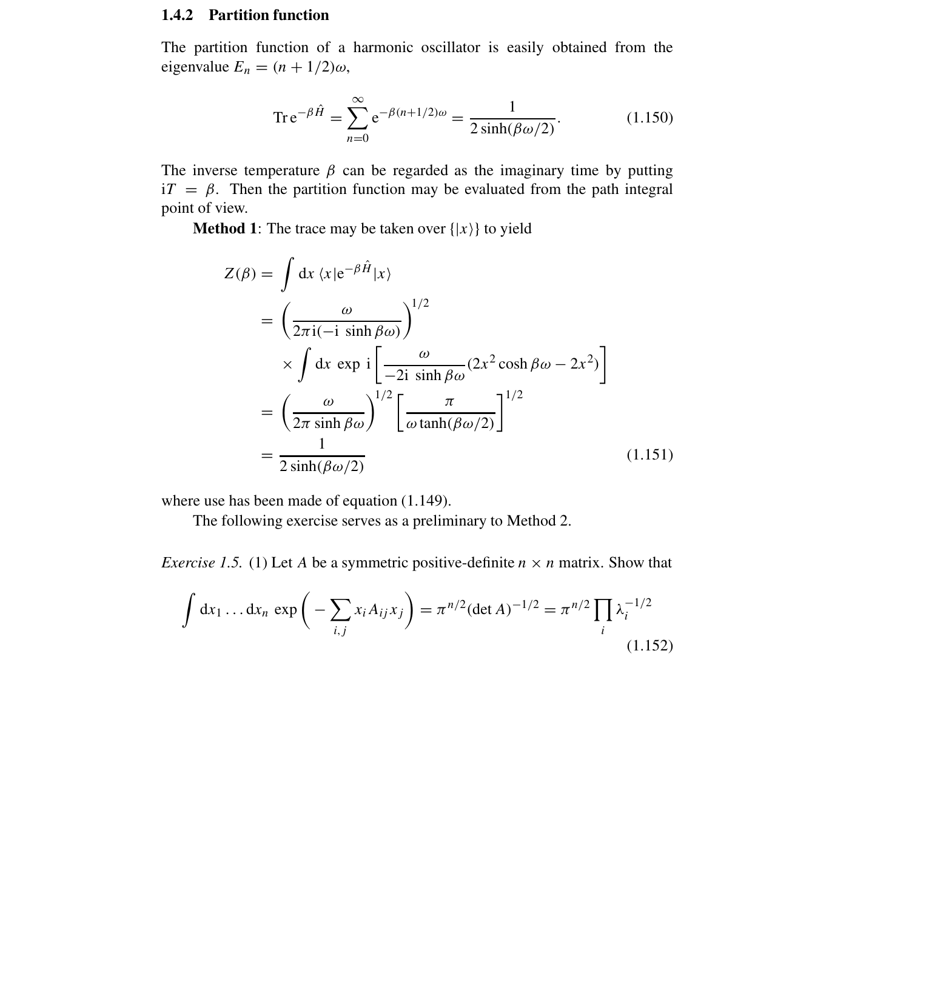
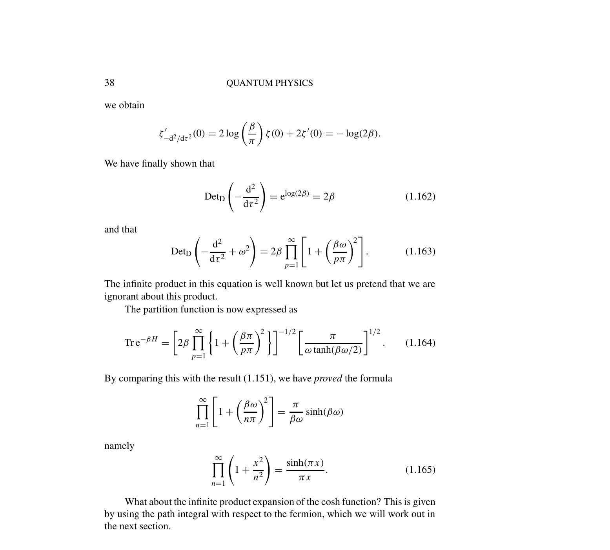

# 1.4.2 Partition function｜谐振子的配分函数与谱行列式

[总目录](README.md) · [上一小节](06-1.4.1.md) · [下一小节](08-1.5.1.md)

本节用能谱、传播核和谱行列式三条路线算同一个热配分函数。物理问题相同，数学表示不同；比较时必须保留一致的测度与边界约定。

## 原书第 35 页：原文底本

以下影印块是本小节在该页的完整原文；相邻小节在同页交接时按标题分界。PDF 页码为 58。

## 第 35 页句读与集注

### 句读式 (1.150)：先数清哪些态参与热平衡

能量为 $E_n=\hbar\omega(n+\tfrac12)$，故

$$
Z(\beta)=e^{-\beta\hbar\omega/2}
\sum_{n=0}^\infty e^{-n\beta\hbar\omega}
=\frac1{2\sinh(\beta\hbar\omega/2)}.
$$

这里的每一项是一种占据数状态的热权重。低温时 $\beta\hbar\omega\gg1$，激发态被压低，$Z\sim e^{-\beta E_0}$。高温时 $Z\sim1/(\beta\hbar\omega)$，很多能级都有显著权重，开始接近经典统计。

从 $\langle H\rangle=-\partial_\beta\log Z$ 可得

$$
\langle H\rangle
=\frac{\hbar\omega}{2}
\frac{\hbar\omega}{e^{\beta\hbar\omega}-1}.
$$

第一项是零点能，第二项是热激发贡献；高温趋近 $k_BT$，对应一个动能二次项和一个势能二次项各贡献 $k_BT/2$。这使配分函数与实验中的平均能量、比热联系起来，而不只是一个求和技巧。

### 句读 Method 1：取迹如何变成普通 Gaussian？

传播核中令 $x_f=x_i=x$，再将 $T$ 旋到欧氏时间，最后积分 $x$。这次 $x$ 不是涨落系数，而是闭合路径可以经过的任意端点。固定端点的核加上端点积分，才等于热迹。双曲函数出现，是因为 $\sin(-iz)=-i\sinh z$。

练习 1.5 则准备下一种算法：实对称正定矩阵可以正交对角化，换元 Jacobian 的绝对值为 1，各模式 Gaussian 积分相乘，给出 $(\det A)^{-1/2}$。复变量相当于两套实变量，因此在相应测度约定下给 $(\det A)^{-1}$。指数有无 $1/2$ 会改变 $2\pi$ 因子；“忽略数字因子”只能用于已约定归一化的问题。

## 原书第 36 页：原文底本

以下影印块是本小节在该页的完整原文；相邻小节在同页交接时按标题分界。PDF 页码为 59。

## 第 36 页句读与集注

### 句读式 (1.154)：微分表达式加边界条件才是算符

欧氏涨落算符是

$$
O_D=-\frac{d^2}{d\tau^2}+\omega^2,\qquad
y(0)=y(\beta)=0.
$$

它的谱是 Dirichlet 谱。热路径本身则是周期的。这两句话并不冲突：作者先固定公共端点 $x$，把路径分成端点相关的经典部分与零端点涨落，再对 $x$ 积分。

若直接从周期路径展开，应该用周期模式，包含常数模式；所得是另一个边界条件下的谱行列式。不能拿周期特征值替换本页的 Dirichlet 特征值，同时又保留作者额外的端点积分，否则会重复计数或漏掉模式。

### 疏：为什么 Gaussian 产生行列式的倒平方根？

有限维中，每个方向的“刚度”是 $\lambda_n$。越刚的模式允许的涨落范围越窄，它的积分约为 $\lambda_n^{-1/2}$。所有方向相乘就是 $(\det O)^{-1/2}$。这可以与你熟悉的 Gaussian 协方差联系起来：二次型矩阵描述代价，逆矩阵描述涨落相关。

书中把有限矩阵写作 $\det$，把算符的形式行列式写作 $\operatorname{Det}$。这个大小写不是新物理量，而是提醒后者通常要处理无限个模式。真实路径积分的整体常数、基的归一化和参考尺度仍需一起给定。

## 原书第 37 页：原文底本

以下影印块是本小节在该页的完整原文；相邻小节在同页交接时按标题分界。PDF 页码为 60。

## 第 37 页句读与集注

### 句读式 (1.156)–(1.159)：ζ 正则化不是把发散乘积当普通乘积

直接相乘 $\prod_n\lambda_n$ 通常发散。先在收敛区域定义

$$
\zeta_O(s)=\sum_n\lambda_n^{-s}.
$$

若它能亚纯延拓且在 $s=0$ 正则，就定义

$$
\det\nolimits_\zeta O=\exp[-\zeta'_O(0)].
$$

“定义”很关键：$\sum\log\lambda_n$ 发散时，不能声称用普通求和已经得到有限值；真正做的是通过解析延拓建立一种相容的正则化量。对有量纲的算符，还需要用参考尺度使 $\lambda_n/\mu^2$ 无量纲。某些变化会表现为归一化或局部项，不能离开完整理论随意解释。

原文说一般算符的 ζ 函数可以延拓，适用范围要联系其具体类型。对本例的正椭圆算符和紧区间边界问题，方法良好；并非任意有正谱的算符都自动具有同样的延拓性质。

### 疏式 (1.160)–(1.161)：这里怎样用到熟悉的 Riemann ζ？

自由 Dirichlet 谱是 $\lambda_n=(n\pi/\beta)^2$，所以

$$
\zeta_{-\partial_\tau^2}(s)
=\left(\frac\beta\pi\right)^{2s}\zeta_R(2s).
$$

微分后代入 $\zeta_R(0)=-1/2$ 和 $\zeta_R'(0)=-\log(2\pi)/2$，就得到下一页的 $2\beta$。这一步是谱结构和数论函数的具体相遇；它不是说任何无穷乘积都可以不问条件地“套 ζ 函数”。

## 原书第 38 页：原文底本

以下影印块是本小节在该页的完整原文；相邻小节在同页交接时按标题分界。PDF 页码为 61。

## 第 38 页句读与集注

### 句读式 (1.162)–(1.165)：把结果与已知答案对上

本例给出

$$
\det\nolimits_{\zeta,D}(-\partial_\tau^2+\omega^2)
=2\beta\prod_{n\ge1}
\left[1+\left(\frac{\beta\omega}{n\pi}\right)^2\right]
=\frac{2\sinh(\beta\omega)}{\omega}.
$$

为了与物理传播核一致，固定端点核前因子的平方根相对于这一定义还有测度常数。比如 $m=\hbar=1$ 时，

$$
K_E(x,x;\beta)
=\frac1{\sqrt{\pi\,\det_{\zeta,D}O_D}}\,
e^{-\omega x^2\tanh(\beta\omega/2)}.
$$

再对 $x$ 积分，才回到 $Z=1/[2\sinh(\beta\omega/2)]$。这明确说明：单独写 $\operatorname{Det}^{-1/2}$ 时若省掉常数，之后不能又把它当带绝对归一化的完整配分函数使用。

**校记：**影印页 (1.164) 的乘积中出现 $\beta\pi/(p\pi)$，按前一式应为 $\beta\omega/(p\pi)$；紧接的未编号公式右侧多出 $\pi$，应为 $\sinh(\beta\omega)/(\beta\omega)$。令 $\omega\to0$ 即可检出：左边趋于 1，印出的右边却趋于 $\pi$。原文最后的 (1.165) 才与标准乘积形式一致。本页中间式也反映前述测度常数被忽略的问题。

### 集注：本节该形成怎样的物理直观？

一个系统可以用“逐个能级数热权重”来计算，也可以用“闭合路径的涨落”来计算。相同的物理量迫使两种数学表达一致，因此得到无穷乘积公式。重要的是这条对应链；ζ 值的特殊常数可随用随查，但边界条件、Gaussian 幂次与归一化应当能自行判断。

---

[总目录](README.md) · [上一小节](06-1.4.1.md) · [下一小节](08-1.5.1.md)
