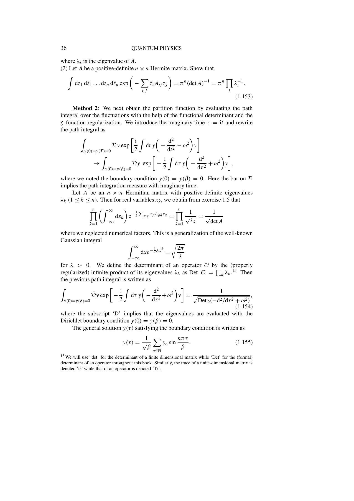
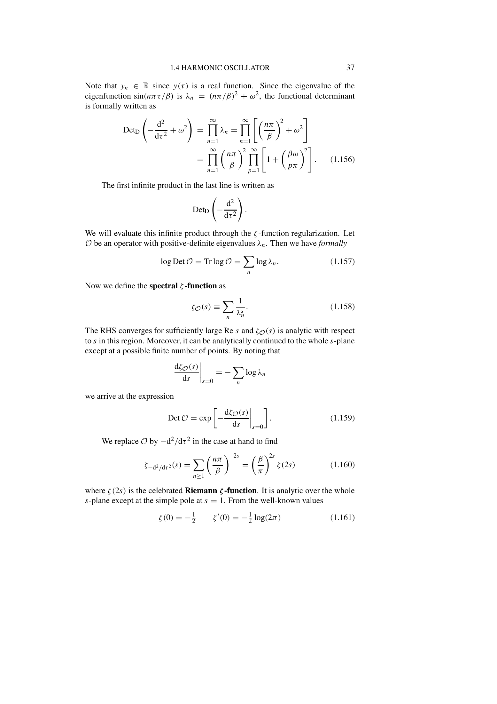

# 1.4.2 Partition function｜谐振子的配分函数与谱行列式

[阅读目录](README.md) · [上一小节](06-1.4.1.md) · [下一小节](08-1.5.1.md)

**这一节在做什么：用三种方法算同一个谐振子的热统计。**先用能级直接求和，得到参照答案；再用传播核和模式积分核对。

## 原书第 35 页：原文底本

本块保留该页属于本小节的完整原文。PDF 阅读器页码为 58。

## 第 35 页：先说目的，再逐步解读

### 一、先用能级算：热环境会把系统放在哪一层？

**这段在干什么：**解释式 (1.150) 的求和，而不是把配分函数当成一个特殊函数公式。

谐振子每层能量为 $E_n=\hbar\omega(n+\tfrac12)$。热平衡给它权重 $e^{-\beta E_n}$，所以

$$
Z=e^{-\beta\hbar\omega/2}
\left(1+e^{-\beta\hbar\omega}+e^{-2\beta\hbar\omega}+\cdots\right)
=\frac1{2\sinh(\beta\hbar\omega/2)}.
$$

括号只是一个几何级数。低温时后面的项很小，主要在最低层；高温时许多层都能参与。

取 $-\partial_\beta\log Z$ 可以算平均能量：

$$
\langle H\rangle=\frac{\hbar\omega}{2}
+\frac{\hbar\omega}{e^{\beta\hbar\omega}-1}.
$$

第一项来自最低能量，第二项来自热激发。高温时趋近 $k_BT$，与高中之后常学的经典能量分配接上。

### 二、用传播核算：为什么令两个端点相等还要再积分？

**这段在干什么：**说明 Method 1 怎样把上一节的答案变成热配分函数。

取迹时，我们要把每个位置 $x$ 上的“从 $x$ 到 $x$”都算进去，所以

$$
Z=\int dx\,K_E(x,x;\beta).
$$

先把两端设为相同位置，是取对角元素；再对 $x$ 积分，是把全部对角元素相加。只算 $K_E(0,0;\beta)$，少了其他端点，不是完整热迹。

代入上一节核后，这最后一步是普通的一维 Gaussian 积分。若归一化正确，应回到能级求和的答案。

## 原书第 36 页：原文底本

本块保留该页属于本小节的完整原文。PDF 阅读器页码为 59。

## 第 36 页：先说目的，再逐步解读

### 三、行列式：把许多方向的 Gaussian 因子收进一个符号

**这段在干什么：**解释 Method 2 为什么出现 $\operatorname{Det}^{-1/2}$。

先看两变量例子：

$$
\int da\,db\,e^{-(\lambda_1a^2+\lambda_2b^2)/2}
=\frac{2\pi}{\sqrt{\lambda_1\lambda_2}}.
$$

两个方向越“陡”，允许的变化范围越窄，积分越小。一般正定二次型可先对角化，得到每个方向的 $\lambda_n^{-1/2}$；全部相乘，就是行列式的倒平方根。

路径展开也一样：一个系数对应一种偏离形状，每种形状贡献一个因子。算符行列式只是把无限多个这样的因子放到一起，并没有额外创造一种力。

### 四、Dirichlet 与周期：为什么同一章会出现两种边界？

**这段在干什么：**说明本页式 (1.154) 的涨落算符为什么用零端点条件。

完整热路径首尾相同，但这个共同端点还会积分。作者先固定它，写成经典部分加偏离 $y$；偏离本身必须两端为零，所以它采用 Dirichlet 边界。

然后再积分共同端点，才得到完整热迹。不能一边使用周期模式，一边又额外重复积分作者已经分出的端点贡献。

所以边界不是可以随手选择的装饰。它来自“当前究竟在积分整个路径，还是固定端点后的偏离”。

## 原书第 37 页：原文底本

本块保留该页属于本小节的完整原文。PDF 阅读器页码为 60。

## 第 37 页：先说目的，再逐步解读

### 五、ζ 正则化：普通乘积发散以后，作者在重新定义什么？

**这段在干什么：**解释式 (1.157)–(1.159) 怎样给无限模式乘积一个可操作的定义。

有限矩阵可以直接乘全部特征值。无限多个模式的乘积通常发散，于是不能假装仍在做有限乘法。

作者先定义一个在适当区域收敛的函数：

$$
\zeta_O(s)=\sum_n\lambda_n^{-s}.
$$

再利用解析延拓，使它能在 $s=0$ 附近使用。若那里正则，就定义

$$
\det\nolimits_\zeta O=e^{-\zeta'_O(0)}.
$$

为什么对 $s$ 求导？因为有限情形有 $(\lambda^{-s})'=-\log\lambda\,\lambda^{-s}$，对数能把乘积变成和。这给定义提供了与有限行列式相接的依据。

你学过分析，可以理解这条数学路线。但初读不必先证明一般谱 ζ 定理；只要知道这是带条件的正则化定义，不是把一个普通发散乘积直接算成有限数。

本例特征值为 $(n\pi/\beta)^2+\omega^2$，所以能够联系到 Riemann ζ 函数与双曲正弦乘积。

## 原书第 38 页：原文底本

本块保留该页属于本小节的完整原文。PDF 阅读器页码为 61。

## 第 38 页：先说目的，再逐步解读

### 六、比较答案：数学恒等式为什么会从物理计算里出现？

**这段在干什么：**把模式乘积与已经知道的热迹相对照，并指出归一化不能丢。

前面已经用能级求出 $Z$，现在又把它写成一个无限乘积。同一个系统、同一个温度、同一个迹，两种算法必须相同，因此得到

$$
\prod_{n\ge1}\left(1+\frac{x^2}{n^2}\right)
=\frac{\sinh(\pi x)}{\pi x}.
$$

但比较时必须保留共同的测度约定。前面若写“忽略常数”，后面就不能突然把结果当作绝对归一化的配分函数。

原文 (1.164) 及随后未编号式有 $\omega/\pi$ 和多出 $\pi$ 的排印问题；例如令 $\omega\to0$，正确乘积应趋于 1，就能检查出来。详细核对保留在附录。

复习顺序应是：先会用能级求 $Z$，再会解释取迹怎样闭合路径，然后理解每个模式为什么贡献倒平方根。最后再研究 ζ 细节。前三项是 A，最后一项是 B；不要让技术计算挡住正在算哪一个物理量。

---

[阅读目录](README.md) · [上一小节](06-1.4.1.md) · [下一小节](08-1.5.1.md)
