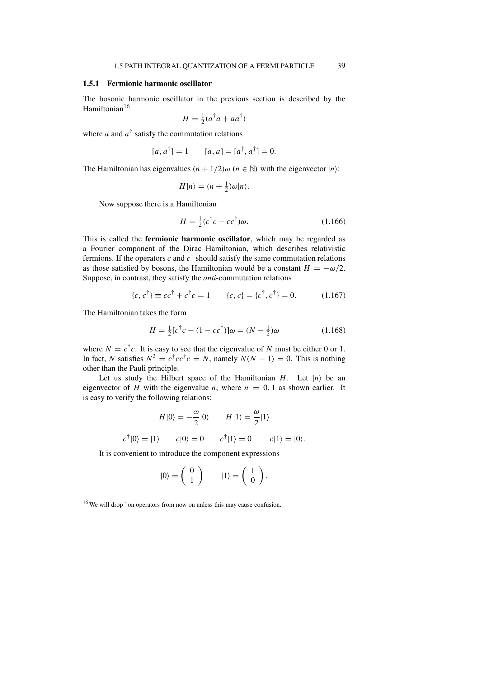
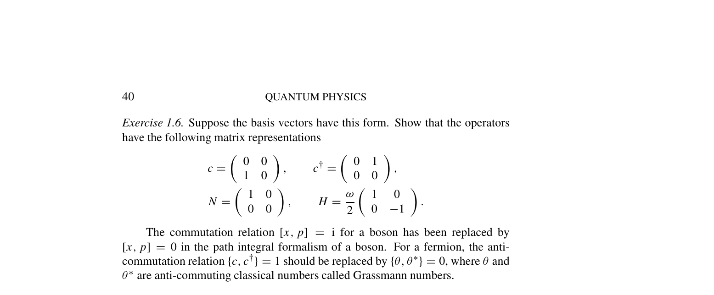

# 1.5.1 Fermionic harmonic oscillator｜费米谐振子

[总目录](README.md) · [上一小节](07-1.4.2.md) · [下一小节](09-1.5.2.md)

本文件包括 1.5 导言及 1.5.1。先把物理对象说清，再引入反交换的计算语言，能避免把 Grassmann 代数当成没有来由的技巧。

## 原书第 38 页：原文底本

以下影印块是本小节在该页的完整原文；相邻小节在同页交接时按标题分界。PDF 页码为 61。

## 第 38 页句读与集注

### 句读导言：“particles called fermions”

电子属于费米子，光子属于玻色子。对于全同粒子，不能只靠给粒子编号来区别物理状态；交换两个全同粒子时，多粒子态具有特定交换规律。通常三维相对论性局部量子理论中的整数自旋粒子与玻色统计、半整数自旋粒子与费米统计相联系。这个自旋—统计联系有一套独立而较深的论证，本页没有证明它。

这里首先采用费米模式满足反对易关系这一输入，再看它带来什么后果。不要把推理顺序颠倒成“因为能构造某种反交换数，所以自然界一定有电子”。数学给出相容的描述方式，采用哪种统计仍涉及物理事实与理论前提。

原文把玻色子概括成位置、动量满足对易关系的粒子，是为了过渡到两类算符代数。应避免扩大为“费米粒子的空间位置和动量就不满足通常的正则关系”。本节改用的是模式的产生、湮灭算符；费米反对易关系主要在这层结构上出现。

## 原书第 39 页：原文底本

以下影印块是本小节在该页的完整原文；相邻小节在同页交接时按标题分界。PDF 页码为 62。

## 第 39 页句读与集注

### 句读式 (1.166)–(1.168)：为什么一个模式只能占据 0 或 1 次？

定义 $\{c,c^\dagger\}=1$、$c^2=(c^\dagger)^2=0$，并令 $N=c^\dagger c$。由

$$
N^2=c^\dagger(1-c^\dagger c)c=c^\dagger c=N
$$

可知 $N$ 是投影算符，其本征值只能是 0、1。若模式已占据，再作用 $c^\dagger$ 就得到零向量。这是 Pauli 不相容原理在单个模式上的代数体现。

“一个模式”包含足够完整的量子数。例如空间轨道相同而自旋不同，仍然可以是两个不同模式，所以同一空间轨道常可容纳两个自旋相反的电子。不能把“不许重复占据一个模式”误读成“任何两个电子绝不能在同一位置附近”。

### 疏：为什么叫费米“谐振子”？

它与玻色振子共享“模式、频率、产生湮灭算符”的结构，但 Hilbert 空间只有两维：

$$
H=\hbar\omega(N-\tfrac12),\quad
E_0=-\tfrac12\hbar\omega,\quad
E_1=+\tfrac12\hbar\omega.
$$

普通弹簧振子的能级可无限上升；费米单模式只有空、占据两个状态。这里的“振子”强调它会成为自由费米场的一种模式，并不是一颗经典小球被装进另一种弹簧。

负的基态能在这个有限系统中不意味着能量无下界。整体加 $\hbar\omega/2$ 就能把两级改为 $0,\hbar\omega$，跃迁能隙仍相同。涉及无穷多个模式、引力或不同系统的能量比较时，真空能的处理还要另行说明；不能仅靠“总能量可平移”解释所有场论问题。

**校记：**原文称 $|n\rangle$ 是 $H$ 的本征值为 $n$ 的态，应按紧接的公式理解为 $N$ 的本征值为 $n$，能量为 $(n-\tfrac12)\omega$。本页 (1.168) 的中间代数也应使用 $cc^\dagger=1-c^\dagger c$；最终的 $H=(N-\tfrac12)\omega$ 才是要保留的结论。

## 原书第 40 页：原文底本

以下影印块是本小节在该页的完整原文；相邻小节在同页交接时按标题分界。PDF 页码为 63。

## 第 40 页句读与集注

### 句读练习 1.6：两维矩阵已经包含全部占据逻辑

按作者的基顺序，$|0\rangle=(0,1)^T$、$|1\rangle=(1,0)^T$。矩阵 $c$ 只把 $|1\rangle$ 送到 $|0\rangle$，把 $|0\rangle$ 消去；$c^\dagger$ 反向作用。直接相乘可检查 $cc^\dagger+c^\dagger c=I$，而两者各自平方为零。

这个小矩阵模型很有用：它说明反对易不是要求普通矩阵乘法失去结合律，也没有逻辑矛盾。非交换算符与反对易关系完全可以用熟悉的线性代数实现。

### 疏：为什么路径积分需要另一种“经典变量”？

玻色路径积分把算符的量子信息编进测度、作用量、排序及边界条件，路径坐标本身是可交换数。若想用同样的框架组织费米模式，也需要能保存交换负号的变量。因此引入 $\theta,\theta^*$，令它们反交换。

这不是把量子反对易关系右边的 1 随意删掉就算证明了量子化。后面真正建立联系的是费米相干态完备关系和时间切片。Grassmann 变量是这套积分表示的代数坐标，不是一个带有反交换实验读数的经典测量装置。

---

[总目录](README.md) · [上一小节](07-1.4.2.md) · [下一小节](09-1.5.2.md)
