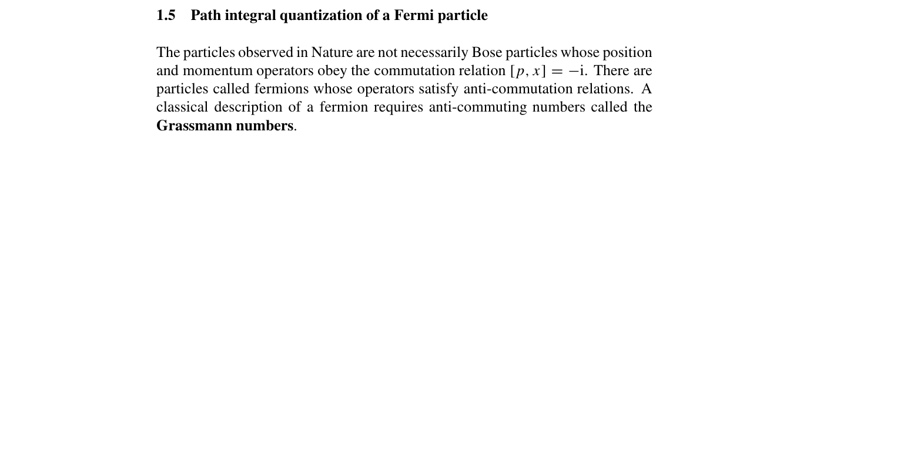

# 1.5.1 Fermionic harmonic oscillator｜费米谐振子

[阅读目录](README.md) · [上一小节](07-1.4.2.md) · [下一小节](09-1.5.2.md)

**这一节在做什么：建立一个最多只能占据一次的量子模式。**它和前面的玻色振子不同，不能一直把激发往上加；作者需要另一套算符关系来表达这个限制。

## 原书第 38 页：原文底本

本块保留该页属于本小节的完整原文。PDF 阅读器页码为 61。

## 第 38 页：先说目的，再逐步解读

### 一、先认识物理问题：为什么有的状态不能重复占据？

**这段在干什么：**解释 1.5 导言为什么开始谈费米子，以及这个新名字要对应什么事实。

电子属于费米子。对全同电子，若把一个量子状态的全部条件都指定好，同一个状态不能再放进第二个电子。这叫 Pauli 不相容原理。

“全部条件”很重要。例如同一空间轨道但自旋不同，可以算两个状态，所以不能把它粗略说成“两个电子不能靠近”。

前面的玻色模式可有 $0,1,2,\ldots$ 个激发；这里每个费米模式只允许 0 或 1。作者先用算符把这项区别写下来，再考虑怎样做路径积分。

本页关于“费米算符满足反对易”的话，主要指模式的产生、湮灭算符。不是说电子的空间位置与动量从此不再具有通常的正则结构。

## 原书第 39 页：原文底本

本块保留该页属于本小节的完整原文。PDF 阅读器页码为 62。

## 第 39 页：先说目的，再逐步解读

### 二、用什么代数表达“再放一次就不行”？

**这段在干什么：**从式 (1.167) 推出数算符的取值只能为 0 或 1。

令 $c^\dagger$ 表示往这个模式增加一次占据，$c$ 表示移走一次。若已经占据，再加一次应当得不到允许状态，所以要求

$$
(c^\dagger)^2=0,\qquad c^2=0.
$$

再给出 $\{c,c^\dagger\}=cc^\dagger+c^\dagger c=1$。花括号表示“两个次序相加”，叫反对易。

数算符 $N=c^\dagger c$ 满足

$$
N^2=c^\dagger(1-c^\dagger c)c=c^\dagger c=N.
$$

若 $N|n\rangle=n|n\rangle$，则 $n^2=n$，所以只能 $n=0,1$。你看见的不是一句“费米子很特殊”，而是明确的占据限制如何从代数关系算出。

### 三、为什么只有两个能量，而且最低能量可以是负的？

**这段在干什么：**解释式 (1.166)–(1.168) 的两态系统，不把它误认成普通弹簧。

作者取

$$
H=\hbar\omega(N-\tfrac12).
$$

于是空态能量为 $-\hbar\omega/2$，占据态为 $+\hbar\omega/2$，能隙为 $\hbar\omega$。

这里叫费米“振子”，因为它会成为自由费米场的一种模式；它并不是一个能无限升高振幅的经典弹簧小球。

最低能量是负数也不表示系统会无限掉下去。只有两个能级，它有明确下界。若在这个孤立模型里把零点整体平移，可写成能量 $0,\hbar\omega$，热占据概率不变。

原文中间替换与本征值标签有小的不一致，最终应以 $N$ 的标签和上面的两能量为准。

## 原书第 40 页：原文底本

本块保留该页属于本小节的完整原文。PDF 阅读器页码为 63。

## 第 40 页：先说目的，再逐步解读

### 四、两维矩阵能做完全部检查

**这段在干什么：**用练习 1.6 说明这套代数可以用普通矩阵实现。

取 $|0\rangle=(0,1)^T$、$|1\rangle=(1,0)^T$。令

$$
c=\begin{pmatrix}0&0\\1&0\end{pmatrix},\qquad
c^\dagger=\begin{pmatrix}0&1\\0&0\end{pmatrix}.
$$

直接算可得 $c^\dagger|0\rangle=|1\rangle$、$c^\dagger|1\rangle=0$。反过来 $c$ 把占据态移回空态。算两次同一种操作，确实变零。

所以“反对易”并没有破坏普通线性代数。它只是某些矩阵满足的特殊关系。

### 五、为什么接着要引入 Grassmann 数？

**这段在干什么：**提出后面几节要解决的计算困难。

玻色路径积分里使用普通坐标数。费米模式的交换会带负号，若仍只用可随便交换的普通数，这些符号不容易自动保存。

作者于是引入一种新的代数变量，让它们交换时本身就带负号。它们叫 Grassmann 变量。先把它看作适合这类计算的符号工具，不要想象成实验仪器会显示一个“反交换读数”。

复习只需先掌握三件 A 级内容：一个模式为什么只许 0、1；$c,c^\dagger$ 怎样作用；普通变量为什么不足以直接照搬玻色路径积分。下一节才真正定义新变量。

---

[阅读目录](README.md) · [上一小节](07-1.4.2.md) · [下一小节](09-1.5.2.md)
