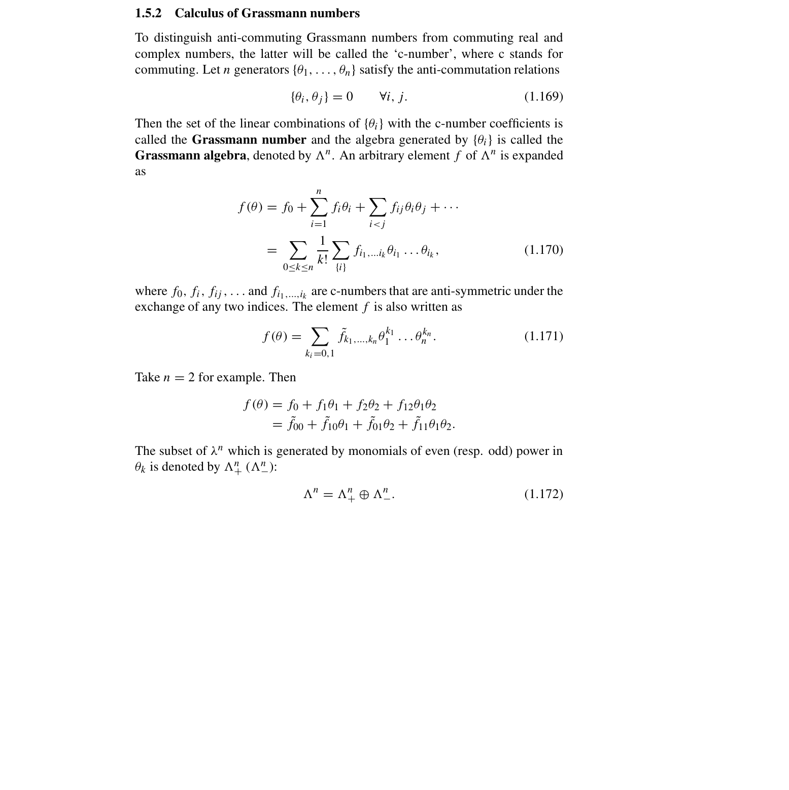
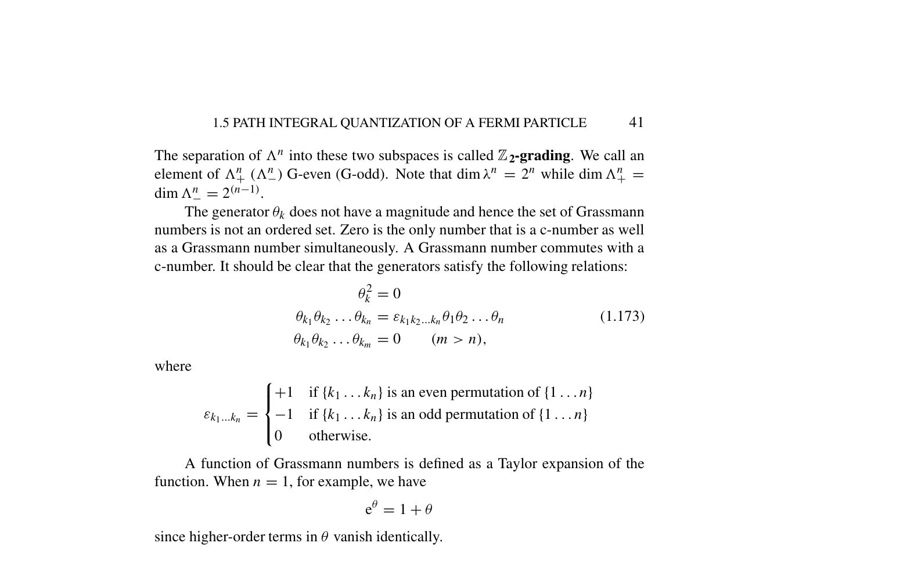

# 1.5.2 Calculus of Grassmann numbers｜Grassmann 数与分次

[阅读目录](README.md) · [上一小节](08-1.5.1.md) · [下一小节](10-1.5.3.md)

**这一节在做什么：为费米计算定义一套能自动记录交换负号的代数。**先给明确运算规则，再看函数、奇偶与指数怎样计算。

## 原书第 40 页：原文底本

本块保留该页属于本小节的完整原文。PDF 阅读器页码为 63。

## 第 40 页：先说目的，再逐步解读

### 一、Grassmann 变量是什么？先看规则，不猜它有多大

**这段在干什么：**解释式 (1.169)，并说明它不是一种很小的普通实数。

定义符号 $\theta_1,\ldots,\theta_n$，要求

$$
\theta_i\theta_j=-\theta_j\theta_i.
$$

因此把 $i=j$ 代入，有 $2\theta_i^2=0$，在实、复系数下得到 $\theta_i^2=0$。

这是严格为零，不是“小到可以不算”。若把 $\theta_i$ 当普通实数，只能得到 $\theta_i=0$；那不是作者想要的代数。因此我们承认它是一种新代数元素，就像学习矩阵时不再要求矩阵乘法可交换。

它的用途是：交换两个费米标签该出现负号时，乘法自己就能给出这个负号。

### 二、一般函数为什么只有有限项？

**这段在干什么：**读懂式 (1.170)–(1.171) 的展开，而不把它当成复杂的无限 Taylor 级数。

只有一个生成元时，因为 $\theta^2=0$，所有函数都可写成

$$
f(\theta)=a+b\theta.
$$

两个生成元时，先把顺序统一为 $\theta_1$ 在前：

$$
f=a+b\theta_1+c\theta_2+d\theta_1\theta_2.
$$

不需要 $\theta_2\theta_1$ 这一项，因为它等于 $-\theta_1\theta_2$；也不需要平方项，因为平方为零。

一般 $n$ 个生成元，每个出现 0 或 1 次，所以有 $2^n$ 个基单项。这就是外代数的一种具体写法。原文的两种展开只是在不同记号下组织同一组单项式。

## 原书第 41 页：原文底本

本块保留该页属于本小节的完整原文。PDF 阅读器页码为 64。

## 第 41 页：先说目的，再逐步解读

### 三、奇、偶分别是什么意思？

**这段在干什么：**为之后的导数和积分确定交换符号。

看单项式里含几个 $\theta$：偶数个叫偶，奇数个叫奇。常数是偶；$\theta_1$ 是奇；$\theta_1\theta_2$ 是偶。

为什么有用？将两个奇单项式整体交换，需要奇数次符号交换，所以带负号。偶单项式整体越过另一个单项式时，交换次数为偶数，不带负号。

因此“奇量彼此反交换，偶量可交换”是一种省力的总规则。这里的奇偶指次数，不是整数的数值。

### 四、每个生成元平方为零，不代表整个代数里所有量都平方为零

**这段在干什么：**纠正一个最容易从定义过度推断的结论，并解释原文的函数例子。

例如

$$
u=\theta_1\theta_2+\theta_3\theta_4
$$

满足 $u^2=2\theta_1\theta_2\theta_3\theta_4$，通常不为零。因此计算时先看具体元素，不能把“生成元幂零”直接替换成“任何表达式的平方都为零”。

对单个 $\theta$，指数却确实精确截断：

$$
e^\theta=1+\theta.
$$

不是省略高阶近似，而是高阶严格消失。

原文说 Grassmann 数不能比较大小，是提醒你不要把它当实数轴上的正负读数。整个代数仍包含普通复常数；“只有零同时是 c-number”应按作者狭义使用奇变量的语境读，不能套到整个外代数。

复习时优先会做两变量展开、判断奇偶、计算一个指数，这些是 A。外代数的抽象定义可作 B 级连接，但不需要让新术语盖住已写明的运算规则。

---

[阅读目录](README.md) · [上一小节](08-1.5.1.md) · [下一小节](10-1.5.3.md)
