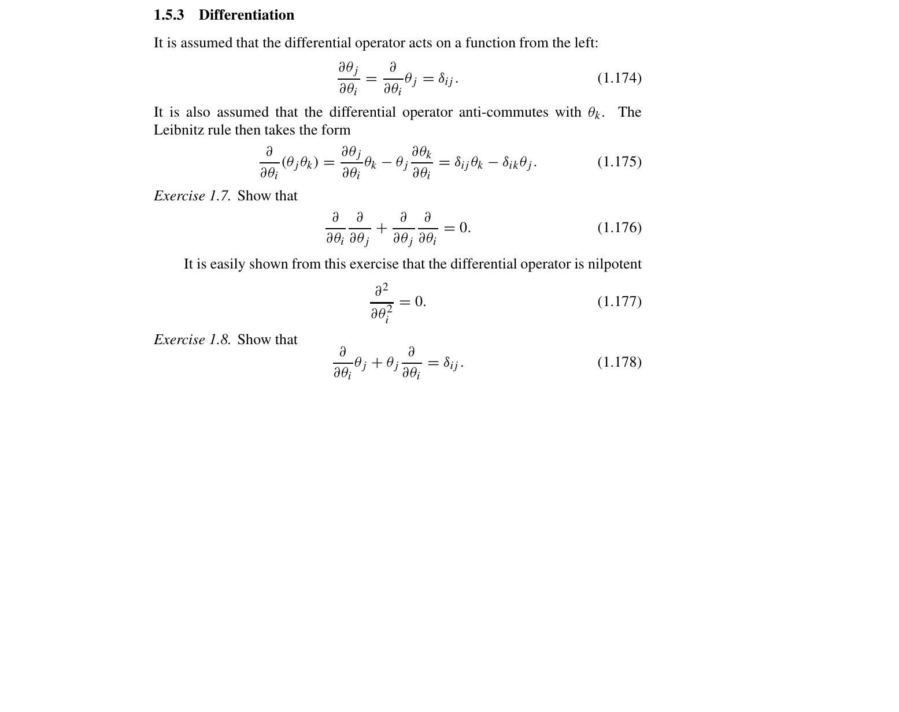

# 1.5.3 Differentiation｜Grassmann 微分

[阅读目录](README.md) · [上一小节](09-1.5.2.md) · [下一小节](11-1.5.4.md)

**这一节在做什么：定义怎样对 Grassmann 变量求导。**因为变量交换会变号，普通乘积求导规则也必须随之调整。

## 原书第 41 页：原文底本

本块保留该页属于本小节的完整原文。PDF 阅读器页码为 64。

## 第 41 页：先说目的，再逐步解读

### 一、先定义最简单的求导：取出一次项的系数

**这段在干什么：**解释式 (1.174)，让你不用猜这种变量应怎样取极限。

单变量函数只有 $f=a+b\theta$。作者定义

$$
\partial_\theta f=b.
$$

所以导数在这里先是一项代数操作：去掉指定的 $\theta$，取出系数。它不是让一个小实数步长趋于零。

多个变量时，作者选“左导数”：把待求导变量移到适合从左取出的地方，并记下交换符号。这项约定必须固定，否则同一个表达式会出现两种答案。

### 二、为什么 Leibniz 规则里多一个负号？

**这段在干什么：**用式 (1.175) 的低维例子证明负号是被反交换要求出来的。

对 $\theta_1\theta_2$ 求 $\theta_1$ 导数，直接得到 $\theta_2$。但对 $\theta_2$ 求导，先用

$$
\theta_1\theta_2=-\theta_2\theta_1,
$$

再取出左边的 $\theta_2$，得到 $-\theta_1$。

因此

$$
\partial_1(\theta_1\theta_2)=\theta_2,\qquad
\partial_2(\theta_1\theta_2)=-\theta_1.
$$

这迫使乘积规则写成

$$
\partial_i(\theta_j\theta_k)
=\delta_{ij}\theta_k-\delta_{ik}\theta_j.
$$

若套普通无负号的规则，就会和 $\theta_1\theta_2=-\theta_2\theta_1$ 冲突。作者不是任意增加一个麻烦条件，而是为了运算一致。

### 三、两次求导为什么也要看顺序？

**这段在干什么：**用练习 1.7–1.8 检查导数自身的代数关系。

记住右边的算符先作用：

$$
\partial_1\partial_2(\theta_1\theta_2)
=\partial_1(-\theta_1)=-1,
$$

而

$$
\partial_2\partial_1(\theta_1\theta_2)
=\partial_2(\theta_2)=1.
$$

所以交换两次导数也会变号。对同一个生成元求两次则为零，因为第一次以后已没有这个变量可取。

练习 1.8 的
$\partial_i\theta_j+\theta_j\partial_i=\delta_{ij}$
是算符恒等式：要让它们继续作用在任意后续函数上理解，不能把第一项当成已算完的常数后再乱加。

本节 A 级目标很具体：能独立算出上面的 $-1$ 与 $+1$，并说明负号来自哪里。之后算费米关联时，就不会凭感觉补符号。

---

[阅读目录](README.md) · [上一小节](09-1.5.2.md) · [下一小节](11-1.5.4.md)
