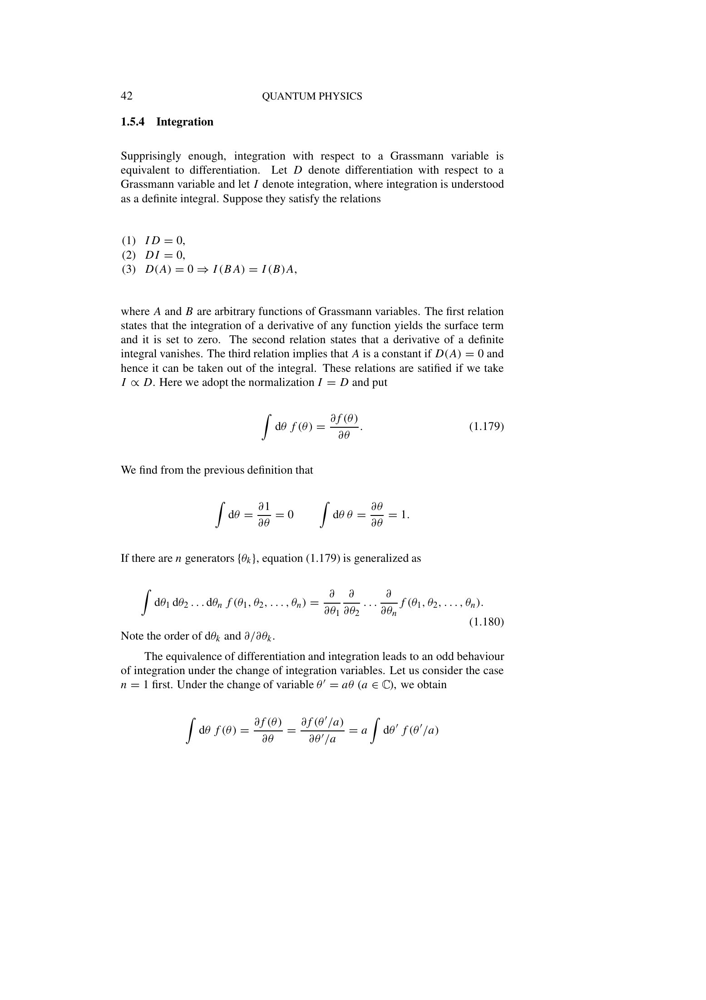
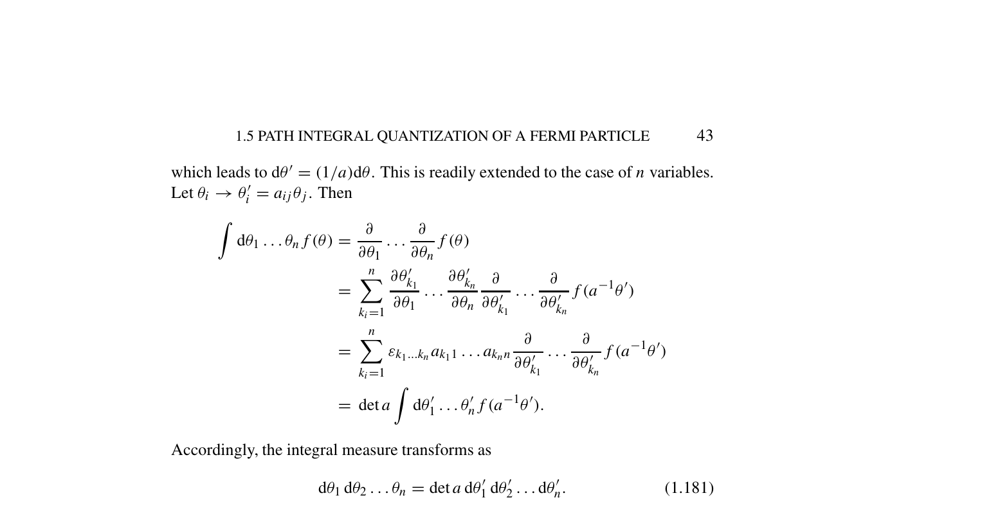

# 1.5.4 Integration｜Berezin 积分与换元

[阅读目录](README.md) · [上一小节](10-1.5.3.md) · [下一小节](12-1.5.5.md)

**这一节在做什么：定义一种适合奇变量的积分。**它不计算曲线下面积，而是从有限多项式里取系数；这个定义会让后面的费米路径积分能够工作。

## 原书第 42 页：原文底本

本块保留该页属于本小节的完整原文。PDF 阅读器页码为 65。

## 第 42 页：先说目的，再逐步解读

### 一、为什么积分 1 等于 0，积分 θ 却等于 1？

**这段在干什么：**解释式 (1.179) 的定义，避免拿普通面积直观与它硬撞。

单变量函数只有 $f=a+b\theta$。作者希望积分是线性的，并且有“全导数积分为零”的性质。由于 $\partial_\theta(a+b\theta)=b$，这要求积分常数为零。

剩下只需规定 $\theta$ 的积分归一化为 1，于是

$$
\int d\theta\,1=0,\qquad
\int d\theta\,\theta=1,\qquad
\int d\theta\,f(\theta)=b.
$$

这叫 Berezin 积分。它和上一节的单变量左导数给出相同结果，但承担的是积分角色。

所以这没有推翻“正函数积分非负”一类普通定理：这里根本没有定义一个普通实区间和正测度，而是定义了另一项代数运算。

### 二、多变量积分为什么必须注明顺序？

**这段在干什么：**把式 (1.180) 落实成能算的例子。

作者规定

$$
\int d\theta_1d\theta_2\,f=\partial_1\partial_2f.
$$

因此

$$
\int d\theta_1d\theta_2\,\theta_2\theta_1=1,\qquad
\int d\theta_1d\theta_2\,\theta_1\theta_2=-1.
$$

原因就是上一节连续求导的次序。你可以把积分看成“把全部指定变量依规定次序取完”，没包含全的项都会消失。

例如两变量的 $a+b\theta_1+c\theta_2+d\theta_2\theta_1$，积分后只剩 $d$。这是后面 Gaussian 展开只保留最高次项的根据。

### 三、换元为什么出现反过来的比例？

**这段在干什么：**解释本页末尾的换元，不凭记忆套普通积分的 Jacobian。

设 $\theta'=a\theta$。为了仍有 $\int d\theta'\,\theta'=1$，测度必须满足

$$
d\theta'=\frac1a\,d\theta.
$$

代回去就看见 $(1/a)\times a$ 正好抵消。这里变量被放大，系数提取操作要反向缩小，才能保持定义。

## 原书第 43 页：原文底本

本块保留该页属于本小节的完整原文。PDF 阅读器页码为 66。

## 第 43 页：先说目的，再逐步解读

### 四、多个变量的逆行列式怎样出现？

**这段在干什么：**把单变量换元推广为式 (1.181)，为 Gaussian 行列式作准备。

若 $\theta'=A\theta$，将最高次项展开时，反交换符号会把所有排列组合成行列式：

$$
\theta_1'\cdots\theta_n'
=(\det A)\theta_1\cdots\theta_n.
$$

要让积分结果保持 1，测度就得乘倒数：

$$
d\theta_1'\cdots d\theta_n'
=(\det A)^{-1}d\theta_1\cdots d\theta_n.
$$

这就是书中反向写法的同一关系。它不是普通体积变换，因而也没有普通实积分里的绝对值规则。

### 五、这一节复习：会取系数，比先背超积分术语更重要

**这段在干什么：**把后面立刻会用的运算整理出来。

你现在需要会做三件 A 级事情：单变量积分取一次项；多变量积分取最高次项并保留顺序；线性换元的测度带逆行列式。

这三件事一齐决定了费米 Gaussian 为什么给出 $\det M$，而不是普通 Gaussian 的倒平方根。下一节 δ 函数也不再是一根无限尖的峰，而是执行代入的一个多项式。

---

[阅读目录](README.md) · [上一小节](10-1.5.3.md) · [下一小节](12-1.5.5.md)
