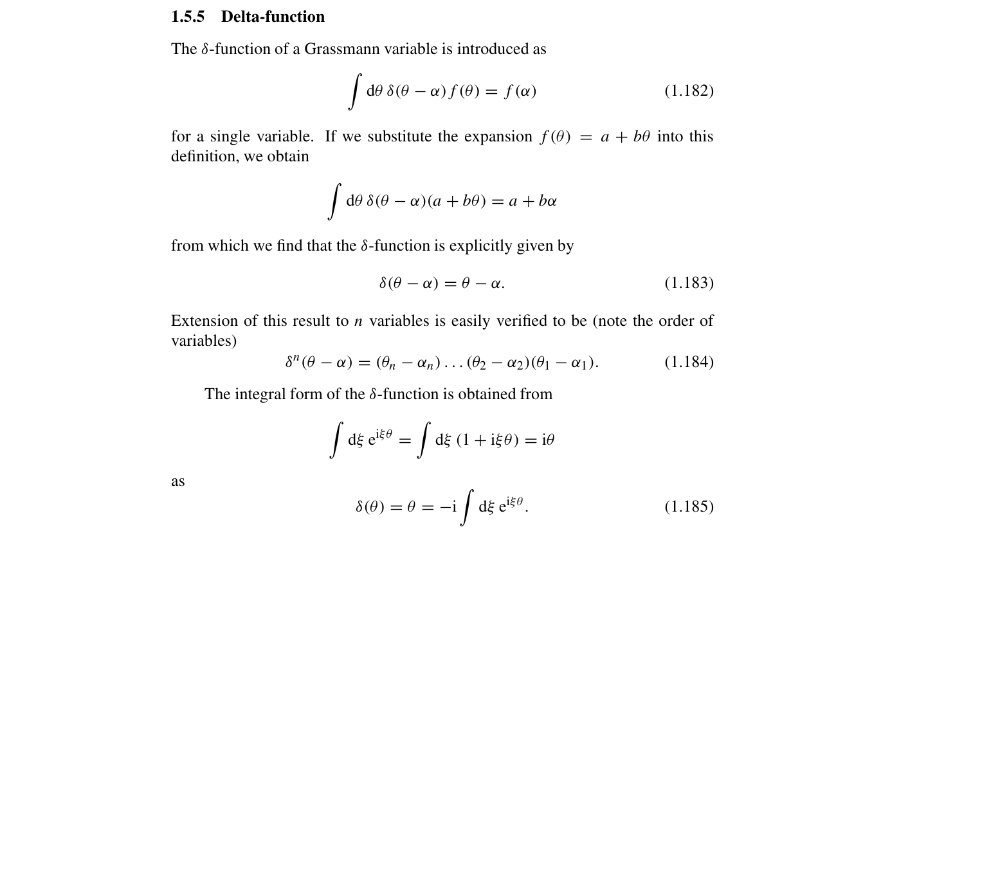

# 1.5.5 Delta-function｜Grassmann δ 函数

[阅读目录](README.md) · [上一小节](11-1.5.4.md) · [下一小节](13-1.5.6.md)

**这一节在做什么：寻找一个积分核，使奇变量积分也能执行“把变量换成指定值”的操作。**作者沿用 δ 的名称，但对象已经不是普通实数上的尖峰。

## 原书第 43 页：原文底本

本块保留该页属于本小节的完整原文。PDF 阅读器页码为 66。

## 第 43 页：先说目的，再逐步解读

### 一、先规定 δ 要完成什么任务

**这段在干什么：**解释式 (1.182)，让定义由用途出发。

我们希望

$$
\int d\theta\,\delta(\theta-\alpha)f(\theta)=f(\alpha).
$$

也就是说，积分后把 $f$ 里的 $\theta$ 替成 $\alpha$。普通 δ 也有这个用途；这里想保留的是代入功能，不是普通 δ 的图像。

由于 $f=a+b\theta$，能用到的项很少。作者给出

$$
\delta(\theta-\alpha)=\theta-\alpha.
$$

下面亲手检查它真的做到这件事。

### 二、把最简单的函数代进去检查

**这段在干什么：**验证式 (1.183)，并指出负号在哪里被反交换改变。

先取 $a,b$ 为普通可交换系数。展开

$$
(\theta-\alpha)(a+b\theta)
=a\theta-a\alpha-b\alpha\theta.
$$

因为 $\alpha\theta=-\theta\alpha$，最后一项可写成 $+b\theta\alpha$。于是含 $\theta$ 的部分为 $a\theta+b\theta\alpha$，左积分后得到

$$
a+b\alpha=f(\alpha).
$$

所以它的确是代入核。若在一般奇系数函数中换动核的位置，要同时核对左右导数与符号，不能随便换序。

### 三、多变量和 Fourier 表示为何也很短？

**这段在干什么：**读懂式 (1.184)–(1.185)，说明这些公式都来自有限项展开。

多变量积分顺序已固定，所以 δ 的因子用反序排列：

$$
\delta^n(\theta-\alpha)
=(\theta_n-\alpha_n)\cdots(\theta_1-\alpha_1).
$$

例如 $\alpha=0,n=2$ 时，$\int d\theta_1d\theta_2\,\theta_2\theta_1=1$，立刻对上。

同样，由 $(\xi\theta)^2=0$，

$$
e^{i\xi\theta}=1+i\xi\theta,\qquad
\int d\xi\,e^{i\xi\theta}=i\theta.
$$

所以 $\delta(\theta)=-i\int d\xi\,e^{i\xi\theta}$。它看起来像 Fourier 积分，实际没有无限振荡求和，只是取出一次项。

本节 A 级目标是会验证代入性质，B 级是熟悉多变量顺序。它没有引入新粒子，也不需要你想象一团“很尖的 Grassmann 物质”。

---

[阅读目录](README.md) · [上一小节](11-1.5.4.md) · [下一小节](13-1.5.6.md)
