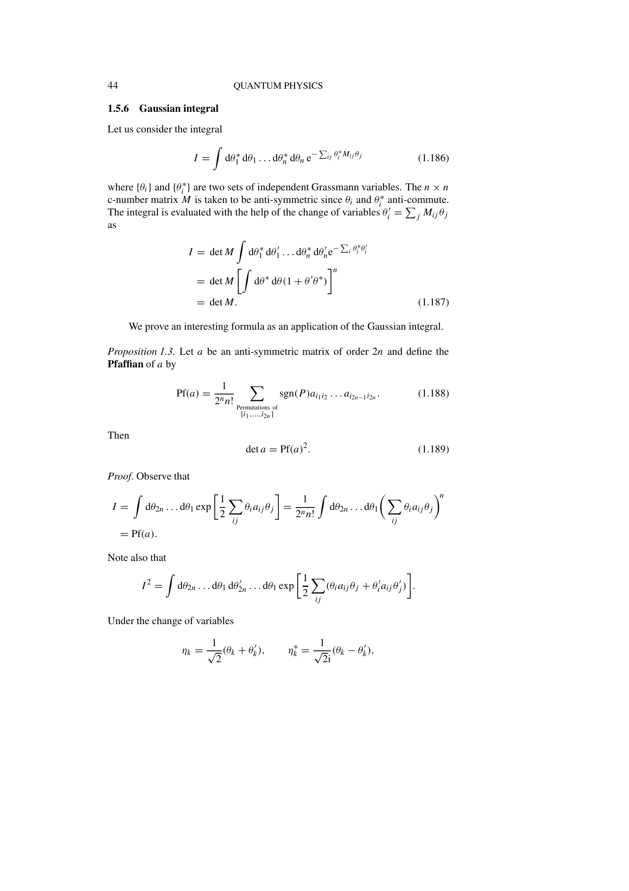
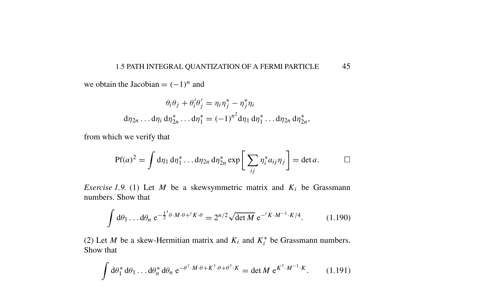

# 1.5.6 Gaussian integral｜费米高斯积分与 Pfaffian

[总目录](README.md) · [上一小节](12-1.5.5.md) · [下一小节](14-1.5.7.md)

本节有两种不同的二次型：两组独立奇变量的双线性型给行列式；一组奇变量的反对称二次型给 Pfaffian。把它们分开，是本节最关键的句读。

## 原书第 44 页：原文底本

以下影印块是本小节在该页的完整原文；相邻小节在同页交接时按标题分界。PDF 页码为 67。

## 第 44 页句读与集注

### 句读式 (1.186)–(1.187)：为何得到 det M 而不是它的倒数？

对一个变量对，按本书测度顺序，

$$
\int d\theta^*d\theta\,e^{-m\theta^*\theta}
=\int d\theta^*d\theta\,(1-m\theta^*\theta)=m.
$$

这是最高次项的系数提取。与普通 Gaussian 的 $m^{-1}$ 或 $m^{-1/2}$ 相反，刚度增大不会“压窄一团正概率分布”；这里并没有那样的正概率密度可供压窄。

多个变量时，指数的展开中，只有恰好每个 $\theta_i,\theta_i^*$ 都出现一次的项能留下。它们按不同排列选择 $M_{ij}$，交换奇变量时的正负号正是行列式的排列符号。因此

$$
\int\prod_{i=1}^n(d\theta_i^*d\theta_i)\,
e^{-\sum_{ij}\theta_i^*M_{ij}\theta_j}=\det M.
$$

也可像原文那样用 $\theta'=M\theta$ 的逆 Jacobian 证明；若 $M$ 不可逆，先在可逆情形证明，再利用两边都是矩阵元的多项式延拓。

**校记：**原文说这里的 $M$ 必须反对称，这个限制并不需要。$\theta_i$ 与 $\theta_i^*$ 是两套独立生成元，$\theta^*M\theta$ 对一般复矩阵 $M$ 都有意义。若连 $n=1$ 都强迫 $M$ 反对称，只能有 $M=0$，反而破坏最简单的非零 Gaussian 例子。反对称性真正必需的是下面只有一套变量的二次型。

### 句读命题 1.3：Pfaffian 在组合什么？

对一套变量 $\vartheta_1,\ldots,\vartheta_{2n}$，

$$
\frac12\sum_{ij}\vartheta_iA_{ij}\vartheta_j
$$

只保留 $A$ 的反对称部分，因为对称部分与奇变量交换抵消。展开指数后，积分必须把 $2n$ 个指标两两配对，所有配对按交换符号相加，这个多项式就是 $\operatorname{Pf}(A)$。

四维例子最容易看：

$$
\operatorname{Pf}(A)
=A_{12}A_{34}-A_{13}A_{24}+A_{14}A_{23}.
$$

三项对应三种配对方式。Pfaffian 不是随便从 $\det A$ 开平方再选个符号，而是由矩阵元和顺序直接定义的多项式；它的符号带有基的定向信息。

## 原书第 45 页：原文底本

以下影印块是本小节在该页的完整原文；相邻小节在同页交接时按标题分界。PDF 页码为 68。

## 第 45 页句读与集注

### 句读证明的收尾：为什么平方等于行列式？

取两份独立的一组变量积分，相乘后得到 Pfaffian 的平方。将两组实型奇变量线性组合为一对复型独立变量，二次型便可改写成 $\eta^*A\eta$，其积分由上一条规则给 $\det A$。原文逐项追踪 Jacobian 和重排符号，正是为了证明两边的多项式符号一致。

你也可用二维反对称矩阵

$$
A=\begin{pmatrix}0&a\\-a&0\end{pmatrix}
$$

做最低维核对：$\operatorname{Pf}(A)=a$，$\det A=a^2$。奇数维反对称矩阵的行列式为零，不能给出同样的非退化配对。

### 校读练习 1.9：用小例子检验常数

练习 (1) 的 (1.190) 不宜直接作为标准模板。令 $K=0$、$n=2$、
$M=\left(\begin{smallmatrix}0&m\\-m&0\end{smallmatrix}\right)$，按本书测度，

$$
\int d\theta_1d\theta_2\,
e^{-\frac12\theta^TM\theta}
=\int d\theta_1d\theta_2(1-m\theta_1\theta_2)=m.
$$

印出的右边却含 $2^{n/2}\sqrt{\det M}=2\sqrt{m^2}$，即使选同一符号也多出系数 2。一般单组变量应以 Pfaffian 及明确的测度定向写公式，不能跳过符号和归一化。这里保留原题，但不要求你证明一个按所给约定并不成立的等式。

练习 (2) 的双组变量源公式可由平移完成平方得到 $\det M\,e^{K^\dagger M^{-1}K}$，前提是固定奇源的排列和可逆性。与前面的双组 Gaussian 相同，$M$ 不必为了这个恒等式特意取斜 Hermitian；具体物理算符可能有额外性质，那是另外一层要求。

### 集注：这对物理有什么用？

自由 Dirac 场的费米积分会给微分算符的行列式；某些实型费米场的积分则给 Pfaffian。交换符号已经被这些代数量编码，所以后面它们影响有效作用量、涨落与拓扑性质。这里应掌握两种二次型各自对应哪种对象，而不是把 det、平方根和 Pfaffian 当成可随意互换的三个记号。

---

[总目录](README.md) · [上一小节](12-1.5.5.md) · [下一小节](14-1.5.7.md)
