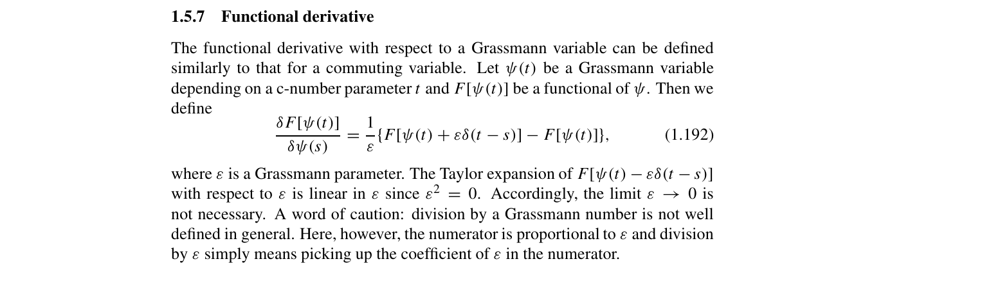

# 1.5.7 Functional derivative｜Grassmann 泛函微分

[总目录](README.md) · [上一小节](13-1.5.6.md) · [下一小节](15-1.5.8.md)

## 原书第 45 页：原文底本

以下影印块是本小节在该页的完整原文；相邻小节在同页交接时按标题分界。PDF 页码为 68。

## 第 45 页句读与集注

### 句读式 (1.192)：为什么出现 Grassmann 参数 ε？

$\psi(t)$ 是由普通时间标记的一族奇变量。想求在时刻 $s$ 改变它所引起的函数变化，就写

$$
\delta\psi(t)=\epsilon\,\delta(t-s).
$$

$\epsilon$ 是奇参数，$\delta(t-s)$ 却是普通时间轴上的 Dirac 分布。前者负责奇偶与交换符号，后者负责选定时间点。它们分属不同数学结构，不能因为都出现在上一节附近就混成同一种 δ。

取左变分约定，把 $\epsilon$ 放在最左边，定义

$$
F[\psi+\epsilon\delta_s]
=F[\psi]+\epsilon\frac{\delta_LF}{\delta\psi(s)}.
$$

由于 $\epsilon^2=0$，不含更高次项。这就是原文“无需取 $\epsilon\to0$”的实际理由。

### 疏：“除以 ε”不是求一个倒数

若非零幂零元素 $\epsilon$ 有逆，$\epsilon^2=0$ 两边乘逆就会得到 $\epsilon=0$，矛盾。因此普通意义的 $1/\epsilon$ 不存在。原文自己提醒了这一点：式中的分式只是“把分子写成 $\epsilon$ 乘某个系数，再取出这个系数”的缩写。

为免歧义，最好把 $\epsilon$ 当作独立新增的生成元，先把它移到固定位置，再读出其系数。若任意混用已有生成元、左右位置不固定，所谓“除掉 $\epsilon$”就可能丢失信息或符号。

### 算例：次序如何影响泛函导数？

令 $F=\psi(t_1)\psi(t_2)$。在 $t=s$ 处变分：

$$
\delta F=
\epsilon\delta(t_1-s)\psi(t_2)
+\psi(t_1)\epsilon\delta(t_2-s)
$$

将第二项的 $\epsilon$ 移到左边，得

$$
\frac{\delta_LF}{\delta\psi(s)}
=\delta(t_1-s)\psi(t_2)
-\delta(t_2-s)\psi(t_1).
$$

这就是有限维奇 Leibniz 规则的连续版本。连续时间没有消除反交换的负号，只把离散指标换成了时间标签。

### 集注：它会在哪里出现？

费米生成泛函的源也是 Grassmann 量。依次对这些源求导，会插入费米场；换一次求导顺序就可能差一个负号。理解这里的系数提取和左右约定，才能正确读 1.7 的传播子公式。它并不需要你先掌握一套新的实分析极限理论。

---

[总目录](README.md) · [上一小节](13-1.5.6.md) · [下一小节](15-1.5.8.md)
