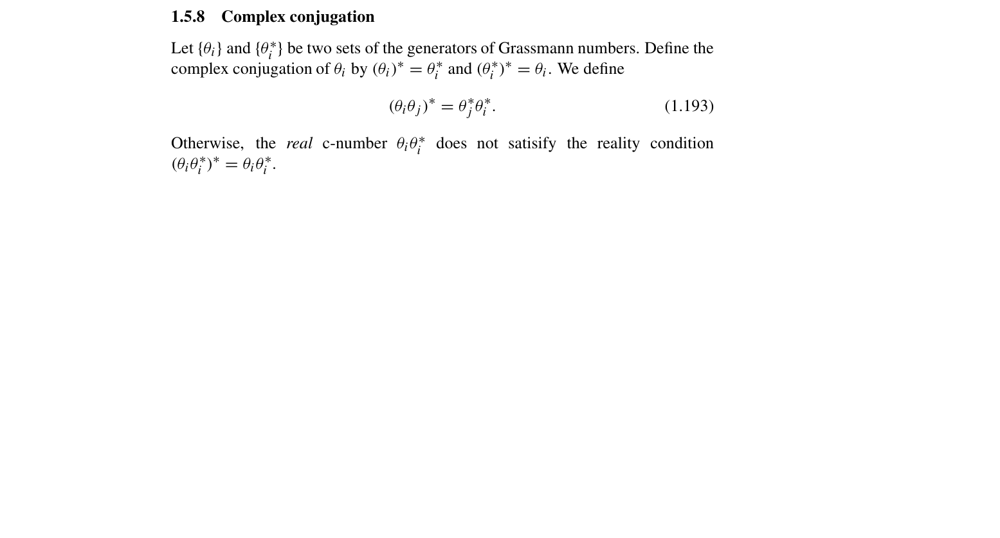

# 1.5.8 Complex conjugation｜Grassmann 共轭

[阅读目录](README.md) · [上一小节](14-1.5.7.md) · [下一小节](16-1.5.9.md)

**这一节在做什么：规定奇变量怎样取复共轭，使后面的二次表达式有一致的现实性条件。**

## 原书第 45 页：原文底本

本块保留该页属于本小节的完整原文。PDF 阅读器页码为 68。

## 第 45 页：先说目的，再逐步解读

### 一、为什么共轭时还要把次序倒过来？

**这段在干什么：**说明式 (1.193) 的规则及它要保住的性质。

对普通复数，你熟悉 $(ab)^*=a^*b^*$。因为普通数可交换，写成 $b^*a^*$ 也一样。奇变量不可交换，这两种写法不再相同。

作者规定

$$
(\theta_i\theta_j)^*=\theta_j^*\theta_i^*.
$$

这和算符伴随 $(AB)^\dagger=B^\dagger A^\dagger$ 的规则相配合。它让费米算符的共轭与奇变量表示中的共轭能一致使用。

用最简单的二次项检查：

$$
(\theta^*\theta)^*=\theta^*\theta.
$$

共轭并倒序后，它回到自身。若不倒序，通常会多一个交换负号。

### 二、共轭后等于自身，为什么仍不能说它是普通非负实数？

**这段在干什么：**分清“在这套代数里满足现实性规则”与“实验读出的实数”。

$\theta^*\theta$ 是一个偶 Grassmann 元素。它与其他元素的交换较简单，但仍带幂零性质，不能搬到实数轴上说“大于零”。

星号只规定代数中怎样对应：$(\theta)^*=\theta^*$、$(\theta^*)^*=\theta$。积分时两者仍可作为独立生成元处理，并不是一对已经给定数值的普通复数。

所以原文称某个二次项为 “real c-number” 时，应理解为它在这里共轭不变、并且是偶量；若 c-number 严格指普通复系数，这个称呼就不够准确。

本节 B 级目标是会核对一个乘积的共轭顺序。物理用途是帮助构造与量子算符伴随相容的作用量，不需要再给它附会一种机械运动图像。

---

[阅读目录](README.md) · [上一小节](14-1.5.7.md) · [下一小节](16-1.5.9.md)
