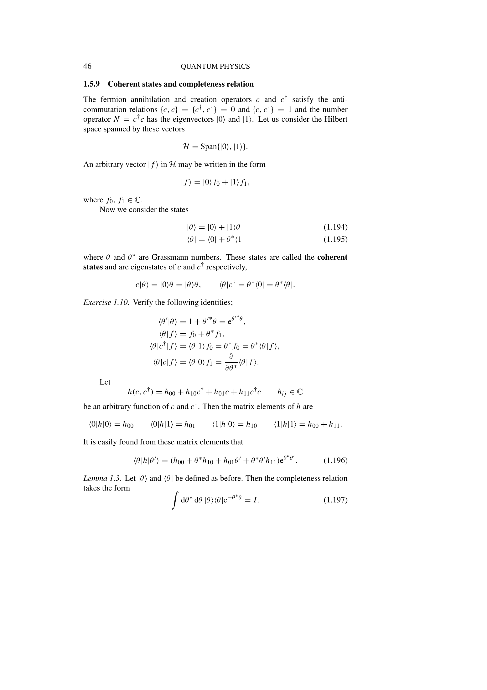
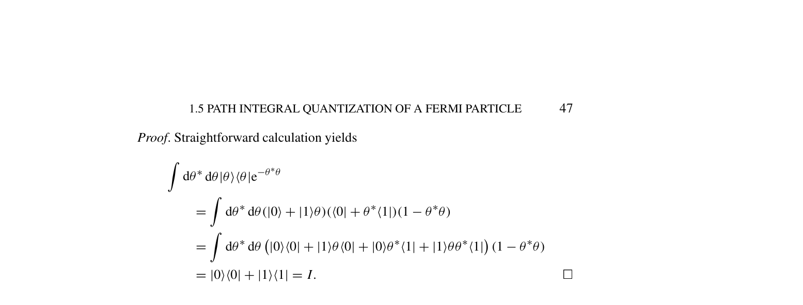

# 1.5.9 Coherent states and completeness relation｜费米相干态与完备关系

[阅读目录](README.md) · [上一小节](15-1.5.8.md) · [下一小节](17-1.5.10.md)

**这一节在做什么：把两维费米态空间与 Grassmann 积分真正连接起来。**前面只是定义了奇变量；现在要证明用它们确实能重写算符计算。

## 原书第 46 页：原文底本

本块保留该页属于本小节的完整原文。PDF 阅读器页码为 69。

## 第 46 页：先说目的，再逐步解读

### 一、为什么定义 |θ〉=|0〉+|1〉θ？

**这段在干什么：**解释式 (1.194)–(1.195) 的辅助状态为什么适合湮灭算符。

普通单模式态写成 $|0\rangle f_0+|1\rangle f_1$，两个系数是复数。作者暂时扩大系数范围，允许写入奇变量：

$$
|\theta\rangle=|0\rangle+|1\rangle\theta.
$$

对它作用 $c$，

$$
c|\theta\rangle=|0\rangle\theta
=|\theta\rangle\theta,
$$

最后等号用了 $\theta^2=0$。因此它像是 $c$ 的一个以奇数为“本征值”的辅助态，叫费米相干态。

它不是说实验可以制备一个振幅读数为奇变量的普通态。我们扩大代数是为了计算，最后仍要回到普通 Hilbert 空间中的物理结果。

为什么普通复本征值不行？若 $cv=\lambda v$，因 $c^2=0$ 得 $\lambda^2v=0$；非零向量只能有复数 $\lambda=0$。奇变量则恰好能非零而平方为零，与这个结构相配。

### 二、为什么重叠写成指数，又为什么不正交？

**这段在干什么：**读懂练习 1.10，并准备时间切片中会反复出现的相邻态重叠。

直接展开：

$$
\langle\theta'|\theta\rangle
=1+\theta'^*\theta=e^{\theta'^*\theta}.
$$

指数等号是精确的，因为二次以上项为零。这不等于两个标签不同就内积为零，所以相干态不是普通的正交基。

对普通态 $|f\rangle$，
$\langle\theta|f\rangle=f_0+\theta^*f_1$。此时 $c^\dagger$ 可用乘 $\theta^*$ 表示，$c$ 可用对 $\theta^*$ 求导表示。它让算符运算变成已经学过的奇变量运算。

一般算符的矩阵元也可这样展开，但算符排序必须先固定。不能先把 $c,c^\dagger$ 当普通数交换，再去替换。

## 原书第 47 页：原文底本

本块保留该页属于本小节的完整原文。PDF 阅读器页码为 70。

## 第 47 页：先说目的，再逐步解读

### 三、完备关系：怎样知道这批辅助态没有丢掉原来的两种状态？

**这段在干什么：**验证引理 1.3，给后面在每个时间片插入相干态提供根据。

作者要证明

$$
\int d\theta^*d\theta\,
e^{-\theta^*\theta}|\theta\rangle\langle\theta|=I.
$$

先把两个括号以及 $1-\theta^*\theta$ 全部展开。积分会删掉常数项、只含一个变量的项，保留恰好同时含 $\theta,\theta^*$ 的项。

空态投影留下 $|0\rangle\langle0|$，占据态投影留下 $|1\rangle\langle1|$；它们相加正是两维恒等算符。

这说明这套积分可以完整重建任意两维态。于是后面像玻色情形一样，能够在每个时间片插入恒等算符，把演化拆开。

### 四、这一节复习：真正的桥梁是完备关系

**这段在干什么：**说明前面几节繁琐代数现在解决了哪个问题。

奇变量不是只为把交换关系右边的 1 删掉。我们先造适合 $c$ 的辅助态，再用 Berezin 积分解析恒等算符，才能证明时间切片后的积分仍代表原来的算符演化。

A 级要求是会验证 $c|\theta\rangle=|\theta\rangle\theta$ 和两维完备关系。一般矩阵元展开为 B。标签连续而物理态空间仍只有两维，说明不能靠数标签个数来数独立物理状态。

---

[阅读目录](README.md) · [上一小节](15-1.5.8.md) · [下一小节](17-1.5.10.md)
