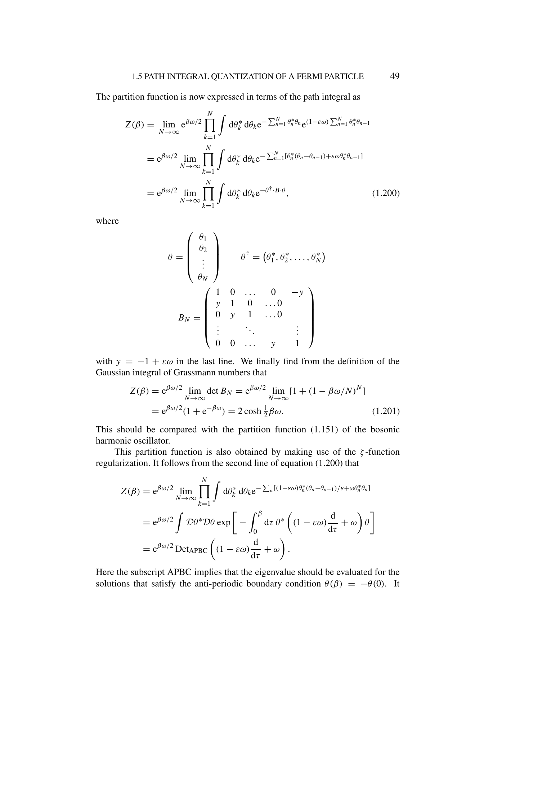
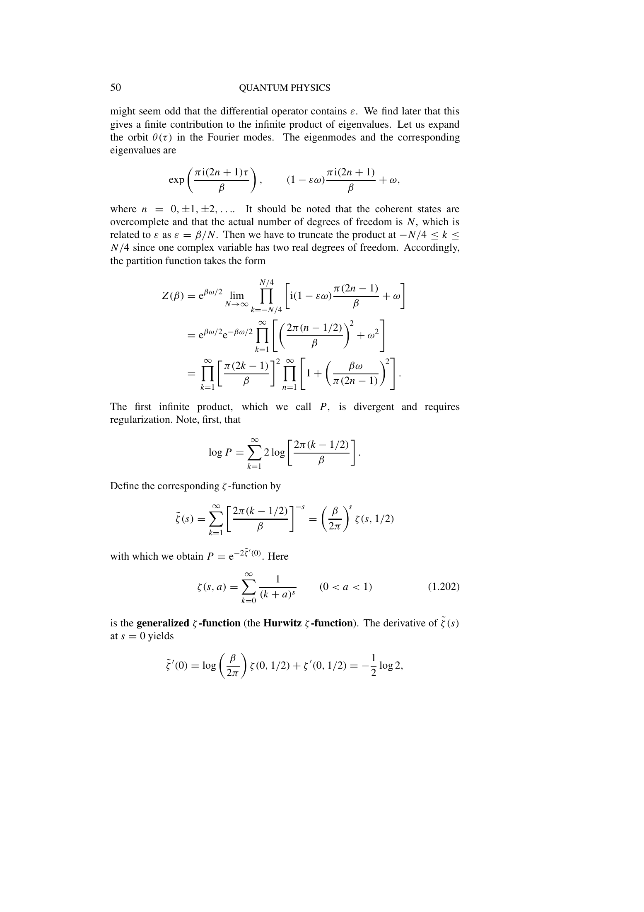

# 1.5.10 Partition function of a fermionic oscillator｜费米配分函数与反周期条件

[总目录](README.md) · [上一小节](16-1.5.9.md) · [下一小节](18-1.6.1.md)

本节的结果很短，推导却很长。读时始终拿两态系统的精确迹做参照：所有路径积分步骤最后都必须回到这两个态的热权重之和。

## 原书第 47 页：原文底本

以下影印块是本小节在该页的完整原文；相邻小节在同页交接时按标题分界。PDF 页码为 70。

## 第 47 页句读与集注

### 句读式 (1.198)：为什么是 cosh，而不是 1/sinh？

费米单模式只有 $n=0,1$：

$$
Z_F=e^{+\beta\hbar\omega/2}+e^{-\beta\hbar\omega/2}
=2\cosh(\beta\hbar\omega/2).
$$

如果改用零点能已平移的 $H'=\hbar\omega N$，则 $Z'_F=1+e^{-\beta\hbar\omega}$。两者给出的归一化占据概率相同：

$$
\langle N\rangle=\frac1{e^{\beta\hbar\omega}+1}.
$$

玻色模式可以任意重复占据，求的是无穷几何级数；费米模式最多占据一次，只加两项。这比单记“玻色对应 sinh、费米对应 cosh”更能解释统计差别。

### 句读引理 1.4：迹中的负标签从哪里来？

普通两维迹是 $\langle0|O|0\rangle+\langle1|O|1\rangle$。换成 Grassmann 相干态时，奇变量与奇态的排列带来符号，正确表示为

$$
\operatorname{Tr}O=
\int d\theta^*d\theta\,
e^{-\theta^*\theta}\langle-\theta|O|\theta\rangle
$$

（对当前偶算符）。这个负号不是预先假定费米子“在时间上走一圈要变号”，而是普通迹在相干态表示中的代数结果。下一页才把它读成反周期边界。

## 原书第 48 页：原文底本

以下影印块是本小节在该页的完整原文；相邻小节在同页交接时按标题分界。PDF 页码为 71。

## 第 48 页句读与集注

### 句读证明收尾：普通迹与超迹要分开

取 $O=I$ 做核对，应该得到 2。若删去 $\langle-\theta|$ 中的负号，按同一测度与权重算出的不再是普通迹。事实上，那种边界结构关联的是含 $(-1)^N$ 的分次迹，空态与占据态带相反权重。普通热统计的概率归一化用普通迹，所以必须保留负号。

由此读出

$$
\theta(\beta)=-\theta(0),\qquad
\theta^*(\beta)=-\theta^*(0).
$$

它是欧氏时间圈上的反周期性。不表示一颗真实电子在某个时间后概率变负，更不意味着它沿真实轨迹过了一圈便消失。Grassmann 配置不是可直接测量的概率幅数值。

### 疏时间切片：一阶导数从哪里来？

每个短时矩阵元包含 overlap
$e^{\theta_k^*\theta_{k-1}}$，完备关系的权重含
$e^{-\theta_k^*\theta_k}$。相乘后出现

$$
-\theta_k^*(\theta_k-\theta_{k-1})
-\epsilon\omega\,\theta_k^*\theta_{k-1}.
$$

第一项在连续记号下成为 $-\int\theta^*\partial_\tau\theta\,d\tau$，第二项是模式能量项。费米作用量中的一阶时间导数，正由相干态 overlap 和邻片差分产生。它不是为了模仿 Dirac 方程而随意选的。

## 原书第 49 页：原文底本

以下影印块是本小节在该页的完整原文；相邻小节在同页交接时按标题分界。PDF 页码为 72。

## 第 49 页句读与集注

### 句读式 (1.200)–(1.201)：为什么离散行列式最可靠？

切片后有 $N$ 对独立奇变量，指数是 $\theta^*B_N\theta$。积分就是 $\det B_N$。沿时间相邻耦合使 $B_N$ 近似为双对角矩阵，首尾反周期耦合给角上的特殊符号。

按原文的 $y=-1+\epsilon\omega$，行列式整理为

$$
\det B_N=1+(1-\beta\omega/N)^N.
$$

于是

$$
Z_F=e^{\beta\omega/2}
\lim_{N\to\infty}[1+(1-\beta\omega/N)^N]
=e^{\beta\omega/2}(1+e^{-\beta\omega}).
$$

它清楚保留了两类贡献：空态和一次占据。反周期负号在行列式中最终给出加号；若错误处理首尾耦合，往往会得到 $1-e^{-\beta\omega}$，那已经是另一个统计问题。

### 疏连续记号中的微小项

原文下一条路线保留 $(1-\epsilon\omega)\partial_\tau$。有限 $\epsilon$ 的小项乘上随截断数增长的模式贡献，可能留下有限常数，因此不能看到 $\epsilon\to0$ 就在乘积形成前全部删掉。可靠做法是保留一套一致的离散定义，比较它与连续正则化后的归一化。

这与你熟悉的数值方法有关：逐点小误差在大量步骤累积后，未必对最终结果仍然小。但这里还涉及无穷乘积，必须明确截断与极限次序，不能仅凭这个类比就任意保留某个常数。

## 原书第 50 页：原文底本

以下影印块是本小节在该页的完整原文；相邻小节在同页交接时按标题分界。PDF 页码为 73。

## 第 50 页句读与集注

### 句读 Fourier 模式：半整数频率不是额外的物理假设

令 $\theta(\tau)\propto e^{i\nu\tau}$，反周期条件要求 $e^{i\nu\beta}=-1$，所以

$$
\nu_n=\frac{(2n+1)\pi}{\beta},\qquad n\in\mathbb Z.
$$

玻色周期条件则给 $2n\pi/\beta$。这些称为 Matsubara 频率，描述热欧氏时间展开，不是系统实际能级之间所有跃迁频率的清单。

一阶算符 $\partial_\tau+\omega$ 的模式特征值是 $i\nu_n+\omega$。将正负频率配对得到 $\nu_n^2+\omega^2$，便出现与 cosh 有关的奇数无穷乘积。它与前面 Dirichlet 二阶算符的整数正弦谱不同，根源是边界条件和一阶结构改变了。

### 校读模式截断：别把“过完备”当作随意计数依据

本页的 $N/4$ 截断以及求积指标 $k,n$ 的混用，不宜当作一般性的精确模式计数规则。有限切片上 $\theta$ 与 $\theta^*$ 是独立积分变量，Fourier 变换必须保持独立变量个数；相干态过完备本身不能替代这项检查。

因此理解主线时，以第 49 页的有限行列式为首要核对，再把本页 ζ 正则化当作同一谱结果的连续组织方式。不要在两个不同截断间搬移单个常数，却不比较完整的 $Z_F$。

### 疏 Hurwitz ζ：数学对象为什么换了？

整数谱用 $\zeta_R(s)=\sum n^{-s}$；半整数谱自然用 $\zeta(s,\tfrac12)=\sum_{n\ge0}(n+\tfrac12)^{-s}$。在收敛区域分离奇数项可得

$$
\zeta(s,\tfrac12)=(2^s-1)\zeta_R(s),
$$

然后解析延拓。原文利用它在 0 点的值来固定剩余谱乘积。这是谱的平移决定特殊函数的种类，不是随意把更多特殊函数堆进计算。

## 原书第 51 页：原文底本

以下影印块是本小节在该页的完整原文；相邻小节在同页交接时按标题分界。PDF 页码为 74。

## 第 51 页句读与集注

### 句读式 (1.203)–(1.206)：回到两个态

最终得到

$$
Z_F=2\prod_{n=1}^\infty
\left[1+\frac{(\beta\omega)^2}{\pi^2(2n-1)^2}\right]
=2\cosh\frac{\beta\omega}{2}.
$$

高温时趋于 2，表示两种模式占据状态近乎等权；低温时由最低能态的权重主导。对于采用 $H=\omega(N-\tfrac12)$ 的本书，$Z_F$ 低温增长并不意味着概率发散，因为概率还要除以 $Z_F$。

作者最后说“用两种方法计算同一个物理量”可以得到数学恒等式。这里可以更明确地说：两态谱的有限求和，等于反周期差分算符的 Grassmann 积分；后者再化为谱乘积。因此 cosh 乘积背后是同一个系统的态计数与模式分解。

**回看问题：**反周期条件由哪一步产生？普通热迹与含 $(-1)^N$ 的迹为什么不同？为什么频率是半整数？怎样从两态权重得到 Fermi 占据函数？这些是本节需要带到量子场论的内容。

---

[总目录](README.md) · [上一小节](16-1.5.9.md) · [下一小节](18-1.6.1.md)
