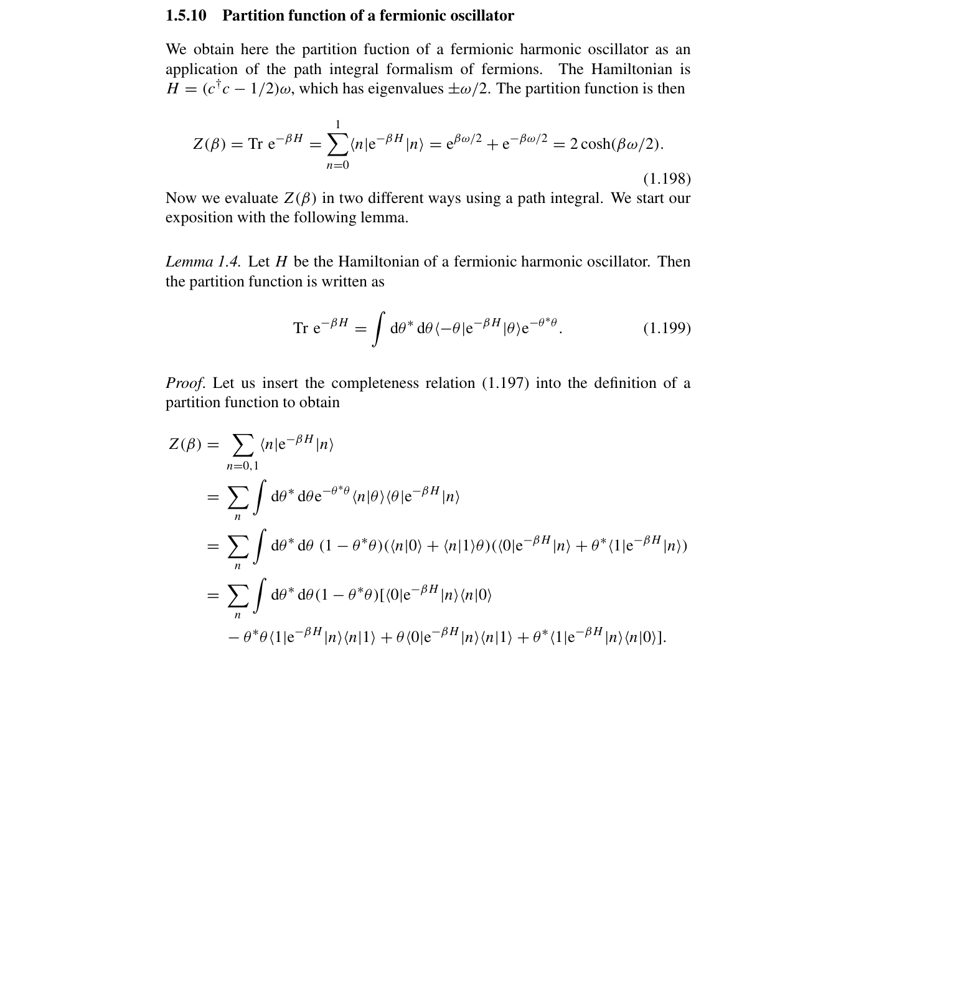
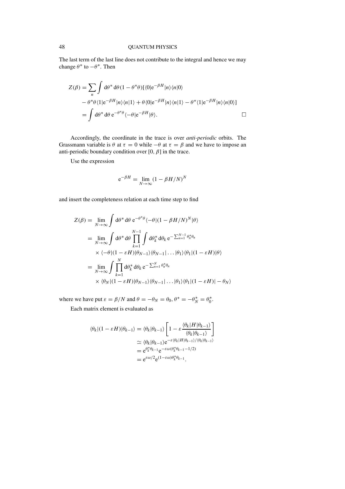
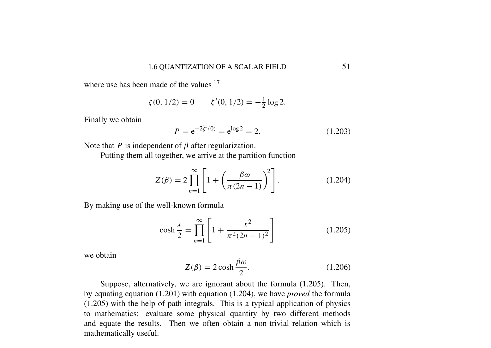

# 1.5.10 Partition function of a fermionic oscillator｜费米配分函数与反周期条件

[阅读目录](README.md) · [上一小节](16-1.5.9.md) · [下一小节](18-1.6.1.md)

**这一节在做什么：用奇变量路径积分重新算一个只有空、占据两种状态的热迹。**最终答案已能直接求出，因此长推导中的每一步都有明确的核对对象。

## 原书第 47 页：原文底本

本块保留该页属于本小节的完整原文。PDF 阅读器页码为 70。

## 第 47 页：先说目的，再逐步解读

### 一、先把两种状态数清楚

**这段在干什么：**由式 (1.198) 得到全节参照答案。

本书取能量 $-\hbar\omega/2$ 和 $+\hbar\omega/2$，所以

$$
Z=e^{\beta\hbar\omega/2}+e^{-\beta\hbar\omega/2}
=2\cosh(\beta\hbar\omega/2).
$$

没有无穷级数，因为不能重复占据。若把零点移成 $0,\hbar\omega$，则 $Z'=1+e^{-\beta\hbar\omega}$，对应占据概率

$$
\Pr(N=1)=\frac1{e^{\beta\hbar\omega}+1}.
$$

低温时占据高一级的概率小；高温时空态与占据态接近各半。这是该两态模型的具体热统计。

### 二、为什么迹公式里偏偏出现 −θ？

**这段在干什么：**说明引理 1.4 的负号不是随意添加，而是为重现普通两维迹所必需。

取最容易检查的算符 $O=I$。两维恒等矩阵的迹应为 2。相干态表示中，

$$
\langle-\theta|\theta\rangle=1-\theta^*\theta.
$$

再乘积分权重 $1-\theta^*\theta$，得到 $1-2\theta^*\theta$。积分后常数消失，后项给 2，正好吻合。

若错误使用 $\langle\theta|$，重叠是 $1+\theta^*\theta$，与权重相乘只剩 1，积分得零，连 $\operatorname{Tr}I=2$ 都算错了。

所以普通热迹要求这个负号。原文的长证明把这项检查推广到相应偶算符。

## 原书第 48 页：原文底本

本块保留该页属于本小节的完整原文。PDF 阅读器页码为 71。

## 第 48 页：先说目的，再逐步解读

### 三、反周期边界：负号现在变成了首尾条件

**这段在干什么：**把迹中的负标签翻译成欧氏路径积分的边界。

前面玻色热迹要求起点、终点相同，所以路径首尾相接。这里相干态迹连接的是 $|\theta\rangle$ 与 $\langle-\theta|$，因此

$$
\theta(\beta)=-\theta(0).
$$

它叫反周期边界。意思是这套辅助变量在欧氏时间区间两端反号；不是电子真实过一段时间后概率变负。

如果没有负标签，计算的是空态与占据态带相反权重的一种分次迹，不是当前普通热平衡的概率总和。

### 四、一阶时间导数是怎样从相邻时间片出现的？

**这段在干什么：**解释原文切片式中的差分项，避免把费米作用量当作另一个猜测。

相邻相干态重叠给 $e^{\theta_k^*\theta_{k-1}}$，完备关系的权重给 $e^{-\theta_k^*\theta_k}$。两者相乘，指数里出现

$$
-\theta_k^*(\theta_k-\theta_{k-1}).
$$

把时间步长记为 $\epsilon$，括号除以 $\epsilon$ 就像普通差分导数。加总后写成连续形式，是 $-\int\theta^*\partial_\tau\theta\,d\tau$。

所以这项一阶导数来自相邻态的重叠与积分权重，不是为了形式好看才写进去。

## 原书第 49 页：原文底本

本块保留该页属于本小节的完整原文。PDF 阅读器页码为 72。

## 第 49 页：先说目的，再逐步解读

### 五、有限行列式怎样回到两个态的答案？

**这段在干什么：**说明式 (1.200)–(1.201) 的矩阵计算到底在核对什么。

取 $N$ 个时间片后，只剩 $N$ 对奇变量，指数是一个有限二次型。上一节 Gaussian 规则告诉我们：积分等于矩阵 $B_N$ 的行列式。

相邻时间片只相邻耦合，所以矩阵很稀疏；首尾反周期条件决定角上那项的负号。计算得到

$$
\det B_N=1+(1-\beta\omega/N)^N.
$$

当 $N\to\infty$，它趋于 $1+e^{-\beta\omega}$；再乘回原来的零点能因子，正好是 $2\cosh(\beta\omega/2)$。

这样，路径积分没有凭空增加无数状态，仍只是在重算空态和占据态的热权重。

原文下一步保留某个随 $\epsilon$ 变小的因子，是为了在无穷模式累积时固定归一化。第一次读先用有限行列式守住答案，再看连续正则化。

## 原书第 50 页：原文底本

本块保留该页属于本小节的完整原文。PDF 阅读器页码为 73。

## 第 50 页：先说目的，再逐步解读

### 六、为什么 Fourier 频率变成半整数？

**这段在干什么：**从反周期条件直接推导模式，而不是要求你背 Matsubara 频率。

假设一个模式为 $e^{i\nu\tau}$。首尾反号要求

$$
e^{i\nu\beta}=-1.
$$

复平面转半圈、再加任意整圈，才能到 $-1$，所以

$$
\nu=\frac{(2n+1)\pi}{\beta},\quad n\in\mathbb Z.
$$

这就是费米热模式的半整数频率。玻色首尾同号则要求转整圈，得到 $2n\pi/\beta$。差别直接来自迹的边界条件。

这些频率属于欧氏热计算，不是探测器观测到的全部实际跃迁频率清单。

本页用 Hurwitz ζ 来处理半整数谱，与前面整数谱用 Riemann ζ 的目的相同。具体截断的变量数要回到有限离散化核对，不以“相干态过完备”代替计数。

## 原书第 51 页：原文底本

本块保留该页属于本小节的完整原文。PDF 阅读器页码为 74。

## 第 51 页：先说目的，再逐步解读

### 七、这一节复习：长推导要始终指向同一份两态统计

**这段在干什么：**把相干态、反周期与 cosh 串成可以复述的过程。

先直接相加两个热权重 → 把普通迹写成相干态积分 → 为重现迹出现负标签 → 首尾反号形成反周期边界 → 时间切片给有限 Grassmann Gaussian → 行列式回到两态答案。

再作 Fourier 展开，半整数频率给奇数乘积：

$$
Z=2\prod_{n\ge1}
\left[1+\frac{(\beta\omega)^2}{\pi^2(2n-1)^2}\right]
=2\cosh\frac{\beta\omega}{2}.
$$

这里的 A 级内容是两态计数、迹的负标签、反周期与半整数频率。无穷乘积和 ζ 常数的精细处理属于 B，可在这四件事清楚以后慢慢算。

---

[阅读目录](README.md) · [上一小节](16-1.5.9.md) · [下一小节](18-1.6.1.md)
