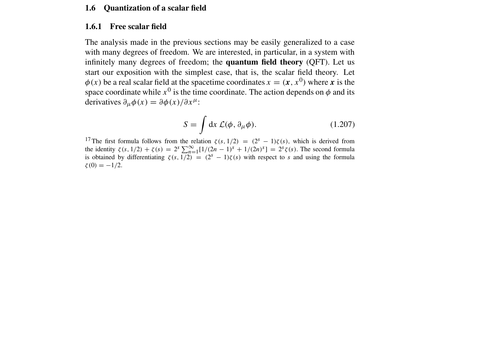
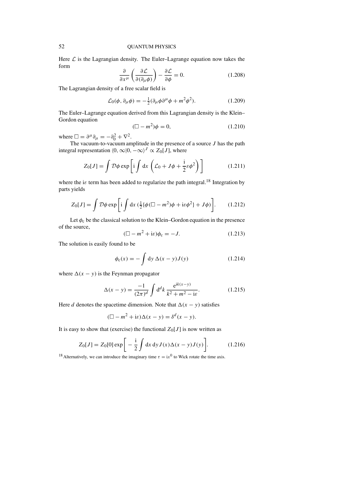
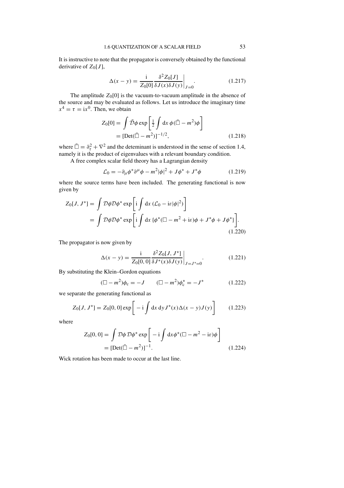

# 1.6.1 Free scalar field｜自由标量场

[阅读目录](README.md) · [上一小节](17-1.5.10.md) · [下一小节](19-1.6.2.md)

**这一节在做什么：把“一个粒子的一个坐标”，推广成“空间每处都有可以变化的量”，再对整个系统量子化。**这是全章最需要放慢的一次转换。

## 原书第 51 页：原文底本

本块保留该页属于本小节的完整原文。PDF 阅读器页码为 74。

## 第 51 页：先说目的，再逐步解读

### 一、场先从一串小振子想起

**这段在干什么：**解释原文 “many degrees of freedom” 与 “scalar field” 的实际对象。

一个弹簧小球，需要一个位移 $q(t)$。一串相连的弹簧小球，需要 $q_1(t),q_2(t),\ldots,q_N(t)$：每个小球都能动，所以每个都要一个坐标。

如果小球分布越来越密，可以用空间位置 $\mathbf x$ 代替编号。位移便写成 $\phi(\mathbf x,t)$，意思是“在时刻 $t$，位置 $\mathbf x$ 上的量有多大”。这就是场的基本图像。

温度场也给每处一个数；绳子的横向位移场也类似。这里用这些帮助理解“每处都有一个数”，不是说基本标量场真的由小弹簧组成，也不是把温度场直接量子化成书中的相对论场。

“标量”表示每处给的是一个数，而不是像风速那样先给一个空间方向向量。

### 二、φ(x) 和前面的波函数 ψ(x) 不能混为一谈

**这段在干什么：**说明作者换了研究对象，避免把所有带 $x$ 的函数都当成位置概率。

单粒子 $\psi(x)$ 用来算“这一个粒子会在哪里被发现”。场配置 $\phi(\mathbf x)$ 则像一整条绳子的形状：同一时刻每一处都可以有一个场值。

一串 $N$ 个小球量子化后，状态函数是 $\Psi(q_1,\ldots,q_N)$。当坐标数连续化，它自然变成 $\Psi[\phi(\cdot)]$：输入的是一整幅场形状。

所以 $\phi$ 是被量子化的坐标，$\Psi$ 才是描述量子态的函数。一般不能把 $|\phi(\mathbf x)|^2$ 直接读成粒子在这里的概率。

路径积分现在也相应扩大：不只枚举一条 $x(t)$ 轨迹，而是枚举整个场随时间变化的历史 $\phi(\mathbf x,t)$。

### 三、为什么要写拉格朗日密度？

**这段在干什么：**解释式 (1.207) 如何给遍布空间的自由度安排动力学。

单个粒子的 $L$ 已经描述整个系统某一时刻的动力学。场铺满空间，因此先写“每一小块空间贡献多少”，叫拉格朗日密度 $\mathcal L$；再对空间和时间积分，得到作用量。

$$
S=\int dt\,d^{d-1}\mathbf x\,
\mathcal L(\phi,\partial_\mu\phi).
$$

时间导数描述当地变化快慢，空间导数描述邻近位置之间是否一致。只让当地及附近变化参与，是这类局部场模型的基本选择。

## 原书第 52 页：原文底本

本块保留该页属于本小节的完整原文。PDF 阅读器页码为 75。

## 第 52 页：先说目的，再逐步解读

### 四、自由标量方程：一片场为什么会像许多个振子？

**这段在干什么：**从式 (1.208)–(1.210) 读出各能量项的作用，并解释“自由”的意思。

按本书的度规，式 (1.209) 可写成较直观的

$$
\mathcal L_0=
\frac12\dot\phi^2-\frac12|\nabla\phi|^2-\frac12m^2\phi^2.
$$

第一项类似动能；第二项惩罚相邻位置变化太急；第三项惩罚场值偏离零。对它变分、分部积分，得到

$$
\ddot\phi-\nabla^2\phi+m^2\phi=0.
$$

这是 Klein–Gordon 方程。暂时先记内容，不靠名字理解它。

把场分成空间 Fourier 模式，例如 $\phi=q_{\mathbf k}(t)e^{i\mathbf k\cdot\mathbf x}$。代入后有

$$
\ddot q_{\mathbf k}+(|\mathbf k|^2+m^2)q_{\mathbf k}=0.
$$

看见了吗？**每个模式就是一个频率 $\omega_{\mathbf k}=\sqrt{|\mathbf k|^2+m^2}$ 的谐振子。**不同模式在这个二次模型里独立，所以叫自由场。

量子化后，每个模式可以逐级增加激发。把一次激发解释为一个携带该动量的粒子，就把振子与粒子语言接了起来。恢复单位后，其能量、动量满足 $E^2=p^2c^2+m^2c^4$，这说明参数 $m$ 为什么与粒子质量相联系。

### 五、传播子：先理解受迫线性方程怎样求解

**这段在干什么：**解释式 (1.213)–(1.216) 为什么引入一个满足 δ 方程的核。

给场加外源 $J$，就像给一串小球的某些位置加外力。线性方程写成 $O\phi_c=-J$。若有核 $\Delta$ 满足

$$
O_x\Delta(x-y)=\delta(x-y),
$$

便可把各处源的贡献叠加，得到 $\phi_c(x)=-\int dy\,\Delta(x-y)J(y)$。这与你学过的线性微分方程 Green 函数方法相同。

但微分方程还需要边界条件。要求响应只在施力之后出现，和要求真空中的编时关联，会选择不同的核。书中这里的 Feynman 传播子服务于后一种量子计算；不要把它一律读成“一个粒子真实沿这个函数走过来”。

$i\epsilon$ 是给积分与极点选择一致处理方式的符号。它不是新的可测外力。

## 原书第 53 页：原文底本

本块保留该页属于本小节的完整原文。PDF 阅读器页码为 76。

## 第 53 页：先说目的，再逐步解读

### 六、源导数怎样把真空中的两点联系取出来？

**这段在干什么：**说明式 (1.217) 的计算为什么有物理内容。

自由场的含源积分仍能完成平方，得到

$$
Z_0[J]=Z_0[0]\exp\left[-\frac i2\int dx\,dy\,J(x)\Delta(x-y)J(y)\right].
$$

对 $J(x)$ 和 $J(y)$ 各求一次导数，就取出连接这两处的核。乘上与本书定义相应的 $i$ 因子，再除以无源值，便得到归一化的真空两点关联。

物理上，基态并不是所有振子坐标和动量都严格为零。每个模式都有基态涨落，两处测量因而可能有相关性。这种相关不等于真空随便提供能量，也不等于可以用它直接超光速发信号。

先把“传播子”掌握为一个有指定边界规则的计算核：它一方面求解带源线性问题，另一方面组织量子关联。具体是哪一个定义，必须看式子。

### 七、实场、复场的行列式为什么相差一个平方根？

**这段在干什么：**解释式 (1.218)–(1.224) 的 Gaussian 幂次，并整理本节核心。

一个复数可以拆成两个实数。类似地，$\phi=(\phi_1+i\phi_2)/\sqrt2$ 是两套实场自由度。每套实 Gaussian 给 $\operatorname{Det}^{-1/2}$，两套相乘成为 $\operatorname{Det}^{-1}$。

欧氏计算应使用正的二次型算符 $-\Delta_E+m^2$。原文若把负号放进 Det，却不说明相位，容易与前面正 Gaussian 混淆；(1.220) 两行的 $i\epsilon$ 也不一致，遇到时查附录核对。

本节 A 级路线是：连续分布的坐标形成场 → Fourier 模式成为独立振子 → 量子激发得到粒子解释 → 线性逆核与 Gaussian 产生关联。实、复场只是自由度数不同，复数本身不会把玻色场变成费米场。

---

[阅读目录](README.md) · [上一小节](17-1.5.10.md) · [下一小节](19-1.6.2.md)
