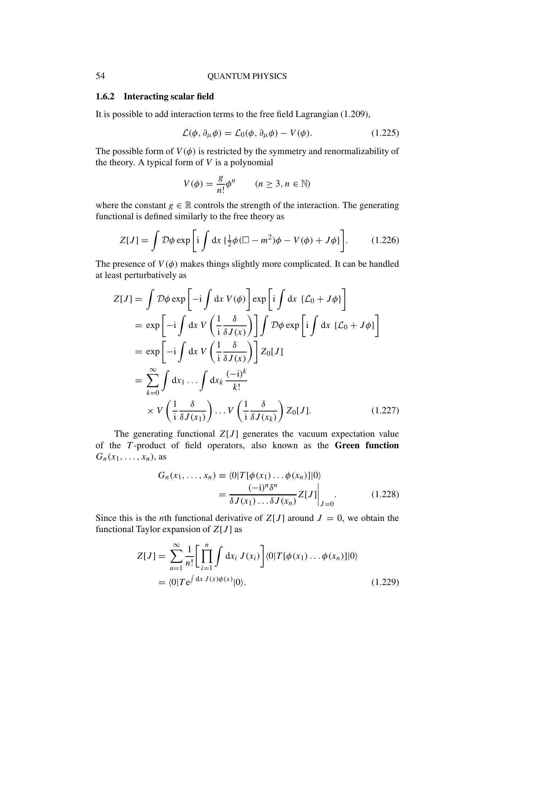
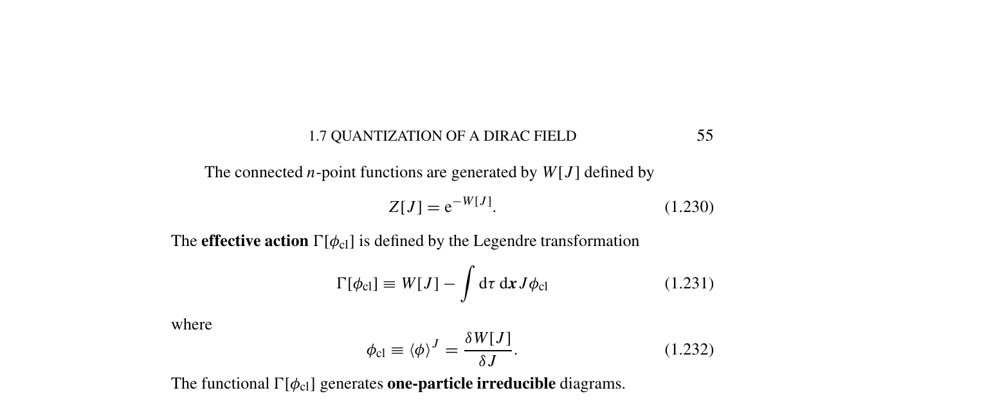

# 1.6.2 Interacting scalar field｜相互作用、关联函数与有效作用量

[总目录](README.md) · [上一小节](18-1.6.1.md) · [下一小节](20-1.7.md)

本节把上一节的二次理论扩展到非二次理论，并引入关联函数、连通性和有效作用量。它们是不同层级的信息组织方式，需要逐层读清楚。

## 原书第 54 页：原文底本

以下影印块是本小节在该页的完整原文；相邻小节在同页交接时按标题分界。PDF 页码为 77。

## 第 54 页句读与集注

### 句读式 (1.225)：为什么非二次项叫相互作用？

自由理论变成 Fourier 模式后，各模式彼此独立。加入 $\phi^4$ 一类项后，Fourier 展开会出现多个模式振幅的乘积，并要求相应动量之和守恒；一个模式的变化会与其他模式耦合。粒子解释中，它们可以产生散射等过程。因此“相互作用”不仅是单个点的势能形状改变，还表示激发模式之间发生耦合。

对称性会排除一些项，比如 $\phi\to-\phi$ 对称排除奇次势。稳定性还要求总势能有合适下界，例如单独正四次项比单独三次项更容易保证全局稳定。重整化性则涉及高能尺度下怎样控制理论参数，依赖时空维数。原文只是概括这些限制；不能把任意 $g\phi^n$ 都自动视为完整而稳定的基本理论。

现代有效场论允许按能量尺度保留高维项。本书在这里的表达服务于入门计算，不必把“非重整化项”理解为在任何低能描述中都不许出现。

### 疏式 (1.227)：用源导数替换场为什么成立？

因为

$$
\frac1i\frac{\delta}{\delta J(x)}
e^{i\int J\phi}=\phi(x)e^{i\int J\phi},
$$

所以可以把 $e^{-i\int V(\phi)}$ 化成作用在 $Z_0[J]$ 上的泛函微分算符。比如 $V=g\phi^4/4!$，最低阶修正是

$$
Z[J]=Z_0[J]
-\frac{ig}{4!}\int dx
\left(\frac1i\frac{\delta}{\delta J(x)}\right)^4Z_0[J]
+O(g^2).
$$

自由 $Z_0$ 是 Gaussian，反复求导产生两点核的配对。把配对画成线、把相互作用插入点画成顶点，就得到费曼图。图主要是组织积分、对称因子与微扰次数的记账工具；不能把每条内部线都当作实验中真正观测到的一颗小粒子沿轨迹飞行。

微扰展开也不保证对任意耦合或任意背景收敛。瞬子一节将讨论的某些贡献具有 $e^{-\text{常数}/g^2}$ 的尺度，任何有限阶的 $g$ 幂展开都捕捉不到它们。这就是为什么后文需要在非平凡场配置附近展开。

### 句读式 (1.228)：n 点函数在记什么？

$G_n(x_1,\ldots,x_n)$ 记录真空中的编时场关联。一次函数是平均场，两点函数记录基本相关，更多点函数则记录不能仅由一次、两次平均概括的结构。

如果 $Z$ 还含真空泡的整体因子，必须先用 $Z[J]/Z[0]$ 归一化，再把导数解释成单位归一化真空期望值。否则整套关联会带一个无关整体乘子。

**校记式 (1.229)：**接续本页 $e^{i\int J\phi}$ 的真实时间约定，展开应含 $n=0$ 项和 $i^n$ 因子：

$$
\widehat Z[J]
=\sum_{n=0}^{\infty}\frac{i^n}{n!}
\int dx_1\cdots dx_n\,J(x_1)\cdots J(x_n)G_n(x_1,\ldots,x_n).
$$

影印原文从 $n=1$ 开始且漏掉这些 $i$，若直接用它检验 $\widehat Z[0]=1$ 就会失败。欧氏约定可去掉 $i$，但需要一起改源的定义和前后公式。

## 原书第 55 页：原文底本

以下影印块是本小节在该页的完整原文；相邻小节在同页交接时按标题分界。PDF 页码为 78。

## 第 55 页句读与集注

### 句读式 (1.230)：为什么 log 会筛出连通关联？

统计中矩母函数的对数产生累积量。二阶例子最直观：

$$
\frac{\delta^2\log Z}{\delta J(x)\delta J(y)}
=\frac{Z_{,xy}}Z-\frac{Z_{,x}Z_{,y}}{Z^2}.
$$

第二项减去两次独立平均的乘积，所以保留连通的相关。更高阶同理剔除可分解成互不相关组块的部分。图像上，$Z$ 包含各种不连通组合，$\log Z$ 把它们整理成连通图。

原文用 $Z=e^{-W}$，因此其 $W=-\log Z$，还需追踪负号。先前使用的是含 $i$ 的真实时间源；本页后面却出现 $d\tau$，显示作者转向欧氏表达但没有完整重列所有约定。不能只抄一个 $W$ 的符号，就声称它的导数无条件等于平均场。

### 疏式 (1.231)–(1.232)：有效作用量为什么用 Legendre 变换？

为把逻辑说明白，单独选一套一致的欧氏约定：

$$
Z_E[J]=\int\mathcal D\phi\,e^{-S_E[\phi]+\int J\phi},\quad
W_E[J]=\log Z_E[J],\quad
\varphi=\frac{\delta W_E}{\delta J}.
$$

$J$ 是外界控制的源，$\varphi$ 是系统平均响应。现在希望以平均场而非外源为自变量，便定义

$$
\Gamma_E[\varphi]=\int J\varphi-W_E[J],
\qquad
\frac{\delta\Gamma_E}{\delta\varphi}=J.
$$

这正与你熟悉的凸对偶相接：在合适正性、正则条件下，$W_E$ 的 Hessian 是关联协方差，Legendre 变换将其逆过来。若存在简并、不可微性或相变，需更一般的 Legendre–Fenchel 处理，不能处处假设光滑可逆。

本书的写法 $W-\int J\phi_{\rm cl}$ 可以与另一套欧氏源符号搭配相容；注中这套定义用于讲清目的，不是把它悄悄当作作者原式的逐字符等同。比较公式时先对齐 $W$ 的正负号、源的正负号及是否含 $i$。

### 集注：经典作用量与有效作用量有何区别？

经典作用量控制经典配置的驻点；有效作用量把量子涨落对平均场动力学的影响也纳入。其顶点生成一粒子不可约图，即不能切断一条内部传播线就分成两个连通块的图。它们是组装更一般关联的基本构件，不是说每张图中只允许一个粒子。

撤去外源后，平均场满足 $\delta\Gamma/\delta\varphi=0$。这并不保证每一次测量的场值等于平均场，更不表示全部量子问题都已经化成经典单条轨迹。当前应掌握三层：$Z$ 记全部关联，$\log Z$ 记连通关联，Legendre 变换后的 $\Gamma$ 以平均场组织不可约顶点。

---

[总目录](README.md) · [上一小节](18-1.6.1.md) · [下一小节](20-1.7.md)
