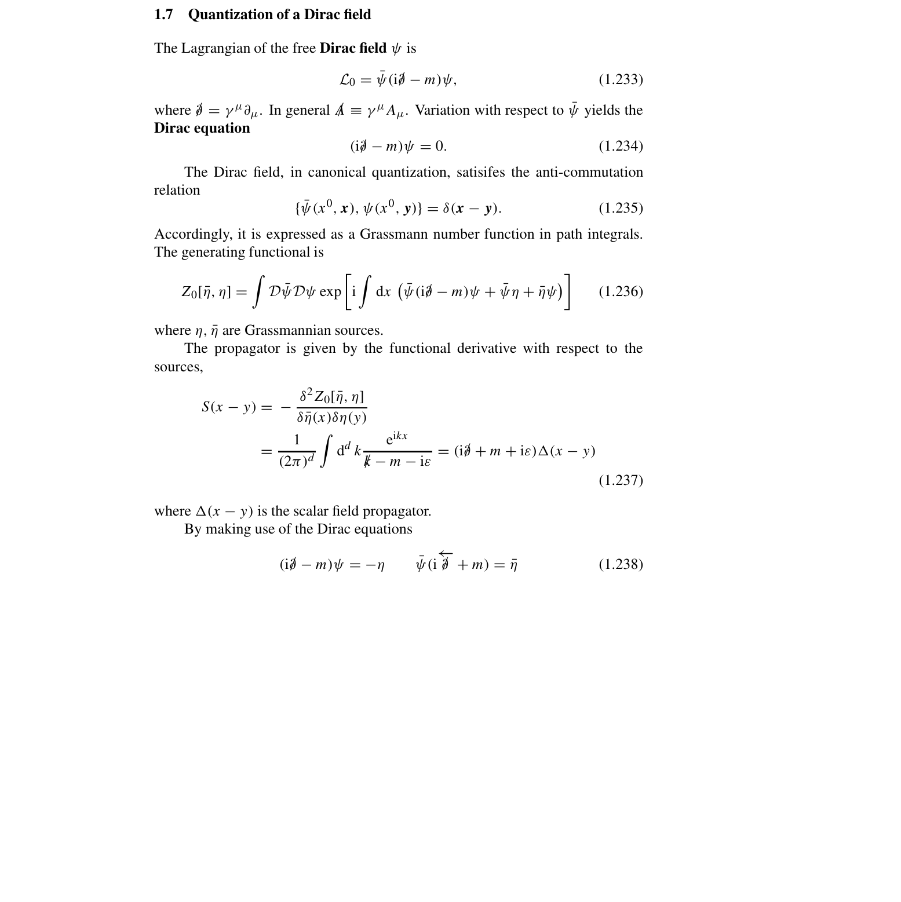
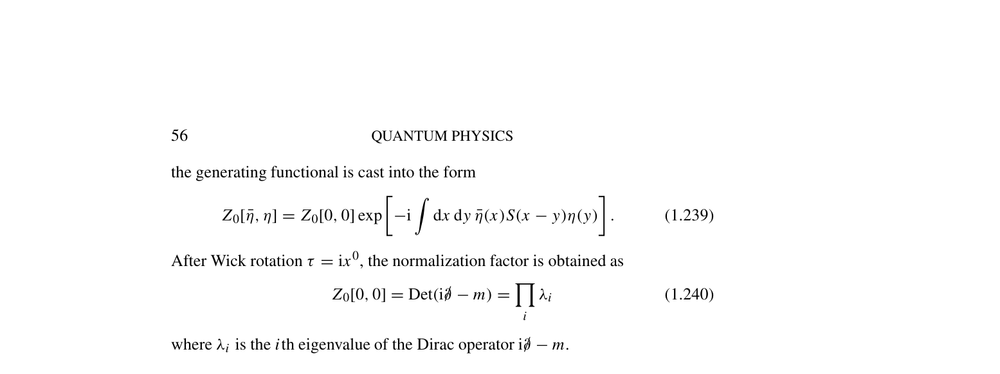

# 1.7 Quantization of a Dirac field｜Dirac 场的量子化

[总目录](README.md) · [上一小节](19-1.6.2.md) · [下一小节](21-1.8.1.md)

Dirac 场在此只用两页概述。对只有高中物理背景的读者，必须补上“自旋、矩阵微分算符、反交换积分”这三件事各自承担的任务，才不至于只看到公式更换字体。

## 原书第 55 页：原文底本

以下影印块是本小节在该页的完整原文；相邻小节在同页交接时按标题分界。PDF 页码为 78。

## 第 55 页句读与集注

### 句读式 (1.233)–(1.234)：为什么不继续用一个标量？

标量在时空坐标变换下没有额外的内部方向分量；Dirac 场则是旋量，具有与 Lorentz 变换相容的分量变换规律，用来描述电子这一类自旋 $1/2$ 的相对论性自由度。自旋不是一颗带电小球真的绕自身表面旋转；它是量子态对空间转动的特定响应。

一个常见动机是希望把相对论能量关系写成对时间、空间都一阶的方程。普通数字系数无法同时处理不同方向的平方和及交叉项，于是引入矩阵 $\gamma^\mu$，用 Clifford 反对易关系消去交叉项。旋量是这些矩阵作用的对象；它不是把普通空间三维向量简单增加一个分量。

对自旋 $1/2$，沿选定轴测量自旋投影时有两种结果，可用两个复振幅表示。旋转这些振幅使用 $SU(2)$ 矩阵；旋转 $2\pi$ 时旋量可变号，旋转 $4\pi$ 才回到原向量。单独的整体变号不改变概率，但在比较有不同旋转历史的相干分量时，相对符号能够进入干涉。这比把自旋想成小球转速更贴近其测量意义。四分量 Dirac 旋量还将相对论所需的粒子、反粒子结构组织在一起；不能仅由“四分量”就把每个分量解释成四个独立空间方向。

若采用常见的 $(+---)$ 演示约定，

$$
\{\gamma^\mu,\gamma^\nu\}=2\eta^{\mu\nu},\qquad
(i\gamma^\mu\partial_\mu+m)
(i\gamma^\nu\partial_\nu-m)=-(\Box+m^2).
$$

因此 Dirac 方程的每个分量也满足相应 Klein–Gordon 方程。但反过来不成立：Dirac 方程还包含自旋及分量之间的一阶约束。

这里特意声明演示约定，因为本书其他段落使用 $(-+++)$；更换度规时 $\gamma$ 与质量项记法也要相容。不能只把一个章节的 $\Box$ 符号搬进另一套 $\gamma$ 约定而不检查平方关系。

### 疏：bar、slash 与独立变分分别是什么意思？

$\not\!\partial=\gamma^\mu\partial_\mu$ 是缩写。$\bar\psi$ 是按相应度规与 $\gamma$ 约定定义的 Dirac 伴随，作用是让 $\bar\psi\psi$ 等双线性量具有需要的时空变换性质；它一般不等于简单逐分量复共轭。

推导方程及 Grassmann 积分时，$\psi,\bar\psi$ 作为独立变量处理。对 $\bar\psi$ 变分直接得到 $(i\not\!\partial-m)\psi=0$；对 $\psi$ 变分得到伴随方程。独立变分是技术安排，不是声称实验中电子场与其伴随毫无关系。

### 校读式 (1.235)：反对易关系的自旋指标不能全省略

通常正则等时关系写成

$$
\{\psi_\alpha(t,\mathbf x),
\psi_\beta^\dagger(t,\mathbf y)\}
=\delta_{\alpha\beta}\delta^{(3)}(\mathbf x-\mathbf y).
$$

若改用 $\bar\psi$，右边要带由伴随定义引入的 $\gamma^0$ 等矩阵结构，并注意指标和次序。原文把 $\{\bar\psi,\psi\}$ 直接写成标量 δ，只能当高度简写，不能当所有分量都共享的完整等式。

### 句读式 (1.236)–(1.238)：为什么源也必须是奇量？

$\bar\psi\eta+\bar\eta\psi$ 要与作用量其他项一样是偶元素，所以 $\eta,\bar\eta$ 也是 Grassmann 奇源。源导数插入场，交换导数次序产生费米负号。传播子现在是旋量分量之间的矩阵核，不再只是一个标量函数。

形式上的 $1/(\not k-m-i\epsilon)$ 指矩阵逆，并带着相应极点处方。可用另一个 Dirac 算符乘在标量 Green 核上来构造它，这就是式 (1.237) 将费米传播子连到标量传播子的结构。具体 $i$ 与质量符号要从一套完整约定核对；不能把未标 $J=0$、未写无源归一化的源导数式直接当作全部信息。

## 原书第 56 页：原文底本

以下影印块是本小节在该页的完整原文；相邻小节在同页交接时按标题分界。PDF 页码为 79。

## 第 56 页句读与集注

### 句读式 (1.239)–(1.240)：形式为什么再次如此熟悉？

记 Dirac 二次算符为 $D$。Grassmann 完成平方后，

$$
Z[\bar\eta,\eta]
=Z[0,0]\,e^{-i\int\bar\eta S_F\eta},
\qquad Z[0,0]\propto\det D
$$

（整体因子和相位按约定）。逆算符负责源之间的关联，行列式负责无源涨落。它与标量场的区别不是“有没有 Gaussian”，而是 Gaussian 所处代数不同，因此费米给 det，实玻色给 det 的倒平方根。

场论的 Det 仍需要边界条件和正则化；自由振子学过的教训没有消失。若只计算归一化自由关联，无源因子常被约掉；若背景场改变、要研究有效作用量，这个行列式可能携带重要背景依赖，不能随意称为无关常数。

### 集注：这一节可以带走的物理直观

Dirac 场的自旋结构由旋量与 Clifford 代数承担，费米统计由反对易关系承担，路径积分用 Grassmann 变量记录这些交换符号。三者彼此相连，却不是同一句话。

你不需要在这一页立即掌握所有自旋表示、反粒子和散射计算，但应能说明：为什么场需要多个分量，为什么求逆的是矩阵微分算符，以及为什么自由费米场会出现行列式。这些已经足够衔接下一节的带电场与规范耦合。

---

[总目录](README.md) · [上一小节](19-1.6.2.md) · [下一小节](21-1.8.1.md)
