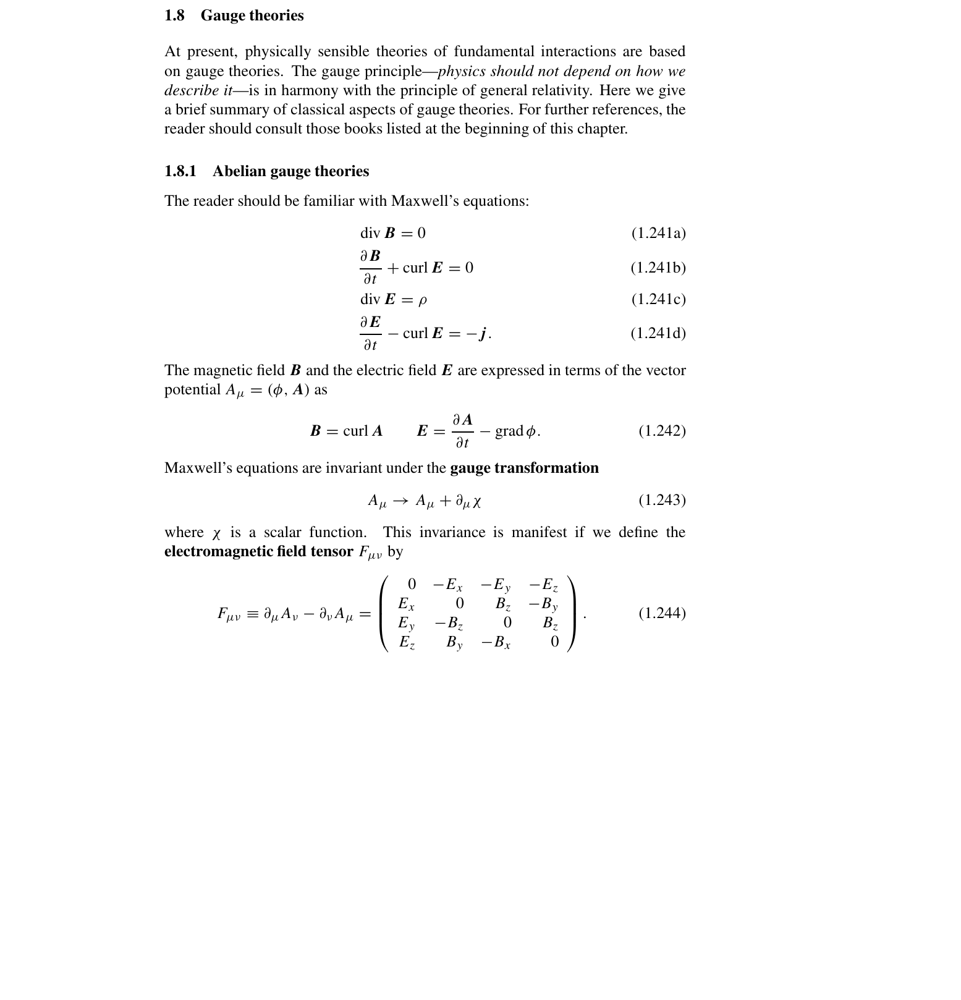
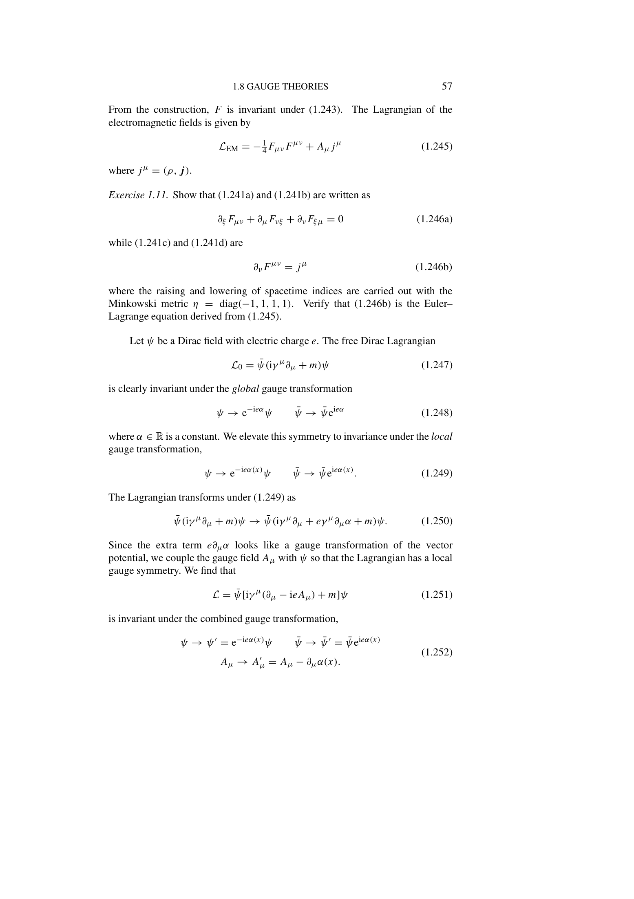
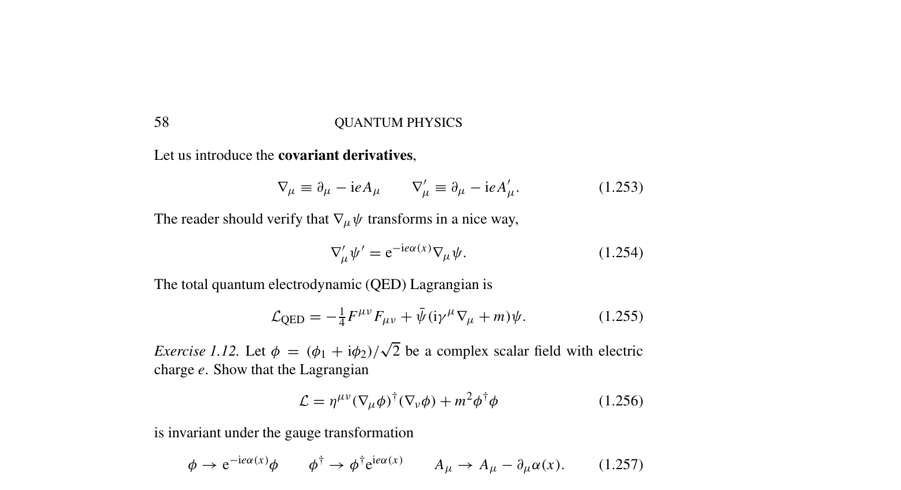

# 1.8.1 Abelian gauge theories｜电磁场与阿贝尔规范理论

[总目录](README.md) · [上一小节](20-1.7.md) · [下一小节](22-1.8.2.md)

本文件包括 1.8 导言与 1.8.1。原文说读者应熟悉 Maxwell 方程，但你的物理背景到高中，因此这里把场、势、四维记号、规范与协变导数依次补出。

## 原书第 56 页：原文底本

以下影印块是本小节在该页的完整原文；相邻小节在同页交接时按标题分界。PDF 页码为 79。

## 第 56 页句读与集注

### 句读导言：“physics should not depend on how we describe it”

同一种物理情况可以有多种描述，理论预测不应依赖这种选择。规范理论把这种冗余组织成局部变换。但这句原则本身不足以推出自然界有哪些粒子、规范群是什么或相互作用强度是多少；仍须给出自由度、作用量并与实验比较。

规范变换通常是同一物理状态的描述变化，不能简单等同于“把实验装置实际旋转了一下”。全局物理对称与局部描述冗余之间也有区别；边界、全局变换和电荷问题会使这种区别更细致。本节先掌握局部表达的基本逻辑。

### 句读式 (1.241)：四条方程各在说什么？

电场 $\mathbf E$ 和磁场 $\mathbf B$ 的操作意义可以从带电试探粒子的受力读出：

$$
\mathbf F=q(\mathbf E+\mathbf v\times\mathbf B)
$$

（取相容单位）。电场作用不要求试探粒子正在运动；磁力与速度有关，并垂直于速度，因此纯磁力本身不改变非相对论质点的速率。

$\operatorname{div}\mathbf B=0$ 说通常电磁理论没有磁荷源：闭曲面磁通净值为零。它不是说磁场不存在，而是磁力线没有像电荷那样的起止源。

$\partial_t\mathbf B+\operatorname{curl}\mathbf E=0$ 是 Faraday 感应：变化的磁通与环绕的电场相关。用 Stokes 定理可写成闭回路电场环量等于磁通变化率的负值。

$\operatorname{div}\mathbf E=\rho$ 是 Gauss 定律，电荷密度决定电通量源。第四式 $\partial_t\mathbf E-\operatorname{curl}\mathbf B=-\mathbf j$ 是带位移电流的 Ampère 定律，说明电流与变化电场关联磁场的环绕结构。

四条式子合起来还给出电荷守恒：对第四式取散度，再用第三式，得 $\partial_t\rho+\nabla\cdot\mathbf j=0$。对无源场进一步取旋度，可得到以 $c$ 传播的波动方程；因此电磁场不只是远处电荷之间的即时受力记号，它本身有局域传播的动力学。

### 物理补注：为什么把电场、磁场装进时空张量？

相对运动的惯性观察者会用不同方式划分电场与磁场。一个观察者看到的静止电荷，在另一观察者看来成为运动电荷与电流；要使同一实验的受力、运动和光传播规律相容，电、磁不能当作两套完全独立而不变的三维对象。

狭义相对论把时间与空间的坐标变换联系起来。取 $x^0=ct$，度规 $(-+++)$ 对应间隔

$$
ds^2=-c^2dt^2+dx^2+dy^2+dz^2.
$$

这不是概率或能量；它是惯性观察者变换下保持的时空间隔。用同一个张量 $F_{\mu\nu}$ 组织电、磁分量，便能用统一变换律比较不同观察者的描述。它没有把真实时间变成普通的第四个空间方向；稍后的欧氏时间则是一项另外声明的数学变换。

### 疏式 (1.242)–(1.244)：为什么引入“势”？

先选常用三维约定：

$$
\mathbf B=\nabla\times\mathbf A,\qquad
\mathbf E=-\partial_t\mathbf A-\nabla\Phi.
$$

这样前两条 Maxwell 方程自动成立，余下两条再决定动力学。势的引入把部分微分约束转成定义恒等式；但势不唯一：

$$
\mathbf A\mapsto\mathbf A+\nabla\chi,\qquad
\Phi\mapsto\Phi-\partial_t\chi
$$

不改变 $\mathbf E,\mathbf B$。这种不唯一性就是电磁规范自由，不是实验预测的任意性。

**校记：**影印 (1.242) 的电场写成 $+\partial_t\mathbf A-\operatorname{grad}\phi$，与其 $\mathbf B=\operatorname{curl}\mathbf A$ 及 (1.241b) 不相容：代入后一般得到 $2\partial_t\mathbf B$ 而不是零。应对齐势与时间分量约定，不能直接沿用该正号。(1.244) 的空间反对称块中，第 3 行第 4 列应对应 $B_x$，印为 $B_z$，与第 4 行第 3 列 $-B_x$ 不匹配。

四维写法 $F_{\mu\nu}=\partial_\mu A_\nu-\partial_\nu A_\mu$ 把 $\mathbf E,\mathbf B$ 合在反对称张量中。$F$ 不变来自偏导交换。这里“张量”首先保证不同时空坐标下以相容方式描述同一电磁场；不是再引入六种独立于电、磁的新物理实体。

## 原书第 57 页：原文底本

以下影印块是本小节在该页的完整原文；相邻小节在同页交接时按标题分界。PDF 页码为 80。

## 第 57 页句读与集注

### 句读式 (1.245)–(1.246)：两类 Maxwell 方程为何地位不同？

$F=dA$ 自动给 $dF=0$，即无磁源与 Faraday 定律。这是定义结构带来的 Bianchi 恒等式。另一组含电流的方程来自作用量变分，是动力学。

以作者的 $F$ 和指标约定，变分 $-\frac14F_{\mu\nu}F^{\mu\nu}+A_\mu j^\mu$：

$$
\delta S=\int d^4x\,
(\partial_\mu F^{\mu\nu}+j^\nu)\delta A_\nu
$$

（略去边界项），等价于原文调换反对称指标后的 $\partial_\nu F^{\mu\nu}=j^\mu$。这解释了为什么只用一条紧凑变分方程，还不足以取代 $F=dA$ 所含的结构条件。

升降指标会改变时间分量的符号，不能把所有上下标都当成版式差异。对于 Maxwell 理论，作用量的正负号应与能量密度 $\frac12(E^2+B^2)$ 及所选度规相容。注中不把本页的符号与别处的相反度规直接拼接。

### 句读式 (1.248)–(1.250)：整体相位为何不够，局部相位又多出什么？

整体变换 $\psi\mapsto e^{-ie\alpha}\psi$，$\alpha$ 常数，导数不碰出额外项。若 $\alpha=\alpha(x)$，

$$
\partial_\mu(e^{-ie\alpha}\psi)
=e^{-ie\alpha}
(\partial_\mu\psi-ie\,\partial_\mu\alpha\,\psi).
$$

普通导数比较相邻点的分量时，把两处相位基准当成相同；一旦允许每点独立选相位，它就把“基准的变化”误算成了“物理场的变化”。

这个问题不局限于相位：在曲面上比较不同点的向量，也需要说明怎样搬运方向。规范场正提供内部空间的比较规则，后面几何语言称其为联络。这里先用导数的额外项实际看见需要什么补偿。

### 疏式 (1.251)–(1.252)：补偿项为什么采取这个形状？

采用本书本段约定，

$$
D_\mu=\partial_\mu-ieA_\mu,\quad
\psi'=e^{-ie\alpha}\psi,\quad
A_\mu'=A_\mu-\partial_\mu\alpha.
$$

将 $D_\mu'\psi'$ 展开，$-ie\partial_\mu\alpha$ 与规范场变换产生的 $+ie\partial_\mu\alpha$ 抵消，留下 $e^{-ie\alpha}D_\mu\psi$。这就是“协变”：导数后的对象与原场按同一种规则变换。

这里选择这种最小耦合，使带电物质与电磁势相互作用。再加入 Maxwell 动能项，规范场才有自己的传播。局部不变性约束耦合结构，但不能单凭描述冗余就断言所有可能的附加规范不变相互作用都不存在。

## 原书第 58 页：原文底本

以下影印块是本小节在该页的完整原文；相邻小节在同页交接时按标题分界。PDF 页码为 81。

## 第 58 页句读与集注

### 句读式 (1.253)–(1.255)：规范场怎样具有可观测后果？

虽然 $A$ 的具体表达可变，沿回路的搬运相位以及曲率仍含物理内容。由

$$
[D_\mu,D_\nu]\psi=-ieF_{\mu\nu}\psi
$$

可见，先沿 $\mu$ 再沿 $\nu$ 与相反顺序比较场，差别由 $F$ 决定。局部规范选择不改变这个电磁场。对足够小的闭回路，累积相位与穿过回路的场强通量相联系；这是后面磁单极子与联络观点的入口。

不能据“势不唯一”得出“势没有任何作用”。量子相位的平行比较可以在全局问题中携带不能由单个点的 $F$ 值概括的信息；下一节非阿贝尔理论会进一步强调搬运次序。

### 句读练习 1.12：为什么标量也能带电？

规范变换作用在内部相位上，不要求场一定有自旋 $1/2$。复标量同样可按 $\phi\mapsto e^{-ie\alpha(x)}\phi$ 变换，使用同一个协变导数；$(D_\mu\phi)^\dagger D_\nu\phi$ 中相位彼此抵消，从而可构造规范不变项。

这道练习要求检查不变性，不等于它列出的全部动能、质量符号已经与前面 $(-+++)$ 的标量作用量约定自动一致。对物理稳定性还需单独检查时间动能与能量的符号。“规范不变”是约束之一，不是理论正确性的全部条件。

**回看问题：**E、B 各自怎样通过受力定义？哪组 Maxwell 方程来自 $F=dA$，哪组来自变分？局部相位为什么使普通导数多出一项？规范场为何可以理解为比较相邻点内部状态的规则？

---

[总目录](README.md) · [上一小节](20-1.7.md) · [下一小节](22-1.8.2.md)
