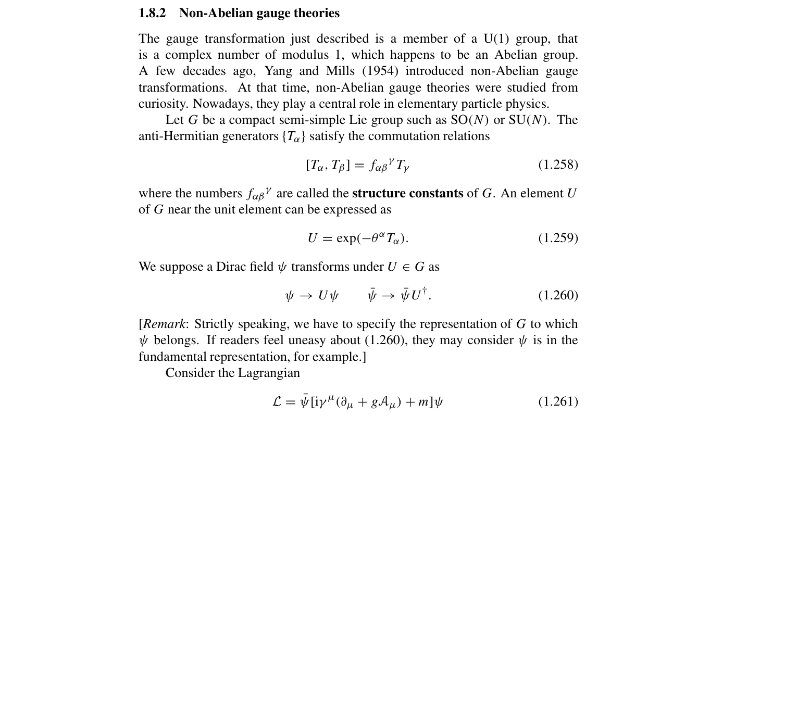
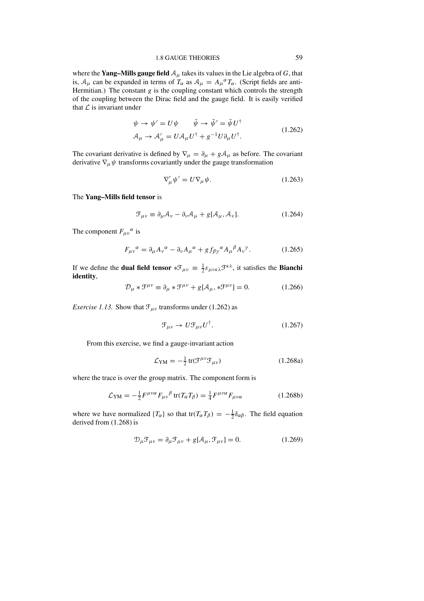

# 1.8.2 Non-Abelian gauge theories｜非阿贝尔规范理论

[阅读目录](README.md) · [上一小节](21-1.8.1.md) · [下一小节](23-1.8.3.md)

**这一节在做什么：把“每点选一个相位角”推广成“每点可对多个内部分量作矩阵变换”。**新的关键是矩阵变换可能不交换，因此先后次序本身带来物理结构。

## 原书第 58 页：原文底本

本块保留该页属于本小节的完整原文。PDF 阅读器页码为 81。

## 第 58 页：先说目的，再逐步解读

### 一、为什么从一个复相位变成一组矩阵？

**这段在干什么：**解释 non-Abelian 的基本差别，不让名称先于例子。

上一节的 $U(1)$ 变换相当于乘单位复数。先转角 $\alpha$ 再转角 $\beta$，和反过来一样，称为阿贝尔。

若场有多个内部分量，可以用矩阵混合这些分量。矩阵 $U,V$ 可能满足 $UV\ne VU$，于是变换先后次序不同，结果也不同。这叫非阿贝尔。

这里“内部”指场分量所在的空间，不一定是实际三维空间方向。例如两个复分量可以构成 $SU(2)$ 的一个基本表示；它们究竟代表什么物理量，需要由模型说明。

### 二、Lie 代数与表示在这页各做什么？

**这段在干什么：**读懂式 (1.258)–(1.261)，区分群自身的规则与它作用在哪种场上。

连续矩阵群靠近单位元时，由生成元 $T_\alpha$ 描述小变化。它们的交换子

$$
[T_\alpha,T_\beta]=f_{\alpha\beta}{}^\gamma T_\gamma
$$

记录不同小变换不交换的程度。$f$ 是在所选基下的结构常数。

“表示”回答的是这些抽象变换具体用什么矩阵作用在 $\psi$ 上。群相同，选择不同表示，场的分量数和变换方式可以不同。因此原文提醒必须指定表示，是在补充具体模型需要的数据。

作者用反 Hermitian 生成元，指数后得到酉变换。其他书常把 $i$ 放到别处，这只是成套约定不同，不能单独混用。

## 原书第 59 页：原文底本

本块保留该页属于本小节的完整原文。PDF 阅读器页码为 82。

## 第 59 页：先说目的，再逐步解读

### 三、为什么规范势的变换不只是普通矩阵换基？

**这段在干什么：**从目标 $D'\psi'=UD\psi$ 推出式 (1.262)，说明导数项的必要性。

取 $D_\mu=\partial_\mu+g\mathcal A_\mu$、$\psi'=U(x)\psi$。展开 $\partial_\mu(U\psi)$ 会多出 $(\partial_\mu U)\psi$。

因此为了让 $D'\psi'=UD\psi$，必须安排

$$
\mathcal A_\mu'
=U\mathcal A_\mu U^{-1}
-\frac1g(\partial_\mu U)U^{-1}.
$$

第一项是普通换基；第二项补偿基准随位置变化。它正是上一节相位补偿的矩阵版本。

你可以自己把它代回去：所有额外导数项抵消，只留下 $UD_\mu\psi$。这是理解变换律最有效的 A 级练习。

### 四、场强为什么非得多一个交换子？

**这段在干什么：**解释式 (1.264) 的新项，说明它不是随意添加的非线性修正。

直接计算两个协变导数的交换子：

$$
[D_\mu,D_\nu]
=g\left(\partial_\mu\mathcal A_\nu-\partial_\nu\mathcal A_\mu
+g[\mathcal A_\mu,\mathcal A_\nu]\right).
$$

括号内定义为 $\mathcal F_{\mu\nu}$。

若两个内部搬运矩阵不交换，先沿一个方向再沿另一个方向，与反过来会留下差别。最后的交换子正好记录这项差别。阿贝尔情形它为零，便退回电磁公式。

因为 $\mathcal F$ 已含势的二次项，再写 $\mathcal F^2$ 就有三次、四次势项。这使规范场能够自相互作用，不再只是线性 Maxwell 理论。

### 五、为什么场强分量会变，作用量仍能不变？

**这段在干什么：**说明式 (1.267)–(1.269) 如何组成与内部基准无关的动力学。

场强按 $\mathcal F'=U\mathcal F U^{-1}$ 变化。单个矩阵分量不必不变，但

$$
\operatorname{tr}(\mathcal F'\mathcal F')
=\operatorname{tr}(\mathcal F\mathcal F)
$$

利用 trace 的循环性质不变。因此可拿这个组合建作用量。

由场强定义自动成立的是 Bianchi 恒等式；由作用量变分得到的是 Yang–Mills 方程。前者是结构关系，后者是具体运动规律，仍须分开。

反 Hermitian 矩阵的平方 trace 一般非正，欧氏正能量型表达要配 $-\operatorname{tr}$。这个约定到瞬子平方不等式时尤其重要。

复习时抓住三问：矩阵为什么不交换？普通导数换基多了什么？闭回路比较留下什么？回答清楚，就是非阿贝尔联络与曲率的物理起点。

---

[阅读目录](README.md) · [上一小节](21-1.8.1.md) · [下一小节](23-1.8.3.md)
