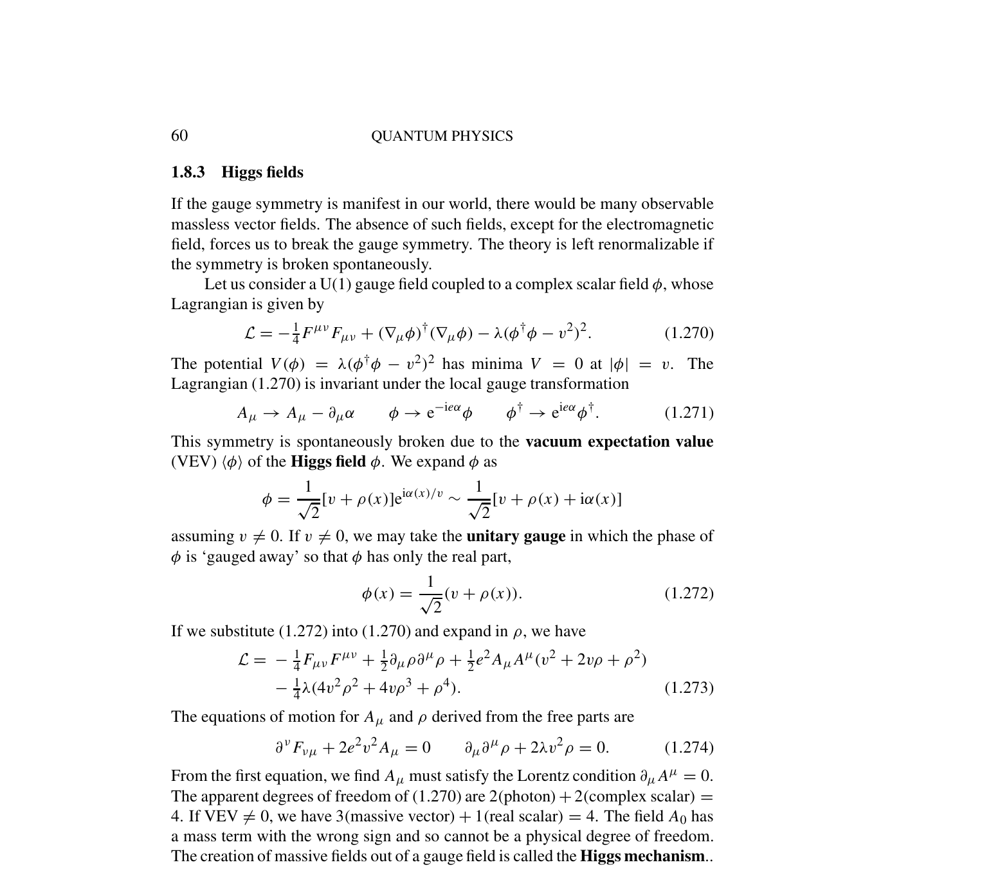

# 1.8.3 Higgs fields｜Higgs 场与质量

[阅读目录](README.md) · [上一小节](22-1.8.2.md) · [下一小节](24-1.9.1.md)

**这一节在做什么：说明一个原本用规范场描述的矢量激发，怎样在与标量场耦合后表现出质量。**先弄清“质量”在这里意味着能量关系，而不是穿过介质的摩擦。

## 原书第 60 页：原文底本

本块保留该页属于本小节的完整原文。PDF 阅读器页码为 83。

## 第 60 页：先说目的，再逐步解读

### 一、为什么不能直接随手加一个矢量质量项？

**这段在干什么：**解释本节开头提出的困难。

对电磁势直接加 $m_A^2A_\mu A^\mu/2$，一般会破坏上一节的局部规范不变写法。但是我们又希望某些理论的矢量激发具有非零静止能量。

Higgs 机制的任务是：让有质量的谱从一个完整规范理论中出现，而不是先把前面费力建立的结构丢掉。

原文给的是一个简化 $U(1)$ 例子。不能据此把所有非阿贝尔质量问题都归为同一个机制。

### 二、势能最低点为什么是一圈？

**这段在干什么：**解释式 (1.270) 的真空结构，以及径向变化与相位变化的差别。

复标量 $\phi$ 可在复平面画成一个点。若势能是 $\lambda(|\phi|^2-v_0^2)^2$，$\lambda>0$，则所有长度为 $v_0$ 的点势能最低，组成一个圆。

离开这圈向内或向外走，会增加势能；沿圈转，只改相位，势能不变。

如果这个相位属于局部规范选择，圆上的不同取向并不全是可测量不同的物理真空。固定一种写法后谈“自发破缺”很常见，但不能把描述冗余本身理解成一条被实验破坏的物理规律。

### 三、质量项到底从哪一步算出来？

**这段在干什么：**把式 (1.272)–(1.273) 的代入展开写清，而不靠“场吃掉相位”的说法跳过计算。

为避免本页 $v$ 的归一化冲突，采用一致的一套：

$$
\phi=\frac{v+h}{\sqrt2}e^{i\vartheta/v},\qquad
V=\lambda\left(|\phi|^2-\frac{v^2}{2}\right)^2.
$$

$h$ 描述离最低圆向内、外偏离多少；$\vartheta$ 描述沿圆转了多少。代入协变导数，得到

$$
|D_\mu\phi|^2=
\frac12(\partial_\mu h)^2+
\frac12(v+h)^2
\left(\frac{\partial_\mu\vartheta}{v}-eA_\mu\right)^2.
$$

选一个规范把相位代表移去，二次部分便含

$$
\frac12e^2v^2 A_\mu A^\mu.
$$

这就是矢量质量项，对应 $m_A=|e|v$。势能的二次部分给标量 $h$ 的质量 $m_h^2=2\lambda v^2$。放入完整 Lorentz 拉格朗日量时，整体符号仍要与度规一致。

**因此质量不是凭空加到答案里，而是协变导数展开后出现的二次系数。**

### 四、为什么说少掉的相位变成了一个纵向自由度？

**这段在干什么：**解释本页最后的自由度计数，替代一句容易神秘化的“吃掉”。

四维里无质量矢量有两个物理横向极化；复标量有两个实自由度。原来一共四个。

质量生成后，矢量有三个极化，多出纵向一种；剩下一个径向实标量，仍一共四个。因此没有凭空删除一个物理自由度，而是在规范约束下重新组合。

如果只是全局相位对称、没有规范场，沿最低圆的变化通常会留下独立的 Goldstone 模；这里不能把那种情形直接照搬。

质量也不是摩擦。一个有质量自由粒子在真空中不必越来越慢；质量说的是能量、动量及静止能量的关系。

### 五、这一页怎样复习，哪些印式不能直接沿用？

**这段在干什么：**总结计算顺序，并保护你不被本页系数冲突卡住。

原文先说最低半径为 $v$，却用 $(v+\rho)/\sqrt2$ 在 $\rho=0$ 展开，前后最低点不一致；矢量方程的质量系数也与印出的二次项不符。详细核对见附录，主线按上面明确约定计算。

A 级是会复述：选择非零最低半径 → 展开径向与相位 → 协变导数把相位、势结合 → 选规范后显出矢量质量 → 自由度总数保持一致。完整约束分析和量子重整化为 B/C，当前不要求只靠这一页全懂。

---

[阅读目录](README.md) · [上一小节](22-1.8.2.md) · [下一小节](24-1.9.1.md)
