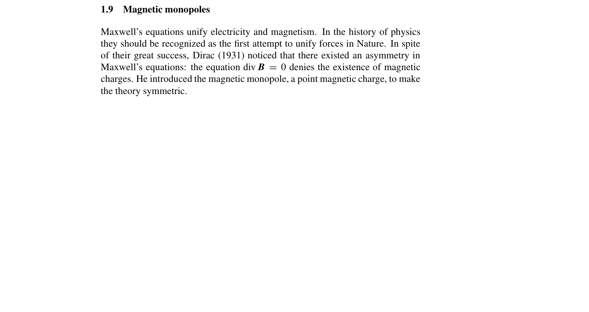
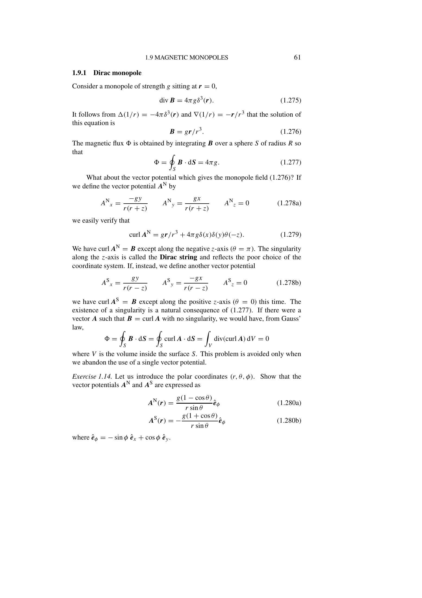

# 1.9.1 Dirac monopole｜Dirac 磁单极子

[总目录](README.md) · [上一小节](23-1.8.3.md) · [下一小节](25-1.9.2.md)

本文件保留 1.9 导言与 1.9.1。磁单极子在此首先是一种假设的磁荷配置；本章研究它若存在，电磁势和带电波函数必须满足怎样的一致性条件。

## 原书第 60 页：原文底本

以下影印块是本小节在该页的完整原文；相邻小节在同页交接时按标题分界。PDF 页码为 83。

## 第 60 页句读与集注

### 句读导言：电、磁的不对称到底是什么？

普通 Maxwell 方程有 $\nabla\cdot\mathbf E=\rho$，却有 $\nabla\cdot\mathbf B=0$。电场可以有电荷源，磁场却没有对应的独立磁荷源。这不是指磁铁没有南北端，而是切开普通磁铁仍会得到具有两端的磁体，不能仅凭切割分离出一个独立磁荷。

Dirac 考察若允许点磁荷，会对量子理论带来什么限制。这个理论问题有价值，不需要先把磁荷当作前面方程已证明存在的对象。物理理论也经常通过研究可能配置及其一致性，发现数学结构与量子化条件。

下一页的 $g$ 是按磁通定义的磁荷强度，满足总磁通 $4\pi g$。因不同电磁单位制会改变 $4\pi,c$ 的位置，后面恢复单位时要跟随同一套磁荷归一化，不应把不同教材的 $g$ 直接当同一个数值。

## 原书第 61 页：原文底本

以下影印块是本小节在该页的完整原文；相邻小节在同页交接时按标题分界。PDF 页码为 84。

## 第 61 页句读与集注

### 句读式 (1.275)–(1.277)：为什么 B 是径向反平方场？

假设原点有点磁荷，且空间各方向等价。场只能径向，写 $\mathbf B=b(r)\hat{\mathbf r}$。对半径 $R$ 球面，通量为 $4\pi R^2b(R)$；若包围的磁荷固定，通量与 $R$ 无关，便得到

$$
\mathbf B=g\frac{\mathbf r}{r^3},\qquad
\int_{S^2}\mathbf B\cdot d\mathbf S=4\pi g.
$$

在原点以外散度为零；δ 分布把原点的源记录下来。不要把“在穿孔空间处处散度零”误解为“包围原点的闭面通量必为零”，因为散度定理所需的整个内部区域不再无奇点。

### 疏式 (1.278)–(1.280)：为什么场光滑而势却有一条线出问题？

原文的两种势在球坐标中为

$$
\mathbf A_N=\frac{g(1-\cos\theta)}{r\sin\theta}\hat{\mathbf e}_\varphi,
\quad
\mathbf A_S=-\frac{g(1+\cos\theta)}{r\sin\theta}\hat{\mathbf e}_\varphi.
$$

在北极附近，$1-\cos\theta\sim\theta^2/2$，所以 $\mathbf A_N$ 的系数趋于零；它在南极方向却奇异。$\mathbf A_S$ 正好相反。场 $\mathbf B$ 在固定半径球面上完全光滑，势的坏处并不是场在该方向真的突然发散。

计算旋度的径向分量可核对：

$$
(\nabla\times\mathbf A_N)_r
=\frac1{r\sin\theta}\partial_\theta
(\sin\theta\,A_{N,\varphi})
=\frac g{r^2}.
$$

这条计算只在该势定义良好的区域使用。若把它强行当作全空间带奇异线的分布势，会出现与 Dirac string 有关的额外分布项。原文 (1.279) 的字符串项需连同方向理解；不能把这个人为奇异线的全部旋度都直接当作想要的纯径向磁场。

### 句读“abandon the use of a single vector potential”：问题究竟是坐标还是拓扑？

“poor choice of coordinate system”容易让人以为换一套好坐标就能找到全球光滑势。实际更强：当通量非零时，不存在覆盖整个球面的单个光滑势一形式。

把磁场通量写成球面上的二形式 $F$。若有全局一形式 $A$ 满足 $F=dA$，由于球面没有边界，

$$
\int_{S^2}F=\int_{S^2}dA=\int_{\partial S^2}A=0,
$$

与 $4\pi g\ne0$ 矛盾。这一论证只在球面上用 Stokes 定理，不必假设势可以光滑延拓到原点内部；因此比单靠原文的体积散度论证更直接地揭示全局障碍。

局部上仍可以写 $F=dA$，全局上却不能。这不是微分运算出了错，而是“闭形式”不一定“恰当形式”。你以后读 de Rham 上同调时，便会看到它系统记录这种差别。

### 集注：物理直观怎样过渡到数学？

高中的磁通概念问“有多少场穿过闭面”；这里发现一个非零整体通量，无法由全球光滑势产生。于是不得不使用局部描述，并研究局部描述怎样拼接。纤维丛不是为了装饰电磁公式而外加的抽象语言，而是为这个拼接问题准备的。

**回看问题：**原点外散度为零为什么不排除非零通量？两种势各在哪个区域光滑？Dirac string 为什么不等同于一根实际磁性细线？Stokes 定理怎样证明全局光滑势不存在？

---

[总目录](README.md) · [上一小节](23-1.8.3.md) · [下一小节](25-1.9.2.md)
