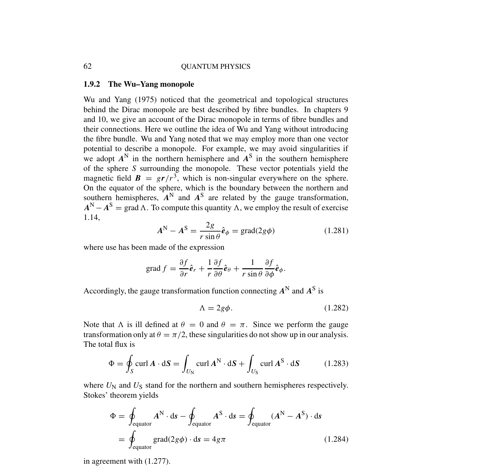

# 1.9.2 The Wu-Yang monopole｜Wu–Yang 拼接

[总目录](README.md) · [上一小节](24-1.9.1.md) · [下一小节](26-1.9.3.md)

## 原书第 62 页：原文底本

以下影印块是本小节在该页的完整原文；相邻小节在同页交接时按标题分界。PDF 页码为 85。

## 第 62 页句读与集注

### 句读开头：为什么“两张图”足以去掉奇异线？

不要只取不相交的南、北开半球，否则赤道没有共同定义域。应取稍大于半球的两个开集，使它们在赤道附近有一条重叠带：$A_N$ 用在避开南极的一片，$A_S$ 用在避开北极的一片。各自内部都没有 Dirac string。

重叠处两个势产生相同磁场，所以不是两个不同物理磁场，而是同一场的两套局部描述。要使带电物质也被一致描述，就还需要规定两片波函数之间的相位转换。下一小节会从这个要求得到量子化条件。

### 句读式 (1.281)–(1.282)：差值为何是一个梯度？

直接相减：

$$
\mathbf A_N-\mathbf A_S
=\frac{2g}{r\sin\theta}\hat{\mathbf e}_\varphi
=\nabla(2g\varphi).
$$

这里 $\varphi$ 是方位角，不是上一节标量场 $\phi$。局部规范函数可写 $\Lambda=2g\varphi$。但方位角绕一圈增加 $2\pi$，所以 $\Lambda$ 也增加 $4\pi g$；它不是覆盖整条赤道的单值实函数。

原文只强调两极不良定义，还应补上这项绕圈多值性。$\nabla\varphi$ 在重叠带局部有明确意义，而 $\varphi$ 自身需要分支。正是这种局部梯度与全球单值之间的区别，保存了非零通量。

### 疏：改写成一形式，半径因子为何消失？

沿球面有 $d\mathbf r=r\,d\theta\,\hat{\mathbf e}_\theta+
r\sin\theta\,d\varphi\,\hat{\mathbf e}_\varphi$。所以

$$
A_N=g(1-\cos\theta)d\varphi,\qquad
A_S=-g(1+\cos\theta)d\varphi,
$$

两者差 $2g\,d\varphi$。对应曲率

$$
F=dA_N=dA_S=g\sin\theta\,d\theta\wedge d\varphi.
$$

这把局部联络与全局曲率的关系写得很清楚。向量场分量中的 $1/(r\sin\theta)$ 来自坐标基的尺度，不是物理耦合忽然少了一项。

### 句读式 (1.283)–(1.284)：为什么两半球相加不会抵消？

对两片分别用 Stokes 定理，赤道的诱导方向相反，于是

$$
\int_{S^2}F
=\oint_{\rm eq}A_N-\oint_{\rm eq}A_S
=\oint_{\rm eq}2g\,d\varphi
=4\pi g.
$$

若是同一个全球 $A$，边界项会抵消；现在两片用不同局部势，差值留下了非零量。不能把最后一步写成“闭曲线上梯度积分必为零”，因为那个定理要求势函数全球单值，而 $\Lambda=2g\varphi$ 正不满足。

### 集注：纤维丛的骨架已经出现

每个点附带一个可选相位基准；在每片上可以选一套基准，重叠带上用 $U(1)$ 变换连接。局部势是这套基准下的联络表达，曲率是两片共同的物理场。

这比“球面必须用多张坐标图”多了一层：底空间坐标只是位置的描述，纤维方向还记录内部相位基准。两者都会用覆盖与拼接，但不能仅以地球经纬度的类比完全替代规范丛。

**回看问题：**为什么覆盖需要重叠？$\Lambda$ 局部存在为何不意味着全球单值？两半球的边界取向为何相反？哪一步使通量在局部势的拼接中被保存下来？

---

[总目录](README.md) · [上一小节](24-1.9.1.md) · [下一小节](26-1.9.3.md)
