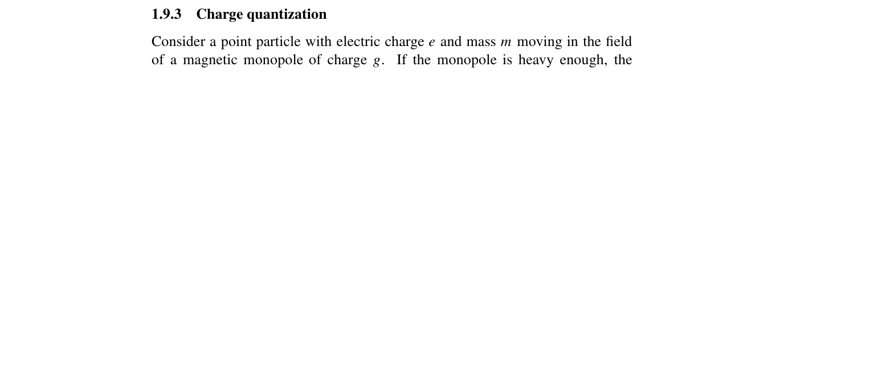
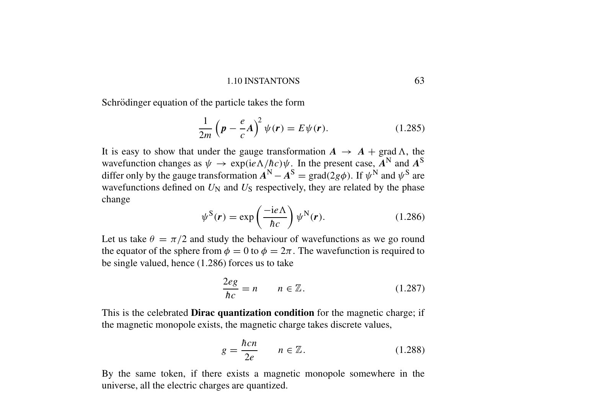

# 1.9.3 Charge quantization｜电荷量子化

[阅读目录](README.md) · [上一小节](25-1.9.2.md) · [下一小节](27-1.10.1.md)

**这一节在做什么：要求带电粒子的量子态也能跨过两片一致拼接，由此限制电荷与磁荷的乘积。**

## 原书第 62 页：原文底本

本块保留该页属于本小节的完整原文。PDF 阅读器页码为 85。

## 第 62 页：先说目的，再逐步解读

### 一、为什么研究磁荷时还要放进一个电荷？

**这段在干什么：**说明本节的量子化条件多用了什么物理输入。

仅写径向磁场时，经典方程可以先让磁荷参数取连续值。现在放进一个电荷 $e$ 的量子粒子，它的波函数要在北片、南片都能算出相同实验结果。

因此除了拼接势，还要拼接波函数。量子相位的规则将对允许的 $e,g$ 产生限制。

假设磁荷很重，是为了先把它当成固定背景，不同时计算它的反冲和运动。

## 原书第 63 页：原文底本

本块保留该页属于本小节的完整原文。PDF 阅读器页码为 86。

## 第 63 页：先说目的，再逐步解读

### 二、为什么两个局部波函数可以不同，却仍描述同一个状态？

**这段在干什么：**解释式 (1.285)–(1.286) 的联合规范变化。

带电粒子的动能使用

$$
H=\frac1{2m}\left(-i\hbar\nabla-\frac ec\mathbf A\right)^2.
$$

改变势时，波函数也按相应相位变化，才能保持同一个物理问题。两片满足

$$
\psi_S=e^{-ie\Lambda/(\hbar c)}\psi_N,\qquad
\Lambda=2g\varphi.
$$

前面的相位因子长度为 1，所以两片概率密度相同。局部函数数值不必完全一样，因为使用的相位基准不同。

这个相位因子叫过渡函数。它不是新的概率，只是在告诉你从一种局部写法怎样换到另一种。

### 三、为什么绕一圈会逼出整数？

**这段在干什么：**从式 (1.286) 直接推导式 (1.287)，让整数有明确来源。

沿赤道走一圈，$\varphi$ 增加 $2\pi$，回到同一个空间点。两片之间的转换关系也必须回到同一个值，否则在同一点会出现互不一致的描述。

因此相位因子的总变化必须为 1：

$$
e^{-ie(4\pi g)/(\hbar c)}=1.
$$

复平面上的箭头转 $2\pi n$ 才回到原方向，所以

$$
\frac{4\pi eg}{\hbar c}=2\pi n,
\qquad
\boxed{\frac{2eg}{\hbar c}=n\in\mathbb Z.}
$$

整数不是预先放进磁场的条件，而是“绕一圈仍描述同一物理状态”逼出来的。

### 四、它为什么也是拓扑的绕数？

**这段在干什么：**将量子相位计算接到后面会学的同伦与 Chern 数。

赤道本身是圆，相位也在单位圆上。过渡函数于是把一个圆映到另一个圆。沿赤道走一圈时，目标相位绕几圈，就是一个整数。

连续改变局部写法，不能在保持条件时随意把整数圈数变成半圈。因此允许的拼接分成整数类别。

以相应定向和单位归一化，这也可写成

$$
\frac e{2\pi\hbar c}\int_{S^2}F\in\mathbb Z,
$$

以后称为第一 Chern 数。名字只是把今天的通量与绕圈计算系统化。

### 五、这一节复习：结论到底依赖什么假设？

**这段在干什么：**避免把有条件的一致性结论误读成磁单极子已经被证明存在。

假如同一理论有固定非零磁荷 $g$，每种电荷都必须满足相应整数条件，因此电荷被限制在一个公共离散单位上。这个结论以磁荷和量子拼接规则为前提。

A 级要求是会从相位绕圈写出上述三行推导，并说明限制的是 $eg$，不是脱离单位直接说 $g$ 本身为整数。正式丛与 Chern 类的定义可作 B 级后续学习。

---

[阅读目录](README.md) · [上一小节](25-1.9.2.md) · [下一小节](27-1.10.1.md)
