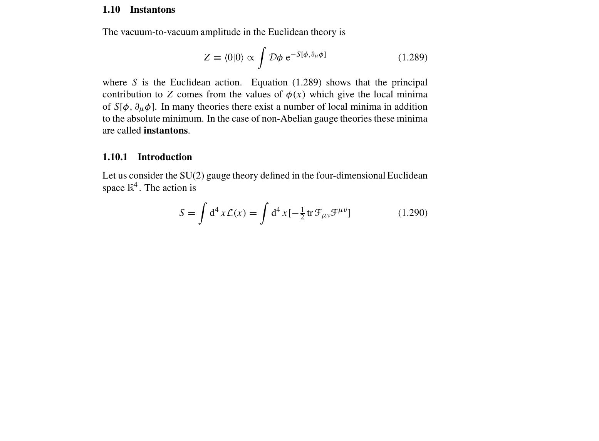

# 1.10.1 Introduction｜瞬子与拓扑扇区

[总目录](README.md) · [上一小节](26-1.9.3.md) · [下一小节](28-1.10.2.md)

本文件包括 1.10 导言与 1.10.1。瞬子把前面的欧氏路径积分、非阿贝尔曲率和全球拓扑放在一起。先弄清研究的对象，公式才不会变成彼此孤立的名词。

## 原书第 63 页：原文底本

以下影印块是本小节在该页的完整原文；相邻小节在同页交接时按标题分界。PDF 页码为 86。

## 第 63 页句读与集注

### 句读式 (1.289)：为什么又回到欧氏时间？

真实时间权重是 $e^{iS/\hbar}$，经典极限靠驻相；欧氏时间权重是 $e^{-S_E/\hbar}$，可围绕有限作用量驻点研究半经典贡献。真空附近的小涨落给微扰理论；若存在不能从真空连续小变动得到的背景，还需要在这些背景附近另行展开。

一个有帮助的低维类比是双势阱的量子隧穿：真实时间经典轨迹可能无法跨越势垒，但欧氏方程可以有连接不同渐近真空的有限作用量轨迹，用来组织隧穿振幅。这解释“为什么找欧氏解”，却不意味着 Yang–Mills 瞬子就是一颗真的小球越过某条空间山坡。

### 疏：瞬子不是“寿命很短的一颗粒子”

这里研究四维欧氏时空中的场配置。它通常在空间与欧氏时间中都局域化，有有限作用量。它不是一个在真实三维空间中静止、随真实时间持续存在的经典粒子；那类对象更接近后文的某些孤子。

“instanton”这个名字容易使人联想到一个持续很短的实体，实际应从配置和边界条件理解。它在量子理论中的作用来自路径积分的不同半经典背景及其拓扑结构。

### 句读“local minima”：在哪个集合里取极小？

纯规范真空可以有零作用量；非零拓扑数瞬子的作用量却为正。因此不能说一个 $Q=1$ 瞬子是所有场配置中唯一的绝对最低点。自对偶解是在固定拓扑类别内达到作用量下界；不同类别不能通过保持相应边界条件的光滑小变形任意连通。

这里也可能有位置、尺度等连续参数，使“极小值”有平坦方向。它不是优化中一个 Hessian 严格正定的孤立极小点。下一节会把下界和参数说明白。

### 句读式 (1.290)：为什么强调四维与 SU(2)？

四维时，二形式的 Hodge 对偶仍是二形式，才能直接提出 $F=\pm *F$。$SU(2)$ 作为流形与 $S^3$ 同胚，恰好与四维空间无穷远的大球面 $S^3$ 发生关系；这种映射具有整数绕数。

因此“四维”“二形式曲率”“$SU(2)\cong S^3$”不是三个随手选择的标签，它们共同使本节最简单的瞬子拓扑与自对偶构造成立。别的群与维数也有相关结构，但不能把本页公式不改条件地平移过去。

## 原书第 64 页：原文底本

以下影印块是本小节在该页的完整原文；相邻小节在同页交接时按标题分界。PDF 页码为 87。

## 第 64 页句读与集注

### 句读式 (1.291)–(1.293)：有限作用量为什么牵涉无穷远？

欧氏作用量积分整个 $\mathbb R^4$。若场强在无穷远衰减不够快，体积因子会让积分发散。在本章考虑的光滑经典背景与常规渐近条件下，要求无穷远趋向平坦联络，即曲率趋零，势趋向纯规范。

原文说路径积分“只有有限作用量配置贡献”，对寻找半经典背景很有启发，但不能当作完整量子泛函测度的严格支撑定理。前面的粒子路径积分已经提醒过，典型积分配置可能粗糙，单独的经典作用量表达并不总逐点有意义。此处讨论的是可用于半经典分析的光滑有限作用量解。

### 校读“pure gauge”：需要一致的 Hermitian 约定

若取反 Hermitian 联络 $a$ 并将耦合吸收，曲率为

$$
f=da+a\wedge a.
$$

纯规范可以写 $a=U^{-1}dU$，Maurer–Cartan 恒等式给 $f=0$。若改用 Hermitian 势，公式中要加入相应 $i$ 和耦合常数。

本书本页一方面定义 $\mathcal A_\mu=A_\mu^\alpha\sigma_\alpha/(2i)$ 为反 Hermitian，另一方面 (1.293) 写 $iU^{-1}\partial_\mu U$，后者是 Hermitian，并且未与前文 $g$ 对齐。因此不能把该式直接代入同一套反 Hermitian 曲率就断言零。注中以明确的 $a,f$ 约定讲结构，原文照存以便核对。

### 疏：“S³ mapped to SU(2)” 怎样产生？

在 $\mathbb R^4$ 取很大的半径，固定半径后的方向组成三维球面 $S^3$。无穷远纯规范由每个方向上的群元素 $U(\Omega)$ 给出，因此有

$$
U:S^3_\infty\longrightarrow SU(2)\cong S^3.
$$

为什么 $SU(2)$ 会是三维球面？取 Pauli 矩阵

$$
\sigma_1=\begin{pmatrix}0&1\\1&0\end{pmatrix},\quad
\sigma_2=\begin{pmatrix}0&-i\\i&0\end{pmatrix},\quad
\sigma_3=\begin{pmatrix}1&0\\0&-1\end{pmatrix}.
$$

它们满足 $\sigma_i\sigma_j=\delta_{ij}I+i\epsilon_{ijk}\sigma_k$。一般 $SU(2)$ 元素可写 $U=a_0I+i\,a_i\sigma_i$，其中 $a_\mu$ 为实数且 $a_0^2+a_1^2+a_2^2+a_3^2=1$。四个实坐标受一个单位球面约束，正是 $S^3$。这里说的是群作为流形的形状，不是说它的乘法等于普通向量加法。

原文下一页的 $U=(x_4I-ix_i\sigma_i)/r$，就是把四维位置的单位方向变成这样的群元素。Pauli 恒等式保证 $U^\dagger U=I$，行列式为 1。于是看似突然出现的矩阵 ansatz，其实直接利用了两边相同的球面结构。

两幅映射若能连续变形，就属于同一同伦类；这些类由 $\pi_3(SU(2))\cong\mathbb Z$ 标记。整数描述覆盖方向球面的次数，不是说 $\mathbb R^4$ 里必须摆放 $n$ 个互不接触的硬球。

非零绕数意味着无穷远的规范数据不能以全球平凡的方式延入内部而始终保持纯规范。这与磁单极子的逻辑类似：局部表达可以简单，全球拼接却有障碍。以后把 $\mathbb R^4$ 紧化并以丛语言处理时，这个整数还会由曲率积分表达。

**补充核对来源：**[David Tong 的 TASI 瞬子讲义，§1.1](https://davidtong.org/pdfs/teaching/solitons/tasi1.pdf) 明确先给出 Euclidean 与 Hermitian 约定，再讨论有限作用量、无穷远纯规范及同伦类别。这里仅用它核对约定和构造次序；本注正文仍逐段解释你提供的原书。

---

[总目录](README.md) · [上一小节](26-1.9.3.md) · [下一小节](28-1.10.2.md)
