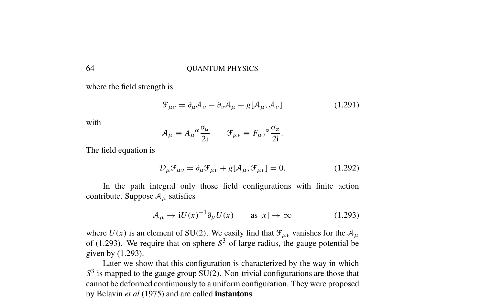

# 1.10.1 Introduction｜瞬子与拓扑扇区

[阅读目录](README.md) · [上一小节](26-1.9.3.md) · [下一小节](28-1.10.2.md)

**这一节在做什么：寻找一些不同于普通真空小涨落的欧氏场配置，它们由无穷远的绕圈方式分成不同类别。**先弄清为什么寻找它们，再看 $S^3$ 与 $SU(2)$ 怎样出现。

## 原书第 63 页：原文底本

本块保留该页属于本小节的完整原文。PDF 阅读器页码为 86。

## 第 63 页：先说目的，再逐步解读

### 一、为什么有了普通微扰计算，还要研究瞬子？

**这段在干什么：**解释 1.10 导言怎样接着前面的欧氏路径积分往下走。

前面在简单背景附近作小展开。它适合研究那些能从这个背景小幅改变得到的配置。但若空间的全局条件把配置分成互不相连的类别，只在其中一类作小展开，可能看不到其他类。

欧氏路径积分使用 $e^{-S_E/\hbar}$。因此可以寻找其他有有限作用量的经典背景，研究它们周围的贡献。这就是瞬子进入计算的动机。

一个较简单的类比是双势阱隧穿：普通真实时间经典轨迹可能过不了势垒，但欧氏方程可以有连接不同渐近状态的解，用来组织量子隧穿计算。这里只借它解释“为什么转向欧氏解”，不把四维规范场想成一颗小球。

### 二、瞬子到底是什么？不是一颗活得很短的小粒子

**这段在干什么：**规定本节研究的对象，防止名字造成错误画面。

这里的瞬子是四维欧氏空间中的规范场配置，通常在各方向局域集中，作用量有限。它不是一个在真实三维空间里停着、随真实时间长期存在的小物体。

前面“虚时间”已经是数学改写，所以这里首先研究的是该改写下的场方程。之后再利用解来理解量子理论。

原文说它是局部极小，还要补一句：通常是在固定拓扑类别里达到下界。零拓扑数的真空可以有零作用量，不代表所有瞬子都是全部配置中的最低点。

### 三、为什么偏偏先选四维和 SU(2)？

**这段在干什么：**指出式 (1.290) 后面构造所依赖的两个便利条件。

四维中，二形式的 Hodge 对偶仍是二形式，所以可要求场强与其对偶相等。下一节会说明这个条件为何使方程简单。

$SU(2)$ 作为一个流形，形状是三维球面 $S^3$。而四维空间的巨大定半径球面也正是 $S^3$。因此无穷远的规范数据会变成“从一个 $S^3$ 映到另一个 $S^3$”的问题。

这些条件共同使最简单的瞬子构造成立。你不必先凭物理直觉想象四维空间的样子，可以用 $x_1^2+\cdots+x_4^2=R^2$ 清楚理解这个球面。

## 原书第 64 页：原文底本

本块保留该页属于本小节的完整原文。PDF 阅读器页码为 87。

## 第 64 页：先说目的，再逐步解读

### 四、有限作用量为什么要管无穷远？

**这段在干什么：**解释式 (1.291)–(1.293) 的边界要求。

作用量要对整个 $\mathbb R^4$ 积分。远处虽然每一点场强可能很小，但位置太多，衰减不够快仍会积出无穷大。

所以寻找这类光滑经典解时，要安排远处曲率趋零，势趋向纯规范。纯规范的意思是：这个势来自一次局部基准变化，本身不给局部场强。

用反 Hermitian 联络 $a$、并将耦合吸收的约定，写

$$
a=U^{-1}dU,\qquad f=da+a\wedge a=0.
$$

这使“有一个不为零的势”与“有局部物理场强”分开。原文把 $i$、反 Hermitian 性与耦合混用的地方仍应查附录，不要直接照印式代算。

本节说有限作用量，针对的是要寻找的光滑半经典背景；不是已经严格规定整个量子路径积分只含这些光滑配置。

### 五、为什么 SU(2) 是一个球面？

**这段在干什么：**把原文的 $SU(2)\cong S^3$ 展开，避免用一个同胚符号替代解释。

取 Pauli 矩阵

$$
\sigma_1=\begin{pmatrix}0&1\\1&0\end{pmatrix},\quad
\sigma_2=\begin{pmatrix}0&-i\\i&0\end{pmatrix},\quad
\sigma_3=\begin{pmatrix}1&0\\0&-1\end{pmatrix}.
$$

一般 $SU(2)$ 元素可写为 $U=a_0I+i a_j\sigma_j$，其中四个 $a$ 是实数，满足

$$
a_0^2+a_1^2+a_2^2+a_3^2=1.
$$

四个实坐标受一个单位球面约束，正是 $S^3$。这里比较的是形状；群的矩阵乘法仍有自己的规则，不等于向量加法。

因此下一页 $U=(x_4I-ix_j\sigma_j)/r$ 很自然：它把空间单位方向的四个坐标，直接变成一个满足同样球面约束的群元素。

### 六、无穷远都没有场强，怎么还可能有不同类别？

**这段在干什么：**解释本页末尾的同伦分类与非平凡配置。

远处每个方向都有一个 $U$，所以得到

$$
U:S^3_\infty\longrightarrow SU(2)\cong S^3.
$$

先用圆到圆的类比：目标相位绕一圈或绕两圈，不能始终保持连续、合法地随便改成彼此。$S^3$ 到 $S^3$ 也有整数的映射次数，记为 $\pi_3(SU(2))\cong\mathbb Z$。

若无穷远带非零次数，不能在内部始终保持全球平凡的纯规范，并在中心正常填满。内部就需要非零曲率承担这个全局条件。

这和磁单极子的逻辑相近：局部公式简单，不保证全局可一笔抹平。A 级是理解为什么出现无穷远球面和整数类别；一般同伦群计算可后学。

---

[阅读目录](README.md) · [上一小节](26-1.9.3.md) · [下一小节](28-1.10.2.md)
